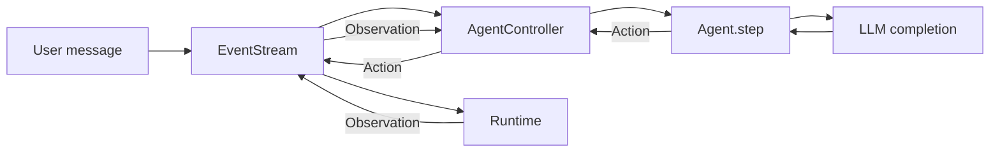

## Overview

OpenHands is a platform for software-development agents powered by language models. An agent looks at the current task state, asks an LLM what to do next, and the platform carries out the resulting action (edit a file, run a command, browse a page, send a message) inside a sandbox and feeds the result back. The same core is driven from a web frontend, an interactive terminal, a headless command, benchmark scripts and an issue resolver.

Sources: [README.md:30-36](repo://README.md#L30-L36), [openhands/README.md:1-24](repo://openhands/README.md#L1-L24)

The repository holds a Python backend (`openhands/`), a React frontend (`frontend/`), benchmark harnesses (`evaluation/`) and a commercial multi-tenant layer (`enterprise/`).

Sources: [openhands/README.md:8-24](repo://openhands/README.md#L8-L24)

## The parts

| Area | What it does | Page |
| --- | --- | --- |
| Events | `Action` and `Observation` objects and the `EventStream` that carries them | [[Events and the Event Stream]] |
| Controller | Drives the agent step by step, tracks state, budget and stuck loops | [[Agent Controller Loop]] |
| Agents | `CodeActAgent` and the other agents that turn state into actions | [[CodeAct Agent and Agent Catalogue]] |
| LLM | LiteLLM wrapper with retries, cost metrics and tool-call emulation | [[LLM Layer]] |
| Memory | Converts events to messages; loads repo info and microagents | [[Conversation Memory and Microagents]] |
| Condensers | Shrink the history when it outgrows the context window | [[Condensers]] |
| Runtime | Executes actions in a sandbox through an action execution server | [[Runtime and Action Execution Server]] |
| MCP and security | External tool servers and action risk analysis | [[MCP Tools and Security Analyzers]] |
| Git providers | GitHub, GitLab, Bitbucket services and the issue resolver | [[Git Provider Integrations and Resolver]] |
| Server | FastAPI and Socket.IO app, conversations and sessions | [[Server, Conversations and Sessions]] |
| Storage | File stores, settings and secrets | [[Storage, Settings and Secrets]] |
| Configuration | `OpenHandsConfig` and its layering | [[Configuration]] |
| CLI | `openhands` terminal entry point | [[Command-Line Interface]] |
| Frontend | React single-page app | [[Web Frontend]] |
| Evaluation and enterprise | Benchmarks and the SaaS layer | [[Evaluation Harness and Enterprise Edition]] |

Sources: [openhands/README.md:8-24](repo://openhands/README.md#L8-L24)

To run it first, see [[Quickstart]].

Sources: [README.md:36-50](repo://README.md#L36-L50)

## The main flow

Sources: [openhands/README.md:39-51](repo://openhands/README.md#L39-L51)

1. The user's request enters as a `MessageAction` added to the stream with source `USER` ([[Events and the Event Stream]]). For a headless run, `run_controller` does this itself.
2. `AgentController` sees the event, asks the agent for its next step and publishes the resulting action ([[Agent Controller Loop]]).
3. The agent builds messages from history ([[Conversation Memory and Microagents]], [[Condensers]]), calls the model ([[LLM Layer]]) and parses the tool call into an action ([[CodeAct Agent and Agent Catalogue]]).
4. The runtime subscribed to the stream executes the action and publishes an observation ([[Runtime and Action Execution Server]]).
5. The controller receives the observation and steps again, until the agent finishes, asks the user, errors, or hits a limit.

Sources: [openhands/core/main.py:100-216](repo://openhands/core/main.py#L100-L216), [openhands/README.md:10-24](repo://openhands/README.md#L10-L24)

## Wiring a run

`run_controller` is the headless composition root. It creates a registry, then the agent with `create_agent`, a runtime with `create_runtime` (connected before use), a `Memory` with `create_memory`, optional MCP tools, and a controller with `create_controller`. It then adds the initial `MessageAction` to the stream and waits in `run_agent_until_done`, which polls once a second until the agent state is one of the end states.

Sources: [openhands/core/main.py:100-216](repo://openhands/core/main.py#L100-L216), [openhands/core/loop.py:11-45](repo://openhands/core/loop.py#L11-L45)

`create_controller` tries to restore an earlier `State` for the session id, and passes the iteration limit, the per-task budget, the confirmation mode and the runtime's security analyzer to `AgentController`.

Sources: [openhands/core/setup.py:210-243](repo://openhands/core/setup.py#L210-L243)

The server path builds the same pieces per conversation instead; see [[Server, Conversations and Sessions]].

Sources: [openhands/README.md:22-24](repo://openhands/README.md#L22-L24)

## Design decisions

**One event stream is the only channel.** The architecture notes say that most of the loop, in spite of its pseudocode form, is "achieved through message passing, via the EventStream", which serves as "the backbone for all communication". The frontend, controller and runtime never call each other directly for actions and observations.

Sources: [openhands/README.md:28-51](repo://openhands/README.md#L28-L51)

**Agents are pluggable.** `create_agent` resolves `config.default_agent` through `Agent.get_cls` and builds it with that agent's own config; importing `openhands.agenthub` registers the available agents.

Sources: [openhands/core/setup.py:202-207](repo://openhands/core/setup.py#L202-L207), [openhands/core/main.py:1-8](repo://openhands/core/main.py#L1-L8)

**The agent lives in a fixed set of states.** `AgentState` has twelve values, from `LOADING` and `RUNNING` to the end states `FINISHED`, `REJECTED`, `ERROR`, `PAUSED` and `STOPPED`, plus confirmation and rate-limit states. Every runner decides when to stop by testing membership in a list of these.

Sources: [openhands/core/schema/agent.py:4-49](repo://openhands/core/schema/agent.py#L4-L49), [openhands/core/main.py:207-214](repo://openhands/core/main.py#L207-L214)

**Session ids are derived, short and stable.** `generate_sid` hashes the session name with the JWT secret and keeps 32 characters so that Kubernetes resource names such as `openhands-runtime-<sid>-ingress-code` stay within 63 characters.

Sources: [openhands/core/setup.py:246-262](repo://openhands/core/setup.py#L246-L262)

**Runs can be saved and replayed.** A finished run can write its trajectory to JSON when `save_trajectory_path` is set, and `load_replay_log` reads one back as events with the first user message as the task.

Sources: [openhands/core/main.py:221-243](repo://openhands/core/main.py#L221-L243), [openhands/core/main.py:263-283](repo://openhands/core/main.py#L263-L283)
