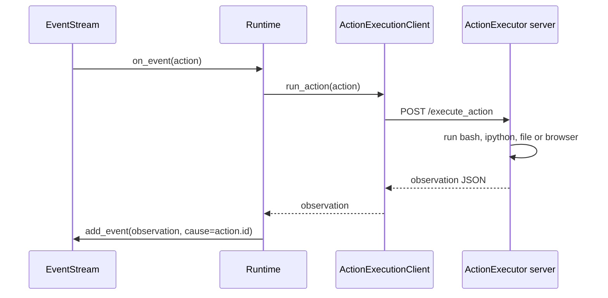

## Overview

A `Runtime` is the component that carries out actions. It subscribes to the [[Events and the Event Stream]], runs each runnable `Action`, and publishes the resulting `Observation` with the action's id as its `cause`. Most runtimes do not run the action in the backend process: an `ActionExecutionClient` posts it over HTTP to an `ActionExecutor` server (`action_execution_server.py`) that runs inside the sandbox, where it owns the bash session, the plugins, the browser and the file editor.

Sources: [openhands/runtime/base.py:90-117](repo://openhands/runtime/base.py#L90-L117), [openhands/runtime/README.md:5-45](repo://openhands/runtime/README.md#L5-L45)

Sources: [openhands/runtime/base.py:320-399](repo://openhands/runtime/base.py#L320-L399), [openhands/runtime/impl/action_execution/action_execution_client.py:315-338](repo://openhands/runtime/impl/action_execution/action_execution_client.py#L315-L338), [openhands/runtime/action_execution_server.py:814-831](repo://openhands/runtime/action_execution_server.py#L814-L831)

## The Runtime base class

The constructor subscribes `on_event` to the stream as `RUNTIME`, appends a `VSCodeRequirement` plugin unless in headless mode, builds the initial environment variables from the sandbox config, creates a `ProviderHandler` for git tokens (see [[Git Provider Integrations and Resolver]]) and adds the token variables, and creates the configured security analyzer. The [[Agent Controller Loop]] reads that analyzer through `runtime.security_analyzer`.

Sources: [openhands/runtime/base.py:128-204](repo://openhands/runtime/base.py#L128-L204)

`on_event` reacts only to actions; `_handle_action` handles each one in five steps.

Sources: [openhands/runtime/base.py:320-323](repo://openhands/runtime/base.py#L320-L323)

1. Gives an action with no timeout the sandbox default, non-blocking.
2. Refreshes git provider tokens if the command references one, which both redacts them in the stream and exports them to the sandbox.
3. Sends an `MCPAction` to `call_tool_mcp`, anything else to `run_action` in a worker thread.
4. Converts a `PermissionError` into an `ErrorObservation` so the agent can carry on; a network or disconnect error, or any other exception, is reported as a runtime status error and no observation is added.
5. Sets the observation's `cause` and tool-call metadata from the action and adds it to the stream, except `NullObservation`s.

Sources: [openhands/runtime/base.py:320-399](repo://openhands/runtime/base.py#L320-L399)

`run_action` is the dispatcher: a non-runnable action is answered locally (a think action, or `TaskTrackingAction`, whose plan it writes to a `TASKS.md` in the conversation's directory in the file store), an action still awaiting confirmation yields a `NullObservation`, a rejected one a `UserRejectObservation`, and otherwise the method named by the action's `action` string is called on the runtime: `run`, `run_ipython`, `read`, `write`, `edit`, `browse` or `browse_interactive`.

Sources: [openhands/runtime/base.py:890-972](repo://openhands/runtime/base.py#L890-L972), [openhands/runtime/base.py:1035-1070](repo://openhands/runtime/base.py#L1035-L1070)

Setup helpers live on the base class as well. `clone_or_init_repo` clones the selected repository using an authenticated URL or, with no repository, runs `git init` when `init_git_in_empty_workspace` is set. `maybe_run_setup_script` runs `.openhands/setup.sh` if present, as a hidden blocking command with a 10-minute timeout. `get_microagents_from_selected_repo` is described in [[Conversation Memory and Microagents]].

Sources: [openhands/runtime/base.py:401-425](repo://openhands/runtime/base.py#L401-L425), [openhands/runtime/base.py:463-489](repo://openhands/runtime/base.py#L463-L489)

## The client side

`ActionExecutionClient` is the shared base for the Docker, local, remote and Kubernetes runtimes. It owns an HTTP session and a one-slot semaphore so that only one action is in flight. `_send_action_server_request` retries up to five times with exponential waiting, but only on `RemoteProtocolError`.

Sources: [openhands/runtime/impl/action_execution/action_execution_client.py:55-129](repo://openhands/runtime/impl/action_execution/action_execution_client.py#L55-L129)

`send_action_for_execution` hands LLM-based file edits to `llm_based_edit` locally. For the others it assigns a default timeout, refuses a blocking command without a timeout, filters non-runnable, awaiting and rejected actions as the base class does, and posts `event_to_dict(action)` to `/execute_action` with a timeout five seconds longer than the action's, so the sandbox's own timeout fires first. The JSON reply is rebuilt with `observation_from_dict`. An HTTP timeout becomes `AgentRuntimeTimeoutError`.

Sources: [openhands/runtime/impl/action_execution/action_execution_client.py:272-338](repo://openhands/runtime/impl/action_execution/action_execution_client.py#L272-L338)

MCP is routed back through the sandbox: `get_mcp_config` adds the sandbox's own `/mcp/sse` endpoint as an SSE server whenever stdio servers have been registered, and `call_tool_mcp` builds clients for the configured servers and calls the tool. Both are disabled on Windows. See [[MCP Tools and Security Analyzers]].

Sources: [openhands/runtime/impl/action_execution/action_execution_client.py:361-376](repo://openhands/runtime/impl/action_execution/action_execution_client.py#L361-L376), [openhands/runtime/impl/action_execution/action_execution_client.py:452-482](repo://openhands/runtime/impl/action_execution/action_execution_client.py#L452-L482)

## The server inside the sandbox

Running `action_execution_server.py` starts a FastAPI app. It parses the port, `--working-dir`, `--plugins`, `--username`, `--user-id` and browser flags, starts a file viewer server on a nearby free port, and its lifespan creates the `ActionExecutor`, calls `ainit`, and mounts an MCP proxy manager (skipped on Windows).

Sources: [openhands/runtime/action_execution_server.py:653-735](repo://openhands/runtime/action_execution_server.py#L653-L735)

A middleware requires the `X-Session-API-Key` header on every path except `/alive` and `/server_info`. Besides `/execute_action`, the app serves `/update_mcp_server`, `/upload_file`, `/download_files`, `/list_files`, `/alive`, `/server_info` (uptime, idle time and system stats) and the VS Code connection token.

Sources: [openhands/runtime/action_execution_server.py:787-833](repo://openhands/runtime/action_execution_server.py#L787-L833), [openhands/runtime/action_execution_server.py:886-1000](repo://openhands/runtime/action_execution_server.py#L886-L1000)

`ActionExecutor.ainit` first creates the bash session, starts the browser in the background, initialises every plugin (within `INIT_PLUGIN_TIMEOUT`, default 120 s), loads the agent skills functions into Jupyter when both plugins are present, and runs init commands (a no-pager `git` alias, and a `cd` for non-root users).

Sources: [openhands/runtime/action_execution_server.py:291-377](repo://openhands/runtime/action_execution_server.py#L291-L377)

`execute_action` decodes the request with `event_from_dict`, rejects anything that is not an `Action` with HTTP 400, and calls `ActionExecutor.run_action`, which holds an asyncio lock and calls the method named by the action. `run` executes in the bash session (a `is_static` command gets a fresh session in its own `cwd`) and turns an exception into an `ErrorObservation`. `run_ipython` needs the Jupyter plugin, first re-syncing the Jupyter working directory with bash's. Any exception in the route becomes a 500 with the traceback.

Sources: [openhands/runtime/action_execution_server.py:379-434](repo://openhands/runtime/action_execution_server.py#L379-L434), [openhands/runtime/action_execution_server.py:814-831](repo://openhands/runtime/action_execution_server.py#L814-L831)

## Plugins

A `Plugin` has a `name`, an async `initialize(username)` and an async `run(action)`; a `PluginRequirement` is what the host side declares. `ALL_PLUGINS` maps the names `jupyter`, `agent_skills` and `vscode` to their classes, and the server instantiates those named on its `--plugins` list. `CodeActAgent.sandbox_plugins` is how the agent asks for agent skills and Jupyter.

Sources: [openhands/runtime/plugins/requirement.py:8-31](repo://openhands/runtime/plugins/requirement.py#L8-L31), [openhands/runtime/plugins/__init__.py:1-25](repo://openhands/runtime/plugins/__init__.py#L1-L25), [openhands/agenthub/codeact_agent/codeact_agent.py:70-76](repo://openhands/agenthub/codeact_agent/codeact_agent.py#L70-L76)

## Choosing a runtime

`get_runtime_cls(name)` returns one of the built-in classes by name, then third-party classes discovered under `third_party.runtime.impl`, and otherwise tries to import `name` as the dotted path of a `Runtime` subclass; it raises `ValueError` listing the known names.

Sources: [openhands/runtime/__init__.py:14-21](repo://openhands/runtime/__init__.py#L14-L21), [openhands/runtime/__init__.py:87-104](repo://openhands/runtime/__init__.py#L87-L104)

| Name | Class | What it does | Choose it when |
| --- | --- | --- | --- |
| `docker`, `eventstream` | `DockerRuntime` | Starts a container from the runtime image, publishes ports for the server, VS Code and app ports, and waits until `/alive` answers | The standard sandboxed setup |
| `local` | `LocalRuntime` | Starts the action server as a local process; logs `NO SANDBOX IS USED` | A controlled environment where Docker is unavailable |
| `remote` | `RemoteRuntime` | Calls a remote API to find, build or start a runtime and connect to it | A hosted runtime service |
| `kubernetes` | `KubernetesRuntime` | Creates pods in a cluster, developed against Kind | Cluster deployments |
| `cli` | `CLIRuntime` | Runs commands with subprocess and file operations with the standard library, no browser, no HTTP server | The terminal interface, which sets `config.runtime = 'cli'` |

Sources: [openhands/runtime/impl/docker/docker_runtime.py:75-86](repo://openhands/runtime/impl/docker/docker_runtime.py#L75-L86), [openhands/runtime/impl/docker/docker_runtime.py:170-214](repo://openhands/runtime/impl/docker/docker_runtime.py#L170-L214), [openhands/runtime/impl/local/local_runtime.py:123-165](repo://openhands/runtime/impl/local/local_runtime.py#L123-L165), [openhands/runtime/impl/remote/remote_runtime.py:39-48](repo://openhands/runtime/impl/remote/remote_runtime.py#L39-L48), [openhands/runtime/impl/remote/remote_runtime.py:125-165](repo://openhands/runtime/impl/remote/remote_runtime.py#L125-L165), [openhands/runtime/impl/kubernetes/kubernetes_runtime.py:61-76](repo://openhands/runtime/impl/kubernetes/kubernetes_runtime.py#L61-L76), [openhands/runtime/impl/cli/cli_runtime.py:90-105](repo://openhands/runtime/impl/cli/cli_runtime.py#L90-L105), [openhands/cli/main.py:672-681](repo://openhands/cli/main.py#L672-L681)

> [!WARNING]
> `LocalRuntime` logs that no sandbox is used and that the current user launches the server, and recommends a sandbox such as `DockerRuntime` unless the environment is controlled.

Sources: [openhands/runtime/impl/local/local_runtime.py:158-168](repo://openhands/runtime/impl/local/local_runtime.py#L158-L168)

Subclasses of `Runtime` can be configured by dotted path, for example `runtime = "app.my.CustomRuntime"` as the README shows.

Sources: [openhands/runtime/README.md:55-60](repo://openhands/runtime/README.md#L55-L60)
