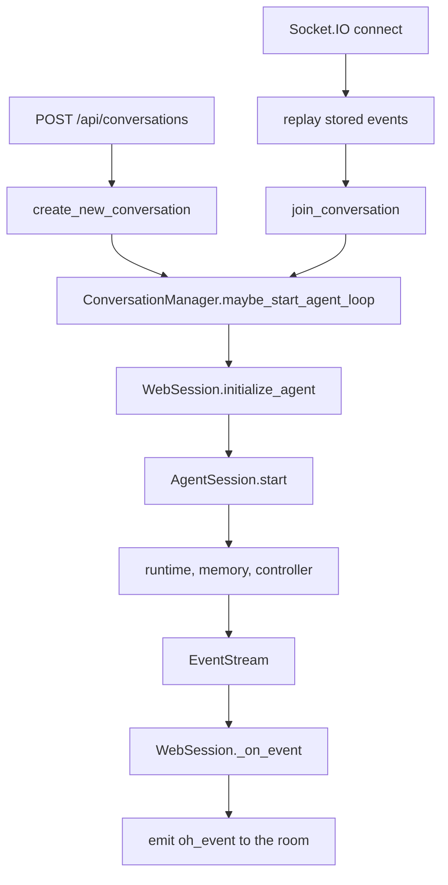

## Overview

The server is a FastAPI application wrapped in a Socket.IO ASGI app. REST routes create, list and manage conversations; a Socket.IO connection streams events to the browser and carries the user's actions back. Each running conversation is a `WebSession`, which owns one `AgentSession`, which in turn builds the runtime, memory and controller that the earlier pages describe. A `ConversationManager` keeps track of all of them. The frontend side of this protocol is in [[Web Frontend]].

Sources: [openhands/server/listen.py:1-27](repo://openhands/server/listen.py#L1-L27), [openhands/server/session/session.py:40-60](repo://openhands/server/session/session.py#L40-L60)

Sources: [openhands/server/routes/manage_conversations.py:189-290](repo://openhands/server/routes/manage_conversations.py#L189-L290), [openhands/server/listen_socket.py:35-140](repo://openhands/server/listen_socket.py#L35-L140), [openhands/server/session/session.py:311-338](repo://openhands/server/session/session.py#L311-L338)

## Application assembly

`app.py` creates the `FastAPI` app, registers an exception handler that maps `AuthenticationError` to HTTP 401, includes the routers (public, files, security, feedback, conversation, conversation management, settings, secrets and trajectory, plus the git routes only in `AppMode.OSS`), adds the health endpoints, and mounts the FastMCP application at `/mcp` ([[Git Provider Integrations and Resolver]] describes its tools). The lifespan enters the `conversation_manager` as an async context manager.

Sources: [openhands/server/app.py:37-86](repo://openhands/server/app.py#L37-L86)

`listen.py` adds the static single-page frontend (unless `SERVE_FRONTEND` is not `true`), CORS, cache-control and an in-memory rate limiter of 10 requests per second, then wraps everything as `socketio.ASGIApp(sio, other_asgi_app=base_app)`; this is the `uvicorn openhands.server.listen:app` target from [[Quickstart]].

Sources: [openhands/server/listen.py:15-27](repo://openhands/server/listen.py#L15-L27)

`shared.py` is the wiring module. It loads the `OpenHandsConfig` and the `ServerConfig`, creates the file store, creates the Socket.IO server (with a Redis client manager when `REDIS_HOST` is set, and a 4 MB buffer), and resolves the monitoring listener, conversation manager and the settings, secrets and conversation stores with `get_impl` from class names in the server config. That is the mechanism that lets the enterprise edition swap implementations ([[Evaluation Harness and Enterprise Edition]]).

Sources: [openhands/server/shared.py:23-77](repo://openhands/server/shared.py#L23-L77), [openhands/server/config/server_config.py:8-32](repo://openhands/server/config/server_config.py#L8-L32)

## Creating a conversation

`POST /api/conversations` (`new_conversation`) takes the repository, branch, initial message, images, a replay file, a suggested task or a microagent-creation request. It picks a `ConversationTrigger` (GUI, suggested task, microagent management or, for bearer-token callers, `REMOTE_API_KEY`, which requires an initial message), verifies the repository with `ProviderHandler.verify_repo_provider`, generates a conversation id (a UUID hex) and calls `create_new_conversation`. `MissingSettingsError` and `LLMAuthenticationError` become HTTP 400 responses with message ids the UI understands.

Sources: [openhands/server/routes/manage_conversations.py:189-290](repo://openhands/server/routes/manage_conversations.py#L189-L290)

`create_new_conversation` stores the conversation's metadata and calls `start_conversation`, which loads the user's saved settings, raises `LLMAuthenticationError` when the model needs an API key and none is set (Bedrock models are exempt) and `MissingSettingsError` when there are no settings, builds `ConversationInitData` from the settings plus tokens, secrets, repository, branch and instructions, wraps the initial text in a `MessageAction`, and calls `conversation_manager.maybe_start_agent_loop`.

Sources: [openhands/server/services/conversation_service.py:78-162](repo://openhands/server/services/conversation_service.py#L78-L162), [openhands/server/services/conversation_service.py:164-202](repo://openhands/server/services/conversation_service.py#L164-L202)

## Conversation managers

`ConversationManager` is the abstract interface and an explicit extension point: a class named in `server_config.conversation_manager_class` replaces the default. Its methods cover attaching and detaching, joining a conversation with a connection id, finding running loops, starting a loop, sending events and closing sessions.

Sources: [openhands/server/conversation_manager/conversation_manager.py:20-50](repo://openhands/server/conversation_manager/conversation_manager.py#L20-L50), [openhands/server/conversation_manager/conversation_manager.py:60-160](repo://openhands/server/conversation_manager/conversation_manager.py#L60-L160)

`StandaloneConversationManager` keeps everything in one process: `_local_agent_loops_by_sid` maps conversation ids to sessions, `_local_connection_id_to_session_id` maps connections to conversations, and `_active_conversations` and `_detached_conversations` hold reference-counted `ServerConversation` objects, with a background `_cleanup_stale` task that removes detached ones. Entering the manager calls the runtime class's `setup` and leaving calls `teardown`.

Sources: [openhands/server/conversation_manager/standalone_conversation_manager.py:53-90](repo://openhands/server/conversation_manager/standalone_conversation_manager.py#L53-L90), [openhands/server/conversation_manager/standalone_conversation_manager.py:91-179](repo://openhands/server/conversation_manager/standalone_conversation_manager.py#L91-L179)

`maybe_start_agent_loop` returns the existing session for an id, or calls `_start_agent_loop`. That method first counts the user's running loops against `max_concurrent_conversations`, and while at the limit it picks the least recently updated conversation, sends it an `AGENT_ERROR$TOO_MANY_CONVERSATIONS` status event and closes it. It then creates the LLM registry and conversation stats, builds a `Session`, registers it, starts `initialize_agent` as a background task and subscribes a `SERVER` callback on the event stream that updates the conversation's `updated_at` and related metadata.

Sources: [openhands/server/conversation_manager/standalone_conversation_manager.py:280-367](repo://openhands/server/conversation_manager/standalone_conversation_manager.py#L280-L367)

`send_to_event_stream` looks up the session for a connection id and calls its `dispatch`, raising `RuntimeError` when there is none. `_close_session` disconnects every connection of the session and calls `session.close()`.

Sources: [openhands/server/conversation_manager/standalone_conversation_manager.py:369-395](repo://openhands/server/conversation_manager/standalone_conversation_manager.py#L369-L395), [openhands/server/conversation_manager/standalone_conversation_manager.py:429-454](repo://openhands/server/conversation_manager/standalone_conversation_manager.py#L429-L454)

`DockerNestedConversationManager` is the other implementation in this repository: the agent loops run inside Docker containers, found by the `openhands-runtime-<id>` container names. Attach, detach and join raise `unsupported_operation`, because clients are meant to connect directly to the nested server, and events sent to a conversation are posted to the nested server's `/api/conversations/<sid>/events`. The enterprise `ClusteredConversationManager` is covered in [[Evaluation Harness and Enterprise Edition]].

Sources: [openhands/server/conversation_manager/docker_nested_conversation_manager.py:50-110](repo://openhands/server/conversation_manager/docker_nested_conversation_manager.py#L50-L110), [openhands/server/conversation_manager/docker_nested_conversation_manager.py:295-310](repo://openhands/server/conversation_manager/docker_nested_conversation_manager.py#L295-L310)

## Sessions

`WebSession` (exported as `Session`) wraps one conversation: a Socket.IO server reference, `last_active_ts`, an `AgentSession`, the config and the LLM registry. Its constructor creates the `AgentSession`, subscribes `on_event` to the stream as `SERVER`, applies an experiment variant to the config, and starts a task that drains an `asyncio.Queue` of outgoing messages.

Sources: [openhands/server/session/session.py:40-117](repo://openhands/server/session/session.py#L40-L117)

`initialize_agent` first emits an `AgentStateChangedObservation` with `LOADING`, then folds the user's settings into the config: agent class, confirmation mode, security analyzer, container images, git identity, iteration and budget limits, search key, sandbox key, custom MCP servers, and the default MCP server. When `enable_default_condenser` is set it replaces the agent's condenser with a pipeline of `ConversationWindowCondenser`, `BrowserOutputCondenser(attention_window=2)` and `LLMSummarizingCondenser(keep_first=4, max_size=condenser_max_size or 120)` ([[Condensers]]). It then builds the agent and calls `AgentSession.start`. Errors are reported to the client as `Failed to create agent session`, with the message shown only for microagent errors so that nothing sensitive leaks.

Sources: [openhands/server/session/session.py:132-212](repo://openhands/server/session/session.py#L132-L212), [openhands/server/session/session.py:213-262](repo://openhands/server/session/session.py#L213-L262), [openhands/server/session/session.py:264-303](repo://openhands/server/session/session.py#L264-L303)

`AgentSession.start` refuses to run twice, and otherwise proceeds in six steps.

Sources: [openhands/server/session/agent_session.py:117-134](repo://openhands/server/session/agent_session.py#L117-L134)

1. Creates and connects the runtime, then clones or initialises the repository and runs the setup script and git hooks (`_create_runtime`). A `RemoteRuntime` gets provider tokens directly; other runtimes get them merged into environment variables.
2. Registers provider tokens and custom secrets as event stream secrets so they are redacted.
3. Creates `Memory` ([[Conversation Memory and Microagents]]).
4. Adds MCP tools to the agent, before the controller exists so that the tools are part of the system message ([[MCP Tools and Security Analyzers]]).
5. Creates the `AgentController`, restoring saved state if there is any, or sets up a replay.
6. Adds the initial user message and a `ChangeAgentStateAction(RUNNING)`, or `AWAITING_USER_INPUT` when there is no message.

Sources: [openhands/server/session/agent_session.py:90-203](repo://openhands/server/session/agent_session.py#L90-L203), [openhands/server/session/agent_session.py:296-390](repo://openhands/server/session/agent_session.py#L296-L390)

`AgentSession.close` waits for a start in progress, closes the event stream, saves the controller state and closes the controller, and closes the runtime on a separate executor.

Sources: [openhands/server/session/agent_session.py:224-245](repo://openhands/server/session/agent_session.py#L224-L245)

## The WebSocket protocol

On `connect`, the socket handler requires a `conversation_id` query parameter, checks the session API key when `SESSION_API_KEY` is set, and validates the user with a conversation validator. It then replays stored events from `latest_event_id + 1` as `oh_event` messages to that one connection, skipping null events and recall actions and sending the latest agent-state change last. Only then does it load the user's settings and call `join_conversation`, which puts the connection in the room for the conversation and starts the agent loop if necessary. Any `ConnectionRefusedError` also disconnects the socket.

Sources: [openhands/server/listen_socket.py:35-141](repo://openhands/server/listen_socket.py#L35-L141), [openhands/server/listen_socket.py:161-168](repo://openhands/server/listen_socket.py#L161-L168)

Client actions arrive as `oh_user_action` (and the legacy `oh_action`) and are forwarded to the conversation manager. `WebSession.dispatch` decodes the data with `event_from_dict`, rejects an image message when the model has vision disabled or unsupported, and adds the event to the stream with source `USER`.

Sources: [openhands/server/listen_socket.py:143-158](repo://openhands/server/listen_socket.py#L143-L158), [openhands/server/session/session.py:353-369](repo://openhands/server/session/session.py#L353-L369)

In the other direction, `WebSession._on_event` forwards agent and user events, and from the environment only command outputs, agent-state changes and recall observations (re-labelled as agent events, since the UI treats environment feedback that way). `ErrorObservation`s are also sent as agent events. Messages go through the queue to `_send`, which emits `oh_event` to the conversation's room; for the first send it waits up to two seconds for a client to be in the room, so that early events are not lost.

Sources: [openhands/server/session/session.py:311-352](repo://openhands/server/session/session.py#L311-L352), [openhands/server/session/session.py:371-420](repo://openhands/server/session/session.py#L371-L420)

## Other routes

Besides conversation management, routes cover the live conversation (`/api/conversations/{id}/events`, `/microagents`, `/config`, `/vscode-url`, `/web-hosts`), files and git changes in the workspace, user settings and secrets, the git provider listings used by the home screen, `/trajectory`, and public listings of models, agents and security analyzers.

Sources: [openhands/server/routes/conversation.py:19-47](repo://openhands/server/routes/conversation.py#L19-L47), [openhands/server/routes/conversation.py:105-195](repo://openhands/server/routes/conversation.py#L105-L195), [openhands/server/routes/public.py:14-65](repo://openhands/server/routes/public.py#L14-L65), [openhands/server/routes/git.py:38-70](repo://openhands/server/routes/git.py#L38-L70)
