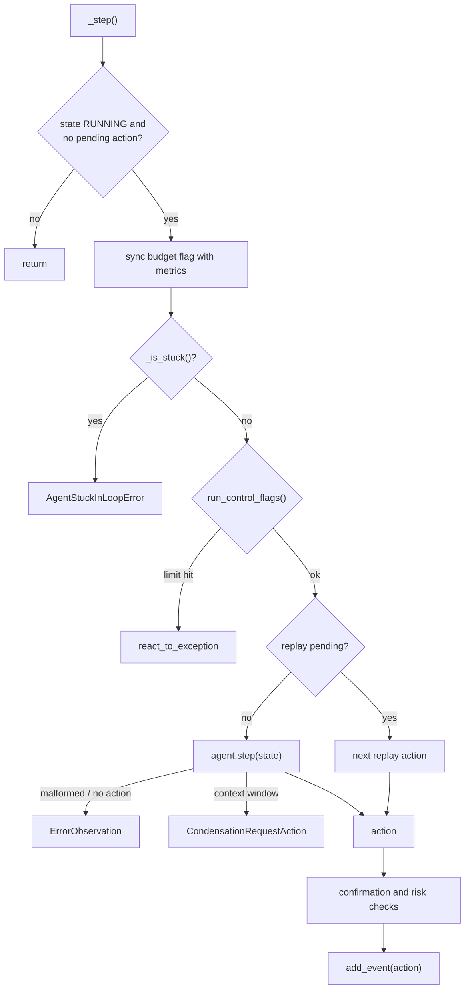
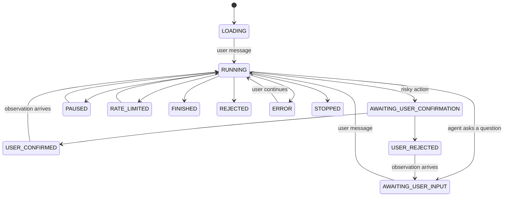

## Overview

The `AgentController` turns an agent, which only knows how to produce the next action from a state, into a running conversation. It subscribes to the [[Event Stream]], keeps the agent's `State` and history, decides after each event whether the agent should take a step, and publishes the agent's actions. It also owns everything around a step: iteration and budget limits, confirmation of risky actions, errors, the agent state machine, delegation to sub-agents and saving the state.

Sources: [openhands/controller/agent_controller.py:100-200](repo://openhands/controller/agent_controller.py#L100-L200)

A controller is built by `create_controller` in headless mode and by the server's `AgentSession` for web conversations. It is given the agent, the event stream, the iteration and budget limits, the per-agent LLM configs for delegation, confirmation mode, and the runtime's security analyzer. On construction it restores or creates the state, loads history from the stream, and adds the agent's `SystemMessageAction` if the stream does not already have one.

Sources: [openhands/core/setup.py:210-243](repo://openhands/core/setup.py#L210-L243), [openhands/controller/agent_controller.py:236-260](repo://openhands/controller/agent_controller.py#L236-L260)

How the agent itself builds a step is on [[Agents]] and [[CodeAct Agent]]; loop detection is on [[Stuck Detection]].

Sources: [openhands/controller/agent_controller.py:1113-1123](repo://openhands/controller/agent_controller.py#L1113-L1123)

## Reacting to events

### Event handling

Every event reaches `on_event` on the stream's subscriber thread. When a delegate is active and still running, the event is forwarded to the delegate and the parent does nothing else; when the delegate has finished or failed, the parent ends it. Otherwise `_on_event` skips hidden events, appends the event to the history (minus null events and state-change bookkeeping), dispatches actions to `_handle_action` and observations to `_handle_observation`, and then asks `should_step`.

Sources: [openhands/controller/agent_controller.py:433-492](repo://openhands/controller/agent_controller.py#L433-L492), [openhands/controller/state/state_tracker.py:41-50](repo://openhands/controller/state/state_tracker.py#L41-L50)

`_handle_action` reacts to actions that change the conversation rather than the sandbox:

Sources: [openhands/controller/agent_controller.py:494-496](repo://openhands/controller/agent_controller.py#L494-L496)

| Action | Effect |
| --- | --- |
| `ChangeAgentStateAction` | sets the requested agent state (pause, resume, stop from the user) |
| `MessageAction` from the user | posts a `RecallAction` for the message and sets the agent running |
| `MessageAction` from the agent with `wait_for_response` | sets `AWAITING_USER_INPUT` |
| `AgentDelegateAction` | starts a delegate controller and posts its task |
| `AgentFinishAction` | stores outputs, sets `FINISHED` |
| `AgentRejectAction` | stores outputs, sets `REJECTED` |

Sources: [openhands/controller/agent_controller.py:494-517](repo://openhands/controller/agent_controller.py#L494-L517), [openhands/controller/agent_controller.py:544-582](repo://openhands/controller/agent_controller.py#L544-L582)

The recall step is how microagent knowledge enters a conversation: the first user message asks for `WORKSPACE_CONTEXT` (repository instructions, runtime info), later ones for `KNOWLEDGE` (keyword-triggered microagents). The recall action becomes the pending action, so the agent waits until the memory component answers. [[Microagents]] covers the answer.

Sources: [openhands/controller/agent_controller.py:560-578](repo://openhands/controller/agent_controller.py#L560-L578)

### When the agent steps

`should_step` returns true for a user message, for an agent message while not waiting for input, for delegate and condensation actions, and for every observation except state changes and null observations. The exception is a `NullObservation` caused by a `RecallAction` (cause greater than zero), which does trigger a step: it means memory had nothing to add. While a delegate is active the parent never steps.

Sources: [openhands/controller/agent_controller.py:392-432](repo://openhands/controller/agent_controller.py#L392-L432)

### Pending actions

A runnable action, once published, becomes the controller's `_pending_action`, stored with the time it was set. `_step` refuses to run while an action is pending, so the agent never acts twice before seeing a result. `_handle_observation` clears it when an observation arrives whose `cause` is the pending action's id, unless the controller is waiting for the user to confirm. An action pending for more than a minute is logged but not cleared.

Sources: [openhands/controller/agent_controller.py:519-542](repo://openhands/controller/agent_controller.py#L519-L542), [openhands/controller/agent_controller.py:972-1024](repo://openhands/controller/agent_controller.py#L972-L1024)

## Taking a step

### The step sequence

Sources: [openhands/controller/agent_controller.py:821-916](repo://openhands/controller/agent_controller.py#L821-L916), [openhands/controller/agent_controller.py:918-970](repo://openhands/controller/agent_controller.py#L918-L970)

`_step` runs only when the agent is `RUNNING` and nothing is pending. It copies the combined LLM cost into the budget flag, asks the stuck detector, and runs the control flags, each of which raises when its limit is reached. It then takes the next action from the replay manager or from `agent.step(self.state)` and marks its source as `AGENT`.

Sources: [openhands/controller/agent_controller.py:821-879](repo://openhands/controller/agent_controller.py#L821-L879)

Errors from the agent split into three groups. A malformed or missing action, or a tool call that fails validation, becomes an `ErrorObservation` in the stream, which the agent sees and can correct on its next step. A context-window overflow, detected from the exception type or from provider-specific message text, becomes a `CondensationRequestAction` when `enable_history_truncation` is on, so a condenser shrinks the history; otherwise it raises `LLMContextWindowExceedError`. Anything else propagates to `_step_with_exception_handling`.

Sources: [openhands/controller/agent_controller.py:873-916](repo://openhands/controller/agent_controller.py#L873-L916)

### Confirmation and risk

In confirmation mode, the commands that touch the sandbox (`CmdRunAction`, `IPythonRunCellAction`, `BrowseInteractiveAction`, `FileEditAction`, `FileReadAction`) are first scored by the security analyzer, which overwrites the action's `security_risk`. Without an analyzer every action is scored `UNKNOWN`. An action is held for confirmation when it is `HIGH` risk, or when it is `UNKNOWN` and no analyzer is configured; in CLI mode every such action is held, because the CLI applies its own risk rules.

Sources: [openhands/controller/agent_controller.py:202-237](repo://openhands/controller/agent_controller.py#L202-L237), [openhands/controller/agent_controller.py:918-956](repo://openhands/controller/agent_controller.py#L918-L956)

A held action gets `confirmation_state = AWAITING_CONFIRMATION` and the agent moves to `AWAITING_USER_CONFIRMATION` before the action is published; the runtime does not run it. When the user answers with `USER_CONFIRMED` or `USER_REJECTED`, `set_agent_state_to` republishes the pending action with the new confirmation state and a cleared id, and the runtime then runs it or answers with a `UserRejectObservation`. [[Security Analyzers and Confirmation Mode]] describes the analyzers.

Sources: [openhands/controller/agent_controller.py:958-970](repo://openhands/controller/agent_controller.py#L958-L970), [openhands/controller/agent_controller.py:640-652](repo://openhands/controller/agent_controller.py#L640-L652)

Before publishing, every action gets a compact `llm_metrics` with the accumulated cost, token usage and budget, which the frontend shows.

Sources: [openhands/controller/agent_controller.py:1078-1100](repo://openhands/controller/agent_controller.py#L1078-L1100)

## Agent states

`AgentState` is the conversation's lifecycle as the user sees it. Every change goes through `set_agent_state_to`, which publishes an `AgentStateChangedObservation` (with the last error as reason for `ERROR`) and saves the state.

Sources: [openhands/core/schema/agent.py:4-51](repo://openhands/core/schema/agent.py#L4-L51), [openhands/controller/agent_controller.py:620-664](repo://openhands/controller/agent_controller.py#L620-L664)

Sources: [openhands/controller/agent_controller.py:494-542](repo://openhands/controller/agent_controller.py#L494-L542), [openhands/controller/agent_controller.py:620-664](repo://openhands/controller/agent_controller.py#L620-L664)

Entering `STOPPED` or `ERROR` calls `_reset`. If the pending action came from a tool call and no observation answers it yet, `_reset` adds an `ErrorObservation` carrying that tool call's metadata, so the LLM conversation never contains a tool call without a result. It then clears the pending action and resets the agent.

Sources: [openhands/controller/agent_controller.py:584-618](repo://openhands/controller/agent_controller.py#L584-L618)

## Limits

### Control flags

`State` carries an `IterationControlFlag` and, when a budget is set, a `BudgetControlFlag`. `run_control_flags` calls `step` on both before every agent step: the iteration flag raises `RuntimeError('Agent reached maximum iteration...')` when its count reaches the maximum and otherwise increments it; the budget flag raises when the synced cost reaches its maximum.

Sources: [openhands/controller/state/control_flags.py:11-95](repo://openhands/controller/state/control_flags.py#L11-L95), [openhands/controller/state/state_tracker.py:254-268](repo://openhands/controller/state/state_tracker.py#L254-L268)

The error moves the agent to `ERROR`. If the user then sets it running again, `maybe_increase_control_flags_limits` extends the limits: the iteration maximum grows by the initial limit except in headless mode, and the budget maximum becomes the current spend plus the initial budget.

Sources: [openhands/controller/agent_controller.py:633-635](repo://openhands/controller/agent_controller.py#L633-L635), [openhands/controller/state/control_flags.py:51-81](repo://openhands/controller/state/control_flags.py#L51-L81), [openhands/controller/state/state_tracker.py:231-236](repo://openhands/controller/state/state_tracker.py#L231-L236)

### Errors and status

`_step_with_exception_handling` catches anything `_step` raises. Known LLM and timeout errors are passed on as they are; unknown ones are wrapped in a generic `RuntimeError` asking the user to retry. `_react_to_exception` stores the error in `state.last_error`, maps it to a `RuntimeStatus` the UI can explain (authentication, service unavailable, out of credits, content policy), and sets `ERROR`. A rate-limit error that is still being retried sets `RATE_LIMITED` instead, and becomes `ERROR` only after the last retry.

Sources: [openhands/controller/agent_controller.py:308-390](repo://openhands/controller/agent_controller.py#L308-L390)

## Delegation

An `AgentDelegateAction` makes the controller create a child controller for the named agent, with its own agent config if one exists and the same LLM registry. The child's `State` shares the parent's iteration and budget flags and metrics, starts at the next event id, records the parent's metrics snapshot, and has `delegate_level` one higher. The child is created with `is_delegate=True`, so it does not subscribe to the stream; the parent forwards events to it. If the delegate action has a `task` input, the parent posts it as a user message `TASK: ...` and sets the delegate running.

Sources: [openhands/controller/agent_controller.py:498-508](repo://openhands/controller/agent_controller.py#L498-L508), [openhands/controller/agent_controller.py:673-732](repo://openhands/controller/agent_controller.py#L673-L732)

When the delegate finishes, is rejected or errors, `end_delegate` copies its iteration count back, closes it, and publishes an `AgentDelegateObservation` with the delegate's outputs, attached to the tool call of the original delegate action. When history is later loaded from the stream, the events between a delegate action and its observation are left out, so the parent agent sees only the request and the result.

Sources: [openhands/controller/agent_controller.py:734-805](repo://openhands/controller/agent_controller.py#L734-L805), [openhands/controller/state/state_tracker.py:104-195](repo://openhands/controller/state/state_tracker.py#L104-L195)

## State and persistence

### State

`State` holds what the agent and controller need between steps: the session and user ids, the control flags, `history`, `inputs` and `outputs`, `agent_state` and `resume_state`, `delegate_level`, the `start_id`/`end_id` range of the history in the stream, metrics, `extra_data` for evaluation tasks, and `last_error`.

Sources: [openhands/controller/state/state.py:49-120](repo://openhands/controller/state/state.py#L49-L120)

`save_to_session` pickles the state (without the conversation stats, which save themselves), base64-encodes it and writes `agent_state.pkl` in the conversation directory. `restore_from_session` reads it back, records the saved state as `resume_state` when it was `RUNNING`, `PAUSED`, `AWAITING_USER_INPUT` or `FINISHED`, and starts the restored state in `LOADING`.

Sources: [openhands/controller/state/state.py:28-33](repo://openhands/controller/state/state.py#L28-L33), [openhands/controller/state/state.py:122-189](repo://openhands/controller/state/state.py#L122-L189)

### StateTracker

`StateTracker` owns the state's lifecycle for the controller. `set_initial_state` creates a fresh state with control flags from the configured limits, or adopts a restored or delegate state. `_init_history` always reloads history from the event stream, so a restored conversation sees every event even if the pickled history was stale. `close` rebuilds the full history including delegate events for trajectories and evaluation. `save_state` saves the state and the conversation stats; the controller calls it on every state change.

Sources: [openhands/controller/state/state_tracker.py:50-103](repo://openhands/controller/state/state_tracker.py#L50-L103), [openhands/controller/state/state_tracker.py:197-252](repo://openhands/controller/state/state_tracker.py#L197-L252)

## Trajectory replay

`ReplayManager` replays a recorded trajectory instead of asking the LLM. It drops environment events and null observations, and turns off `wait_for_response` on every message except the last so the replay does not stop for input. While `should_replay` finds another action, `_step` takes it from `step()` instead of calling the agent; observations come from really executing the replayed actions. After the last action, the agent continues normally. [[Headless Mode]] shows how a trajectory file is loaded.

Sources: [openhands/controller/replay.py:11-98](repo://openhands/controller/replay.py#L11-L98), [openhands/controller/agent_controller.py:865-868](repo://openhands/controller/agent_controller.py#L865-L868)
