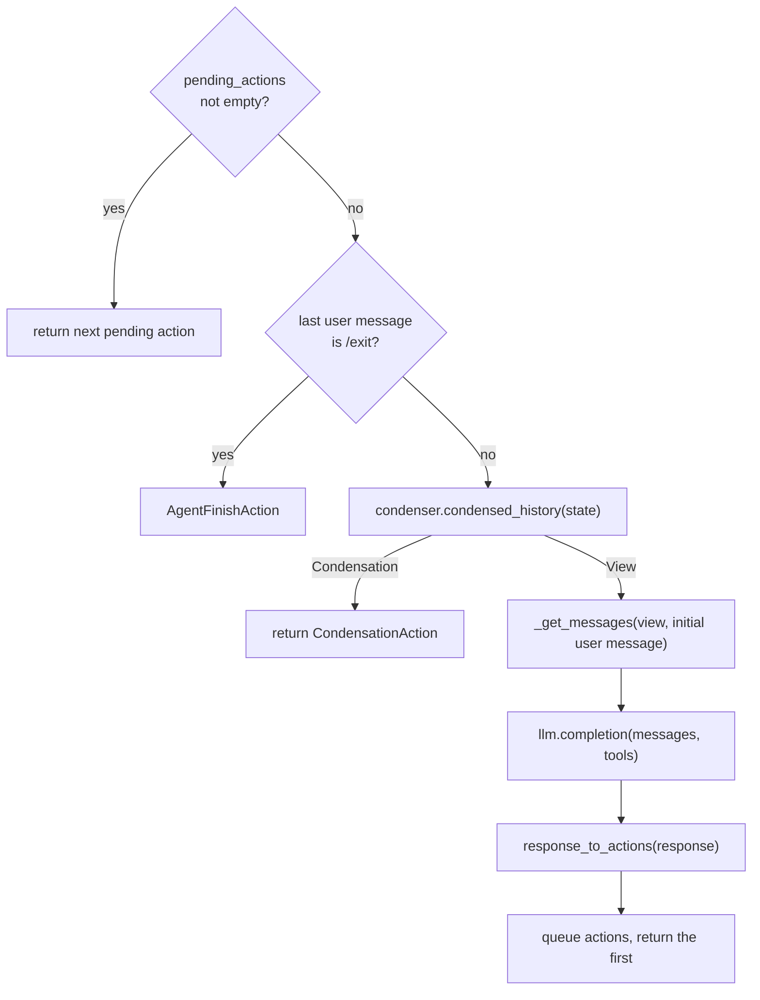

## Overview

`CodeActAgent` is the default OpenHands agent. It follows the CodeAct idea: rather than a fixed menu of narrow actions, the model works mostly by executing code, running bash commands and Python cells, alongside conversing with the user. Every capability is offered to the LLM as a tool definition, and every tool call in the model's reply becomes one OpenHands action.

Sources: [openhands/agenthub/codeact_agent/codeact_agent.py:50-70](repo://openhands/agenthub/codeact_agent/codeact_agent.py#L50-L70)

The agent needs two plugins in the sandbox: agent skills, a library of Python helpers, and Jupyter for IPython cells. Agent skills is listed first because Jupyter imports its functions when it starts (see [[Runtime Plugins]]).

Sources: [openhands/agenthub/codeact_agent/codeact_agent.py:71-76](repo://openhands/agenthub/codeact_agent/codeact_agent.py#L71-L76)

This page follows one step. How the event history becomes LLM messages is on [[Conversation Memory and Prompts]]; how the history is shortened is on [[Context Condensers]].

Sources: [openhands/agenthub/codeact_agent/codeact_agent.py:160-221](repo://openhands/agenthub/codeact_agent/codeact_agent.py#L160-L221)

## Construction

`__init__` builds everything the step needs once:

Sources: [openhands/agenthub/codeact_agent/codeact_agent.py:78-84](repo://openhands/agenthub/codeact_agent/codeact_agent.py#L78-L84)

1. a `pending_actions` deque for replies that contain several tool calls;
2. the tool list from `_get_tools`, according to the agent config;
3. a `ConversationMemory` bound to the agent's config and prompt manager;
4. a condenser from `Condenser.from_config(config.condenser, llm_registry)`;
5. the LLM, replaced by a router from `llm_registry.get_router(config)` when model routing is configured (see [[LLM Registry and Routing]]).

Sources: [openhands/agenthub/codeact_agent/codeact_agent.py:78-96](repo://openhands/agenthub/codeact_agent/codeact_agent.py#L78-L96)

The prompt manager reads templates from the agent's `prompts` directory. Its system prompt file comes from `resolved_system_prompt_filename`, which switches the default `system_prompt.j2` to `system_prompt_long_horizon.j2` when plan mode is on and no custom file was set.

Sources: [openhands/agenthub/codeact_agent/codeact_agent.py:98-106](repo://openhands/agenthub/codeact_agent/codeact_agent.py#L98-L106), [openhands/core/config/agent_config.py:68-77](repo://openhands/core/config/agent_config.py#L68-L77)

## One step

### The sequence



Sources: [openhands/agenthub/codeact_agent/codeact_agent.py:160-221](repo://openhands/agenthub/codeact_agent/codeact_agent.py#L160-L221)

### Pending actions first

A model may return several tool calls in one reply. The agent turns them all into actions at once, queues them, and returns one per step, so the controller executes them one at a time with an observation in between. The next steps drain the queue without calling the LLM.

Sources: [openhands/agenthub/codeact_agent/codeact_agent.py:181-183](repo://openhands/agenthub/codeact_agent/codeact_agent.py#L181-L183), [openhands/agenthub/codeact_agent/codeact_agent.py:217-221](repo://openhands/agenthub/codeact_agent/codeact_agent.py#L217-L221)

### Condensing the history

The condenser either returns a `View`, the events the LLM should see, or a `Condensation` holding a `CondensationAction`. In the second case the agent returns that action instead of calling the LLM; the controller adds it to the stream and steps again, and the next call to the condenser sees the condensed history.

Sources: [openhands/agenthub/codeact_agent/codeact_agent.py:190-202](repo://openhands/agenthub/codeact_agent/codeact_agent.py#L190-L202)

### Calling the model

`_get_messages` finds the first user message in the full history (it raises if there is none) and passes the view to `ConversationMemory.process_events`, together with the LLM's `max_message_chars` and whether vision is active; prompt caching markers are added when the LLM supports them. The completion call sends the messages, the tools after `check_tools` adapts them to the model (for Gemini it strips unsupported `default` and `format` fields), and metadata from `state.to_llm_metadata` in `extra_body`.

Sources: [openhands/agenthub/codeact_agent/codeact_agent.py:204-216](repo://openhands/agenthub/codeact_agent/codeact_agent.py#L204-L216), [openhands/agenthub/codeact_agent/codeact_agent.py:242-293](repo://openhands/agenthub/codeact_agent/codeact_agent.py#L242-L293), [openhands/llm/llm_utils.py:11-44](repo://openhands/llm/llm_utils.py#L11-L44)

Whether the model has native tool calling or not makes no difference here: for models without it, the [[LLM Client]] converts tools and replies through [[Function Calling Emulation]], so the response always arrives with `tool_calls`.

Sources: [openhands/agenthub/codeact_agent/codeact_agent.py:213-216](repo://openhands/agenthub/codeact_agent/codeact_agent.py#L213-L216)

## The tools

### Tool set and flags

`_get_tools` assembles the tool list from the `AgentConfig` flags. For models whose name contains `gpt-4`, `o1`, `o3` or `o4` it uses shorter tool descriptions, a precaution from when OpenAI limited description length.

Sources: [openhands/agenthub/codeact_agent/codeact_agent.py:108-153](repo://openhands/agenthub/codeact_agent/codeact_agent.py#L108-L153)

| Tool name | Flag | Becomes |
| --- | --- | --- |
| `execute_bash` | `enable_cmd` | `CmdRunAction(command, is_input)` with optional hard `timeout` |
| `think` | `enable_think` | `AgentThinkAction` |
| `finish` | `enable_finish` | `AgentFinishAction(final_thought=message)` |
| `request_condensation` | `enable_condensation_request` | `CondensationRequestAction` |
| `browser` | `enable_browsing` (not on Windows) | `BrowseInteractiveAction(browser_actions=code)` |
| `execute_ipython_cell` | `enable_jupyter` | `IPythonRunCellAction(code)` |
| `task_tracker` | `enable_plan_mode` | `TaskTrackingAction(command, task_list)` |
| `edit_file` | `enable_llm_editor` | `FileEditAction` with the LLM-based editor (deprecated) |
| `str_replace_editor` | `enable_editor` (when the LLM editor is off) | `FileReadAction` for `view`, otherwise `FileEditAction` with the ACI editor |
| MCP tools | `enable_mcp` | `MCPAction(name, arguments)` |

Sources: [openhands/agenthub/codeact_agent/codeact_agent.py:125-153](repo://openhands/agenthub/codeact_agent/codeact_agent.py#L125-L153), [openhands/llm/tool_names.py:1-8](repo://openhands/llm/tool_names.py#L1-L8), [openhands/agenthub/codeact_agent/function_calling.py:101-200](repo://openhands/agenthub/codeact_agent/function_calling.py#L101-L200), [openhands/agenthub/codeact_agent/function_calling.py:201-305](repo://openhands/agenthub/codeact_agent/function_calling.py#L201-L305)

### The bash tool

The bash tool's description teaches the model how the persistent shell behaves: one command at a time, chained with `&&` or `;`; a soft timeout of about ten seconds after which the command returns exit code `-1` while it keeps running; and `is_input=true` to read more output, type into the running process or send `C-c`, `C-d` or `C-z`. Long-running servers should be backgrounded with output redirected to a file. [[Shell Sessions]] explains the implementation behind these rules.

Sources: [openhands/agenthub/codeact_agent/tools/bash.py:10-39](repo://openhands/agenthub/codeact_agent/tools/bash.py#L10-L39)

```python
parameters={
    'type': 'object',
    'properties': {
        'command': {...},
        'is_input': {..., 'enum': ['true', 'false']},
        'timeout': {'type': 'number', ...},
        'security_risk': {..., 'enum': RISK_LEVELS},
    },
    'required': ['command', 'security_risk'],
},
```

Sources: [openhands/agenthub/codeact_agent/tools/bash.py:42-82](repo://openhands/agenthub/codeact_agent/tools/bash.py#L42-L82)

### The file editor

`str_replace_editor` offers `view`, `create`, `str_replace`, `insert` and `undo_edit`. `view` shows a file with line numbers or lists a directory two levels deep, and can render some binary formats (PDF, Office documents, audio) as Markdown. `str_replace` requires `old_str` to match exactly one place in the file, including whitespace. The editing itself runs in the sandbox through the `openhands-aci` editor.

Sources: [openhands/agenthub/codeact_agent/tools/str_replace_editor.py:9-40](repo://openhands/agenthub/codeact_agent/tools/str_replace_editor.py#L9-L40), [openhands/agenthub/codeact_agent/function_calling.py:173-229](repo://openhands/agenthub/codeact_agent/function_calling.py#L173-L229)

### Risk levels from the model

Every tool that changes something (`execute_bash`, `execute_ipython_cell`, `browser`, `str_replace_editor`) requires a `security_risk` argument of `LOW`, `MEDIUM` or `HIGH`, explained by a section in the system prompt. `set_security_risk` copies a valid value onto the action and logs a warning for anything else. In confirmation mode, a security analyzer may replace this value before the controller decides whether to ask the user (see [[Security Analyzers and Confirmation Mode]]).

Sources: [openhands/agenthub/codeact_agent/tools/security_utils.py:6-10](repo://openhands/agenthub/codeact_agent/tools/security_utils.py#L6-L10), [openhands/agenthub/codeact_agent/function_calling.py:59-70](repo://openhands/agenthub/codeact_agent/function_calling.py#L59-L70)

### Task tracker

In plan mode the `task_tracker` tool keeps a structured to-do list. `view` shows the current list; `plan` replaces it with a full `task_list` of items with `id`, `title`, `status` (`todo`, `in_progress`, `done`) and optional `notes`. The parser fills missing ids and titles and rejects a list whose items are not objects.

Sources: [openhands/agenthub/codeact_agent/tools/task_tracker.py:149-203](repo://openhands/agenthub/codeact_agent/tools/task_tracker.py#L149-L203), [openhands/agenthub/codeact_agent/function_calling.py:253-296](repo://openhands/agenthub/codeact_agent/function_calling.py#L253-L296)

## From response to actions

`response_to_actions` reads the single choice in the response. If it has tool calls, any text content becomes the `thought` of the first action only; each call's JSON arguments are parsed and matched by function name as in the table above. Missing required arguments, unparsable JSON and unexpected editor arguments raise `FunctionCallValidationError`; an unknown tool name raises `FunctionCallNotExistsError`. The controller turns both into an `ErrorObservation` the model sees on its next step.

Sources: [openhands/agenthub/codeact_agent/function_calling.py:73-123](repo://openhands/agenthub/codeact_agent/function_calling.py#L73-L123), [openhands/agenthub/codeact_agent/function_calling.py:306-313](repo://openhands/agenthub/codeact_agent/function_calling.py#L306-L313), [openhands/controller/agent_controller.py:873-887](repo://openhands/controller/agent_controller.py#L873-L887)

Each action gets `ToolCallMetadata` with the call id, the function name, the whole model response and the number of calls in it. [[Conversation Memory and Prompts]] uses this to rebuild the assistant message once and attach every tool result to its call. A reply without tool calls becomes a `MessageAction` with `wait_for_response=True`, which hands the turn back to the user. Every action also gets the response id, which links it to the token usage of that LLM call.

Sources: [openhands/agenthub/codeact_agent/function_calling.py:311-338](repo://openhands/agenthub/codeact_agent/function_calling.py#L311-L338)

## Variants

`ReadOnlyAgent` and `LocAgent` subclass `CodeActAgent` and reuse this whole step. They only swap the tool list and the `response_to_actions` function, as described on [[Agents]].

Sources: [openhands/agenthub/readonly_agent/readonly_agent.py:65-83](repo://openhands/agenthub/readonly_agent/readonly_agent.py#L65-L83), [openhands/agenthub/loc_agent/loc_agent.py:29-40](repo://openhands/agenthub/loc_agent/loc_agent.py#L29-L40)
