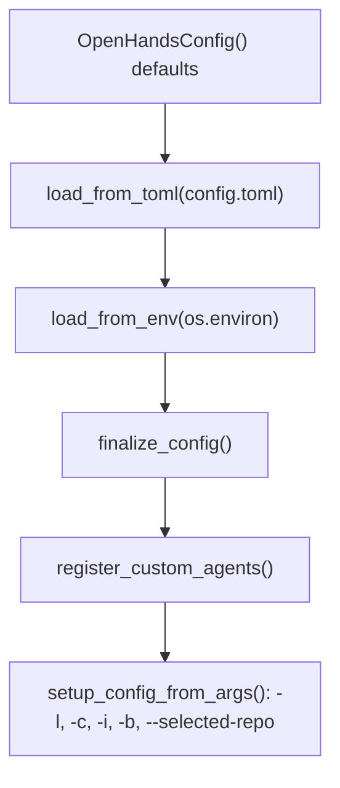

## Overview

Every OpenHands entry point works from one `OpenHandsConfig` object: a Pydantic model whose top-level fields are the `[core]` settings and whose nested models hold the sandbox, security, MCP, Kubernetes and CLI settings, plus two dictionaries of named LLM and agent configurations. The model forbids unknown fields, so a misspelled key fails validation instead of being silently ignored.

Sources: [openhands/core/config/openhands_config.py:23-129](repo://openhands/core/config/openhands_config.py#L23-L129)

`load_openhands_config` fills that object in a fixed order: defaults, then `config.toml`, then environment variables, then derived values in `finalize_config`, and finally registration of custom agent classes. Command-line arguments are applied on top by `setup_config_from_args`. This page follows that order; each subsystem's page explains what its own options do.

Sources: [openhands/core/config/utils.py:819-836](repo://openhands/core/config/utils.py#L819-L836), [openhands/core/config/utils.py:839-904](repo://openhands/core/config/utils.py#L839-L904)

## Load order and precedence



Sources: [openhands/core/config/utils.py:819-836](repo://openhands/core/config/utils.py#L819-L836)

Each later step overwrites what the earlier one set, so the effective precedence from highest to lowest is: command-line arguments, environment variables, `config.toml`, code defaults. The web UI's own settings (model, API key, agent) are stored separately per user and applied when a conversation starts; [[Settings, Secrets and User Auth]] covers that path.

Sources: [openhands/core/config/utils.py:828-831](repo://openhands/core/config/utils.py#L828-L831), [Development.md:74-76](repo://Development.md#L74-L76)

## The config.toml file

### Sections

`load_from_toml` reads the file given by `--config-file` (default `config.toml` in the working directory) and does nothing if it is missing. A file that fails to parse logs a warning and is ignored entirely. Each known section maps to one part of the config:

Sources: [openhands/core/config/utils.py:138-160](repo://openhands/core/config/utils.py#L138-L160)

| Section | Lands in | Notes |
| --- | --- | --- |
| `[core]` | top-level fields of `OpenHandsConfig` | unknown keys warn; string values become `SecretStr` where the field is secret |
| `[llm]`, `[llm.<name>]` | `config.llms` | see named groups below |
| `[agent]`, `[agent.<name>]` | `config.agents` | see named groups below |
| `[security]` | `config.security` | `confirmation_mode`, `security_analyzer` |
| `[sandbox]` | `config.sandbox` | a validation error is raised, not ignored |
| `[mcp]` | `config.mcp` | MCP servers, see [[MCP Integration]] |
| `[kubernetes]` | `config.kubernetes` | used by the Kubernetes runtime |
| `[condenser]` | default agent's `condenser` | see [[Context Condensers]] |
| `[model_routing]` | default agent's `model_routing` | see [[LLM Registry and Routing]] |
| `[extended]` | `config.extended` | free-form settings for extensions |

Sources: [openhands/core/config/utils.py:170-260](repo://openhands/core/config/utils.py#L170-L260), [openhands/core/config/utils.py:262-346](repo://openhands/core/config/utils.py#L262-L346)

Any other section name logs `Unknown section`. A file without `[core]` still loads, with a warning that core settings use defaults.

Sources: [openhands/core/config/utils.py:161-168](repo://openhands/core/config/utils.py#L161-L168), [openhands/core/config/utils.py:348-364](repo://openhands/core/config/utils.py#L348-L364)

### Named LLM and agent groups

Within `[llm]`, plain keys build the default configuration, stored under the name `llm`. Every sub-table such as `[llm.gpt4o-mini]` is a named configuration built by merging its keys over the default's, so a `num_retries` set in `[llm]` also applies to every named group. A named group that fails validation is skipped with a warning; the others still load.

Sources: [openhands/core/config/llm_config.py:100-160](repo://openhands/core/config/llm_config.py#L100-L160)

`[agent]` works the same way, with one addition: a named group is validated against the agent class's own `config_model`. The class is found from the group's `classpath` if one is given, otherwise by looking the group's name up in the agent registry, and the plain `AgentConfig` is used if neither works.

Sources: [openhands/core/config/agent_config.py:79-156](repo://openhands/core/config/agent_config.py#L79-L156)

```toml
[llm]
model = "claude-sonnet-4-20250514"
api_key = "..."
num_retries = 5

[llm.gpt4o-mini]
model = "gpt-4o"

[agent]
enable_browsing = true

[agent.RepoExplorerAgent]
llm_config = "gpt4o-mini"   # this agent uses the named LLM group

[agent.CustomAgent]
classpath = "my_package.my_module.MyCustomAgent"
```

Sources: [config.template.toml:214-225](repo://config.template.toml#L214-L225), [config.template.toml:278-286](repo://config.template.toml#L278-L286)

### How an agent finds its LLM

`get_agent_config(name)` returns the named agent group, or the default `agent` group when there is none. `get_llm_config_from_agent` then reads that agent config's `llm_config` field and returns the LLM group of that name, falling back to the default `llm` group. `get_agent_to_llm_config_map` builds this mapping for every configured agent; the controller uses it when an agent delegates to another, so each sub-agent runs on its own model.

Sources: [openhands/core/config/openhands_config.py:131-172](repo://openhands/core/config/openhands_config.py#L131-L172), [openhands/core/setup.py:230-242](repo://openhands/core/setup.py#L230-L242)

### Default condenser and routing

When the file has no `[condenser]` section and `enable_default_condenser` is true (the default), the loader gives the default agent an `LLMSummarizingCondenserConfig` that uses the default LLM. A `[model_routing]` section is attached to the default agent together with every LLM group marked `for_routing = true`.

Sources: [openhands/core/config/utils.py:202-231](repo://openhands/core/config/utils.py#L202-L231), [openhands/core/config/utils.py:302-336](repo://openhands/core/config/utils.py#L302-L336)

## Environment variables

`load_from_env` walks the config model and, for every field, looks for an environment variable named after the field path in upper case: a top-level field `max_iterations` reads `MAX_ITERATIONS`, a nested model's field reads `<MODEL>_<FIELD>` such as `SANDBOX_TIMEOUT`. The default LLM and agent configs are then filled from variables prefixed `LLM_` and `AGENT_`, such as `LLM_API_KEY` or `LLM_MODEL`.

Sources: [openhands/core/config/utils.py:66-135](repo://openhands/core/config/utils.py#L66-L135)

Values are cast to the field's type: booleans accept `true` or `1`, dictionaries and lists are parsed as Python literals (and list items become Pydantic models when the list holds models), and other types are passed to the type's constructor. Empty values are skipped, and a value that fails to cast logs an error and keeps the previous value.

Sources: [openhands/core/config/utils.py:79-125](repo://openhands/core/config/utils.py#L79-L125)

> [!NOTE]
> Environment variables only reach the default `llm` and `agent` groups. Named groups such as `[llm.gpt4o-mini]` can only be set in the file.

Sources: [openhands/core/config/utils.py:127-135](repo://openhands/core/config/utils.py#L127-L135)

## Derived values in finalize_config

`finalize_config` turns the raw settings into what the runtime needs:

Sources: [openhands/core/config/utils.py:377-380](repo://openhands/core/config/utils.py#L377-L380)

- **Workspace mounts.** `sandbox.volumes` (for example `/my/host/dir:/workspace:rw`, comma-separated for several) is the current way to mount host folders. A mount whose container path is `/workspace` sets `workspace_base` and `workspace_mount_path`; with no such mount, both are cleared. Each mount must have two or three colon-separated parts. The older `workspace_base` and `workspace_mount_path` still work and log a deprecation warning.
- **Paths.** Each LLM's `log_completions_folder` becomes absolute and `cache_dir` is created.
- **JWT secret.** When `jwt_secret` is unset, one is read from the file store or generated and saved there, so session ids derived from it stay stable across restarts.
- **CLI runtime.** With `runtime = "cli"`, Jupyter and browsing are switched off for every agent, because that runtime cannot run IPython.

Sources: [openhands/core/config/utils.py:367-470](repo://openhands/core/config/utils.py#L367-L470)

Finally, `register_custom_agents` imports every agent group's `classpath` with `get_impl` and registers the class under the group's name, so `default_agent` or `-c` can name it like a built-in agent (see [[Agents]]).

Sources: [openhands/core/config/utils.py:796-816](repo://openhands/core/config/utils.py#L796-L816)

## Command-line overrides

`setup_config_from_args` is shared by the [[CLI]] and [[Headless Mode]]. It loads the config from `--config-file`, then applies:

Sources: [openhands/core/config/utils.py:839-850](repo://openhands/core/config/utils.py#L839-L850)

| Argument | Effect |
| --- | --- |
| `-l`, `--llm-config NAME` | replaces the default LLM with the named group, searched in the loaded config, then the config file, then `~/.openhands/config.toml`; raises if none has it |
| `-c`, `--agent-cls` | sets `default_agent` |
| `-i`, `--max-iterations` | sets `max_iterations` |
| `-b`, `--max-budget-per-task` | sets `max_budget_per_task` |
| `--selected-repo` | sets `sandbox.selected_repo` |

Sources: [openhands/core/config/utils.py:839-904](repo://openhands/core/config/utils.py#L839-L904), [openhands/core/config/arg_utils.py:102-142](repo://openhands/core/config/arg_utils.py#L102-L142)

## Notable core defaults

| Field | Default | Used by |
| --- | --- | --- |
| `default_agent` | `CodeActAgent` | [[Agents]] |
| `runtime` | `docker` | [[Runtime Implementations]] |
| `max_iterations` | `500` | [[Agent Controller]] |
| `file_store`, `file_store_path` | `local`, `~/.openhands` | [[Storage]] |
| `workspace_mount_path_in_sandbox` | `/workspace` | runtimes |
| `max_concurrent_conversations` | `3` | [[Conversation Managers]] |
| `conversation_max_age_seconds` | `864000` (10 days) | conversation cleanup |
| `enable_default_condenser` | `true` | [[Context Condensers]] |
| `llm.model` | `claude-sonnet-4-20250514` | [[LLM Client]] |
| `sandbox.timeout` | `120` seconds | default action timeout |

Sources: [openhands/core/config/config_utils.py:7-9](repo://openhands/core/config/config_utils.py#L7-L9), [openhands/core/config/openhands_config.py:65-118](repo://openhands/core/config/openhands_config.py#L65-L118), [openhands/core/config/llm_config.py:52-53](repo://openhands/core/config/llm_config.py#L52-L53), [openhands/core/config/sandbox_config.py:61-61](repo://openhands/core/config/sandbox_config.py#L61-L61)

`LLMConfig` also applies provider-specific defaults when it is created: `reasoning_effort` becomes `high` for models other than Gemini 2.5 Pro, Azure models get API version `2024-12-01-preview`, and AWS and OpenRouter settings are exported as environment variables for LiteLLM.

Sources: [openhands/core/config/llm_config.py:162-194](repo://openhands/core/config/llm_config.py#L162-L194)
