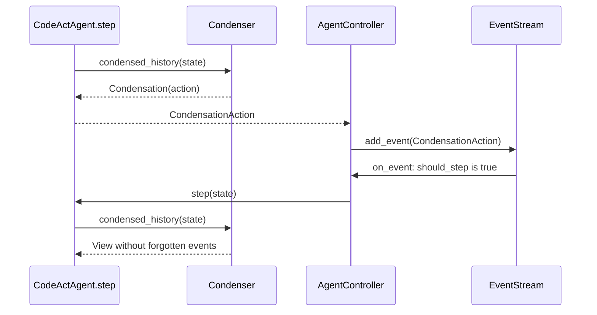

## Overview

A long task produces hundreds of events, and sending them all to the LLM on every step eventually overflows its context window and makes every step slower and more expensive. A condenser decides which part of the history the LLM sees. It never deletes events from the stream: it either returns a `View`, the list of events to show, or a `Condensation`, an instruction to forget some events that becomes a `CondensationAction` in the stream. Forgetting is therefore recorded, replayable and visible in the conversation.

Sources: [openhands/memory/condenser/condenser.py:38-52](repo://openhands/memory/condenser/condenser.py#L38-L52), [openhands/memory/condenser/condenser.py:89-114](repo://openhands/memory/condenser/condenser.py#L89-L114)

Each agent gets its condenser from its `AgentConfig.condenser`. The [[CodeAct Agent]] asks it for the condensed history at the start of every step and passes the resulting view to [[Conversation Memory and Prompts]].

Sources: [openhands/agenthub/codeact_agent/codeact_agent.py:92-93](repo://openhands/agenthub/codeact_agent/codeact_agent.py#L92-L93), [openhands/agenthub/codeact_agent/codeact_agent.py:190-202](repo://openhands/agenthub/codeact_agent/codeact_agent.py#L190-L202)

## Views and condensation events

### Building a view

`State.view` builds a `View` from the history with `View.from_events`, cached until the history grows. `from_events` collects the ids every `CondensationAction` forgets, either an explicit `forgotten_event_ids` list or a `forgotten_events_start_id`..`forgotten_events_end_id` range, and also forgets the condensation actions and condensation requests themselves. If the most recent condensation that carries a summary has a `summary_offset`, the summary is inserted at that position as an `AgentCondensationObservation`.

Sources: [openhands/memory/view.py:13-93](repo://openhands/memory/view.py#L13-L93), [openhands/controller/state/state.py:299-311](repo://openhands/controller/state/state.py#L299-L311), [openhands/events/action/agent.py:164-182](repo://openhands/events/action/agent.py#L164-L182)

The view also reports `unhandled_condensation_request`: true when a `CondensationRequestAction` appears after the last `CondensationAction`. That request comes either from the agent's `request_condensation` tool or from the controller when the LLM reports a context-window overflow.

Sources: [openhands/memory/view.py:80-93](repo://openhands/memory/view.py#L80-L93), [openhands/controller/agent_controller.py:907-913](repo://openhands/controller/agent_controller.py#L907-L913)

### The condensation round trip



Sources: [openhands/agenthub/codeact_agent/codeact_agent.py:190-202](repo://openhands/agenthub/codeact_agent/codeact_agent.py#L190-L202), [openhands/controller/agent_controller.py:392-418](repo://openhands/controller/agent_controller.py#L392-L418)

## Condenser interfaces

### Condenser

`Condenser.condense(view)` is the one method to implement. `condensed_history(state)` wraps it: it computes LLM metadata for any LLM the condenser calls, and runs `condense` inside `metadata_batch`, so whatever the condenser recorded with `add_metadata` (for example the summarizing LLM's response and cost) is appended to `state.extra_data['condenser_meta']`.

Sources: [openhands/memory/condenser/condenser.py:16-31](repo://openhands/memory/condenser/condenser.py#L16-L31), [openhands/memory/condenser/condenser.py:54-126](repo://openhands/memory/condenser/condenser.py#L54-L126)

### RollingCondenser

Most strategies only act when the history passes a threshold. `RollingCondenser` splits `condense` into `should_condense(view)` and `get_condensation(view)`: below the threshold it returns the view untouched, above it returns a `Condensation`. Because the result is an event, a rolling condenser does its expensive work, such as a summarization call, once per threshold crossing rather than on every step.

Sources: [openhands/memory/condenser/condenser.py:168-193](repo://openhands/memory/condenser/condenser.py#L168-L193)

### Registry

Each implementation registers itself against its config class with `register_config`; `Condenser.from_config(config, llm_registry)` looks the class up by the config's type and calls the class's own `from_config`. Condensers that call an LLM request it from the [[LLM Registry and Routing]] under the service id `condenser` with prompt caching turned off, because a summarization prompt is never reused.

Sources: [openhands/memory/condenser/condenser.py:34-35](repo://openhands/memory/condenser/condenser.py#L34-L35), [openhands/memory/condenser/condenser.py:129-165](repo://openhands/memory/condenser/condenser.py#L129-L165), [openhands/memory/condenser/impl/llm_summarizing_condenser.py:163-182](repo://openhands/memory/condenser/impl/llm_summarizing_condenser.py#L163-L182)

## Implementations

### Catalogue

| `type` | Class | What it does | Choose it when |
| --- | --- | --- | --- |
| `noop` | `NoOpCondenser` | returns the view unchanged | you want the full history and accept overflow errors |
| `recent` | `RecentEventsCondenser` | keeps the first `keep_first` and the last events up to `max_events`, on every step | a simple sliding window is enough |
| `observation_masking` | `ObservationMaskingCondenser` | replaces observations older than `attention_window` events with `<MASKED>` | old outputs are bulky but the action trail matters |
| `browser_output_masking` | `BrowserOutputCondenser` | replaces all but the last `attention_window` browser observations with `Visited URL ... Content omitted` | browsing tasks with large screenshots and accessibility trees |
| `amortized` | `AmortizedForgettingCondenser` | above `max_size`, forgets everything but the head and the newest events, down to half of `max_size` | cheap forgetting without an LLM call |
| `llm` | `LLMSummarizingCondenser` | above `max_size`, forgets the middle and inserts an LLM summary after the head | the default when the config file has no `[condenser]` section |
| `structured` | `StructuredSummaryCondenser` | like `llm`, but the summary is a `StateSummary` filled through a forced tool call | models with function calling, when a fixed summary layout helps |
| `llm_attention` | `LLMAttentionCondenser` | above `max_size`, asks an LLM to rank events by importance and keeps the top ones | models that support `response_schema` |
| `conversation_window` | `ConversationWindowCondenser` | on a condensation request, keeps the essential opening events and the newer half of the rest | the default for agents without other settings; reacts only to overflow |
| `pipeline` | `CondenserPipeline` | runs several condensers in order | combining masking with a rolling strategy |

Sources: [openhands/core/config/condenser_config.py:270-312](repo://openhands/core/config/condenser_config.py#L270-L312), [openhands/memory/condenser/impl/recent_events_condenser.py:1-31](repo://openhands/memory/condenser/impl/recent_events_condenser.py#L1-L31), [openhands/memory/condenser/impl/observation_masking_condenser.py:1-39](repo://openhands/memory/condenser/impl/observation_masking_condenser.py#L1-L39), [openhands/memory/condenser/impl/browser_output_condenser.py:1-49](repo://openhands/memory/condenser/impl/browser_output_condenser.py#L1-L49), [openhands/memory/condenser/impl/amortized_forgetting_condenser.py:1-69](repo://openhands/memory/condenser/impl/amortized_forgetting_condenser.py#L1-L69)

### LLM summarizing

`LLMSummarizingCondenser` triggers when the view has more than `max_size` events (default 100). It keeps the first `keep_first` events and enough of the newest to reach half of `max_size` with one slot for the summary, and forgets the rest. The summarization prompt asks for a running state summary with sections such as `USER_CONTEXT`, `TASK_TRACKING` (with task ids preserved), `COMPLETED`, `PENDING`, `CODE_STATE`, `TESTS`, `CHANGES` and `VERSION_CONTROL_STATUS`, and includes the previous summary and every forgotten event, each truncated to `max_event_length` characters. The result is one `CondensationAction` with a forgotten range, the summary, and `summary_offset = keep_first`.

Sources: [openhands/memory/condenser/impl/llm_summarizing_condenser.py:52-161](repo://openhands/memory/condenser/impl/llm_summarizing_condenser.py#L52-L161)

Because the previous summary sits right after the head, each new summary folds the old one in, so the summary carries everything ever forgotten. `keep_first` must be less than half of `max_size`, or the constructor raises.

Sources: [openhands/memory/condenser/impl/llm_summarizing_condenser.py:32-63](repo://openhands/memory/condenser/impl/llm_summarizing_condenser.py#L32-L63)

### Structured summary and attention

`StructuredSummaryCondenser` uses the same window but forces the LLM to call a `create_state_summary` tool whose arguments are the fields of `StateSummary` (user context, completed and pending tasks, files and functions changed, test status and more). A reply it cannot parse yields an empty summary rather than an error. It refuses to start with an LLM that lacks function calling.

Sources: [openhands/memory/condenser/impl/structured_summary_condenser.py:25-60](repo://openhands/memory/condenser/impl/structured_summary_condenser.py#L25-L60), [openhands/memory/condenser/impl/structured_summary_condenser.py:168-193](repo://openhands/memory/condenser/impl/structured_summary_condenser.py#L168-L193), [openhands/memory/condenser/impl/structured_summary_condenser.py:260-329](repo://openhands/memory/condenser/impl/structured_summary_condenser.py#L260-L329)

`LLMAttentionCondenser` asks the LLM for a list of event ids ordered by importance through a `response_schema`, keeps the head plus the top-ranked ids up to half of `max_size`, fills any shortfall with the newest events, and forgets the rest without a summary.

Sources: [openhands/memory/condenser/impl/llm_attention_condenser.py:17-120](repo://openhands/memory/condenser/impl/llm_attention_condenser.py#L17-L120)

### Conversation window

`ConversationWindowCondenser` is the default in `AgentConfig`, chosen so a context-window overflow is always handled: with `noop`, the controller's condensation request would never be answered. It acts only when the view has an unhandled condensation request. It keeps the system message, the first user message, and the recall action and observation for that message; of the remaining events it keeps the newer half, skipping observations at the start of that slice whose action was dropped. The forgotten ids become a range when contiguous and a list otherwise.

Sources: [openhands/core/config/agent_config.py:54-60](repo://openhands/core/config/agent_config.py#L54-L60), [openhands/memory/condenser/impl/conversation_window_condenser.py:15-110](repo://openhands/memory/condenser/impl/conversation_window_condenser.py#L15-L110), [openhands/memory/condenser/impl/conversation_window_condenser.py:111-188](repo://openhands/memory/condenser/impl/conversation_window_condenser.py#L111-L188)

### Pipeline

`CondenserPipeline` passes the view through each condenser in turn and stops at the first one that returns a `Condensation`. It overrides `metadata_batch` to collect metadata from every stage.

Sources: [openhands/memory/condenser/impl/pipeline.py:12-50](repo://openhands/memory/condenser/impl/pipeline.py#L12-L50)

## Configuration

A `[condenser]` section in `config.toml` sets the default agent's condenser by `type`, with the type's own fields. For `llm` and `llm_attention`, `llm_config` may name an `[llm.<name>]` section; an unknown name falls back to the default LLM with a warning, and an invalid section falls back to `noop`. Without a section, the loader installs an `llm` condenser on the default LLM when `enable_default_condenser` is true (see [[Configuration]]).

Sources: [openhands/core/config/condenser_config.py:196-266](repo://openhands/core/config/condenser_config.py#L196-L266), [openhands/core/config/utils.py:302-336](repo://openhands/core/config/utils.py#L302-L336)

```toml
[llm.condenser]
model = "gpt-4o-mini"

[condenser]
type = "llm"
llm_config = "condenser"
keep_first = 1
max_size = 100
```

Sources: [config.template.toml:384-430](repo://config.template.toml#L384-L430)

When condensation itself stops helping and condensation observations follow each other with nothing in between, [[Stuck Detection]] stops the agent.

Sources: [openhands/controller/stuck.py:336-382](repo://openhands/controller/stuck.py#L336-L382)
