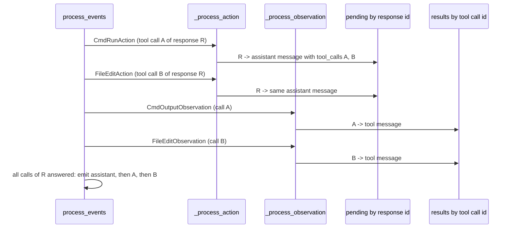

## Overview

The agent's history is a list of events; an LLM wants a list of chat messages with roles, tool calls and tool results in a strict order. `ConversationMemory` translates one into the other on every step. It decides what each action and observation looks like to the model, pairs every tool result with the tool call that requested it, renders workspace context and microagent knowledge through the `PromptManager`, and marks messages for prompt caching.

Sources: [openhands/memory/conversation_memory.py:55-164](repo://openhands/memory/conversation_memory.py#L55-L164)

The [[CodeAct Agent]] creates one `ConversationMemory` at construction and calls `process_events` with the condensed view of the history from [[Context Condensers]]. Where the recalled knowledge comes from is on [[Microagents]].

Sources: [openhands/agenthub/codeact_agent/codeact_agent.py:88-90](repo://openhands/agenthub/codeact_agent/codeact_agent.py#L88-L90), [openhands/agenthub/codeact_agent/codeact_agent.py:278-293](repo://openhands/agenthub/codeact_agent/codeact_agent.py#L278-L293)

## Message model

### Message and content

`Message` is a Pydantic model with an LLM API role (`user`, `system`, `assistant` or `tool`, unrelated to `EventSource`), a list of `TextContent` and `ImageContent` items, and the tool-calling fields: `tool_calls` on an assistant message, `tool_call_id` and `name` on a tool result. Every content item has a `cache_prompt` flag, which serializes to Anthropic-style `cache_control: ephemeral`.

Sources: [openhands/core/message.py:8-68](repo://openhands/core/message.py#L8-L68)

### Two serializations

Providers disagree on message format, so `Message` serializes two ways. When caching, vision or function calling is enabled, content is a list of typed items (images only when vision is on); otherwise the text items are joined into one string, which providers such as Hugging Face and Groq require. For tool messages with caching, the cache marker moves from the content item to the message. The [[LLM Client]] sets these flags in `format_messages_for_llm` just before sending, and forces the string form for some models such as DeepSeek.

Sources: [openhands/core/message.py:74-158](repo://openhands/core/message.py#L74-L158), [openhands/llm/llm.py:803-820](repo://openhands/llm/llm.py#L803-L820)

## Processing the history

### Guaranteed opening

`process_events` first makes sure the history starts the way LLM APIs expect. If no `SystemMessageAction` is present, as in conversations recorded before it existed, it renders one and inserts it at the front. If the second event is not a user `MessageAction`, it inserts the initial user message that the agent found in the full, uncondensed history. This keeps the task statement in front of the model even after a condenser has dropped it.

Sources: [openhands/memory/conversation_memory.py:74-97](repo://openhands/memory/conversation_memory.py#L74-L97), [openhands/memory/conversation_memory.py:801-860](repo://openhands/memory/conversation_memory.py#L801-L860)

### Pairing tool calls with results

Sources: [openhands/memory/conversation_memory.py:98-160](repo://openhands/memory/conversation_memory.py#L98-L160)

An action that came from a tool call does not produce a message of its own. `_process_action` takes the original model response from the action's `tool_call_metadata` and stores the assistant message, with its text and all its tool calls, under the response id; several actions from the same response overwrite the same entry. Each matching observation becomes a `tool` message stored under its tool call id. After every event, `process_events` checks each pending response: once every tool call in it has a result, it emits the assistant message followed by the results in call order.

Sources: [openhands/memory/conversation_memory.py:221-269](repo://openhands/memory/conversation_memory.py#L221-L269), [openhands/memory/conversation_memory.py:668-681](repo://openhands/memory/conversation_memory.py#L668-L681)

This rebuilds the exact assistant turn the model produced, rather than one message per action, and it is why the controller always answers a tool call, even with an error, when an agent is stopped (see [[Agent Controller]]).

Sources: [openhands/controller/agent_controller.py:584-618](repo://openhands/controller/agent_controller.py#L584-L618)

### Dropping unmatched calls

As a last safeguard, `_filter_unmatched_tool_calls` removes tool results whose call is not in any assistant message, and removes from assistant messages the tool calls that have no result, dropping the message if none remain. A condenser that forgets one half of a pair therefore cannot produce a request the provider rejects. Consecutive user messages are then separated by a blank line.

Sources: [openhands/memory/conversation_memory.py:146-181](repo://openhands/memory/conversation_memory.py#L146-L181), [openhands/memory/conversation_memory.py:746-799](repo://openhands/memory/conversation_memory.py#L746-L799)

## How events read to the model

### Actions

| Event | Message |
| --- | --- |
| tool-call actions (commands, IPython, file read/edit, browse, delegate, think, MCP, task tracking) | the assistant message with tool calls, emitted when all results are in |
| `AgentFinishAction` | an assistant message with the final thought, merged with the reply text |
| `MessageAction` | a user or assistant message; user images are added as `ImageContent`, labelled `Image 1:` when vision is on |
| `CmdRunAction` from the user | `User executed the command:` and the command |
| `SystemMessageAction` | the system message |

Sources: [openhands/memory/conversation_memory.py:221-300](repo://openhands/memory/conversation_memory.py#L221-L300), [openhands/memory/conversation_memory.py:301-342](repo://openhands/memory/conversation_memory.py#L301-L342)

### Observations

| Observation | Message text |
| --- | --- |
| `CmdOutputObservation` | the agent-facing output; prefixed `Observed result of command executed by user:` when it has no tool call |
| `IPythonRunCellObservation` | the output with inline base64 images replaced by a placeholder, plus valid image URLs as images |
| `BrowserOutputObservation` | the page text, plus the set-of-marks image or screenshot for interactive browsing when visual browsing is on |
| `FileReadObservation`, `FileEditObservation` | the content or the edit summary |
| `ErrorObservation` | the error plus `[Error occurred in processing last action]` |
| `UserRejectObservation` | the content plus `[Last action has been rejected by the user]` |
| `AgentDelegateObservation` | the delegate's `content` output |
| `RecallObservation` | workspace context and microagent knowledge, see below |

Sources: [openhands/memory/conversation_memory.py:386-450](repo://openhands/memory/conversation_memory.py#L386-L450), [openhands/memory/conversation_memory.py:451-524](repo://openhands/memory/conversation_memory.py#L451-L524)

Every observation's text goes through `truncate_content` with the LLM's `max_message_chars`, which keeps the head and tail and cuts the middle. File reads are the exception: the ACI editor has already limited them. An observation type with no rule raises `ValueError`, because silently skipping a tool result would break the pairing.

Sources: [openhands/memory/conversation_memory.py:386-400](repo://openhands/memory/conversation_memory.py#L386-L400), [openhands/memory/conversation_memory.py:448-451](repo://openhands/memory/conversation_memory.py#L448-L451), [openhands/memory/conversation_memory.py:662-666](repo://openhands/memory/conversation_memory.py#L662-L666), [openhands/events/serialization/event.py:167-178](repo://openhands/events/serialization/event.py#L167-L178)

### Recall observations

A `RecallObservation` becomes a user message only when `enable_prompt_extensions` is on. For `WORKSPACE_CONTEXT`, the first recall of a conversation, it collects the repository name, directory and branch, the runtime's hosts, date, working directory and custom-secret descriptions, the repository instructions and any conversation instructions, and renders them with `build_workspace_context`; triggered microagents are appended with `build_microagent_info`. For `KNOWLEDGE`, a later recall, it renders only microagents that no earlier recall observation already included. In both cases microagents listed in `disabled_microagents` are dropped.

Sources: [openhands/memory/conversation_memory.py:525-610](repo://openhands/memory/conversation_memory.py#L525-L610), [openhands/memory/conversation_memory.py:611-661](repo://openhands/memory/conversation_memory.py#L611-L661), [openhands/memory/conversation_memory.py:698-744](repo://openhands/memory/conversation_memory.py#L698-L744)

## Prompt caching

`apply_prompt_caching` marks two places as cache breakpoints: the last content item of the system message, and the last content item of the most recent user or tool message. Everything before the breakpoint, which is most of the conversation, is reused by the provider on the next step. The agent calls it only when `is_caching_prompt_active` reports that the model supports caching.

Sources: [openhands/memory/conversation_memory.py:683-696](repo://openhands/memory/conversation_memory.py#L683-L696), [openhands/agenthub/codeact_agent/codeact_agent.py:290-291](repo://openhands/agenthub/codeact_agent/codeact_agent.py#L290-L291)

## PromptManager

### Templates

`PromptManager` loads Jinja templates from an agent's prompt directory: the system prompt (file name configurable), `user_prompt.j2`, `additional_info.j2` for workspace context and `microagent_info.j2` for triggered microagents. A missing template raises `FileNotFoundError` with its path.

Sources: [openhands/utils/prompt.py:43-87](repo://openhands/utils/prompt.py#L43-L87)

| Method | Renders |
| --- | --- |
| `get_system_message(**context)` | the system prompt, with context such as `cli_mode` |
| `get_example_user_message()` | an optional example first user message |
| `build_workspace_context(repository_info, runtime_info, conversation_instructions, repo_instructions)` | the workspace block of the first recall |
| `build_microagent_info(triggered_agents)` | the knowledge block for triggered microagents |
| `add_turns_left_reminder(messages, state)` | appends the number of turns left to the latest user message |

Sources: [openhands/utils/prompt.py:89-151](repo://openhands/utils/prompt.py#L89-L151)

### Context objects

The workspace block is filled from three small dataclasses: `RuntimeInfo` (date, available hosts, extra agent instructions, custom-secret descriptions, working directory), `RepositoryInfo` (name, directory, branch) and `ConversationInstructions`, free text that integrations such as the resolver or Slack attach to a conversation.

Sources: [openhands/utils/prompt.py:12-40](repo://openhands/utils/prompt.py#L12-L40)

## Token usage per event

`message_utils` links events back to the LLM call that produced them: `get_token_usage_for_event` finds the token usage record whose response id matches the event's tool call response or its `response_id`, and `get_token_usage_for_event_id` walks back from an event until it finds one.

Sources: [openhands/core/message_utils.py:5-52](repo://openhands/core/message_utils.py#L5-L52)
