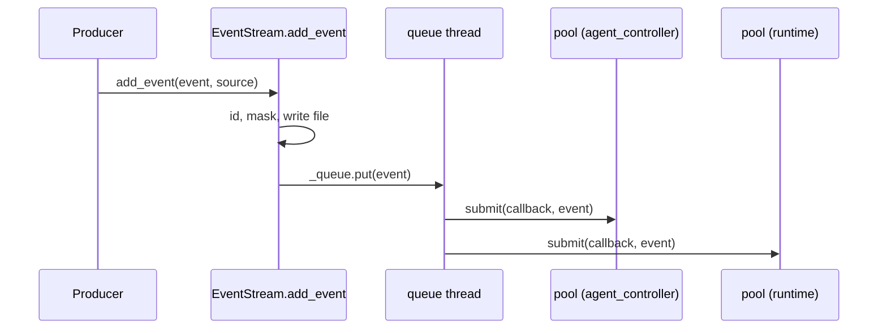

## Overview

The `EventStream` is the hub of a conversation. Any component adds an event to it; the stream numbers the event, masks secrets, writes it to the file store and then hands it to every subscriber. The agent controller, the runtime, the memory and the server never call each other to pass work along: each subscribes to the stream and reacts to the events it cares about.

Sources: [openhands/events/stream.py:43-69](repo://openhands/events/stream.py#L43-L69), [openhands/events/stream.py:163-203](repo://openhands/events/stream.py#L163-L203)

`EventStream` extends `EventStore`, the read side, which finds stored events by id. The stream therefore doubles as the conversation's history: reconnecting browsers, the controller restoring a session and the trajectory export all read it back. The event classes themselves are described on [[Events, Actions and Observations]]; the file store backends on [[Storage]].

Sources: [openhands/events/event_store.py:43-58](repo://openhands/events/event_store.py#L43-L58)

## Subscribers

A subscriber registers a callback under a role from `EventStreamSubscriber` and a callback id, which lets one role hold several callbacks (for example, one per connected browser). Registering the same id twice raises `ValueError`.

Sources: [openhands/events/stream.py:23-30](repo://openhands/events/stream.py#L23-L30), [openhands/events/stream.py:130-148](repo://openhands/events/stream.py#L130-L148)

| Role | Subscribed by | Reacts to |
| --- | --- | --- |
| `agent_controller` | `AgentController` (not delegates) | user messages and observations, by stepping the agent |
| `runtime` | `Runtime` | actions, by executing them |
| `memory` | `Memory` | `RecallAction`, by answering with workspace context and microagents |
| `server` | `WebSession`, `StandaloneConversationManager` | everything, to forward to the browser and update metadata |
| `main` | the headless runner and the CLI | state changes, to read user input |
| `openhands_resolver` | the issue resolver | |

Sources: [openhands/controller/agent_controller.py:164-170](repo://openhands/controller/agent_controller.py#L164-L170), [openhands/runtime/base.py:147-151](repo://openhands/runtime/base.py#L147-L151), [openhands/memory/memory.py:64-68](repo://openhands/memory/memory.py#L64-L68), [openhands/core/main.py:205-205](repo://openhands/core/main.py#L205-L205)

## Adding an event

### The add_event steps

`add_event(event, source)` is the only way into the stream:

Sources: [openhands/events/stream.py:163-163](repo://openhands/events/stream.py#L163-L163)

1. It refuses an event that already has an id. An id means the event was added before, usually by a handler that re-published what it received, which would loop forever.
2. It sets the timestamp and source.
3. Under a lock, it takes the next id from `cur_id`, serializes the event, replaces secrets in the serialized form, rebuilds the event from that dictionary and appends it to the in-memory write page. When the page reaches `cache_size` (25) events, a new page starts.
4. Outside the lock, it writes the event as JSON to its own file, logging a warning for events over about 1 MB, and then writes the full cache page if this event filled it.
5. It puts the event on the delivery queue.

Sources: [openhands/events/stream.py:163-213](repo://openhands/events/stream.py#L163-L213), [openhands/events/event_store.py:50-50](repo://openhands/events/event_store.py#L50-L50)

Because the event put on the queue is rebuilt from the masked dictionary, subscribers see exactly what was stored, secrets included as `<secret_hidden>`. The cache page is written after the event file, so a reader that finds no page simply falls back to the single files.

Sources: [openhands/events/stream.py:177-203](repo://openhands/events/stream.py#L177-L203)

### Secret masking

`set_secrets` replaces and `update_secrets` extends the map of secret values to hide. `_replace_secrets` walks the serialized event and replaces every occurrence of a secret value in string fields with `<secret_hidden>`, recursing into nested dictionaries. The top-level system fields (`id`, `timestamp`, `source`, `cause`, `action`, `observation`, `message`) are left alone. Git provider tokens and user custom secrets are registered this way when they are exported to the sandbox, so a token echoed by a command never reaches disk or the LLM.

Sources: [openhands/events/stream.py:215-244](repo://openhands/events/stream.py#L215-L244), [openhands/integrations/provider.py:350-356](repo://openhands/integrations/provider.py#L350-L356), [openhands/storage/data_models/user_secrets.py:140-150](repo://openhands/storage/data_models/user_secrets.py#L140-L150)

## Delivery

### Queue thread and subscriber pools

Sources: [openhands/events/stream.py:246-275](repo://openhands/events/stream.py#L246-L275)

The constructor starts a daemon thread running its own asyncio loop, `_process_queue`, which takes events off the queue (polling every 0.1 seconds so it can stop) and passes each one to every callback, iterating subscriber roles in sorted order. Each callback has its own single-worker `ThreadPoolExecutor` whose thread gets a fresh asyncio event loop at start.

Sources: [openhands/events/stream.py:56-76](repo://openhands/events/stream.py#L56-L76), [openhands/events/stream.py:254-275](repo://openhands/events/stream.py#L254-L275)

This arrangement gives two guarantees. Each callback receives events in the order they were added, because its pool has one worker. And a slow subscriber never blocks the others: the runtime can spend minutes in a command while the server keeps forwarding events. Callbacks are synchronous; the controller and runtime run their async handlers on the thread's loop with `run_until_complete`.

Sources: [openhands/events/stream.py:136-148](repo://openhands/events/stream.py#L136-L148), [openhands/runtime/base.py:320-322](repo://openhands/runtime/base.py#L320-L322), [openhands/controller/agent_controller.py:433-465](repo://openhands/controller/agent_controller.py#L433-L465)

An exception in a callback is logged with the subscriber and callback ids by a done-callback on the future; it does not stop delivery to other callbacks or later events.

Sources: [openhands/events/stream.py:277-291](repo://openhands/events/stream.py#L277-L291)

### Unsubscribing and closing

`unsubscribe` cancels pending tasks on the callback's loop, closes the loop, shuts down its pool and removes the callback. `close` sets the stop flag, joins the queue thread, cleans up every subscriber and drains the queue.

Sources: [openhands/events/stream.py:78-128](repo://openhands/events/stream.py#L78-L128), [openhands/events/stream.py:150-161](repo://openhands/events/stream.py#L150-L161)

## Reading events back

### Storage layout

Events live under the conversation directory: `sessions/<sid>/` for single-user mode or `users/<user_id>/conversations/<sid>/` when a user id is known. Each event is `events/<id>.json`, and full pages of 25 are also stored as `event_cache/<start>-<end>.json`. The same directory holds the conversation's metadata, agent state and statistics files.

Sources: [openhands/storage/locations.py:1-42](repo://openhands/storage/locations.py#L1-L42), [openhands/events/event_store.py:155-159](repo://openhands/events/event_store.py#L155-L159)

When a stream is opened on an existing conversation, `cur_id` is computed lazily by listing the events directory and taking the highest id plus one, so new events continue the numbering.

Sources: [openhands/events/event_store.py:53-83](repo://openhands/events/event_store.py#L53-L83)

### search_events

`search_events(start_id, end_id, reverse, filter, limit)` yields events in id order, or backwards with `reverse`. `end_id` is inclusive. For each index it first tries the cache page covering that index, loading the page file once per 25 events, and falls back to reading the single event file; ids whose file is missing are skipped. It stops after `limit` matches or when the process is shutting down.

Sources: [openhands/events/event_store.py:85-136](repo://openhands/events/event_store.py#L85-L136), [openhands/events/event_store.py:161-175](repo://openhands/events/event_store.py#L161-L175)

`EventStoreABC` adds conveniences on top: `get_matching_events` builds a filter from a text query, event types, source and date range and returns at most 100 events, and the deprecated `get_events` maps the old arguments onto an `EventFilter`.

Sources: [openhands/events/event_store_abc.py:11-53](repo://openhands/events/event_store_abc.py#L11-L53), [openhands/events/event_store_abc.py:71-111](repo://openhands/events/event_store_abc.py#L71-L111)

### EventFilter

An `EventFilter` passes an event only if every set criterion holds: its type is in `include_types` and not in `exclude_types`, its source matches, its timestamp lies between `start_date` and `end_date`, it is not hidden when `exclude_hidden` is set, and, for `query`, the lower-cased JSON of the event contains the lower-cased query.

Sources: [openhands/events/event_filter.py:8-98](repo://openhands/events/event_filter.py#L8-L98)

### Other stores

`NestedEventStore` reads a conversation that runs inside another OpenHands server, as the Docker nested conversation manager does (see [[Conversation Managers]]). It pages through the nested server's `/events` endpoint, at most 100 events per request, sending the `X-Session-API-Key` header and keeping explicit cursors so pages do not overlap. `AsyncEventStoreWrapper` turns `search_events` into an async iterator for server routes and the Socket.IO handler that replays history to a browser.

Sources: [openhands/events/nested_event_store.py:14-101](repo://openhands/events/nested_event_store.py#L14-L101), [openhands/events/async_event_store_wrapper.py:8-23](repo://openhands/events/async_event_store_wrapper.py#L8-L23), [openhands/server/listen_socket.py:94-94](repo://openhands/server/listen_socket.py#L94-L94)
