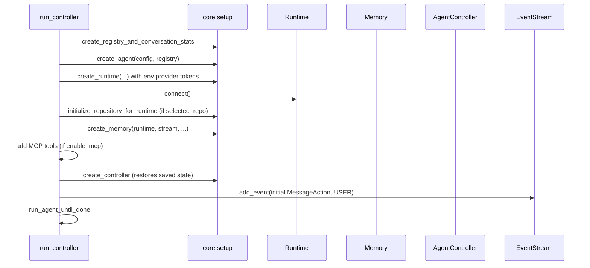

## Overview

Headless mode runs one task with no web server and no interactive terminal: `python -m openhands.core.main -t "<task>"` builds an agent, a runtime and a controller, lets the agent work until it finishes, and exits. It is the simplest complete use of the OpenHands core, and its function `run_controller` is also the programmatic API that the benchmark harness and tests call to run an agent on one instance.

Sources: [openhands/core/main.py:51-96](repo://openhands/core/main.py#L51-L96), [openhands/core/main.py:286-320](repo://openhands/core/main.py#L286-L320)

The command-line options are listed on [[Quickstart]] and [[Configuration]]; this page follows what happens when the command runs.

Sources: [openhands/core/config/arg_utils.py:210-215](repo://openhands/core/config/arg_utils.py#L210-L215)

## From the command line

### The entry point

The `__main__` block parses the headless argument set, builds the config with `setup_config_from_args`, and reads the task with `read_task`: from the file given with `-f`, else from `-t`, else from standard input when it is piped. Without a task it raises an error, except in replay mode, where a task is not allowed because it comes from the trajectory. The session id is derived from `-n` (or a random name) and the JWT secret, and `run_controller` runs under `asyncio.run` with `auto_continue_response` as the fake user unless `--no-auto-continue` is given.

Sources: [openhands/core/main.py:286-320](repo://openhands/core/main.py#L286-L320), [openhands/io/io.py:20-37](repo://openhands/io/io.py#L20-L37)

### Session ids

`generate_sid` hashes the session name with the JWT secret and keeps the id at most 32 characters: the name (cut to 16 characters if longer) plus part of the hash. The limit leaves room for prefixes and suffixes in Kubernetes resource names, which may not exceed 63 characters. Running again with the same `-n` and the same JWT secret, which `finalize_config` stores in the file store, yields the same id, so the previous session's events and state are found again.

Sources: [openhands/core/setup.py:246-270](repo://openhands/core/setup.py#L246-L270), [openhands/core/config/utils.py:367-374](repo://openhands/core/config/utils.py#L367-L374)

## run_controller

### Building the pieces



Sources: [openhands/core/main.py:97-216](repo://openhands/core/main.py#L97-L216)

1. `create_registry_and_conversation_stats` creates the LLM registry and the stats object for the session (see [[LLM Registry and Routing]]).
2. `create_agent` instantiates `default_agent` with its agent config.
3. Unless a runtime was passed in, `create_runtime` builds the event stream on the configured file store and the runtime with the agent's sandbox plugins and provider tokens from the environment, then the runtime connects. With `sandbox.selected_repo`, `initialize_repository_for_runtime` clones the repository and runs `.openhands/setup.sh` and the pre-commit hook setup.
4. `create_memory` creates the [[Microagents]] memory with runtime info and repository microagents.
5. With MCP enabled, the OpenHands default stdio servers are added and the MCP tools are attached to the agent (see [[MCP Integration]]).
6. `create_controller` tries to restore the agent state saved for this session, then creates the [[Agent Controller]] with the iteration and budget limits, per-agent LLM configs, confirmation mode and the runtime's security analyzer.

Sources: [openhands/core/setup.py:35-89](repo://openhands/core/setup.py#L35-L89), [openhands/core/setup.py:119-154](repo://openhands/core/setup.py#L119-L154), [openhands/core/setup.py:157-243](repo://openhands/core/setup.py#L157-L243), [openhands/core/main.py:145-167](repo://openhands/core/main.py#L145-L167)

### The first event

If a restored state carries a `last_error`, the session is resuming after a failure, and the first event is a user message asking the agent not to resume blindly but to ask about it. Otherwise the initial action, normally the task's `MessageAction`, is added to the stream as a user event, which starts the agent.

Sources: [openhands/core/main.py:177-191](repo://openhands/core/main.py#L177-L191)

### Answering the agent

`run_controller` subscribes to the stream as `main`. Whenever the agent enters `AWAITING_USER_INPUT`, it adds a user message: `/exit` when `exit_on_message` is set, the output of `fake_user_response_fn` when given, or a line read from the terminal otherwise (multi-line with `cli_multiline_input`, ended by `/exit`).

Sources: [openhands/core/main.py:193-205](repo://openhands/core/main.py#L193-L205), [openhands/io/io.py:5-17](repo://openhands/io/io.py#L5-L17)

The default fake user, `auto_continue_response`, always tells the agent to continue with whatever approach it thinks suitable, to finish when done, and never to ask for a human response. A run therefore ends only by finishing, rejecting, an error or a limit. The CodeAct agent finishes on a user message of exactly `/exit`.

Sources: [openhands/core/main.py:247-260](repo://openhands/core/main.py#L247-L260), [openhands/agenthub/codeact_agent/codeact_agent.py:185-188](repo://openhands/agenthub/codeact_agent/codeact_agent.py#L185-L188)

### Waiting for the end

`run_agent_until_done` installs one status callback on the runtime, the controller and the memory that logs messages and, on an error, records it as the controller's last error and moves the agent to `ERROR`. It refuses to run if a status callback is already set, since it would override it. It then checks once a second until the agent state is `FINISHED`, `REJECTED`, `ERROR`, `PAUSED` or `STOPPED`. An exception in the loop is logged, not raised.

Sources: [openhands/core/loop.py:9-45](repo://openhands/core/loop.py#L9-L45), [openhands/core/main.py:207-218](repo://openhands/core/main.py#L207-L218)

### After the run

With a persistent file store, the final state is saved to the session (without delegate events), so a later run with the same session name can resume. The controller is closed without changing the state to `STOPPED`. With `save_trajectory_path`, the history is written as JSON, to `<sid>.json` when the path is a directory, including screenshots only if `save_screenshots_in_trajectory` is set. The function returns the final `State`.

Sources: [openhands/core/main.py:220-244](repo://openhands/core/main.py#L220-L244)

## Replaying a trajectory

With `replay_trajectory_path` in the config, the task must be empty: `load_replay_log` reads the JSON file, rebuilds the events with ids cleared and environment events dropped, and uses the first event, which must be a user `MessageAction`, as the initial action. The rest is passed to the controller, which replays the recorded actions instead of asking the LLM until they run out. This reruns a recorded session against a fresh sandbox.

Sources: [openhands/core/main.py:157-163](repo://openhands/core/main.py#L157-L163), [openhands/core/main.py:263-283](repo://openhands/core/main.py#L263-L283), [openhands/controller/replay.py:82-98](repo://openhands/controller/replay.py#L82-L98)

## Using it from code

Benchmarks create and prepare the runtime themselves, then call `run_controller` with it, the instance's instruction as the initial action, and a benchmark-specific fake user. The returned state's history and `last_error` decide the result, as on [[Evaluation Harness]].

Sources: [evaluation/benchmarks/swe_bench/run_infer.py:636-658](repo://evaluation/benchmarks/swe_bench/run_infer.py#L636-L658)

```python
from openhands.core.main import run_controller
from openhands.events.action import MessageAction

state = await run_controller(
    config=config,
    initial_user_action=MessageAction(content='Write a hello world program'),
    fake_user_response_fn=auto_continue_response,
)
```

Sources: [openhands/core/main.py:92-95](repo://openhands/core/main.py#L92-L95)
