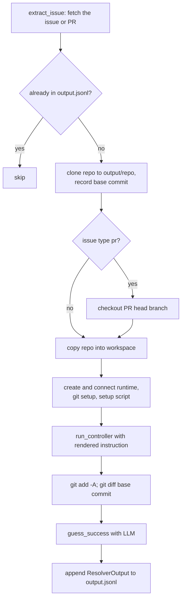

## Overview

The issue resolver turns an issue, or review comments on a pull request, into a proposed fix without anyone sitting at a UI. It reads the issue from GitHub, GitLab or Bitbucket, runs the CodeAct agent on a fresh copy of the repository through [[Headless Mode]], asks an LLM whether the result resolves the issue, and records a patch. A second command applies the patch and pushes a branch, opens a pull request, or updates the existing pull request. A GitHub Actions workflow runs both when an issue is labelled or the agent is mentioned.

Sources: [openhands/resolver/README.md:1-10](repo://openhands/resolver/README.md#L1-L10), [openhands/resolver/issue_resolver.py:397-470](repo://openhands/resolver/issue_resolver.py#L397-L470), [openhands/resolver/issue_resolver.py:470-517](repo://openhands/resolver/issue_resolver.py#L470-L517)

## Running it

### Commands

```bash
# 1. try to resolve an issue; results go to output/output.jsonl
python -m openhands.resolver.resolve_issue --selected-repo OWNER/REPO --issue-number 100

# 2. publish the result as a branch, a draft PR or a ready PR
python -m openhands.resolver.send_pull_request --issue-number 100 --pr-type draft
```

Sources: [openhands/resolver/README.md:134-201](repo://openhands/resolver/README.md#L134-L201)

The resolver needs a token in `GITHUB_TOKEN`, `GITLAB_TOKEN` or `BITBUCKET_TOKEN` (or `--token`), a username in `GIT_USERNAME` (or `--username`), and the LLM settings in `LLM_MODEL`, `LLM_API_KEY` and optionally `LLM_BASE_URL`. `--issue-type pr` addresses review feedback on a pull request instead of an issue, and `--comment-id` focuses on a single comment. Other options select the runtime, container images, iteration limit, a prompt template and a file of repository instructions.

Sources: [openhands/resolver/README.md:104-130](repo://openhands/resolver/README.md#L104-L130), [openhands/resolver/resolve_issue.py:8-110](repo://openhands/resolver/resolve_issue.py#L8-L110)

### The GitHub Actions workflow

`examples/openhands-resolver.yml` is the file users copy into their repository. It triggers on labelled issues and pull requests, new issue comments, review comments and submitted reviews, and calls the reusable workflow `All-Hands-AI/OpenHands/.github/workflows/openhands-resolver.yml@main` with repository variables for the mention macro (default `@openhands-agent`), iteration limit (default 50), base container image, model and target branch, and secrets for the personal access token and LLM key.

Sources: [openhands/resolver/examples/openhands-resolver.yml:1-34](repo://openhands/resolver/examples/openhands-resolver.yml#L1-L34)

With the `fix-me` label the agent considers the whole issue thread; with a mention it considers only that comment. Either way the workflow resolves, opens a draft PR on success or pushes a branch otherwise, and comments with the result.

Sources: [openhands/resolver/README.md:47-66](repo://openhands/resolver/README.md#L47-L66)

## Resolving an issue

### Setting up

`IssueResolver.__init__` splits `owner/repo`, takes the token and username from arguments or the environment, and identifies the platform from the token by asking each provider who owns it. It picks a prompt template, `basic-with-tests.jinja` for issues or `basic-followup.jinja` for pull requests, together with its matching conversation-instructions template. It points the workspace at `output/workspace/<type>_<number>`, configures OpenHands for the run, and creates the issue handler through `IssueHandlerFactory`.

Sources: [openhands/resolver/issue_resolver.py:55-120](repo://openhands/resolver/issue_resolver.py#L55-L120), [openhands/resolver/issue_resolver.py:120-176](repo://openhands/resolver/issue_resolver.py#L120-L176), [openhands/resolver/issue_resolver.py:389-395](repo://openhands/resolver/issue_resolver.py#L389-L395)

### Issue handlers

`IssueHandlerFactory.create` pairs the platform and issue type: `ServiceContextIssue` or `ServiceContextPR` wrapping `GithubIssueHandler`, `GitlabIssueHandler` or `BitbucketIssueHandler` (and the matching PR handlers for all three). The handlers implement `IssueHandlerInterface`: downloading issues and comments, building API, clone and compare URLs, choosing a free branch name, finding the default branch, creating pull requests, requesting reviewers, and commenting.

Sources: [openhands/resolver/issue_handler_factory.py:15-110](repo://openhands/resolver/issue_handler_factory.py#L15-L110), [openhands/resolver/interfaces/issue.py:27-125](repo://openhands/resolver/interfaces/issue.py#L27-L125)

`get_converted_issues` returns provider-neutral `Issue` objects: owner, repo, number, title, body, thread comments, issues a PR closes, review comments, review threads with their files, thread ids, and head and base branches.

Sources: [openhands/resolver/interfaces/issue.py:7-25](repo://openhands/resolver/interfaces/issue.py#L7-L25)

### The run



Sources: [openhands/resolver/issue_resolver.py:519-600](repo://openhands/resolver/issue_resolver.py#L519-L600), [openhands/resolver/issue_resolver.py:600-665](repo://openhands/resolver/issue_resolver.py#L600-L665)

`resolve_issue` fetches the issue, checks that a requested comment id actually matched something, and skips issues already present in `output.jsonl`. It clones the repository once into `output/repo`, records the base commit, and reads `.openhands_instructions` from it when no instruction file was given. For a pull request it checks out the PR's head branch and uses that as the base commit.

Sources: [openhands/resolver/issue_resolver.py:535-600](repo://openhands/resolver/issue_resolver.py#L535-L600), [openhands/resolver/issue_resolver.py:600-660](repo://openhands/resolver/issue_resolver.py#L600-L660)

`process_issue` copies the repository into the workspace, creates and connects a runtime, changes to `/workspace`, disables git's pager, and runs the repository's setup script and git hooks. The handler renders the instruction and conversation instructions from the templates with the issue, its comments and the repository instructions, and `run_controller` runs the agent with that message, any images from the issue, and a fake user that keeps it working. Afterwards `complete_runtime` stages everything and takes `git diff --cached <base commit>` as the patch, retrying up to five times with growing timeouts.

Sources: [openhands/resolver/issue_resolver.py:267-300](repo://openhands/resolver/issue_resolver.py#L267-L300), [openhands/resolver/issue_resolver.py:309-387](repo://openhands/resolver/issue_resolver.py#L309-L387), [openhands/resolver/issue_resolver.py:397-470](repo://openhands/resolver/issue_resolver.py#L397-L470)

### Judging success

`guess_success` asks the LLM, through templates in `prompts/guess_success`, whether the agent's last message and the patch resolve the issue, and expects an answer in the form `--- success` `true|false` `--- explanation` text. For pull requests it checks each review thread, review comment and thread comment separately, producing a list of per-item results and explanations that are logged as a checklist. A run that crashed is recorded as failed.

Sources: [openhands/resolver/interfaces/issue_definitions.py:370-410](repo://openhands/resolver/interfaces/issue_definitions.py#L370-L410), [openhands/resolver/interfaces/issue_definitions.py:45-110](repo://openhands/resolver/interfaces/issue_definitions.py#L45-L110), [openhands/resolver/interfaces/issue_definitions.py:173-200](repo://openhands/resolver/interfaces/issue_definitions.py#L173-L200), [openhands/resolver/issue_resolver.py:470-517](repo://openhands/resolver/issue_resolver.py#L470-L517)

Each run appends a `ResolverOutput` line to `output/output.jsonl` with the issue, instruction, base commit, patch, full history, metrics, success flags, explanation and error. `visualize_resolver_output` prints one for inspection.

Sources: [openhands/resolver/resolver_output.py:1-20](repo://openhands/resolver/resolver_output.py#L1-L20), [openhands/resolver/visualize_resolver_output.py:1-45](repo://openhands/resolver/visualize_resolver_output.py#L1-L45)

## Publishing the result

### process_single_issue

`send_pull_request.py` reads the output line for an issue and skips unsuccessful ones unless `--send-on-failure` is set. It copies `output/repo` into a patched directory, checks out the base commit (or the PR head branch), applies the patch with the resolver's own patch parser, which handles new, deleted and renamed files, and commits as the configured git user.

Sources: [openhands/resolver/send_pull_request.py:502-586](repo://openhands/resolver/send_pull_request.py#L502-L586), [openhands/resolver/send_pull_request.py:28-60](repo://openhands/resolver/send_pull_request.py#L28-L60), [openhands/resolver/send_pull_request.py:124-232](repo://openhands/resolver/send_pull_request.py#L124-L232)

### New pull requests

For an issue, `send_pull_request` creates a branch named after `openhands-fix-issue-<n>` (suffixed if it exists), pushes it to the repository or to `--fork-owner`'s fork, and then, by `pr_type`: `branch` returns a compare URL; `draft` and `ready` open a pull request against `--target-branch` or the default branch, titled `Fix issue #<n>: <title>`, with a body that references the issue and includes the resolver's explanation. A reviewer can be requested.

Sources: [openhands/resolver/send_pull_request.py:233-320](repo://openhands/resolver/send_pull_request.py#L233-L320), [openhands/resolver/send_pull_request.py:320-392](repo://openhands/resolver/send_pull_request.py#L320-L392)

### Updating a pull request

For a pull request, `update_existing_pull_request` pushes the new commit to the PR's own branch, has the LLM summarise the changes with `pr-changes-summary.jinja`, comments with the summary, and replies to the addressed review threads.

Sources: [openhands/resolver/send_pull_request.py:393-500](repo://openhands/resolver/send_pull_request.py#L393-L500)

## Customising the agent

Repository microagents at `.openhands/microagents/repo.md` are loaded into the agent's prompt during resolution, like in any other conversation (see [[Microagents]]), so a repository can teach the resolver how to build and test it.

Sources: [openhands/resolver/README.md:197-200](repo://openhands/resolver/README.md#L197-L200)
