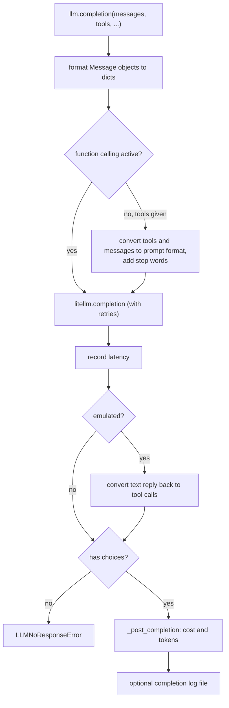

## Overview

Every model call in OpenHands, from the agent, a condenser, the LLM security analyzer or the conversation title generator, goes through the `LLM` class. It wraps LiteLLM's `completion` so that any provider LiteLLM supports can be used with one configuration object, and adds what OpenHands needs on top: provider-specific parameter fixes, retries, tool-call emulation for models without native function calling, cost and token accounting, and optional logging of every prompt and response.

Sources: [openhands/llm/llm.py:54-81](repo://openhands/llm/llm.py#L54-L81), [openhands/llm/llm.py:410-415](repo://openhands/llm/llm.py#L410-L415)

An `LLM` is built from an `LLMConfig` and a `service_id` naming its user (for example `agent` or `condenser`). Instances are normally created and shared by the [[LLM Registry and Routing]], which also aggregates their metrics; [[Function Calling Emulation]] covers the conversion used for non-native tool calling.

Sources: [openhands/llm/llm.py:61-81](repo://openhands/llm/llm.py#L61-L81)

## Setting up a model

### Model information

`init_model_info` looks up the model's metadata once: from the LiteLLM proxy's `/v1/model/info` endpoint for `litellm_proxy/` models, from OpenRouter, or from LiteLLM's own table using the name before a `:` or after the last `/`. From that metadata it fills `max_input_tokens` and `max_output_tokens` when the config leaves them unset (Claude 3.7 Sonnet is capped at 64,000 output tokens), and lowers the default `top_p` for Hugging Face models.

Sources: [openhands/llm/llm.py:417-519](repo://openhands/llm/llm.py#L417-L519)

### Model features

`get_features(model)` answers four capability questions from glob pattern tables, matched against the model's base name (provider prefix, Ollama `:tag` and `-gguf` suffix removed) or, for patterns containing `/`, against the full name.

Sources: [openhands/llm/model_features.py:7-51](repo://openhands/llm/model_features.py#L7-L51), [openhands/llm/model_features.py:131-139](repo://openhands/llm/model_features.py#L131-L139)

| Feature | Examples of matching models | Effect |
| --- | --- | --- |
| `supports_function_calling` | `claude-sonnet-4*`, `claude-opus-4*`, `gpt-4o*`, `gpt-5*`, `o3*`, `gemini-2.5-pro*`, `qwen3-coder*` | native tool calls; otherwise emulation |
| `supports_reasoning_effort` | `o1`, `o3`, `o4-mini`, `gpt-5*`, `gemini-2.5-*`, `deepseek-r1-0528*` | sends `reasoning_effort`, drops `temperature` and `top_p` |
| `supports_prompt_cache` | Claude 3.5, 3.7, Sonnet 4, Opus 4 families | enables cache breakpoints |
| `supports_stop_words` | everything except `o1*`, `grok-4-0709`, `grok-code-fast-1`, `deepseek-r1-0528*` | stop words for emulated tool calls |

Sources: [openhands/llm/model_features.py:54-128](repo://openhands/llm/model_features.py#L54-L128)

`is_function_calling_active` uses the feature table unless `native_tool_calling` is set in the config, which overrides it in either direction. `vision_is_active` is true unless `disable_vision` is set and LiteLLM or the model info reports vision support; `OPENHANDS_FORCE_VISION` forces it on. `is_caching_prompt_active` requires both `caching_prompt` and a prompt-cache model.

Sources: [openhands/llm/llm.py:521-581](repo://openhands/llm/llm.py#L521-L581)

### Completion parameters

The constructor binds the fixed arguments into a `partial` of `litellm.completion`: model, API key, base URL, API version, provider, timeout, `drop_params`, seed, temperature, `max_completion_tokens`, `top_k` and `top_p`, and AWS credentials for Bedrock. It then applies provider rules:

Sources: [openhands/llm/llm.py:196-209](repo://openhands/llm/llm.py#L196-L209)

- a model named `openhands/<name>` becomes `litellm_proxy/<name>` against the All Hands LLM proxy;
- reasoning models get `reasoning_effort` instead of temperature and `top_p`; Gemini 2.5 Pro maps a low or unset effort to a 128-token thinking budget;
- Azure models get `max_tokens` instead of `max_completion_tokens`;
- Mistral and Gemini models get the configured `safety_settings`;
- Claude Opus 4.1 has extended thinking disabled and never receives both `temperature` and `top_p`.

Sources: [openhands/llm/llm.py:110-209](repo://openhands/llm/llm.py#L110-L209)

## One completion call

### The wrapper

Sources: [openhands/llm/llm.py:219-327](repo://openhands/llm/llm.py#L219-L327), [openhands/llm/llm.py:328-408](repo://openhands/llm/llm.py#L328-L408)

The wrapper accepts messages as dictionaries or `Message` objects (the latter serialized by `format_messages_for_llm`, see [[Conversation Memory and Prompts]]). When the model lacks native tool calling and tools were passed, it converts tools and messages to a text format, adds stop words if the model supports them, and removes `tools` from the request; the reply is converted back so callers always see `tool_calls`. `extra_body` is only forwarded to LiteLLM proxy models. LiteLLM's global `modify_params` is set from the config before each call.

Sources: [openhands/llm/llm.py:219-327](repo://openhands/llm/llm.py#L219-L327), [openhands/llm/llm.py:333-357](repo://openhands/llm/llm.py#L333-L357)

A response without choices, which some Gemini responses produce, raises `LLMNoResponseError` so it can be retried.

Sources: [openhands/llm/llm.py:359-364](repo://openhands/llm/llm.py#L359-L364)

### Retries

The wrapper is decorated by `RetryMixin.retry_decorator` with tenacity. It retries only `APIConnectionError`, `RateLimitError`, `ServiceUnavailableError`, timeouts, `InternalServerError` and `LLMNoResponseError`, up to `num_retries` attempts (default 5), with exponential backoff from `retry_multiplier`, `retry_min_wait` and `retry_max_wait` (defaults 8, 8 and 64 seconds), and stops early when the process is shutting down.

Sources: [openhands/llm/llm.py:43-50](repo://openhands/llm/llm.py#L43-L50), [openhands/llm/llm.py:211-218](repo://openhands/llm/llm.py#L211-L218), [openhands/llm/retry_mixin.py:18-69](repo://openhands/llm/retry_mixin.py#L18-L69), [openhands/core/config/llm_config.py:62-65](repo://openhands/core/config/llm_config.py#L62-L65)

Before each wait the mixin logs the attempt, records `retry_attempt` and `max_retries` on the exception, and calls the optional `retry_listener` with the attempt number; the web session uses this to tell the user the LLM is being retried. When the error is `LLMNoResponseError` at temperature 0, the next attempt runs at temperature 1.0, since an identical request would likely fail the same way. The [[Agent Controller]] uses the recorded attempt numbers to show `RATE_LIMITED` during retries and `ERROR` after the last one.

Sources: [openhands/llm/retry_mixin.py:35-55](repo://openhands/llm/retry_mixin.py#L35-L55), [openhands/llm/retry_mixin.py:71-100](repo://openhands/llm/retry_mixin.py#L71-L100), [openhands/controller/agent_controller.py:337-350](repo://openhands/controller/agent_controller.py#L337-L350)

## Cost and token accounting

### Post-processing a response

`_post_completion` computes the call's cost and records token usage. The cost comes, in order, from the `x-litellm-response-cost` header a LiteLLM proxy returns, from `litellm.completion_cost`, or from `completion_cost` retried with the provider prefix stripped; `input_cost_per_token` and `output_cost_per_token` in the config override LiteLLM's prices. If none works, cost tracking is switched off for that LLM. Token usage records prompt and completion tokens, cache reads (`cached_tokens`), cache writes (Anthropic's `cache_creation_input_tokens`) and the model's context window, keyed by response id.

Sources: [openhands/llm/llm.py:583-666](repo://openhands/llm/llm.py#L583-L666), [openhands/llm/llm.py:733-791](repo://openhands/llm/llm.py#L733-L791)

### Metrics

`Metrics` keeps an accumulated cost, the list of individual costs, response latencies, per-call `TokenUsage` records and an accumulated `TokenUsage`, plus the task budget. `merge` adds another metrics object into this one; `diff(baseline)` returns only what was added after a snapshot, which is how a delegate's own spending is computed; `get` returns a dictionary for serialization into events.

Sources: [openhands/llm/metrics.py:21-72](repo://openhands/llm/metrics.py#L21-L72), [openhands/llm/metrics.py:130-198](repo://openhands/llm/metrics.py#L130-L198), [openhands/llm/metrics.py:223-250](repo://openhands/llm/metrics.py#L223-L250)

`get_token_count(messages)` counts tokens with LiteLLM's tokenizer for the model, or with the Hugging Face tokenizer named in `custom_tokenizer`, and returns 0 when counting is not supported.

Sources: [openhands/llm/llm.py:668-716](repo://openhands/llm/llm.py#L668-L716)

## Logging

`DebugMixin` writes each prompt and response to dedicated prompt and response loggers when debug logging is enabled. Separately, `log_completions = true` writes one JSON file per call to `log_completions_folder` with the messages, response, arguments, timestamp and cost; for emulated tool calling it stores both the text form actually sent and the tool-call form the agent saw. Evaluation runs use these files to inspect raw completions.

Sources: [openhands/llm/debug_mixin.py:14-49](repo://openhands/llm/debug_mixin.py#L14-L49), [openhands/llm/llm.py:370-405](repo://openhands/llm/llm.py#L370-L405)

## Async and streaming variants

`AsyncLLM` adds `async_completion`, built on `litellm.acompletion` with the same retry decorator, logging and cost accounting. While a request runs, a background task polls `on_cancel_requested_fn` on the config every 0.1 seconds so a caller can cancel a request in flight. `StreamingLLM` extends it with `async_streaming_completion`, the same call with `stream=True`. Neither variant performs tool-call emulation.

Sources: [openhands/llm/async_llm.py:17-130](repo://openhands/llm/async_llm.py#L17-L130), [openhands/llm/streaming_llm.py:11-60](repo://openhands/llm/streaming_llm.py#L11-L60)

## Bedrock helpers

`list_foundation_models` lists the AWS Bedrock text models available on demand, prefixed with `bedrock/`, and returns an empty list with a warning when AWS credentials are missing; `remove_error_modelId` drops Bedrock entries from a model list.

Sources: [openhands/llm/bedrock.py:6-32](repo://openhands/llm/bedrock.py#L6-L32)
