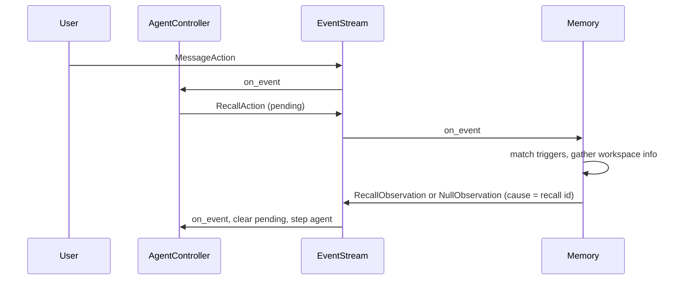

## Overview

Microagents are Markdown files that give the agent knowledge it would not otherwise have: how a particular repository is built and tested, how to use the GitHub API, or the steps of a recurring workflow. They are not separate programs; their text is injected into the conversation as context. Some are always active for a repository, some fire when a keyword appears in a message, and some are invoked like commands with inputs.

Sources: [microagents/README.md:1-4](repo://microagents/README.md#L1-L4), [openhands/microagent/types.py:11-16](repo://openhands/microagent/types.py#L11-L16)

The `Memory` component holds the loaded microagents and answers the agent controller's `RecallAction`s with `RecallObservation`s. This page covers loading and matching; how a recall observation is rendered into the prompt is on [[Conversation Memory and Prompts]].

Sources: [openhands/memory/memory.py:41-84](repo://openhands/memory/memory.py#L41-L84)

## File format

### Frontmatter

A microagent file is Markdown with optional YAML frontmatter, parsed into `MicroagentMetadata`: `name`, `type`, `version`, `agent` (default `CodeActAgent`), `triggers`, `inputs` (each with `name` and `description`) and `mcp_tools`, an MCP configuration that the microagent contributes.

Sources: [openhands/microagent/types.py:19-37](repo://openhands/microagent/types.py#L19-L37)

```markdown
---
name: github
type: knowledge
version: 1.0.0
agent: CodeActAgent
triggers:
- github
- git
---

You have access to an environment variable, `GITHUB_TOKEN`, which allows you to interact with
the GitHub API.
```

Sources: [microagents/github.md:1-12](repo://microagents/github.md#L1-L12)

### Types

The type is inferred from the metadata, not taken from the `type` field: a microagent with `inputs` is a task microagent, one with `triggers` is a knowledge microagent, and one with neither is a repository microagent. An invalid `type` value still fails validation, with a message listing the valid values.

Sources: [openhands/microagent/microagent.py:119-171](repo://openhands/microagent/microagent.py#L119-L171)

| Type | Class | Active when |
| --- | --- | --- |
| `repo` | `RepoMicroagent` | always, for the repository it is loaded from |
| `knowledge` | `KnowledgeMicroagent` | a trigger word appears in a message (case-insensitive substring) |
| `task` | `TaskMicroagent` | the user types `/<name>`, which is added as a trigger automatically |

Sources: [openhands/microagent/microagent.py:174-274](repo://openhands/microagent/microagent.py#L174-L274)

### Task inputs

A task microagent declares its inputs in the frontmatter and refers to them in its text as `${name}` variables. When it has inputs or variables, a sentence is appended telling the agent to ask the user for any value they did not provide before proceeding.

Sources: [openhands/microagent/microagent.py:226-274](repo://openhands/microagent/microagent.py#L226-L274), [microagents/add_repo_inst.md:1-14](repo://microagents/add_repo_inst.md#L1-L14)

### Special files

`BaseMicroagent.load` also accepts files from other tools as repository microagents: `.cursorrules` (named `cursorrules`), `AGENTS.md` or `agent.md` (named `agents`), and the legacy `.openhands_instructions` file (named `repo_legacy`). A microagent's name is its path relative to the microagents directory without the `.md` suffix, so `.openhands/microagents/testing/unit.md` is `testing/unit`.

Sources: [openhands/microagent/microagent.py:26-91](repo://openhands/microagent/microagent.py#L26-L91)

A microagent with `mcp_tools` must declare at least one stdio server; SSE servers only log a warning. The [[MCP Integration]] page shows how these servers join the agent's tools.

Sources: [openhands/microagent/microagent.py:104-118](repo://openhands/microagent/microagent.py#L104-L118), [openhands/memory/memory.py:302-318](repo://openhands/memory/memory.py#L302-L318)

## Where microagents come from

### Loading a directory

`load_microagents_from_dir(dir)` loads every `.md` file under the directory recursively, except `README.md`. It also looks two levels up, at the repository root that contains `.openhands/microagents`, for `.cursorrules` and the first of `AGENTS.md`, `agents.md`, `AGENT.md`, `agent.md`. It returns repository microagents and knowledge microagents (task microagents included) as two name-keyed dictionaries, and raises on the first file that fails to load.

Sources: [openhands/microagent/microagent.py:277-341](repo://openhands/microagent/microagent.py#L277-L341)

### Sources in load order

| Source | Location | Loaded by |
| --- | --- | --- |
| Global | `microagents/` in the OpenHands installation | `Memory.__init__` |
| User | `~/.openhands/microagents/` (created if missing) | `Memory.__init__` |
| Organization | `<org>/.openhands` repository (`<org>/openhands-config` on GitLab), its `microagents/` folder | `Runtime.get_microagents_from_org_or_user` |
| Repository | `.openhands/microagents/` in the selected repository, plus `.openhands_instructions` | `Runtime.get_microagents_from_selected_repo` |

Sources: [openhands/memory/memory.py:33-38](repo://openhands/memory/memory.py#L33-L38), [openhands/memory/memory.py:270-300](repo://openhands/memory/memory.py#L270-L300), [openhands/runtime/base.py:666-720](repo://openhands/runtime/base.py#L666-L720), [openhands/runtime/base.py:823-885](repo://openhands/runtime/base.py#L823-L885)

Global and user microagents are read from the host when `Memory` is created. Organization and repository microagents live in the sandbox, so the runtime lists the directory there, copies it out as a zip, extracts it to a temporary folder and loads it with the same function. The organization repository is shallow-cloned with the user's git credentials. `create_memory` and the server's agent session pass the result to `Memory.load_user_workspace_microagents`. Later sources replace earlier ones with the same name.

Sources: [openhands/runtime/base.py:586-640](repo://openhands/runtime/base.py#L586-L640), [openhands/core/setup.py:186-197](repo://openhands/core/setup.py#L186-L197), [openhands/memory/memory.py:254-268](repo://openhands/memory/memory.py#L254-L268)

## Answering recalls

### The recall flow



Sources: [openhands/controller/agent_controller.py:560-578](repo://openhands/controller/agent_controller.py#L560-L578), [openhands/memory/memory.py:86-137](repo://openhands/memory/memory.py#L86-L137)

For every user message the [[Agent Controller]] posts a `RecallAction` with the message text as query, and waits for it. `Memory` always answers with an event whose `cause` is the recall's id, a `NullObservation` when there is nothing to add, because the controller does not step until its pending action is answered. Errors are reported through the status callback as `ERROR_MEMORY`.

Sources: [openhands/memory/memory.py:90-137](repo://openhands/memory/memory.py#L90-L137)

### Workspace context

The first user message triggers a `WORKSPACE_CONTEXT` recall. Memory concatenates the content of every repository microagent into `repo_instructions` and adds the knowledge microagents triggered by the message. It also adds what the session set up front: repository name, directory and branch (`set_repository_info`); the runtime's web hosts, extra agent instructions, today's date, custom-secret descriptions and working directory (`set_runtime_info`); and conversation instructions (`set_conversation_instructions`).

Sources: [openhands/memory/memory.py:139-205](repo://openhands/memory/memory.py#L139-L205), [openhands/memory/memory.py:320-365](repo://openhands/memory/memory.py#L320-L365)

### Knowledge

Later messages, from the user or the agent, trigger a `KNOWLEDGE` recall that carries only the triggered microagents as `MicroagentKnowledge` items (name, matched trigger, content). Conversation memory renders a knowledge microagent only the first time it appears, so a trigger word repeated in later messages does not duplicate the text in the prompt. Agents can switch microagents off by name with `disabled_microagents`, and switch the whole mechanism off with `enable_prompt_extensions = false`.

Sources: [openhands/memory/memory.py:207-252](repo://openhands/memory/memory.py#L207-L252), [openhands/events/observation/agent.py:47-60](repo://openhands/events/observation/agent.py#L47-L60), [openhands/memory/conversation_memory.py:611-661](repo://openhands/memory/conversation_memory.py#L611-L661)

## Built-in microagents

The repository's `microagents/` folder ships knowledge microagents for tools and platforms such as `github`, `gitlab`, `bitbucket`, `docker`, `kubernetes`, `npm` and `ssh`, and task microagents such as `add_repo_inst`, which asks the agent to write a `.openhands/microagents/repo.md` for the current repository, and `address_pr_comments`.

Sources: [microagents/github.md:1-8](repo://microagents/github.md#L1-L8), [microagents/add_repo_inst.md:1-16](repo://microagents/add_repo_inst.md#L1-L16), [microagents/README.md:5-45](repo://microagents/README.md#L5-L45)
