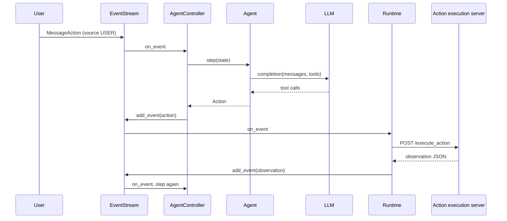

## Overview

OpenHands is a platform for AI software-development agents: an agent reads a task, asks a large language model what to do next, and carries out the answer by running shell commands, editing files, executing Python and browsing the web inside a sandbox. The same core runs behind a web application, an interactive terminal client, a headless one-shot mode used by benchmarks, and a GitHub issue resolver.

Sources: [README.md:38-44](repo://README.md#L38-L44)

The core is built from a handful of classes. An `Agent` looks at the current `State` and produces the next `Action`; the `AgentController` drives the agent step by step; the `EventStream` is the hub where every component publishes and listens for events; the `Runtime` performs actions and returns observations; and the server holds one session per conversation, routed by a `ConversationManager`.

Sources: [openhands/README.md:10-24](repo://openhands/README.md#L10-L24)

## Parts of the system

| Area | What it does | Page |
| --- | --- | --- |
| Events | Actions (what someone wants done) and observations (what happened), with their JSON form | [[Events, Actions and Observations]] |
| Event stream | Orders, persists and delivers every event to its subscribers | [[Event Stream]] |
| Controller | Decides when the agent steps, enforces limits, handles errors and delegation | [[Agent Controller]], [[Stuck Detection]] |
| Agents | Pluggable agent classes; the default CodeAct agent calls tools through the LLM | [[Agents]], [[CodeAct Agent]] |
| Memory | Turns history into prompts, shrinks it to fit the context window, injects microagent knowledge | [[Conversation Memory and Prompts]], [[Context Condensers]], [[Microagents]] |
| LLM layer | LiteLLM wrapper with retries, cost tracking, tool-call emulation and model routing | [[LLM Client]], [[Function Calling Emulation]], [[LLM Registry and Routing]] |
| Runtime | Runs actions in a sandbox through an HTTP action server; Docker, remote, local, Kubernetes and CLI backends | [[Runtime Architecture]], [[Action Execution Server]], [[Runtime Implementations]] |
| Sandbox tools | Shell, Jupyter, VS Code, browser and MCP tools inside the sandbox | [[Shell Sessions]], [[Runtime Plugins]], [[Browser Environment]], [[MCP Integration]] |
| Safety | Risk analysis of actions and user confirmation | [[Security Analyzers and Confirmation Mode]] |
| Server | FastAPI REST API, Socket.IO channel, conversation lifecycle, storage, auth | [[Server Application and REST API]], [[Sessions and Socket.IO]], [[Conversation Managers]], [[Storage]], [[Settings, Secrets and User Auth]] |
| Git providers | GitHub, GitLab and Bitbucket APIs and token handling | [[Git Provider Integrations]] |
| Clients | Headless runner, terminal client, VS Code extension, React web app | [[Headless Mode]], [[CLI]], [[VS Code Integration]], [[Web Frontend]] |
| Automation | Issue resolver, benchmark harness, OpenHands Cloud server | [[Issue Resolver]], [[Evaluation Harness]], [[Enterprise Server]], [[Enterprise Integrations]] |

Sources: [openhands/core/setup.py:35-89](repo://openhands/core/setup.py#L35-L89), [openhands/server/app.py:75-86](repo://openhands/server/app.py#L75-L86)

## The main flow

Every client builds the same objects and then lets events drive them. The headless runner shows the whole chain in one function: `run_controller` creates the LLM registry, the agent, the runtime (which owns the event stream), the memory and the controller, posts the user's task as a `MessageAction`, and waits until the agent reaches an end state.

Sources: [openhands/core/main.py:97-216](repo://openhands/core/main.py#L97-L216)

Sources: [openhands/controller/agent_controller.py:821-880](repo://openhands/controller/agent_controller.py#L821-L880), [openhands/runtime/base.py:320-398](repo://openhands/runtime/base.py#L320-L398), [openhands/runtime/impl/action_execution/action_execution_client.py:300-340](repo://openhands/runtime/impl/action_execution/action_execution_client.py#L300-L340)

1. The user's message enters the [[Event Stream]], which stamps it with an id, timestamp and source, writes it to storage and hands it to every subscriber.
2. The [[Agent Controller]] receives it in `on_event`; `should_step` returns true for a user message or for any observation, so the controller calls `_step`, which first checks [[Stuck Detection]] and the iteration and budget limits.
3. The agent's `step` (see [[CodeAct Agent]]) condenses the history with a condenser from [[Context Condensers]], builds messages through [[Conversation Memory and Prompts]], and calls the model through the [[LLM Client]].
4. The returned tool calls become actions, which the controller adds to the stream; confirmation mode and risk checks from [[Security Analyzers and Confirmation Mode]] may hold them back.
5. The runtime subscriber picks up each action in `on_event`, and an action-execution runtime posts it to `/execute_action` on the [[Action Execution Server]] inside the sandbox.
6. The resulting observation is linked to its action through `cause` and the tool call metadata, added to the stream, and wakes the controller for the next step.

Sources: [openhands/events/stream.py:163-197](repo://openhands/events/stream.py#L163-L197), [openhands/controller/agent_controller.py:392-432](repo://openhands/controller/agent_controller.py#L392-L432), [openhands/agenthub/codeact_agent/codeact_agent.py:160-221](repo://openhands/agenthub/codeact_agent/codeact_agent.py#L160-L221)

## Design decisions

### Everything is an event on one stream

Components never call each other to exchange work: the controller, the runtime, the memory and the server all subscribe to the same `EventStream` and talk by adding events to it. This keeps one ordered, persisted record of the conversation, so a session can be restored, replayed or shown to a reconnecting browser from the stored events. The runtime, for example, only reacts to `Action` events and answers by adding an observation.

Sources: [openhands/README.md:39-51](repo://openhands/README.md#L39-L51), [openhands/runtime/base.py:320-323](repo://openhands/runtime/base.py#L320-L323), [openhands/runtime/base.py:390-398](repo://openhands/runtime/base.py#L390-L398)

### Execution happens behind an HTTP boundary

The agent's commands never run in the server process. Runtimes based on `ActionExecutionClient` serialize each action with `event_to_dict` and POST it to an action server running in the sandbox, then rebuild the observation with `observation_from_dict`. The same client therefore drives a Docker container, a remote sandbox, a Kubernetes pod or a local process, and a sandbox crash surfaces as a runtime error status rather than taking the server down.

Sources: [openhands/runtime/impl/action_execution/action_execution_client.py:315-340](repo://openhands/runtime/impl/action_execution/action_execution_client.py#L315-L340), [openhands/runtime/base.py:361-389](repo://openhands/runtime/base.py#L361-L389)

### Registries make the parts pluggable

Agents, runtimes and condensers are looked up by name or configuration type instead of being imported directly. Each agent package registers itself with `Agent.register`, the runtime factory maps names such as `docker` or `remote` to classes and also discovers third-party runtimes, and condenser classes register against their config type. A configuration file can therefore switch any of them without code changes.

Sources: [openhands/agenthub/codeact_agent/__init__.py:1-4](repo://openhands/agenthub/codeact_agent/__init__.py#L1-L4), [openhands/controller/agent.py:120-150](repo://openhands/controller/agent.py#L120-L150), [openhands/runtime/__init__.py:14-103](repo://openhands/runtime/__init__.py#L14-L103), [openhands/memory/condenser/condenser.py:129-165](repo://openhands/memory/condenser/condenser.py#L129-L165)

### Server components are replaced by class path

The server builds its conversation manager, stores, user authentication and monitoring listener from fully qualified class names in `ServerConfig`, resolved by `get_impl`, which checks that the class subclasses the expected base. Setting `OPENHANDS_CONFIG_CLS` swaps in a different server config, which is how the [[Enterprise Server]] adds database-backed stores and cloud authentication on top of the same OSS code.

Sources: [openhands/server/config/server_config.py:8-60](repo://openhands/server/config/server_config.py#L8-L60), [openhands/utils/import_utils.py:33-73](repo://openhands/utils/import_utils.py#L33-L73), [openhands/server/shared.py:55-77](repo://openhands/server/shared.py#L55-L77)

## Where to start

Run the project with [[Quickstart]], and set the model, agent and sandbox in [[Configuration]]. To follow a single task without the web stack, read [[Headless Mode]], which uses the same setup functions as the server's [[Sessions and Socket.IO]].

Sources: [openhands/core/setup.py:202-243](repo://openhands/core/setup.py#L202-L243)
