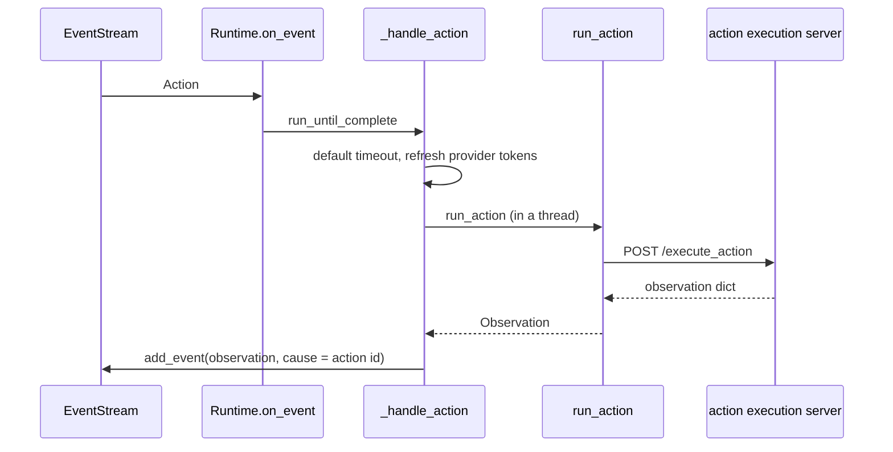

## Overview

The runtime is where the agent's actions happen: it runs shell commands and Python cells, reads and edits files, drives the browser and calls MCP tools, and turns each result into an observation. The `Runtime` base class defines this interface and the work every backend shares, such as executing actions from the event stream, injecting environment variables and secrets, cloning the repository and loading its microagents. Concrete backends decide where the sandbox lives.

Sources: [openhands/runtime/base.py:90-126](repo://openhands/runtime/base.py#L90-L126), [openhands/runtime/README.md:9-24](repo://openhands/runtime/README.md#L9-L24)

Most backends do not execute anything themselves. They start an action execution server inside a container, pod or process, and the `ActionExecutionClient` sends every action to it over HTTP. The server side is on [[Action Execution Server]]; the backends are on [[Runtime Implementations]].

Sources: [openhands/runtime/impl/action_execution/action_execution_client.py:61-100](repo://openhands/runtime/impl/action_execution/action_execution_client.py#L61-L100), [openhands/runtime/README.md:26-48](repo://openhands/runtime/README.md#L26-L48)

## Choosing a runtime

`config.runtime` names the backend. `get_runtime_cls` maps the built-in names to classes, adds third-party runtimes discovered as packages under `third_party.runtime.impl` (class `<NAME>Runtime` or `<Name>Runtime` in `<name>_runtime.py`, silently skipped when their library is not installed), and otherwise treats the name as a fully qualified class path that must subclass `Runtime`.

Sources: [openhands/runtime/__init__.py:14-103](repo://openhands/runtime/__init__.py#L14-L103)

| Name | Class |
| --- | --- |
| `docker` (also `eventstream`) | `DockerRuntime` |
| `remote` | `RemoteRuntime` |
| `local` | `LocalRuntime` |
| `kubernetes` | `KubernetesRuntime` |
| `cli` | `CLIRuntime` |

Sources: [openhands/runtime/__init__.py:14-21](repo://openhands/runtime/__init__.py#L14-L21)

## Lifecycle

### Construction

`create_runtime` in headless mode, and the server's agent session, build the runtime with the config, the conversation's event stream, the LLM registry, the session id, the agent class's sandbox plugins and the user's git provider tokens. Outside headless mode the VS Code plugin is added to the plugins.

Sources: [openhands/core/setup.py:35-89](repo://openhands/core/setup.py#L35-L89), [openhands/runtime/base.py:128-160](repo://openhands/runtime/base.py#L128-L160)

The constructor subscribes the runtime to the [[Event Stream]] as `runtime`, collects initial environment variables (every host variable named `SANDBOX_ENV_<NAME>` becomes `<NAME>`, `ENABLE_AUTO_LINT` when auto-lint is on, and the git provider tokens), sets up the LLM-based file editor, and instantiates the configured security analyzer.

Sources: [openhands/runtime/base.py:79-88](repo://openhands/runtime/base.py#L79-L88), [openhands/runtime/base.py:160-205](repo://openhands/runtime/base.py#L160-L205)

### Connecting and setting up

`connect()` is abstract: each backend starts or attaches to its sandbox there and waits until it responds. After connecting, `setup_initial_env` exports the initial and `runtime_startup_env_vars` variables and sets the git user name and email (skipped for the CLI runtime, which keeps the user's own git settings). Attaching to an existing sandbox skips this setup.

Sources: [openhands/runtime/base.py:207-219](repo://openhands/runtime/base.py#L207-L219), [openhands/runtime/base.py:985-1023](repo://openhands/runtime/base.py#L985-L1023)

`add_env_vars` sets variables in every shell the agent may use: in the IPython kernel when Jupyter is installed, with `$env:` assignments on Windows, and otherwise with `export` in the current bash session plus a line in `~/.bashrc` so new shells see them too.

Sources: [openhands/runtime/base.py:245-318](repo://openhands/runtime/base.py#L245-L318)

`RuntimeStatus` values (`BUILDING_RUNTIME`, `STARTING_RUNTIME`, `SETTING_UP_WORKSPACE`, `READY`, the `ERROR_*` family and others) are reported through `set_runtime_status` to the session's status callback, which shows them in the UI.

Sources: [openhands/runtime/runtime_status.py:4-24](repo://openhands/runtime/runtime_status.py#L4-L24), [openhands/runtime/base.py:235-243](repo://openhands/runtime/base.py#L235-L243)

## Executing actions

### From the stream

Sources: [openhands/runtime/base.py:320-398](repo://openhands/runtime/base.py#L320-L398)

`on_event` reacts only to actions. `_handle_action` gives an action without a timeout the sandbox's default (`sandbox.timeout`, 120 seconds) without making it blocking. If a shell command mentions a git provider token variable, it first fetches fresh tokens and re-exports them, registering them as secrets for masking. MCP actions go to `call_tool_mcp`; everything else runs `run_action` in a worker thread.

Sources: [openhands/runtime/base.py:324-372](repo://openhands/runtime/base.py#L324-L372)

The resulting observation gets the action's id as `cause` and the action's tool call metadata, and is added to the stream; null observations are dropped. Failures become observations or statuses: a `PermissionError` becomes an `ErrorObservation` the agent sees, a network error or `AgentRuntimeDisconnectedError` sets `ERROR_RUNTIME_DISCONNECTED`, and any other exception sets `ERROR`.

Sources: [openhands/runtime/base.py:366-398](repo://openhands/runtime/base.py#L366-L398)

### Dispatch in run_action

`run_action` maps the action's type string to a method of the same name: `run`, `run_ipython`, `read`, `write`, `edit`, `browse`, `browse_interactive`. Before dispatching it handles the special cases:

Sources: [openhands/runtime/base.py:957-976](repo://openhands/runtime/base.py#L957-L976)

| Case | Result |
| --- | --- |
| `AgentThinkAction` | `AgentThinkObservation('Your thought has been logged.')` |
| `TaskTrackingAction` `plan` | writes the list to `TASKS.md` in the conversation directory |
| `TaskTrackingAction` `view` | reads `TASKS.md` back |
| other non-runnable actions | `NullObservation` |
| awaiting confirmation | `NullObservation`; nothing runs yet |
| rejected by the user | `UserRejectObservation` |
| unknown type or method not implemented | `ErrorObservation` |

Sources: [openhands/runtime/base.py:890-976](repo://openhands/runtime/base.py#L890-L976)

## The HTTP client

### ActionExecutionClient

`ActionExecutionClient` implements every action method by calling `send_action_for_execution`. That method routes LLM-based edits to the local `llm_based_edit` mixin, fails a blocking command that has no timeout, and then, holding a semaphore that allows one action at a time, repeats the confirmation and support checks and POSTs `{"action": event_to_dict(action)}` to `/execute_action`. The HTTP timeout is the action's timeout plus five seconds, so the server's own timeout message arrives first; an HTTP timeout raises `AgentRuntimeTimeoutError`.

Sources: [openhands/runtime/impl/action_execution/action_execution_client.py:272-358](repo://openhands/runtime/impl/action_execution/action_execution_client.py#L272-L358)

### Requests and retries

Requests go through `send_request`, which raises `RequestHTTPError` with the server's `detail` on an HTTP error and retries 429 responses up to three times. The client retries protocol errors from a dropped connection up to five times with backoff.

Sources: [openhands/runtime/utils/request.py:11-60](repo://openhands/runtime/utils/request.py#L11-L60), [openhands/runtime/impl/action_execution/action_execution_client.py:54-129](repo://openhands/runtime/impl/action_execution/action_execution_client.py#L54-L129)

### Other endpoints

| Method | Endpoint |
| --- | --- |
| `check_if_alive` | `GET /alive` |
| `list_files(path)` | `POST /list_files` |
| `copy_from(path)` | `GET /download_files`, streamed to a local zip |
| `copy_to(src, dest, recursive)` | `POST /upload_file`, zipping directories |
| `get_vscode_token` | `GET /vscode/connection_token` |

Sources: [openhands/runtime/impl/action_execution/action_execution_client.py:131-200](repo://openhands/runtime/impl/action_execution/action_execution_client.py#L131-L200), [openhands/runtime/impl/action_execution/action_execution_client.py:201-270](repo://openhands/runtime/impl/action_execution/action_execution_client.py#L201-L270)

## Workspace preparation

### Repository

`clone_or_init_repo` clones the selected repository with an authenticated URL from the provider handler into a folder named after it, and checks out the requested branch or a new `openhands-workspace-<random>` branch. With no repository selected, it runs `git init` in the workspace only when `init_git_in_empty_workspace` is set.

Sources: [openhands/runtime/base.py:401-461](repo://openhands/runtime/base.py#L401-L461)

### Setup script and hooks

If `.openhands/setup.sh` exists, `maybe_run_setup_script` sources it as a hidden, blocking command with a ten-minute limit, recorded in the stream as an environment event. If `.openhands/pre-commit.sh` exists, `maybe_setup_git_hooks` installs a git pre-commit hook that runs it, moving any existing hook that OpenHands did not install to `pre-commit.local`.

Sources: [openhands/runtime/base.py:463-489](repo://openhands/runtime/base.py#L463-L489), [openhands/runtime/base.py:495-584](repo://openhands/runtime/base.py#L495-L584)

### Microagents and git state

`get_microagents_from_selected_repo` loads the organization's and repository's microagents from the sandbox (see [[Microagents]]). `get_git_changes`, `get_git_diff` and `get_workspace_branch` run git through a `GitHandler` with hidden commands, which the server's file and git routes use to show changes.

Sources: [openhands/runtime/base.py:823-888](repo://openhands/runtime/base.py#L823-L888), [openhands/runtime/base.py:1115-1170](repo://openhands/runtime/base.py#L1115-L1170)

## Extension points

A backend subclasses `Runtime` or, more often, `ActionExecutionClient`. It implements `connect`, `action_execution_server_url`, `get_mcp_config` and `close`, and may override `vscode_url`, `web_hosts` (ports the agent's web apps can use, shown in the prompt), `additional_agent_instructions`, the class-level `setup` and `teardown` hooks, and `delete` for removing a conversation's sandbox.

Sources: [openhands/runtime/base.py:221-230](repo://openhands/runtime/base.py#L221-L230), [openhands/runtime/base.py:1100-1197](repo://openhands/runtime/base.py#L1100-L1197), [openhands/runtime/impl/action_execution/action_execution_client.py:101-104](repo://openhands/runtime/impl/action_execution/action_execution_client.py#L101-L104)
