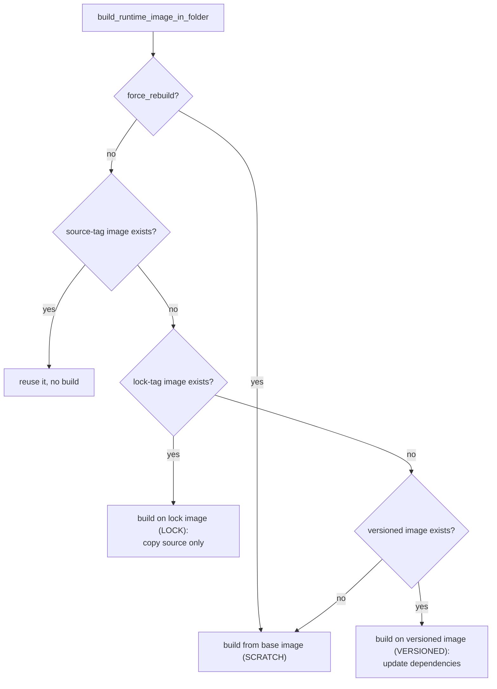

## Overview

A sandbox needs more than an operating system: it must contain the OpenHands source that runs the [[Action Execution Server]], its Python dependencies, a Jupyter kernel, a headless browser and a VS Code server. OpenHands therefore does not run the user's chosen image directly. It builds a runtime image on top of it, and caches that image under tags derived from the inputs, so a rebuild happens only when something relevant changed.

Sources: [openhands/runtime/utils/runtime_build.py:108-165](repo://openhands/runtime/utils/runtime_build.py#L108-L165), [containers/runtime/README.md:1-12](repo://containers/runtime/README.md#L1-L12)

The sandbox config offers two ways in. `runtime_container_image` names a ready runtime image, which is used as is. `base_container_image` names any image (by default the Python and Node.js image `nikolaik/python-nodejs:python3.12-nodejs22`), from which the Docker and remote runtimes build a runtime image at connect time; with neither set, startup fails.

Sources: [openhands/core/config/sandbox_config.py:55-58](repo://openhands/core/config/sandbox_config.py#L55-L58), [openhands/runtime/impl/docker/docker_runtime.py:233-249](repo://openhands/runtime/impl/docker/docker_runtime.py#L233-L249), [openhands/runtime/utils/runtime_build.py:389-395](repo://openhands/runtime/utils/runtime_build.py#L389-L395)

## Image names and tags

### Repository

Runtime images live in one repository, `ghcr.io/all-hands-ai/runtime` unless `OH_RUNTIME_RUNTIME_IMAGE_REPO` overrides it; the remote runtime sets it to the registry its API reports. If the base image already belongs to that repository, it is taken to be a runtime image and reused with its own tag.

Sources: [openhands/runtime/utils/runtime_build.py:27-28](repo://openhands/runtime/utils/runtime_build.py#L27-L28), [openhands/runtime/utils/runtime_build.py:65-105](repo://openhands/runtime/utils/runtime_build.py#L65-L105), [openhands/runtime/impl/remote/remote_runtime.py:224-237](repo://openhands/runtime/impl/remote/remote_runtime.py#L224-L237)

### Three tags

Every build computes three tags, each more specific than the last:

Sources: [openhands/runtime/utils/runtime_build.py:179-187](repo://openhands/runtime/utils/runtime_build.py#L179-L187)

| Tag | Made from | Means |
| --- | --- | --- |
| versioned | `oh_v<version>_` + the base image name | same OpenHands version and base image |
| lock | `oh_v<version>_` + a hash of the base image name, `pyproject.toml` and `poetry.lock` (and the browser flag when it is off) | same dependencies |
| source | the lock tag + `_` + a hash of the `openhands` source directory | exactly this code |

Sources: [openhands/runtime/utils/runtime_build.py:179-187](repo://openhands/runtime/utils/runtime_build.py#L179-L187), [openhands/runtime/utils/runtime_build.py:320-358](repo://openhands/runtime/utils/runtime_build.py#L320-L358)

Hashes are MD5 digests re-encoded in base 36 and cut to 16 characters, which keeps tags short; uniqueness, not security, is the goal.

Sources: [openhands/runtime/utils/runtime_build.py:307-317](repo://openhands/runtime/utils/runtime_build.py#L307-L317)

## Choosing how to build



Sources: [openhands/runtime/utils/runtime_build.py:168-255](repo://openhands/runtime/utils/runtime_build.py#L168-L255)

`BuildFromImageType` names the three strategies from slowest to fastest. Building on the lock image only copies new source code, since all dependencies are already installed; building on the versioned image reuses most dependencies; building from scratch installs everything. A new image is tagged with every tag of the three that does not exist yet, except that the versioned tag is only applied to scratch builds, to avoid stacking layers indefinitely.

Sources: [openhands/runtime/utils/runtime_build.py:21-24](repo://openhands/runtime/utils/runtime_build.py#L21-L24), [openhands/runtime/utils/runtime_build.py:236-255](repo://openhands/runtime/utils/runtime_build.py#L236-L255), [openhands/runtime/utils/runtime_build.py:361-385](repo://openhands/runtime/utils/runtime_build.py#L361-L385)

The function returns the source-tag image name, which the runtime then starts. A failed build raises `AgentRuntimeBuildError`.

Sources: [openhands/runtime/utils/runtime_build.py:254-255](repo://openhands/runtime/utils/runtime_build.py#L254-L255), [openhands/runtime/utils/runtime_build.py:382-385](repo://openhands/runtime/utils/runtime_build.py#L382-L385)

## The build folder

`prep_build_folder` copies the `openhands` package (without hidden folders, caches and Markdown files), the global `microagents` folder, and `pyproject.toml` and `poetry.lock` into `code/` of the build folder, and renders a `Dockerfile` from the Jinja template `runtime_templates/Dockerfile.j2` with the base image, the build strategy, `runtime_extra_deps` and whether the browser is enabled.

Sources: [openhands/runtime/utils/runtime_build.py:258-304](repo://openhands/runtime/utils/runtime_build.py#L258-L304), [openhands/runtime/utils/runtime_build.py:31-62](repo://openhands/runtime/utils/runtime_build.py#L31-L62)

When building from scratch the template installs micromamba under `/openhands/micromamba` and the openvscode-server under `/openhands/.openvscode-server` with OpenHands' own VS Code extensions. It then installs the main and runtime Poetry dependency groups into an `openhands` environment, Playwright's Chromium in `/opt/playwright-browsers` when the browser is enabled, and makes the environment active in every bash shell. This is the environment the server startup command runs under.

Sources: [openhands/runtime/utils/runtime_templates/Dockerfile.j2:1-20](repo://openhands/runtime/utils/runtime_templates/Dockerfile.j2#L1-L20), [openhands/runtime/utils/runtime_templates/Dockerfile.j2:149-195](repo://openhands/runtime/utils/runtime_templates/Dockerfile.j2#L149-L195), [openhands/runtime/utils/runtime_templates/Dockerfile.j2:205-290](repo://openhands/runtime/utils/runtime_templates/Dockerfile.j2#L205-L290), [openhands/runtime/utils/command.py:5-13](repo://openhands/runtime/utils/command.py#L5-L13)

The module also runs as a script to prepare a build folder without building, as the image release process does:

Sources: [openhands/runtime/utils/runtime_build.py:388-400](repo://openhands/runtime/utils/runtime_build.py#L388-L400)

```bash
poetry run python3 openhands/runtime/utils/runtime_build.py \
    --base_image nikolaik/python-nodejs:python3.12-nodejs22 \
    --build_folder containers/runtime
```

Sources: [containers/runtime/README.md:6-12](repo://containers/runtime/README.md#L6-L12)

## Builders

### The interface

A `RuntimeBuilder` has two methods: `build(path, tags, platform, extra_build_args)` returns the built image name, and `image_exists(image_name, pull_from_repo)` reports whether an image is available, optionally pulling it from the registry.

Sources: [openhands/runtime/builder/base.py:4-42](repo://openhands/runtime/builder/base.py#L4-L42)

### DockerRuntimeBuilder

The local builder requires Docker Buildx (or Podman), switches to the default builder, and runs `docker buildx build --load` with the tags, the target `platform` and any `runtime_extra_build_args`, optionally with a local layer cache in `/tmp/.buildx-cache` whose files older than seven days are pruned. It streams build progress to the log. `image_exists` checks locally and then tries to pull.

Sources: [openhands/runtime/builder/docker.py:39-50](repo://openhands/runtime/builder/docker.py#L39-L50), [openhands/runtime/builder/docker.py:93-180](repo://openhands/runtime/builder/docker.py#L93-L180), [openhands/runtime/builder/docker.py:251-308](repo://openhands/runtime/builder/docker.py#L251-L308), [openhands/runtime/builder/docker.py:371-410](repo://openhands/runtime/builder/docker.py#L371-L410)

### RemoteRuntimeBuilder

The remote builder sends the build folder to the runtime API's `/build` endpoint, polls `/build_status` until the build finishes, and asks `/image_exists` for existence, so images are built by the remote service rather than on the OpenHands host.

Sources: [openhands/runtime/builder/remote.py:22-120](repo://openhands/runtime/builder/remote.py#L22-L120), [openhands/runtime/builder/remote.py:122-149](repo://openhands/runtime/builder/remote.py#L122-L149)
