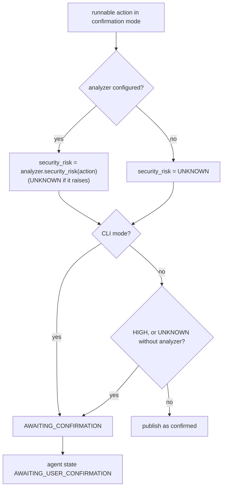

## Overview

An agent that can run any shell command can also delete files, leak credentials or push to the wrong branch. Confirmation mode puts a person between the agent and such commands: actions judged risky are held until the user confirms or rejects them. A security analyzer decides what counts as risky by assigning each action a `security_risk` of `LOW`, `MEDIUM`, `HIGH` or `UNKNOWN`.

Sources: [openhands/events/action/action.py:14-18](repo://openhands/events/action/action.py#L14-L18), [openhands/security/README.md:1-20](repo://openhands/security/README.md#L1-L20)

Both are set in the `[security]` section, or per user in the web settings, which override the file when set.

Sources: [openhands/core/config/security_config.py:4-35](repo://openhands/core/config/security_config.py#L4-L35), [openhands/server/session/session.py:143-152](repo://openhands/server/session/session.py#L143-L152)

```toml
[security]
confirmation_mode = true
security_analyzer = "llm"   # or "invariant"
```

Sources: [openhands/security/options.py:1-8](repo://openhands/security/options.py#L1-L8)

## Where the risk comes from

### The model's own assessment

Every tool of the [[CodeAct Agent]] that changes something requires a `security_risk` argument, and a section of the system prompt defines the levels. The parser copies a valid value onto the action, so each action already carries the model's assessment before any analyzer runs.

Sources: [openhands/agenthub/codeact_agent/tools/security_utils.py:6-10](repo://openhands/agenthub/codeact_agent/tools/security_utils.py#L6-L10), [openhands/agenthub/codeact_agent/function_calling.py:59-70](repo://openhands/agenthub/codeact_agent/function_calling.py#L59-L70)

### The SecurityAnalyzer interface

A `SecurityAnalyzer` implements `security_risk(action)`, returning a risk level, `handle_api_request(request)` for its own HTTP endpoints, and `close()`. The runtime instantiates the analyzer named by `security.security_analyzer` from the `SecurityAnalyzers` map when it is created, and the controller receives it from the runtime.

Sources: [openhands/security/analyzer.py:8-29](repo://openhands/security/analyzer.py#L8-L29), [openhands/runtime/base.py:194-204](repo://openhands/runtime/base.py#L194-L204), [openhands/core/setup.py:230-242](repo://openhands/core/setup.py#L230-L242)

| Name | Class | Judges risk by |
| --- | --- | --- |
| `llm` | `LLMRiskAnalyzer` | trusting the model's `security_risk`; anything unrecognised becomes `UNKNOWN` |
| `invariant` | `InvariantAnalyzer` | checking the action trace against an Invariant policy |

Sources: [openhands/security/options.py:5-8](repo://openhands/security/options.py#L5-L8), [openhands/security/llm/analyzer.py:12-42](repo://openhands/security/llm/analyzer.py#L12-L42)

### The Invariant analyzer

`InvariantAnalyzer` runs the Invariant Labs policy server, `ghcr.io/invariantlabs-ai/server:openhands`, as a Docker container named `openhands-invariant-server`, reusing a running or stopped one if present, and connects a monitor to it with a policy (the server's template when none is given). Each action is converted into an Invariant trace element, a tool call named after the action type with the action's arguments and a preceding message for its thought, and checked together with the trace so far. Every policy violation carries `[risk=...]` in its message; the analyzer returns the highest risk found, `LOW` when nothing matched, and `UNKNOWN` when the check failed.

Sources: [openhands/security/invariant/analyzer.py:15-125](repo://openhands/security/invariant/analyzer.py#L15-L125), [openhands/security/invariant/parser.py:39-60](repo://openhands/security/invariant/parser.py#L39-L60)

The default policy in `policies.py` flags secrets in bash commands, and Semgrep findings in Python cells and bash commands, all as medium risk.

Sources: [openhands/security/invariant/policies.py:1-19](repo://openhands/security/invariant/policies.py#L1-L19)

## Holding an action for confirmation

### The decision

The [[Agent Controller]] applies confirmation mode in `_step`, after the agent returns a runnable action. Only `CmdRunAction`, `IPythonRunCellAction`, `BrowseInteractiveAction`, `FileEditAction` and `FileReadAction` are considered.

Sources: [openhands/controller/agent_controller.py:918-925](repo://openhands/controller/agent_controller.py#L918-L925)



Sources: [openhands/controller/agent_controller.py:202-237](repo://openhands/controller/agent_controller.py#L202-L237), [openhands/controller/agent_controller.py:918-970](repo://openhands/controller/agent_controller.py#L918-L970)

The analyzer's verdict replaces the model's. Without an analyzer every action is `UNKNOWN`, so confirmation mode then asks about every one of these actions; with an analyzer only `HIGH` ones are held. The CLI holds every such action, because the terminal client applies its own rules to the risk level.

Sources: [openhands/controller/agent_controller.py:926-956](repo://openhands/controller/agent_controller.py#L926-L956)

### What the runtime does meanwhile

A held action is published with `confirmation_state = AWAITING_CONFIRMATION`, and the agent moves to `AWAITING_USER_CONFIRMATION`. The runtime sees the action but answers with a `NullObservation` without running it, so nothing happens in the sandbox and the action stays pending in the controller.

Sources: [openhands/controller/agent_controller.py:958-967](repo://openhands/controller/agent_controller.py#L958-L967), [openhands/runtime/base.py:953-958](repo://openhands/runtime/base.py#L953-L958)

### The user's answer

The user answers by changing the agent state to `USER_CONFIRMED` or `USER_REJECTED` (the web UI and the CLI send a `ChangeAgentStateAction`). `set_agent_state_to` then sets the pending action's `confirmation_state` to `CONFIRMED` or `REJECTED`, clears its thought and id, and publishes it again. A confirmed action runs normally and the agent returns to `RUNNING`; a rejected one makes the runtime return a `UserRejectObservation`, and the agent waits for user input, seeing `[Last action has been rejected by the user]` on its next step.

Sources: [openhands/controller/agent_controller.py:640-652](repo://openhands/controller/agent_controller.py#L640-L652), [openhands/controller/agent_controller.py:519-542](repo://openhands/controller/agent_controller.py#L519-L542), [openhands/runtime/base.py:965-972](repo://openhands/runtime/base.py#L965-L972), [openhands/memory/conversation_memory.py:509-512](repo://openhands/memory/conversation_memory.py#L509-L512)

### In the terminal

The [[CLI]] asks for each held action with a prompt whose wording and colour depend on the risk. Besides yes and no, the user can auto-confirm low and medium risk actions while still being asked about high risk ones, or confirm everything for the rest of the session.

Sources: [openhands/cli/tui.py:839-870](repo://openhands/cli/tui.py#L839-L870), [openhands/cli/tui.py:920-945](repo://openhands/cli/tui.py#L920-L945)

## Analyzer API

Analyzers can expose their own endpoints to the web UI. The server routes every request under `/api/conversations/<id>/security/<path>`, with any method, to the conversation's analyzer `handle_api_request`, and answers 404 when the conversation has none. The LLM analyzer answers `{"status": "ok"}`.

Sources: [openhands/server/routes/security.py:14-42](repo://openhands/server/routes/security.py#L14-L42), [openhands/server/session/conversation.py:53-55](repo://openhands/server/session/conversation.py#L53-L55), [openhands/security/llm/analyzer.py:15-17](repo://openhands/security/llm/analyzer.py#L15-L17)

## Adding an analyzer

A new analyzer subclasses `SecurityAnalyzer`, implements `security_risk` (and `handle_api_request` if it has endpoints), and is added to `SecurityAnalyzers` in `options.py` under the name used in configuration and shown in the settings drop-down.

Sources: [openhands/security/README.md:48-54](repo://openhands/security/README.md#L48-L54), [openhands/security/options.py:5-8](repo://openhands/security/options.py#L5-L8)
