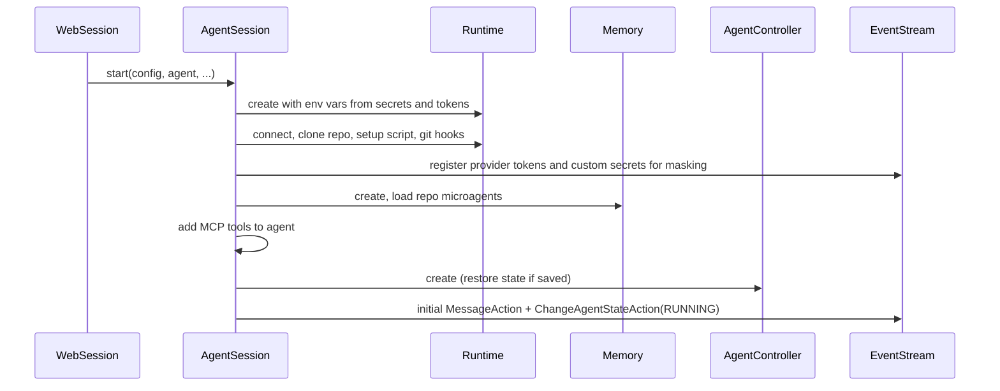

## Overview

The web UI talks to a running conversation over one Socket.IO connection. Through it the browser receives every event of the conversation as an `oh_event` message and sends the user's messages and commands as `oh_user_action`. On the server, three objects stand behind that connection: the Socket.IO handlers in `listen_socket.py`, a `WebSession` that pushes events to the browser's room, and an `AgentSession` that owns the conversation's event stream, runtime, memory and controller.

Sources: [openhands/server/listen_socket.py:35-140](repo://openhands/server/listen_socket.py#L35-L140), [openhands/server/listen_socket.py:143-158](repo://openhands/server/listen_socket.py#L143-L158), [openhands/server/session/session.py:40-117](repo://openhands/server/session/session.py#L40-L117)

Which process holds these objects, and how many conversations may run at once, is decided by the [[Conversation Managers]]. The REST API that creates conversations is on [[Server Application and REST API]].

Sources: [openhands/server/shared.py:61-67](repo://openhands/server/shared.py#L61-L67)

## Connecting

### The connect handler

The client connects with query parameters `conversation_id`, `latest_event_id` (the last event it already has, default -1), `providers_set` and, when the server requires it, `session_api_key`. The `connect` handler refuses a connection without a conversation id or with a wrong session key, then asks the conversation validator to check that the user, identified from cookies or the `Authorization` header, may open this conversation.

Sources: [openhands/server/listen_socket.py:35-76](repo://openhands/server/listen_socket.py#L35-L76), [openhands/server/listen_socket.py:161-168](repo://openhands/server/listen_socket.py#L161-L168)

### Replaying history

Before joining, the handler replays stored events newer than `latest_event_id` from the conversation's `EventStore` to this connection, so a reloaded page or a second tab catches up from where it is. Null events and recall actions are skipped, and only the most recent `AgentStateChangedObservation` is sent, after everything else, so the UI ends in the current state.

Sources: [openhands/server/listen_socket.py:78-118](repo://openhands/server/listen_socket.py#L78-L118)

### Joining

`setup_init_conversation_settings` loads the user's settings and secrets into a `ConversationInitData`: the settings plus git provider tokens, custom secrets, selected repository and branch, conversation instructions and replay data. Missing settings refuse the connection with `CONFIGURATION$SETTINGS_NOT_FOUND`. The handler then calls `conversation_manager.join_conversation`, which starts the agent loop if it is not running and adds the connection to the conversation's room. Any refusal disconnects the socket.

Sources: [openhands/server/services/conversation_service.py:217-257](repo://openhands/server/services/conversation_service.py#L217-L257), [openhands/server/session/conversation_init_data.py:8-21](repo://openhands/server/session/conversation_init_data.py#L8-L21), [openhands/server/listen_socket.py:120-140](repo://openhands/server/listen_socket.py#L120-L140)

### Messages from the client

`oh_user_action` (and the older `oh_action`) hand the payload to `conversation_manager.send_to_event_stream`; `disconnect` removes the connection. The session's `dispatch` rebuilds the event from the dictionary and adds it to the stream with source `USER`. A message with images is refused with an error message when the model's vision is disabled or unsupported.

Sources: [openhands/server/listen_socket.py:143-158](repo://openhands/server/listen_socket.py#L143-L158), [openhands/server/session/session.py:353-369](repo://openhands/server/session/session.py#L353-L369)

## WebSession

### Forwarding events

`WebSession` subscribes to the conversation's [[Event Stream]] as `server`. Its `_on_event` sends every agent and user event to the browser, skipping null events. Environment events are mostly internal; only command output, agent state changes and recall observations are forwarded, relabelled as agent events because the UI treats them as the agent's. Error observations are forwarded the same way.

Sources: [openhands/server/session/session.py:97-101](repo://openhands/server/session/session.py#L97-L101), [openhands/server/session/session.py:311-351](repo://openhands/server/session/session.py#L311-L351)

### The publish queue

Sending goes through a queue drained by one background task, so events reach the browser in order even though they are produced on the stream's threads. Each payload is emitted as `oh_event` to the room `room:<sid>`, so every tab connected to the conversation receives it. The first send waits up to two seconds for a client to join the room, so the opening events of a new conversation are not emitted into an empty room.

Sources: [openhands/server/session/session.py:371-416](repo://openhands/server/session/session.py#L371-L416), [openhands/server/constants.py:3-3](repo://openhands/server/constants.py#L3-L3)

### Status messages

Runtime, controller and memory report progress through a status callback. `queue_status_message` schedules `_send_status_message` on the session's loop, which sends `{"status_update": true, "type", "id", "message"}` with a `RuntimeStatus` id the UI translates. An `error` status also moves the agent to `ERROR`. LLM retries are reported as `LLM_RETRY` through the registry's retry listener.

Sources: [openhands/server/session/session.py:306-309](repo://openhands/server/session/session.py#L306-L309), [openhands/server/session/session.py:418-450](repo://openhands/server/session/session.py#L418-L450)

## Starting the agent

### initialize_agent

`WebSession.initialize_agent(settings, initial_message, replay_json)` turns the user's settings into a per-conversation config:

Sources: [openhands/server/session/session.py:132-142](repo://openhands/server/session/session.py#L132-L142)

- confirmation mode, security analyzer, sandbox images, git user, iteration and budget limits, search and sandbox API keys from the settings override the server config;
- the user's MCP servers are merged, and the OpenHands MCP server and search engine are added;
- with `enable_default_condenser`, the agent gets a condenser pipeline: conversation window, browser output masking (last two), and LLM summarizing with `keep_first=4` and `max_size` from `condenser_max_size` (default 120);
- the agent is created from its class name with the session's LLM registry.

Sources: [openhands/server/session/session.py:132-152](repo://openhands/server/session/session.py#L132-L152), [openhands/server/session/session.py:153-210](repo://openhands/server/session/session.py#L153-L210), [openhands/server/session/session.py:211-250](repo://openhands/server/session/session.py#L211-L250)

It then calls `AgentSession.start` with the repository, branch, provider tokens, custom secrets and the first message, and reports microagent validation errors and other start failures to the user.

Sources: [openhands/server/session/session.py:251-304](repo://openhands/server/session/session.py#L251-L304)

### AgentSession.start

Sources: [openhands/server/session/agent_session.py:90-159](repo://openhands/server/session/agent_session.py#L90-L159), [openhands/server/session/agent_session.py:160-222](repo://openhands/server/session/agent_session.py#L160-L222)

`_create_runtime` passes custom secrets as environment variables and, for non-remote runtimes, the git provider tokens too; for the remote runtime, a token given as a custom secret takes precedence over the provider token. A runtime that cannot start reports `ERROR_RUNTIME_DISCONNECTED` instead of raising. After connecting it clones the repository and runs the workspace setup.

Sources: [openhands/server/session/agent_session.py:296-384](repo://openhands/server/session/agent_session.py#L296-L384)

MCP tools are added before the controller exists because the controller writes the system message with the agent's tool list. With a first message, the session posts it and sets the agent running; without one, it sets `AWAITING_USER_INPUT`. A `replay_json` replays a recorded trajectory instead (see [[Agent Controller]]).

Sources: [openhands/server/session/agent_session.py:160-205](repo://openhands/server/session/agent_session.py#L160-L205)

### Closing

`AgentSession.close` waits for a start in progress to finish (with a time limit), closes the event stream, saves and closes the controller, and closes the runtime on a background executor. `WebSession.close` first tells clients the agent is `STOPPED`.

Sources: [openhands/server/session/agent_session.py:224-245](repo://openhands/server/session/agent_session.py#L224-L245), [openhands/server/session/session.py:119-130](repo://openhands/server/session/session.py#L119-L130)

## ServerConversation for REST calls

REST routes that act on a running conversation get a `ServerConversation`: the conversation's event stream and a runtime created with `attach_to_existing=True`, which connects to the sandbox already started by the agent session instead of starting a new one. It exposes the runtime's security analyzer for the security routes.

Sources: [openhands/server/session/conversation.py:15-66](repo://openhands/server/session/conversation.py#L15-L66), [openhands/server/utils.py:96-112](repo://openhands/server/utils.py#L96-L112)
