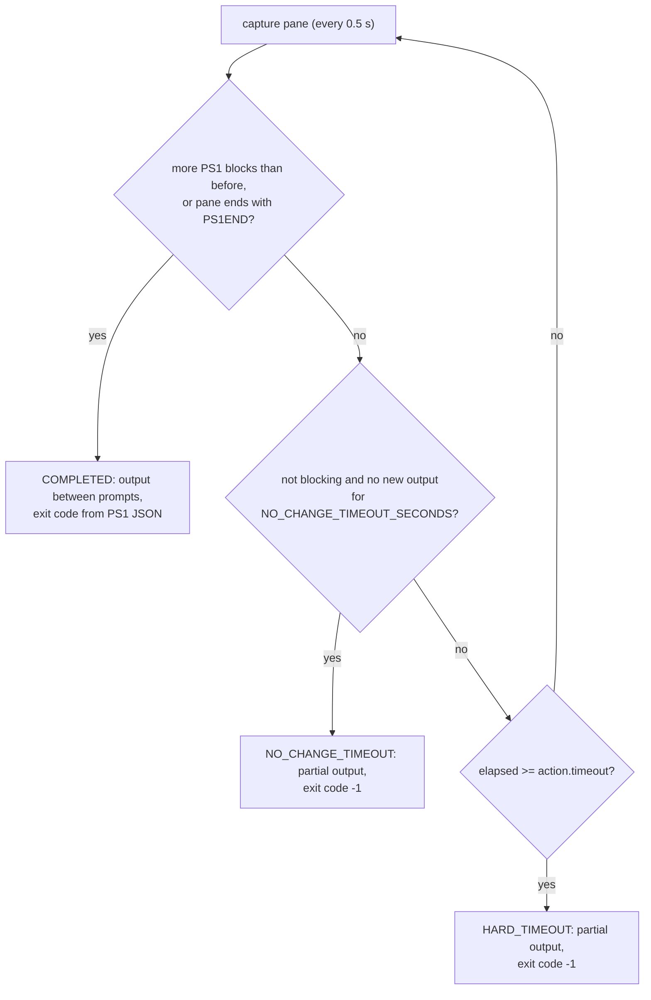

## Overview

The agent's `execute_bash` tool runs in one long-lived shell, so `cd`, exported variables and activated virtual environments persist between commands, as they would for a person at a terminal. On Linux and macOS this is a `BashSession`: a bash process inside a tmux pane that OpenHands types commands into and reads back from the screen. Reading the screen, rather than waiting for a process to exit, lets a command keep running while the agent looks at partial output, sends input to it, or interrupts it.

Sources: [openhands/runtime/utils/bash.py:175-251](repo://openhands/runtime/utils/bash.py#L175-L251), [openhands/agenthub/codeact_agent/tools/bash.py:10-34](repo://openhands/agenthub/codeact_agent/tools/bash.py#L10-L34)

The [[Action Execution Server]] creates the session at startup and calls `execute` for every `CmdRunAction`; on Windows it uses `WindowsPowershellSession` instead.

Sources: [openhands/runtime/action_execution_server.py:269-289](repo://openhands/runtime/action_execution_server.py#L269-L289), [openhands/runtime/action_execution_server.py:385-397](repo://openhands/runtime/action_execution_server.py#L385-L397)

## Starting the session

### The tmux pane

`initialize` starts a tmux server and a session named `openhands-<user>-<uuid>` in the working directory, sets a history limit of 10,000 lines, and opens a new window whose shell is `su <user> -` for the `root` and `openhands` users or plain `/bin/bash` otherwise. The first window is killed because it was created with tmux's default 2,000-line history.

Sources: [openhands/runtime/utils/bash.py:175-237](repo://openhands/runtime/utils/bash.py#L175-L237)

### The PS1 marker

The trick that makes screen-scraping reliable is the prompt. The session sets `PROMPT_COMMAND` so every prompt is a JSON block between `###PS1JSON###` and `###PS1END###` lines, carrying the last exit code, the process id, user, host, working directory and Python interpreter path. A new prompt block on screen means the previous command has finished, and the block says how it ended. `PS2` is emptied so continuation prompts do not pollute output.

Sources: [openhands/runtime/utils/bash.py:239-251](repo://openhands/runtime/utils/bash.py#L239-L251), [openhands/events/observation/commands.py:13-57](repo://openhands/events/observation/commands.py#L13-L57)

## Executing a command

### Guards before sending

`execute(action)` first checks the request against the state of the previous command:

Sources: [openhands/runtime/utils/bash.py:483-492](repo://openhands/runtime/utils/bash.py#L483-L492)

- an empty command or `is_input` when nothing is running returns an error message, since there is nothing to read or type into;
- a command that `bashlex` splits into several top-level commands is refused with a list of them, asking the agent to chain them with `&&` or `;`;
- a new command while the previous one is still running (after a timeout and no prompt yet) is not sent; the agent gets the previous command's new output and a note that it must use `is_input` or interrupt first.

Sources: [openhands/runtime/utils/bash.py:483-580](repo://openhands/runtime/utils/bash.py#L483-L580), [openhands/runtime/utils/bash.py:24-60](repo://openhands/runtime/utils/bash.py#L24-L60)

### Sending keys

A command is escaped with `escape_bash_special_chars` (so sequences such as `\;` survive the trip through tmux) and sent with Enter. With `is_input`, the text goes to the running process as typed input. A special key such as `C-c`, `C-d` or `C-z` is sent without Enter.

Sources: [openhands/runtime/utils/bash.py:582-598](repo://openhands/runtime/utils/bash.py#L582-L598), [openhands/runtime/utils/bash.py:81-95](repo://openhands/runtime/utils/bash.py#L81-L95), [openhands/runtime/utils/bash.py:279-283](repo://openhands/runtime/utils/bash.py#L279-L283)

### The polling loop

Sources: [openhands/runtime/utils/bash.py:600-670](repo://openhands/runtime/utils/bash.py#L600-L670)

The session captures the whole pane every half second (`capture-pane -J -pS -`) and counts PS1 blocks. It ends in one of three ways, recorded as the session's `prev_status`:

Sources: [openhands/runtime/utils/bash.py:600-615](repo://openhands/runtime/utils/bash.py#L600-L615)

| Status | When | What the agent sees |
| --- | --- | --- |
| `COMPLETED` | a new prompt appeared | the output, `[The command completed with exit code N.]`, working directory, interpreter and exit code |
| `NO_CHANGE_TIMEOUT` | the screen did not change for `NO_CHANGE_TIMEOUT_SECONDS` and the action is not blocking | the output so far and `[The command has no new output after N seconds. ...]` |
| `HARD_TIMEOUT` | the action's timeout elapsed | the output so far and `[The command timed out after N seconds. ...]` |

Sources: [openhands/runtime/utils/bash.py:164-169](repo://openhands/runtime/utils/bash.py#L164-L169), [openhands/runtime/utils/bash.py:316-372](repo://openhands/runtime/utils/bash.py#L316-L372), [openhands/runtime/utils/bash.py:374-438](repo://openhands/runtime/utils/bash.py#L374-L438)

Both timeouts leave the process running and end with the same guidance from `TIMEOUT_MESSAGE_TEMPLATE`: send an empty command to see more output, send input to the process, send `C-c`, `C-z` or `C-d`, or use the `timeout` parameter next time. The action server sets the no-change timeout from `NO_CHANGE_TIMEOUT_SECONDS` (default 10 seconds), which is the "soft timeout" the bash tool's description tells the model about.

Sources: [openhands/runtime/utils/bash_constants.py:1-7](repo://openhands/runtime/utils/bash_constants.py#L1-L7), [openhands/runtime/action_execution_server.py:279-287](repo://openhands/runtime/action_execution_server.py#L279-L287)

### Building the output

For a completed command, the session takes the text between the last two prompt blocks, reads the metadata from the last one, and updates its own `cwd` if the working directory changed, which is what other file operations resolve relative paths against. When only one prompt is left on screen because history scrolled away, it takes everything before that prompt and prefixes the output with `[Previous command outputs are truncated. Showing the last N lines of the output below.]`.

Sources: [openhands/runtime/utils/bash.py:316-372](repo://openhands/runtime/utils/bash.py#L316-L372)

While a command is still running, each call returns only the output that is new since the previous call, prefixed `[Below is the output of the previous command.]`. The echoed command line is stripped from the output. After completion the screen and history are cleared, so the next command starts from an empty pane.

Sources: [openhands/runtime/utils/bash.py:291-314](repo://openhands/runtime/utils/bash.py#L291-L314), [openhands/runtime/utils/bash.py:440-443](repo://openhands/runtime/utils/bash.py#L440-L443)

The observation's `to_agent_observation` assembles prefix, output and suffix and appends the working directory, Python interpreter and exit code lines, which is the exact text the LLM receives (see [[Events, Actions and Observations]]).

Sources: [openhands/events/observation/commands.py:197-205](repo://openhands/events/observation/commands.py#L197-L205)

## Static commands

A `CmdRunAction` with `is_static=True` does not use the agent's session: the action server creates a fresh session in the action's `cwd` for it. The runtime's git helper uses these, together with `hidden=True`, so checking the repository state never disturbs the agent's shell or appears in the conversation.

Sources: [openhands/runtime/action_execution_server.py:385-397](repo://openhands/runtime/action_execution_server.py#L385-L397), [openhands/runtime/base.py:1115-1133](repo://openhands/runtime/base.py#L1115-L1133)

## PowerShell on Windows

`WindowsPowershellSession` provides the same `execute` interface on Windows through the PowerShell SDK, loaded into Python with pythonnet. It keeps one runspace so variables and the current directory persist. A command ending in `&` runs as a background job, and long-running commands are tracked as PowerShell jobs whose output is collected on later calls, mirroring the bash session's continue-and-interrupt behaviour. It uses a default hard timeout of 60 seconds. If .NET or the SDK cannot be loaded, importing the module raises `DotNetMissingError`.

Sources: [openhands/runtime/utils/windows_bash.py:1-60](repo://openhands/runtime/utils/windows_bash.py#L1-L60), [openhands/runtime/utils/windows_bash.py:96-120](repo://openhands/runtime/utils/windows_bash.py#L96-L120), [openhands/runtime/utils/windows_bash.py:646-700](repo://openhands/runtime/utils/windows_bash.py#L646-L700)

## Starting the server that owns the shell

Container-based runtimes start the action server with `get_action_execution_server_startup_command`, which runs the module under the image's micromamba and Poetry environment with the port, the workspace directory, the plugin names, and the user: `openhands` with uid 1000 when `run_as_openhands` is set, otherwise `root` with uid 0.

Sources: [openhands/runtime/utils/command.py:5-69](repo://openhands/runtime/utils/command.py#L5-L69)
