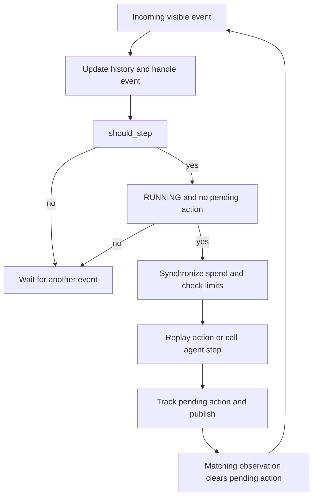

## Overview

`AgentController` coordinates an agent with a stream, state tracker, limits, replay manager and optional security analyzer. The root controller subscribes to the event stream; delegated controllers receive forwarded events instead. [[Browser Conversations]] describes how a session creates it. Once initialized, the controller determines whether an incoming event should trigger a model step, wait for another component or change the conversation state.

Sources: [openhands/controller/agent_controller.py:154-202](repo://openhands/controller/agent_controller.py#L154-L202), [openhands/controller/agent_controller.py:433-485](repo://openhands/controller/agent_controller.py#L433-L485)

## From user message to agent step

`_on_event` ignores hidden events, asks the state tracker to add history, dispatches actions or observations, then evaluates `should_step`. A user message first creates a pending `RecallAction`: the first message requests workspace context and later messages request knowledge. The controller appends the recall as a user-triggered action and switches to `RUNNING` if necessary. This means the first model step waits for [[Memory and Microagents]] to complete retrieval rather than racing it.

Sources: [openhands/controller/agent_controller.py:467-485](repo://openhands/controller/agent_controller.py#L467-L485), [openhands/controller/agent_controller.py:549-588](repo://openhands/controller/agent_controller.py#L549-L588), [openhands/controller/agent_controller.py:831-839](repo://openhands/controller/agent_controller.py#L831-L839)

`should_step` allows user messages, eligible agent messages, delegation and condensation actions. Most observations also qualify. State-change observations and ordinary null observations do not, but a null observation with a positive cause can release a recall. An active delegate prevents the parent from stepping. These are event eligibility rules; `_step` still independently requires the controller to be running and to have no pending action.

Sources: [openhands/controller/agent_controller.py:392-431](repo://openhands/controller/agent_controller.py#L392-L431), [openhands/controller/agent_controller.py:821-839](repo://openhands/controller/agent_controller.py#L821-L839)

Sources: [openhands/controller/agent_controller.py:467-485](repo://openhands/controller/agent_controller.py#L467-L485), [openhands/controller/agent_controller.py:536-546](repo://openhands/controller/agent_controller.py#L536-L546), [openhands/controller/agent_controller.py:821-887](repo://openhands/controller/agent_controller.py#L821-L887), [openhands/controller/agent_controller.py:919-973](repo://openhands/controller/agent_controller.py#L919-L973)

## Pending actions and state transitions

After `agent.step` returns, runnable actions become pending before publication. `_handle_observation` clears pending work only if the observation's `cause` matches its ID, and does not clear it while awaiting user confirmation. A confirmed action's observation returns the controller to `RUNNING`; a rejected action's observation moves it to `AWAITING_USER_INPUT`. [[Sandbox Execution]] supplies the caused observations, while [[Events and Persistence]] defines their durable identity.

Sources: [openhands/controller/agent_controller.py:536-546](repo://openhands/controller/agent_controller.py#L536-L546), [openhands/controller/agent_controller.py:919-973](repo://openhands/controller/agent_controller.py#L919-L973), [openhands/runtime/base.py:391-399](repo://openhands/runtime/base.py#L391-L399)

An agent message with `wait_for_response` changes state to `AWAITING_USER_INPUT`. `AgentFinishAction` and `AgentRejectAction` copy their outputs into state and select `FINISHED` or `REJECTED`. `set_agent_state_to` skips duplicate transitions, resets agent state on `STOPPED` or `ERROR`, emits an `AgentStateChangedObservation`, and saves state. The source gives crash and unexpected-shutdown recovery as the reason for saving on every state change.

Sources: [openhands/controller/agent_controller.py:494-517](repo://openhands/controller/agent_controller.py#L494-L517), [openhands/controller/agent_controller.py:585-588](repo://openhands/controller/agent_controller.py#L585-L588), [openhands/controller/agent_controller.py:631-683](repo://openhands/controller/agent_controller.py#L631-L683)

## Confirmation flow

Confirmation mode examines exact command, IPython, interactive-browser, file-edit and file-read action types. It invokes the security analyzer and reads the action's risk. In the non-CLI path, high risk requires confirmation; unknown risk also does when no analyzer exists. The CLI path marks these actions as awaiting confirmation so its own interface can handle the decision. A marked action moves the controller to `AWAITING_USER_CONFIRMATION` before it is published.

Sources: [openhands/controller/agent_controller.py:919-973](repo://openhands/controller/agent_controller.py#L919-L973)

When the user confirms or rejects, the controller updates the pending action's confirmation state, clears its thought if present, resets its ID and appends it again. The fresh ID allows the confirmed or rejected event to pass the stream's duplicate-event guard. Runtime dispatch then decides whether to execute it or return a user-rejection observation. This flow does not mean every action type is covered by the confirmation branch.

Sources: [openhands/controller/agent_controller.py:658-669](repo://openhands/controller/agent_controller.py#L658-L669), [openhands/events/stream.py:163-167](repo://openhands/events/stream.py#L163-L167), [openhands/runtime/base.py:951-972](repo://openhands/runtime/base.py#L951-L972)

## Limits and failure recovery

Before model work, `_step` synchronizes spend into the budget flag, checks for a stuck agent and runs control flags. Iteration limits reject a step when the current count reaches the maximum, otherwise incrementing it. Budget limits compare externally updated spending without incrementing it themselves. A falsy task budget creates no budget flag. These controls constrain the loop at step boundaries; they are not a preflight price estimate for the next provider request.

Sources: [openhands/controller/agent_controller.py:847-860](repo://openhands/controller/agent_controller.py#L847-L860), [openhands/controller/state/control_flags.py:43-95](repo://openhands/controller/state/control_flags.py#L43-L95), [openhands/controller/state/state_tracker.py:73-91](repo://openhands/controller/state/state_tracker.py#L73-L91)

Malformed actions, missing actions, response errors and function-call validation failures become `ErrorObservation` events, giving the agent feedback for another step. Recognized context-window errors produce a `CondensationRequestAction` when history truncation is enabled; otherwise they become a context-window exception. [[Model Decisions and Tools]] covers response conversion, and [[Memory and Microagents]] handles the condensation request. Other step exceptions pass through `_step_with_exception_handling` into error-state reporting.

Sources: [openhands/controller/agent_controller.py:869-917](repo://openhands/controller/agent_controller.py#L869-L917), [openhands/controller/agent_controller.py:361-390](repo://openhands/controller/agent_controller.py#L361-L390)

`_react_to_exception` records a reason and, when a status callback exists, maps known provider failures to specific runtime status messages. Rate-limit handling distinguishes an exhausted retry from a retry still in progress, selecting `ERROR` or `RATE_LIMITED`. A transition from `ERROR` back to `RUNNING` asks the state tracker to consider increasing limits. Iteration increases are restricted to non-headless mode after a hit; budget increases use current spend plus the configured increment when their flag was hit.

Sources: [openhands/controller/agent_controller.py:302-356](repo://openhands/controller/agent_controller.py#L302-L356), [openhands/controller/agent_controller.py:654-656](repo://openhands/controller/agent_controller.py#L654-L656), [openhands/controller/state/control_flags.py:51-55](repo://openhands/controller/state/control_flags.py#L51-L55), [openhands/controller/state/control_flags.py:77-81](repo://openhands/controller/state/control_flags.py#L77-L81)

## Delegated subtasks

A delegation action chooses an agent class and creates a child using the parent's LLM registry. Child state shares iteration and budget flags and global metrics, records its own start ID and depth, and receives a controller marked `is_delegate=True`. The parent forwards events while the child remains active. This preserves global accounting across subtasks and avoids giving the child an independent direct subscription to the same stream.

Sources: [openhands/controller/agent_controller.py:433-462](repo://openhands/controller/agent_controller.py#L433-L462), [openhands/controller/agent_controller.py:709-752](repo://openhands/controller/agent_controller.py#L709-L752)

When the child finishes, is rejected or ends in an error, `end_delegate` closes it and publishes an `AgentDelegateObservation` containing outputs and a result message. It carries the initiating delegation's tool metadata and clears the active delegate. Parent history reconstruction hides the events inside matched delegation ranges while retaining the delegation action and result, so the parent's model sees the subtask boundary rather than every internal child step.

Sources: [openhands/controller/agent_controller.py:754-819](repo://openhands/controller/agent_controller.py#L754-L819), [openhands/controller/state/state_tracker.py:145-192](repo://openhands/controller/state/state_tracker.py#L145-L192)
