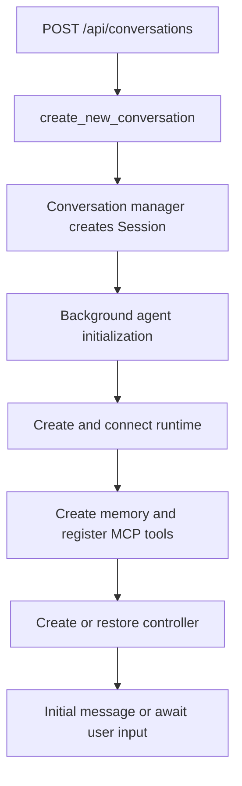

## Overview

The browser application uses HTTP to create and manage conversations and Socket.IO to exchange live actions and events. The server combines the FastAPI application with a Socket.IO ASGI application. A conversation ID connects these interfaces to a running `Session` and its `AgentSession`. Startup configuration comes from the saved-settings path in [[Configuration]]; this page follows what happens after the user submits a task.

Sources: [openhands/server/listen.py:5-27](repo://openhands/server/listen.py#L5-L27), [openhands/server/routes/manage_conversations.py:189-201](repo://openhands/server/routes/manage_conversations.py#L189-L201), [openhands/server/conversation_manager/standalone_conversation_manager.py:340-355](repo://openhands/server/conversation_manager/standalone_conversation_manager.py#L340-L355), [openhands/server/services/conversation_service.py:98-159](repo://openhands/server/services/conversation_service.py#L98-L159)

## Create a conversation

The frontend mutation passes the query, optional repository/provider/branch, suggested task, conversation instructions and microagent-creation request to `OpenHands.createConversation`. On success it invalidates the user's conversation list. On the server, `POST /api/conversations` accepts `InitSessionRequest`, which also supports image URLs, replay JSON and MCP configuration. Extra fields are forbidden; explicitly setting a conversation ID is exposed only when `ALLOW_SET_CONVERSATION_ID=1`.

Sources: [frontend/src/hooks/mutation/use-create-conversation.ts:23-52](repo://frontend/src/hooks/mutation/use-create-conversation.ts#L23-L52), [openhands/server/routes/manage_conversations.py:78-78](repo://openhands/server/routes/manage_conversations.py#L78-L78), [openhands/server/routes/manage_conversations.py:160-201](repo://openhands/server/routes/manage_conversations.py#L160-L201)

The route determines the conversation trigger, lets suggested tasks supply the initial prompt and verifies a selected repository through the provider handler. Bearer-authenticated remote API creation requires an initial user message. It generates a conversation ID unless an allowed one was supplied, calls `create_new_conversation`, and returns the ID with the agent-loop status. Missing settings and LLM credential configuration errors become HTTP 400 responses.

Sources: [openhands/server/routes/manage_conversations.py:213-288](repo://openhands/server/routes/manage_conversations.py#L213-L288)

## Initialize the session

`create_new_conversation` first initializes conversation metadata, then calls the service's `start_conversation`. The service creates a `MessageAction` when text or images are present and asks the conversation manager to start the loop. In the standalone manager, startup constructs a registry, statistics and session configuration, stores a `Session`, and schedules `session.initialize_agent` with `asyncio.create_task`. Returning the session therefore does not mean all runtime initialization has already completed.

Sources: [openhands/server/services/conversation_service.py:146-202](repo://openhands/server/services/conversation_service.py#L146-L202), [openhands/server/conversation_manager/standalone_conversation_manager.py:340-367](repo://openhands/server/conversation_manager/standalone_conversation_manager.py#L340-L367)

Sources: [openhands/server/routes/manage_conversations.py:242-269](repo://openhands/server/routes/manage_conversations.py#L242-L269), [openhands/server/services/conversation_service.py:153-202](repo://openhands/server/services/conversation_service.py#L153-L202), [openhands/server/conversation_manager/standalone_conversation_manager.py:340-355](repo://openhands/server/conversation_manager/standalone_conversation_manager.py#L340-L355), [openhands/server/session/agent_session.py:134-202](repo://openhands/server/session/agent_session.py#L134-L202)

`AgentSession.start` refuses a second start when a controller or runtime already exists. It creates the runtime, installs provider and custom secrets into the event stream, creates memory, then registers MCP tools before controller creation so those tools appear in the system message. With an initial message it appends that message and a transition to `RUNNING`; without one it requests `AWAITING_USER_INPUT`. [[Agent Control Loop]] owns subsequent stepping, and [[Sandbox Execution]] owns runtime connection details.

Sources: [openhands/server/session/agent_session.py:117-202](repo://openhands/server/session/agent_session.py#L117-L202)

## Connect and recover history

The main frontend socket provider supplies `conversation_id`, `providers_set`, `session_api_key` and `latest_event_id`, defaulting the last value to `-1`. It selects a socket path from the conversation URL when needed and otherwise uses `/socket.io`. As numbered events arrive it remembers the last event; on disconnect it updates the socket query so reconnection can request subsequent history. Changing conversation IDs clears the provider's event state.

Sources: [frontend/src/context/ws-client-provider.tsx:252-269](repo://frontend/src/context/ws-client-provider.tsx#L252-L269), [frontend/src/context/ws-client-provider.tsx:286-345](repo://frontend/src/context/ws-client-provider.tsx#L286-L345)

The server socket handler parses the cursor, requires a conversation ID, checks the configured session API key and invokes the conversation validator. It opens an event store and replays from `latest_event_id + 1`. Replay excludes null actions, null observations and recall actions; agent-state observations are held back so the last state update is emitted after other replayed events. Only then does the handler load initialization settings and join the live conversation. [[Events and Persistence]] explains the history being read here.

Sources: [openhands/server/listen_socket.py:35-129](repo://openhands/server/listen_socket.py#L35-L129), [openhands/server/listen_socket.py:161-168](repo://openhands/server/listen_socket.py#L161-L168)

A separate `ConversationSubscriptionsProvider` supports multiple background subscriptions. It keeps sockets and event arrays per conversation, declines a duplicate subscription, configures five reconnection attempts with a one-second delay, and shows status toasts. A finished-state event causes it to unsubscribe that conversation. Its query does not contain the main provider's history cursor, so the two providers should not be assumed to have identical reconnect bookkeeping.

Sources: [frontend/src/context/conversation-subscriptions-provider.tsx:75-81](repo://frontend/src/context/conversation-subscriptions-provider.tsx#L75-L81), [frontend/src/context/conversation-subscriptions-provider.tsx:152-216](repo://frontend/src/context/conversation-subscriptions-provider.tsx#L152-L216)

## Exchange live actions and observations

Clients submit `oh_user_action`; the server retains `oh_action` as a compatibility alias. Both forward to the conversation manager. `Session.dispatch` reconstructs the event, checks image support for image-bearing messages when a controller exists, and appends accepted events as user events. Disabled vision and unsupported image models return an error without appending that message.

Sources: [openhands/server/listen_socket.py:143-152](repo://openhands/server/listen_socket.py#L143-L152), [openhands/server/session/session.py:353-369](repo://openhands/server/session/session.py#L353-L369)

Outbound session handling drops null actions and observations. Agent and user events are sent directly; selected environment observations are relabeled as agent events for the UI. A publish queue separates the event callback from Socket.IO emission to the conversation room. During initial publication the sender briefly waits for a listening room, then emits `oh_event`. This UI projection is not identical to every event in the durable store.

Sources: [openhands/server/session/session.py:314-351](repo://openhands/server/session/session.py#L314-L351), [openhands/server/session/session.py:371-416](repo://openhands/server/session/session.py#L371-L416)

## Stop, expire and restore

The start endpoint checks that metadata exists, rebuilds initialization settings and calls `maybe_start_agent_loop`. The stop endpoint closes a loop only when its conversation status is `STARTING` or `RUNNING`; otherwise it reports that the conversation was not running. Stopping is distinct from socket disconnection: the standalone disconnect handler removes the connection mapping, while session closing disconnects associated sockets and closes the session itself.

Sources: [openhands/server/routes/manage_conversations.py:473-518](repo://openhands/server/routes/manage_conversations.py#L473-L518), [openhands/server/routes/manage_conversations.py:534-574](repo://openhands/server/routes/manage_conversations.py#L534-L574), [openhands/server/conversation_manager/standalone_conversation_manager.py:397-453](repo://openhands/server/conversation_manager/standalone_conversation_manager.py#L397-L453)

The standalone manager also enforces concurrent-loop capacity by closing older conversations before creating a new session. Its stale cleanup considers age since activity, excludes running or still-initializing agents, and excludes conversations that still have connections. A falsy `sandbox.close_delay` disables that automatic loop-closing path. On explicit agent-session close, the stream is closed, controller state is saved and the controller closes; runtime closure is submitted to an executor. Restoration attempts to load saved state and logs a warning if events exist but state cannot be restored.

Sources: [openhands/server/conversation_manager/standalone_conversation_manager.py:306-338](repo://openhands/server/conversation_manager/standalone_conversation_manager.py#L306-L338), [openhands/server/conversation_manager/standalone_conversation_manager.py:179-216](repo://openhands/server/conversation_manager/standalone_conversation_manager.py#L179-L216), [openhands/server/session/agent_session.py:224-245](repo://openhands/server/session/agent_session.py#L224-L245), [openhands/server/session/agent_session.py:492-510](repo://openhands/server/session/agent_session.py#L492-L510)
