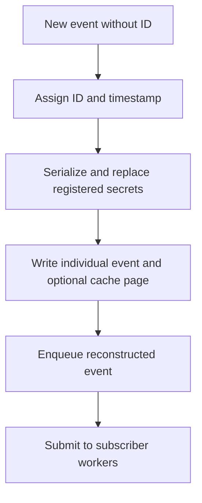

## Overview

`EventStream` combines a stored event sequence with subscriber delivery. It extends `EventStore`, which reads a conversation's serialized events through a configurable file store. Controller state is saved separately and deliberately omits history, rebuilding it from events on restore. This distinction connects the live [[Agent Control Loop]] to the reconnect behavior in [[Browser Conversations]] without treating a browser's displayed messages as the complete stored record.

Sources: [openhands/events/stream.py:43-69](repo://openhands/events/stream.py#L43-L69), [openhands/events/event_store.py:43-50](repo://openhands/events/event_store.py#L43-L50), [openhands/controller/state/state.py:191-209](repo://openhands/controller/state/state.py#L191-L209), [openhands/controller/state/state_tracker.py:104-143](repo://openhands/controller/state/state_tracker.py#L104-L143)

## Identity and append sequence

An event exposes an ID, timestamp, source and optional cause. Before insertion its ID is `Event.INVALID_ID`, or `-1`. `add_event` rejects events that already have an ID, stamps the event and assigns the next ID under a lock. It serializes the event, replaces registered secrets, reconstructs the event from that representation and adds the serialized data to the current cache page. The reconstructed event is the one later delivered to subscribers.

Sources: [openhands/events/event.py:35-77](repo://openhands/events/event.py#L35-L77), [openhands/events/stream.py:163-184](repo://openhands/events/stream.py#L163-L184)

Outside the assignment lock, the method writes the individual JSON event, writes a full cache page if ready, then queues the event. A missing cache page can be bypassed on reads, which is why the source writes it last. Storage is therefore on the append path, before notification. The lock protects allocation and cache assembly; this implementation does not hold that lock across file I/O and queue insertion, so it should not be described as a global transaction across concurrent writers.

Sources: [openhands/events/stream.py:170-213](repo://openhands/events/stream.py#L170-L213), [openhands/events/event_store.py:123-130](repo://openhands/events/event_store.py#L123-L130)

Sources: [openhands/events/stream.py:163-213](repo://openhands/events/stream.py#L163-L213), [openhands/events/stream.py:254-275](repo://openhands/events/stream.py#L254-L275)

## Delivery and shutdown

Each subscription is identified by subscriber type and callback ID. Registration creates a one-worker thread pool with its own event-loop initializer, and duplicate callback IDs within a subscriber raise an error. The queue consumer visits subscriber keys in sorted order and submits callbacks to their pools. A single callback's work is serialized by its one-worker pool, but separate callbacks can execute concurrently; submission order does not imply that one subscriber finishes before the next begins.

Sources: [openhands/events/stream.py:71-76](repo://openhands/events/stream.py#L71-L76), [openhands/events/stream.py:130-148](repo://openhands/events/stream.py#L130-L148), [openhands/events/stream.py:254-275](repo://openhands/events/stream.py#L254-L275)

Callback futures install an error handler that obtains their result, logs exceptions and reraises them. The queue consumer does not await each callback's completion. Closing sets a stop flag, joins the queue thread, cleans up subscriber loops and pools, and clears remaining queued events. This is a shutdown procedure, not a promise that every event queued immediately before close will reach every subscriber.

Sources: [openhands/events/stream.py:78-128](repo://openhands/events/stream.py#L78-L128), [openhands/events/stream.py:254-291](repo://openhands/events/stream.py#L254-L291)

## Secret replacement boundaries

The stream holds a dictionary of registered secrets. `set_secrets` replaces it and `update_secrets` merges additional values. Replacement traverses dictionaries and replaces matching secret values inside string fields. Top-level event metadata fields such as ID, source, cause, action, observation and message are protected from replacement. The implementation does not recursively traverse lists in this function, so its behavior should not be generalized to every possible nested payload shape.

Sources: [openhands/events/stream.py:215-244](repo://openhands/events/stream.py#L215-L244)

Browser session initialization registers provider and custom secrets before memory and controller initialization. This supports redaction of subsequent event payloads through the stream. It does not make every other output channel part of that redaction path: for example, [[Model Decisions and Tools]] describes optional completion logs written directly by the LLM wrapper.

Sources: [openhands/server/session/agent_session.py:149-168](repo://openhands/server/session/agent_session.py#L149-L168), [openhands/llm/llm.py:372-403](repo://openhands/llm/llm.py#L372-L403)

## Reading history and storage layout

Without a user ID, conversation files live under `sessions/<sid>/`; with one, they live under `users/<user_id>/conversations/<sid>/`. Event files are `events/<id>.json`, metadata is `metadata.json`, initialization data is `init.json` and state is `agent_state.pkl`. Cache pages live below `event_cache/` and cover batches of 25 events by default. The next event ID is calculated lazily from the highest numbered event filename plus one.

Sources: [openhands/storage/locations.py:1-30](repo://openhands/storage/locations.py#L1-L30), [openhands/events/event_store.py:43-83](repo://openhands/events/event_store.py#L43-L83), [openhands/events/event_store.py:155-175](repo://openhands/events/event_store.py#L155-L175)

`search_events` supports inclusive start/end IDs, reverse traversal, a filter and a result limit. It checks an aligned cache page first and falls back to individual reads; missing individual files are skipped. `get_event` reads one JSON file and reconstructs the event, while the latest ID is `cur_id - 1`. The controller applies a history filter and delegation-range handling described in [[Agent Control Loop]]; socket replay applies its own projection.

Sources: [openhands/events/event_store.py:85-148](repo://openhands/events/event_store.py#L85-L148), [openhands/controller/state/state_tracker.py:38-48](repo://openhands/controller/state/state_tracker.py#L38-L48), [openhands/controller/state/state_tracker.py:145-192](repo://openhands/controller/state/state_tracker.py#L145-L192), [openhands/server/listen_socket.py:94-114](repo://openhands/server/listen_socket.py#L94-L114)

## File-store implementations

| Selection | Backing behavior | Configuration |
| --- | --- | --- |
| `local` | Reads and writes files beneath a root, creating directories and expanding a leading tilde | Requires `file_store_path` |
| `s3` | Uses S3 object reads and writes | Uses the supplied bucket name or `AWS_S3_BUCKET`, with endpoint and credential environment settings |
| `google_cloud` | Uses Google Cloud Storage blobs | Uses the supplied bucket name or `GOOGLE_CLOUD_BUCKET_NAME` |
| Other values, including `memory` | Keeps file contents in an in-process dictionary | No durable filesystem backing in this implementation |

Sources: [openhands/storage/__init__.py:14-31](repo://openhands/storage/__init__.py#L14-L31), [openhands/storage/local.py:11-38](repo://openhands/storage/local.py#L11-L38), [openhands/storage/s3.py:23-64](repo://openhands/storage/s3.py#L23-L64), [openhands/storage/google_cloud.py:13-36](repo://openhands/storage/google_cloud.py#L13-L36), [openhands/storage/memory.py:10-23](repo://openhands/storage/memory.py#L10-L23)

A configured webhook wraps the selected store rather than replacing it. The regular wrapper performs the underlying write or delete first and schedules notification through an executor; write notifications retry three times with a fixed one-second wait. The batched wrapper queues updates after writing to the underlying store, with default batching thresholds of five seconds and 1 MiB. Unknown store names fall through to memory, so inspect the exact `file_store` value if persistence unexpectedly disappears across process restarts.

Sources: [openhands/storage/__init__.py:22-57](repo://openhands/storage/__init__.py#L22-L57), [openhands/storage/web_hook.py:40-99](repo://openhands/storage/web_hook.py#L40-L99), [openhands/storage/batched_web_hook.py:11-22](repo://openhands/storage/batched_web_hook.py#L11-L22), [openhands/storage/batched_web_hook.py:71-93](repo://openhands/storage/batched_web_hook.py#L71-L93)

## Controller snapshots and trajectories

`State.save_to_session` temporarily removes the conversation-statistics reference, pickles state, base64-encodes it and writes the state file. `__getstate__` clears history and view caches and removes deprecated fields. Restoration decodes the snapshot, supports a legacy location fallback when a user ID is present, records a resumable prior state where applicable and sets the immediate state to `LOADING`. It is a Python state snapshot distinct from JSON event history.

Sources: [openhands/controller/state/state.py:122-209](repo://openhands/controller/state/state.py#L122-L209)

Direct controller runs can additionally export a trajectory after closing the controller. If the configured destination already exists as a directory, the session ID becomes the JSON filename; otherwise the configured value is used as the file path. This export uses the controller trajectory and optional screenshot setting. It is separate from the per-event store and from the state snapshot used for resuming a session.

Sources: [openhands/core/main.py:220-244](repo://openhands/core/main.py#L220-L244)
