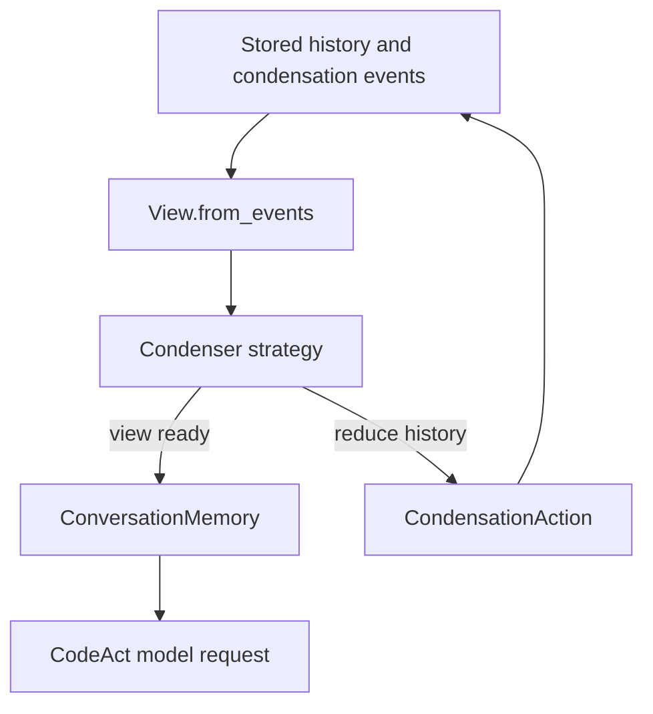

## Overview

Context enters CodeAct through three cooperating components. `Memory` listens for retrieval actions and publishes workspace or knowledge observations. `ConversationMemory` converts selected events into model messages. A condenser determines which history view should reach that conversion. [[Model Decisions and Tools]] describes the completion call that consumes these messages; this page explains how their context is assembled and reduced.

Sources: [openhands/memory/memory.py:53-84](repo://openhands/memory/memory.py#L53-L84), [openhands/memory/memory.py:90-131](repo://openhands/memory/memory.py#L90-L131), [openhands/memory/conversation_memory.py:92-164](repo://openhands/memory/conversation_memory.py#L92-L164), [openhands/memory/condenser/condenser.py:104-115](repo://openhands/memory/condenser/condenser.py#L104-L115)

## Recall and workspace context

The controller creates a workspace recall for the first user message and a knowledge recall for subsequent messages, holding it as pending work. Memory accepts user workspace recalls and user- or agent-sourced knowledge recalls. Each result receives the recall action's ID as its cause and is published as an environment event. When no information is available, memory still emits a caused `NullObservation`; the code explicitly explains that this releases the execution flow from waiting for retrieval.

Sources: [openhands/controller/agent_controller.py:566-583](repo://openhands/controller/agent_controller.py#L566-L583), [openhands/memory/memory.py:90-131](repo://openhands/memory/memory.py#L90-L131)

Workspace recall concatenates the contents of all repository microagents and also matches knowledge triggers against the query. Its structured observation can contain repository name, directory and branch, runtime hosts, additional instructions, date, working directory, secret descriptions and conversation instructions. Knowledge-only recall returns matched microagent names, triggers and contents. Retrieval exceptions report `ERROR_MEMORY` through runtime status rather than publishing the ordinary successful recall result.

Sources: [openhands/memory/memory.py:133-205](repo://openhands/memory/memory.py#L133-L205), [openhands/memory/memory.py:207-252](repo://openhands/memory/memory.py#L207-L252)

## Loading and matching microagents

Memory loads bundled microagents first, then the user's `~/.openhands/microagents/`, and accepts workspace microagents afterward. Repository and knowledge collections are dictionaries keyed by name, so later assignments replace matching names within their category. The runtime obtains organization/user microagents before repository-specific ones and reads `.openhands/microagents` under either the workspace or selected repository. It also checks the legacy `.openhands_instructions` location. [[Sandbox Execution]] covers the workspace setup that precedes this loading.

Sources: [openhands/memory/memory.py:79-84](repo://openhands/memory/memory.py#L79-L84), [openhands/memory/memory.py:254-300](repo://openhands/memory/memory.py#L254-L300), [openhands/runtime/base.py:838-888](repo://openhands/runtime/base.py#L838-L888)

The loader reads Markdown frontmatter and content, derives names from relative paths when a microagent directory is supplied, and recognizes legacy instructions plus `.cursorrules`, `agents.md` and `agent.md` as repository knowledge. Type inference uses inputs first, triggers second and repository knowledge otherwise. An input-bearing task gains a slash-name trigger; task microagents append instructions to ask for missing variables. These are prompt additions, distinct from the separately executing delegated agents in [[Agent Control Loop]].

Sources: [openhands/microagent/microagent.py:26-49](repo://openhands/microagent/microagent.py#L26-L49), [openhands/microagent/microagent.py:62-105](repo://openhands/microagent/microagent.py#L62-L105), [openhands/microagent/microagent.py:129-171](repo://openhands/microagent/microagent.py#L129-L171), [openhands/microagent/microagent.py:226-269](repo://openhands/microagent/microagent.py#L226-L269)

Knowledge trigger matching is a case-insensitive substring search returning the first matching trigger for each microagent. Empty queries produce no knowledge results. During message conversion, disabled microagents are excluded, and knowledge already present in earlier recall observations in the current event list is filtered out. Repository microagents may also carry MCP configuration, which memory gathers from all repository entries; [[MCP Tools]] follows that configuration into tool discovery.

Sources: [openhands/microagent/microagent.py:189-203](repo://openhands/microagent/microagent.py#L189-L203), [openhands/memory/memory.py:234-252](repo://openhands/memory/memory.py#L234-L252), [openhands/memory/memory.py:302-318](repo://openhands/memory/memory.py#L302-L318), [openhands/memory/conversation_memory.py:580-650](repo://openhands/memory/conversation_memory.py#L580-L650), [openhands/memory/conversation_memory.py:698-722](repo://openhands/memory/conversation_memory.py#L698-L722)

## Building a valid model conversation

`process_events` ensures a system message and initial user message are available, then converts actions and observations. It keeps assistant tool-call messages pending until all their results are available, appending the initiating message followed by results in tool-call order. A final filter removes unmatched tool responses and unmatched assistant calls. This matters after context reduction: retaining an isolated observation is not enough to form a valid tool interaction for the next model request.

Sources: [openhands/memory/conversation_memory.py:92-164](repo://openhands/memory/conversation_memory.py#L92-L164), [openhands/memory/conversation_memory.py:747-799](repo://openhands/memory/conversation_memory.py#L747-L799)

Recall observations become user-role context messages through the prompt manager. Workspace information and repository instructions are formatted together, while triggered knowledge is rendered separately and included only when it survives filtering. Missing system messages are regenerated for legacy compatibility. This conversion is a model-facing representation; it does not replace the persisted events described in [[Events and Persistence]].

Sources: [openhands/memory/conversation_memory.py:566-650](repo://openhands/memory/conversation_memory.py#L566-L650), [openhands/memory/conversation_memory.py:801-823](repo://openhands/memory/conversation_memory.py#L801-L823), [openhands/events/stream.py:186-203](repo://openhands/events/stream.py#L186-L203)

## Condensation protocol

`Condenser.condensed_history` uses `state.view` and records diagnostic metadata in `state.extra_data`. It returns either another `View` or a `Condensation` containing a `CondensationAction`. CodeAct returns that action instead of calling the model. On the next step, `View.from_events` excludes forgotten event IDs and condensation control events, inserts the most recent available summary, and tracks whether a condensation request still awaits handling. Forgetting is expressed in the view, not by deleting stored event files.

Sources: [openhands/memory/condenser/condenser.py:70-115](repo://openhands/memory/condenser/condenser.py#L70-L115), [openhands/agenthub/codeact_agent/codeact_agent.py:191-201](repo://openhands/agenthub/codeact_agent/codeact_agent.py#L191-L201), [openhands/memory/view.py:47-93](repo://openhands/memory/view.py#L47-L93)

Sources: [openhands/memory/view.py:47-93](repo://openhands/memory/view.py#L47-L93), [openhands/memory/condenser/condenser.py:104-115](repo://openhands/memory/condenser/condenser.py#L104-L115), [openhands/agenthub/codeact_agent/codeact_agent.py:191-218](repo://openhands/agenthub/codeact_agent/codeact_agent.py#L191-L218), [openhands/agenthub/codeact_agent/codeact_agent.py:282-288](repo://openhands/agenthub/codeact_agent/codeact_agent.py#L282-L288)

## Condenser catalogue

| Strategy | Transformation |
| --- | --- |
| No-op | Returns the input view unchanged |
| Recent events | Builds a view from a retained prefix and a calculated recent tail |
| Observation masking | Replaces observations outside an event attention window with a masked observation |
| Browser output | Replaces older browser observations with URL-only omission messages while keeping recent browser output |
| Amortized forgetting | When event count exceeds `max_size`, emits a forgotten range while retaining a prefix and tail targeting half the configured size |

Sources: [openhands/memory/condenser/impl/no_op_condenser.py:11-13](repo://openhands/memory/condenser/impl/no_op_condenser.py#L11-L13), [openhands/memory/condenser/impl/recent_events_condenser.py:17-22](repo://openhands/memory/condenser/impl/recent_events_condenser.py#L17-L22), [openhands/memory/condenser/impl/observation_masking_condenser.py:19-28](repo://openhands/memory/condenser/impl/observation_masking_condenser.py#L19-L28), [openhands/memory/condenser/impl/browser_output_condenser.py:21-40](repo://openhands/memory/condenser/impl/browser_output_condenser.py#L21-L40), [openhands/memory/condenser/impl/amortized_forgetting_condenser.py:40-58](repo://openhands/memory/condenser/impl/amortized_forgetting_condenser.py#L40-L58)

| Strategy | Transformation |
| --- | --- |
| Conversation window | Handles an outstanding condensation request, preserving essential initial events and a recent suffix while trimming dangling leading observations |
| LLM summarizing | Summarizes forgotten events with the previous summary, recording a new summary and forgotten range above `max_size` |
| LLM attention | Asks an LLM to rank event IDs, keeps selected IDs and a prefix, and fills short selections from recent events |
| Structured summary | Parses a `create_state_summary` tool call into structured state; parsing failures use an empty summary |
| Pipeline | Applies strategies in order and stops at the first `Condensation` result |

Sources: [openhands/memory/condenser/impl/conversation_window_condenser.py:92-145](repo://openhands/memory/condenser/impl/conversation_window_condenser.py#L92-L145), [openhands/memory/condenser/impl/conversation_window_condenser.py:176-177](repo://openhands/memory/condenser/impl/conversation_window_condenser.py#L176-L177), [openhands/memory/condenser/impl/llm_summarizing_condenser.py:122-161](repo://openhands/memory/condenser/impl/llm_summarizing_condenser.py#L122-L161), [openhands/memory/condenser/impl/llm_attention_condenser.py:56-119](repo://openhands/memory/condenser/impl/llm_attention_condenser.py#L56-L119), [openhands/memory/condenser/impl/structured_summary_condenser.py:264-308](repo://openhands/memory/condenser/impl/structured_summary_condenser.py#L264-L308), [openhands/memory/condenser/impl/pipeline.py:34-47](repo://openhands/memory/condenser/impl/pipeline.py#L34-L47)

[[Configuration]] explains the path-dependent default strategy. To add a strategy, implement the condenser interface and register its configuration type; duplicate registrations and unknown configuration types raise errors. Rolling strategies separate `should_condense` from `get_condensation`, while metadata batching records diagnostics even when the condensation operation exits through an exception.

Sources: [openhands/memory/condenser/condenser.py:83-115](repo://openhands/memory/condenser/condenser.py#L83-L115), [openhands/memory/condenser/condenser.py:129-193](repo://openhands/memory/condenser/condenser.py#L129-L193), [openhands/core/config/utils.py:301-338](repo://openhands/core/config/utils.py#L301-L338)
