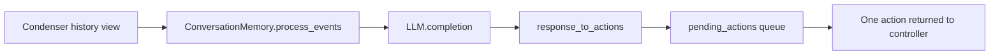

## Overview

`CodeActAgent` implements the decision step used by the default agent. It owns a queue of pending actions, tool schemas, prompt manager, conversation memory and condenser, and obtains its model through an LLM registry or router. [[Agent Control Loop]] decides when to call this step; CodeAct decides which action to return. The runtime executes the result separately, so a successful model completion is not itself a successful workspace operation.

Sources: [openhands/agenthub/codeact_agent/codeact_agent.py:78-106](repo://openhands/agenthub/codeact_agent/codeact_agent.py#L78-L106), [openhands/agenthub/codeact_agent/codeact_agent.py:182-224](repo://openhands/agenthub/codeact_agent/codeact_agent.py#L182-L224), [openhands/controller/agent_controller.py:869-887](repo://openhands/controller/agent_controller.py#L869-L887), [openhands/runtime/base.py:361-399](repo://openhands/runtime/base.py#L361-L399)

## One decision step

The agent first returns an already queued action, if one exists. Otherwise, a latest user message containing exactly `/exit` after stripping whitespace becomes `AgentFinishAction`. Next the condenser either returns a history `View` or a `Condensation` action. A condensation action leaves the step immediately; a view proceeds to message construction. [[Memory and Microagents]] owns that context-selection policy and the conversion of events into messages.

Sources: [openhands/agenthub/codeact_agent/codeact_agent.py:182-208](repo://openhands/agenthub/codeact_agent/codeact_agent.py#L182-L208)

CodeAct finds the initial user message in full history, independently of the condensed view, and errors if none exists. It passes both to `ConversationMemory.process_events` with message-length and vision settings, then applies prompt caching when the LLM supports and enables it. Completion receives messages, checked tool schemas and state-derived metadata. The response is converted into actions, all of which are queued; only the first is returned for this controller step.

Sources: [openhands/agenthub/codeact_agent/codeact_agent.py:207-244](repo://openhands/agenthub/codeact_agent/codeact_agent.py#L207-L244), [openhands/agenthub/codeact_agent/codeact_agent.py:279-299](repo://openhands/agenthub/codeact_agent/codeact_agent.py#L279-L299)

Sources: [openhands/agenthub/codeact_agent/codeact_agent.py:191-224](repo://openhands/agenthub/codeact_agent/codeact_agent.py#L191-L224), [openhands/agenthub/codeact_agent/codeact_agent.py:282-299](repo://openhands/agenthub/codeact_agent/codeact_agent.py#L282-L299)

## Built-in tool catalogue

| Capability | Selection and result |
| --- | --- |
| Shell | `enable_cmd` adds the command tool; its required `command` becomes `CmdRunAction`, with an optional numeric timeout |
| Python | `enable_jupyter` adds IPython; required `code` becomes `IPythonRunCellAction` |
| Browser | `enable_browsing` adds the browser tool except on Windows; required `code` becomes `BrowseInteractiveAction` |
| Editor | `enable_llm_editor` selects the LLM editor ahead of the standard editor; standard `view` becomes `FileReadAction`, other commands become `FileEditAction` |
| Thinking and finish | Independent toggles add think and finish tools, producing `AgentThinkAction` and `AgentFinishAction` |
| Task tracking | Plan mode adds the task tracker; `plan` requires a list of task dictionaries |
| Condensation | `enable_condensation_request` adds a tool producing `CondensationRequestAction` |

Sources: [openhands/agenthub/codeact_agent/codeact_agent.py:125-152](repo://openhands/agenthub/codeact_agent/codeact_agent.py#L125-L152), [openhands/agenthub/codeact_agent/function_calling.py:105-150](repo://openhands/agenthub/codeact_agent/function_calling.py#L105-L150), [openhands/agenthub/codeact_agent/function_calling.py:155-229](repo://openhands/agenthub/codeact_agent/function_calling.py#L155-L229), [openhands/agenthub/codeact_agent/function_calling.py:233-296](repo://openhands/agenthub/codeact_agent/function_calling.py#L233-L296)

Tool descriptions are shortened when the configured model name contains `gpt-4`, `o3`, `o1` or `o4`. The comments explain this as retained compatibility with older tool-description limits. External schemas join through [[MCP Tools]] and are recognized by their registered names. Tool exposure and runtime support are separate checks: [[Sandbox Execution]] describes what happens when the selected runtime cannot implement an action.

Sources: [openhands/agenthub/codeact_agent/codeact_agent.py:108-123](repo://openhands/agenthub/codeact_agent/codeact_agent.py#L108-L123), [openhands/agenthub/codeact_agent/function_calling.py:301-308](repo://openhands/agenthub/codeact_agent/function_calling.py#L301-L308), [openhands/runtime/base.py:957-963](repo://openhands/runtime/base.py#L957-L963)

## Model registry and routing

`LLMRegistry` deep-copies application configuration and stores LLM instances by service ID. `get_llm` reuses an existing instance, rejects an attempt to reuse that ID with a different configuration, and requires configuration for a new service. Newly created services notify a subscriber, allowing other components to observe them. The agent-specific helper also reuses service instances, but its configuration-mismatch branch currently leaves the existing instance in place.

Sources: [openhands/llm/llm_registry.py:23-55](repo://openhands/llm/llm_registry.py#L23-L55), [openhands/llm/llm_registry.py:71-106](repo://openhands/llm/llm_registry.py#L71-L106), [openhands/llm/llm_registry.py:130-146](repo://openhands/llm/llm_registry.py#L130-L146)

The `noop_router` returns the agent LLM directly; other routing names use `RouterLLM.from_config`. The included multimodal router requires a `secondary_model`. It chooses the primary for image-bearing messages or when the secondary's context limit is exceeded, otherwise selecting the secondary. Once the context threshold has been exceeded, its stored flag continues favoring the primary. [[Configuration]] describes where named models and routing settings are assembled.

Sources: [openhands/llm/llm_registry.py:111-128](repo://openhands/llm/llm_registry.py#L111-L128), [openhands/llm/router/rule_based/impl.py:19-69](repo://openhands/llm/router/rule_based/impl.py#L19-L69)

## Completion adaptation and retries

`LLM` builds a LiteLLM completion callable using model, credentials, base URL, API version, provider, timeout and other configuration. Its wrapper formats internal `Message` objects as dictionaries. If native function calling is inactive, it converts tool messages into prompt-based equivalents, removes the native tool schema argument and later converts the response back to function-call form. The wrapper rejects an empty message list and strips extra metadata unless the model is a LiteLLM proxy model.

Sources: [openhands/llm/llm.py:194-217](repo://openhands/llm/llm.py#L194-L217), [openhands/llm/llm.py:243-310](repo://openhands/llm/llm.py#L243-L310), [openhands/llm/llm.py:335-357](repo://openhands/llm/llm.py#L335-L357)

The standard callable obtains a complete non-streaming response and records latency. Retryable failures include connection errors, rate limits, service unavailability, timeouts, internal-server errors and empty responses. The retry decorator uses configured exponential waits, stops after the configured attempts or an exit request, and reraises the final exception. On an empty-response retry with zero or unset temperature, it changes the next attempt's temperature to 1.0. The retry listener is notified before sleeping.

Sources: [openhands/llm/llm.py:43-51](repo://openhands/llm/llm.py#L43-L51), [openhands/llm/llm.py:312-333](repo://openhands/llm/llm.py#L312-L333), [openhands/llm/retry_mixin.py:28-69](repo://openhands/llm/retry_mixin.py#L28-L69)

## Response validation and correlation

The parser accepts exactly one response choice and JSON-decodes each tool call's arguments. Built-in branches validate required fields; unknown tool names raise `FunctionCallNotExistsError`. The standard editor rejects unexpected arguments and separates security risk from editor parameters. Each action receives the tool-call ID, function name, original model response and total call count. Assistant prose is attached as thought only to the first tool action, avoiding repetition across a multi-tool response.

Sources: [openhands/agenthub/codeact_agent/function_calling.py:73-99](repo://openhands/agenthub/codeact_agent/function_calling.py#L73-L99), [openhands/agenthub/codeact_agent/function_calling.py:173-229](repo://openhands/agenthub/codeact_agent/function_calling.py#L173-L229), [openhands/agenthub/codeact_agent/function_calling.py:301-321](repo://openhands/agenthub/codeact_agent/function_calling.py#L301-L321)

A response without tool calls becomes a `MessageAction` that waits for a user response. Every parsed action also carries the response ID, which the source identifies as the connection to token usage. Completion post-processing records prompt, completion and cache-token usage; optional completion logs include messages, response, arguments, timestamp and cost. The controller's handling of invalid responses and context errors remains in [[Agent Control Loop]], keeping retrying a provider call distinct from asking the agent to repair an invalid action.

Sources: [openhands/agenthub/codeact_agent/function_calling.py:322-338](repo://openhands/agenthub/codeact_agent/function_calling.py#L322-L338), [openhands/llm/llm.py:369-403](repo://openhands/llm/llm.py#L369-L403), [openhands/llm/llm.py:606-660](repo://openhands/llm/llm.py#L606-L660), [openhands/controller/agent_controller.py:874-917](repo://openhands/controller/agent_controller.py#L874-L917)
