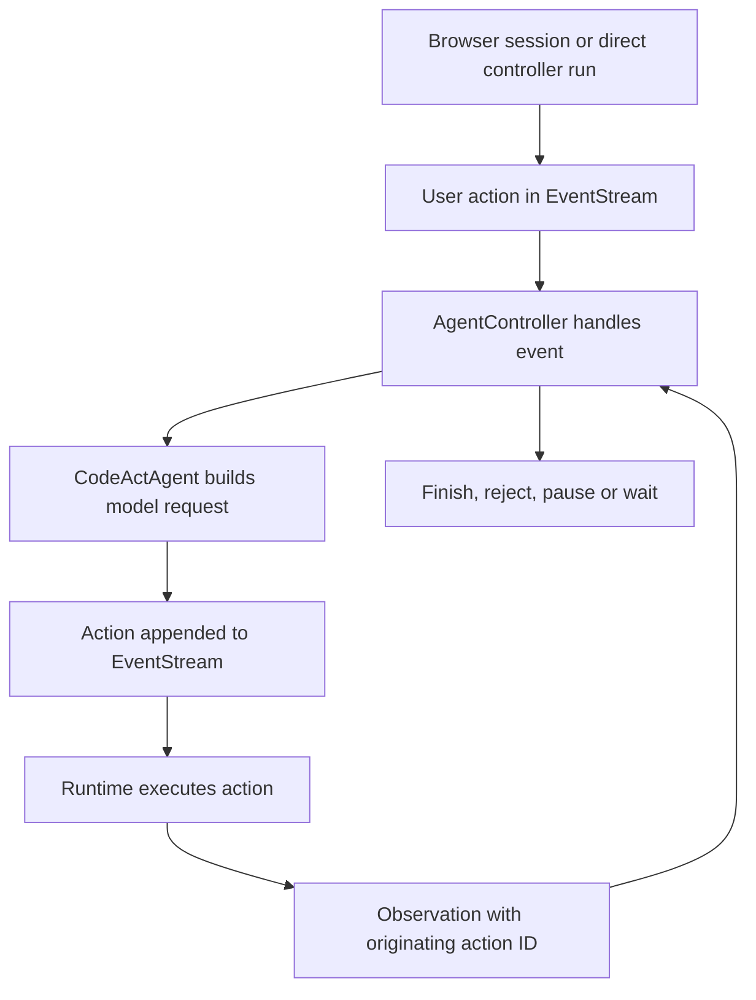

## Overview

OpenHands is a platform for software development agents. A task becomes a conversation in which an agent chooses actions, a runtime executes them, and observations return to the agent. The repository's CodeAct implementation exposes command execution, editing, browsing, Python execution and other tools according to configuration. This documentation describes the implementation in this checkout, whose Python package declares version 0.56.0.

Sources: [README.md:35-38](repo://README.md#L35-L38), [pyproject.toml:7-28](repo://pyproject.toml#L7-L28), [openhands/agenthub/codeact_agent/codeact_agent.py:125-152](repo://openhands/agenthub/codeact_agent/codeact_agent.py#L125-L152)

There are separate entry paths into the same core systems. A browser conversation starts through the server and an `AgentSession`; direct backend callers use `run_controller`. Both arrange a runtime, memory, agent and controller around a shared event stream. The distinction matters when debugging initialization: browser startup includes saved settings and conversation management, while the direct coroutine accepts an application configuration and initial action explicitly.

Sources: [openhands/server/session/agent_session.py:90-197](repo://openhands/server/session/agent_session.py#L90-L197), [openhands/core/main.py:97-167](repo://openhands/core/main.py#L97-L167)

## System map

| Area | What it does | Documentation |
| --- | --- | --- |
| Local startup | Builds the checkout and starts the frontend and backend | [[Quickstart]] |
| Settings | Supplies model credentials and session initialization values | [[Configuration]] |
| Browser sessions | Creates conversations and initializes agent sessions | [[Browser Conversations]] |
| Controller | Decides when to step, wait, finish or require confirmation | [[Agent Control Loop]] |
| Agent and model | Constructs a model request and converts its response into actions | [[Model Decisions and Tools]] |
| Event stream | Persists events and queues them for subscribers | [[Events and Persistence]] |
| Runtime | Executes actions and publishes their observations | [[Sandbox Execution]] |
| Context | Retrieves workspace information and microagent knowledge | [[Memory and Microagents]] |
| External tools | Connects MCP servers and converts discovered tool schemas | [[MCP Tools]] |
| Validation | Provides development tests and benchmark runners | [[Testing and Evaluation]] |

Sources: [Makefile:24-45](repo://Makefile#L24-L45), [Development.md:81-104](repo://Development.md#L81-L104), [Development.md:142-150](repo://Development.md#L142-L150), [openhands/server/services/conversation_service.py:98-159](repo://openhands/server/services/conversation_service.py#L98-L159), [openhands/controller/agent_controller.py:919-973](repo://openhands/controller/agent_controller.py#L919-L973), [openhands/agenthub/codeact_agent/codeact_agent.py:182-224](repo://openhands/agenthub/codeact_agent/codeact_agent.py#L182-L224), [openhands/events/stream.py:163-203](repo://openhands/events/stream.py#L163-L203), [openhands/runtime/base.py:361-399](repo://openhands/runtime/base.py#L361-L399), [openhands/memory/memory.py:90-131](repo://openhands/memory/memory.py#L90-L131), [openhands/mcp/utils.py:28-60](repo://openhands/mcp/utils.py#L28-L60), [openhands/mcp/utils.py:81-148](repo://openhands/mcp/utils.py#L81-L148), [evaluation/README.md:3-18](repo://evaluation/README.md#L3-L18)

## Task lifecycle

Sources: [openhands/core/main.py:165-216](repo://openhands/core/main.py#L165-L216), [openhands/controller/agent_controller.py:467-517](repo://openhands/controller/agent_controller.py#L467-L517), [openhands/controller/agent_controller.py:919-973](repo://openhands/controller/agent_controller.py#L919-L973), [openhands/agenthub/codeact_agent/codeact_agent.py:182-224](repo://openhands/agenthub/codeact_agent/codeact_agent.py#L182-L224), [openhands/runtime/base.py:361-399](repo://openhands/runtime/base.py#L361-L399)

Startup supplies the initial user action: [[Browser Conversations]] follows the session path, and [[Quickstart]] introduces local entry points. [[Events and Persistence]] explains how that action receives an ID and is saved before delivery. [[Agent Control Loop]] follows event handling and the decision to take another step. [[Model Decisions and Tools]] follows the model response into one or more queued actions. [[Sandbox Execution]] completes runnable actions and attaches their IDs to observations, allowing the controller to release its pending action. Finish and reject actions instead update controller outputs and state.

Sources: [openhands/server/session/agent_session.py:181-202](repo://openhands/server/session/agent_session.py#L181-L202), [openhands/core/main.py:177-216](repo://openhands/core/main.py#L177-L216), [openhands/events/stream.py:163-203](repo://openhands/events/stream.py#L163-L203), [openhands/controller/agent_controller.py:467-546](repo://openhands/controller/agent_controller.py#L467-L546), [openhands/agenthub/codeact_agent/codeact_agent.py:207-224](repo://openhands/agenthub/codeact_agent/codeact_agent.py#L207-L224), [openhands/runtime/base.py:391-399](repo://openhands/runtime/base.py#L391-L399)

Context and external capabilities join before or during that cycle. Session startup creates memory and adds MCP tools before creating the controller; the source explicitly requires that ordering so the system message contains the MCP tools. During execution, memory answers recall actions with observations. [[Memory and Microagents]] explains the information supplied, while [[MCP Tools]] covers tool discovery and invocation.

Sources: [openhands/server/session/agent_session.py:156-189](repo://openhands/server/session/agent_session.py#L156-L189), [openhands/memory/memory.py:90-131](repo://openhands/memory/memory.py#L90-L131)

## Cross-cutting decisions

Events carry both execution and recorded history. `EventStream.add_event` rejects an event that already has an ID, with an error identifying accidental re-addition from a handler as a possible loop. It serializes and redacts the event, writes it to the file store, then queues the reconstructed event for delivery. This makes the persisted representation part of the delivery path rather than a separate optional logging callback. Storage failures therefore occur before the queue insertion in this method.

Sources: [openhands/events/stream.py:163-203](repo://openhands/events/stream.py#L163-L203)

The controller tracks one pending action and declines another step while it remains pending. An observation clears that pending action only when its `cause` matches the action ID, subject to confirmation state. Memory follows the same correlation convention even when it has no information: it returns a caused `NullObservation`, with a comment explaining that this releases execution from waiting for retrieval. These checks explain why an unrelated observation is not a substitute for an action's completion.

Sources: [openhands/controller/agent_controller.py:536-546](repo://openhands/controller/agent_controller.py#L536-L546), [openhands/controller/agent_controller.py:821-839](repo://openhands/controller/agent_controller.py#L821-L839), [openhands/memory/memory.py:104-131](repo://openhands/memory/memory.py#L104-L131)

The action-execution client and server communicate using serialized events. The client posts an action to `/execute_action`; the server reconstructs it, dispatches it under a lock and serializes the observation. The transport waits five seconds beyond the action timeout, explicitly to allow the execution side to report its timeout. This separation exposes both action-level feedback and transport failures, which the runtime handles differently.

Sources: [openhands/runtime/impl/action_execution/action_execution_client.py:313-338](repo://openhands/runtime/impl/action_execution/action_execution_client.py#L313-L338), [openhands/runtime/action_execution_server.py:379-397](repo://openhands/runtime/action_execution_server.py#L379-L397), [openhands/runtime/action_execution_server.py:814-831](repo://openhands/runtime/action_execution_server.py#L814-L831), [openhands/runtime/base.py:372-389](repo://openhands/runtime/base.py#L372-L389)

## Scope and operating boundaries

The repository describes its standard local application as intended for a single user on a workstation and explicitly excludes shared multi-tenant deployments from that operating model. It also distinguishes the MIT-licensed project from the separately licensed `enterprise/` folder. The implementation pages here follow the core local/server paths; they do not treat enterprise deployment behavior as a guarantee of the local application.

Sources: [README.md:114-119](repo://README.md#L114-L119), [README.md:161-163](repo://README.md#L161-L163)
