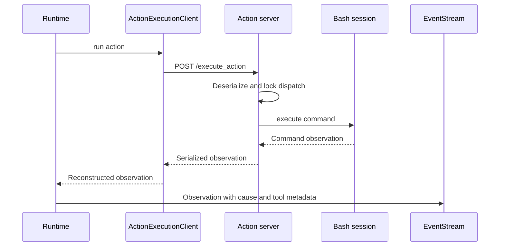

## Overview

The runtime turns agent actions into operations on a workspace and returns observations. Base initialization subscribes to the event stream, copies configuration, assembles environment variables and plugin requirements, and initializes optional security analysis. It adds the VS Code plugin outside headless mode. [[Model Decisions and Tools]] owns the action schemas; the runtime owns dispatch, execution and the feedback that releases pending work in [[Agent Control Loop]].

Sources: [openhands/runtime/base.py:142-203](repo://openhands/runtime/base.py#L142-L203), [openhands/runtime/base.py:361-399](repo://openhands/runtime/base.py#L361-L399), [openhands/controller/agent_controller.py:536-546](repo://openhands/controller/agent_controller.py#L536-L546)

## Runtime selection

`get_runtime_cls` resolves built-in names first, then tries a class path implementing `Runtime`. Invalid selections raise an error listing known names. Optional third-party runtimes are discovered by importing packages under `third_party.runtime.impl`; unavailable optional dependencies are skipped. A runtime's presence in the source tree does not guarantee it is registered in a particular installed environment.

Sources: [openhands/runtime/__init__.py:14-103](repo://openhands/runtime/__init__.py#L14-L103)

| Name | Execution boundary and constraints |
| --- | --- |
| `docker`, `eventstream` | Both resolve to `DockerRuntime`, which attaches to or creates a runtime container |
| `local` | Runs the action-execution server on the host and communicates over HTTP; the implementation explicitly reports that no sandbox is used |
| `cli` | Runs host commands through subprocess or PowerShell helpers; interactive input, IPython and browser operations are unsupported |
| `remote` | Starts or attaches through a remote runtime service; requires a sandbox API key and remote API URL |
| `kubernetes` | Uses the action-execution client with a Kubernetes pod lifecycle |
| Optional third-party names | Registered only when discovery and imports succeed; follow that implementation's configuration |

Sources: [openhands/runtime/__init__.py:14-20](repo://openhands/runtime/__init__.py#L14-L20), [openhands/runtime/__init__.py:49-79](repo://openhands/runtime/__init__.py#L49-L79), [openhands/runtime/impl/docker/docker_runtime.py:170-206](repo://openhands/runtime/impl/docker/docker_runtime.py#L170-L206), [openhands/runtime/impl/local/local_runtime.py:123-160](repo://openhands/runtime/impl/local/local_runtime.py#L123-L160), [openhands/runtime/impl/cli/cli_runtime.py:432-493](repo://openhands/runtime/impl/cli/cli_runtime.py#L432-L493), [openhands/runtime/impl/cli/cli_runtime.py:588-598](repo://openhands/runtime/impl/cli/cli_runtime.py#L588-L598), [openhands/runtime/impl/remote/remote_runtime.py:80-104](repo://openhands/runtime/impl/remote/remote_runtime.py#L80-L104), [openhands/runtime/impl/remote/remote_runtime.py:135-171](repo://openhands/runtime/impl/remote/remote_runtime.py#L135-L171), [openhands/runtime/impl/kubernetes/kubernetes_runtime.py:219-235](repo://openhands/runtime/impl/kubernetes/kubernetes_runtime.py#L219-L235)

## Docker startup and workspace

`DockerRuntime.connect` first tries the session's container. If it is missing and `attach_to_existing` is true, connection fails with `AgentRuntimeDisconnectedError`; otherwise it builds an image if necessary and creates the container. It waits for the action server to become alive and sets up the initial environment for a new attachment mode. This distinguishes a missing existing runtime from an ordinary first startup that is allowed to provision one.

Sources: [openhands/runtime/impl/docker/docker_runtime.py:170-206](repo://openhands/runtime/impl/docker/docker_runtime.py#L170-L206), [openhands/runtime/impl/docker/docker_runtime.py:233-240](repo://openhands/runtime/impl/docker/docker_runtime.py#L233-L240)

Container creation allocates ports with locks, adds configured startup environment values, processes volume mounts and starts the action-server command. GPU settings become Docker device requests when enabled. The final `containers.run` also receives configured Docker keyword arguments. If container creation raises, the runtime logs the failure, calls close and reraises. Workspace mount normalization belongs to [[Configuration]]; the Docker implementation translates the resulting mount settings into Docker volumes and optional overlay mounts.

Sources: [openhands/runtime/impl/docker/docker_runtime.py:391-408](repo://openhands/runtime/impl/docker/docker_runtime.py#L391-L408), [openhands/runtime/impl/docker/docker_runtime.py:470-541](repo://openhands/runtime/impl/docker/docker_runtime.py#L470-L541), [openhands/runtime/impl/docker/docker_runtime.py:285-322](repo://openhands/runtime/impl/docker/docker_runtime.py#L285-L322)

Repository setup obtains an authenticated clone URL, clones into the repository's final path component and checks out either the selected branch or a generated workspace branch. Without a repository, it initializes Git only when `init_git_in_empty_workspace` is enabled. The optional `.openhands/setup.sh` hook is read from the workspace, marked executable and sourced with a 600-second hard timeout as a hidden environment action. Repository knowledge loaded later is described in [[Memory and Microagents]].

Sources: [openhands/runtime/base.py:401-488](repo://openhands/runtime/base.py#L401-L488)

## Action round trip

`Runtime._handle_action` supplies a default nonblocking timeout when the event has none and refreshes provider tokens before execution. MCP actions use the asynchronous MCP dispatch path; other actions call `run_action` through the async bridge. Base dispatch handles non-runnable actions, checks confirmation state, verifies the action type and implementation method, and invokes that method. [[MCP Tools]] explains the external-tool branch separately.

Sources: [openhands/runtime/base.py:361-371](repo://openhands/runtime/base.py#L361-L371), [openhands/runtime/base.py:890-898](repo://openhands/runtime/base.py#L890-L898), [openhands/runtime/base.py:950-972](repo://openhands/runtime/base.py#L950-L972)

Sources: [openhands/runtime/impl/action_execution/action_execution_client.py:313-341](repo://openhands/runtime/impl/action_execution/action_execution_client.py#L313-L341), [openhands/runtime/action_execution_server.py:379-397](repo://openhands/runtime/action_execution_server.py#L379-L397), [openhands/runtime/action_execution_server.py:814-831](repo://openhands/runtime/action_execution_server.py#L814-L831), [openhands/runtime/base.py:391-399](repo://openhands/runtime/base.py#L391-L399)

The action-execution client serializes requests under its action semaphore and waits for the action timeout plus five seconds. It reconstructs the observation and sets its cause; a transport timeout raises `AgentRuntimeTimeoutError`. The server reconstructs an `Action`, updates activity time, dispatches under an async lock and serializes the result. These client and server locks serialize action dispatch within their respective instances, rather than offering parallel execution of a model's queued tool calls.

Sources: [openhands/runtime/impl/action_execution/action_execution_client.py:280-338](repo://openhands/runtime/impl/action_execution/action_execution_client.py#L280-L338), [openhands/runtime/action_execution_server.py:379-383](repo://openhands/runtime/action_execution_server.py#L379-L383), [openhands/runtime/action_execution_server.py:814-831](repo://openhands/runtime/action_execution_server.py#L814-L831)

## Commands, plugins and editing

The execution server uses its persistent Bash session for normal commands and creates a separate session for static actions. Bash execution checks initialization, rejects empty polling or interactive input when no prior command is running, and rejects multiple parsed commands unless represented as a single chained shell command. If a previous command is still active after a timeout, a new ordinary command can return the earlier output with a message that the new command was not executed. A timeout observation is therefore not sufficient evidence that the process has exited.

Sources: [openhands/runtime/action_execution_server.py:385-397](repo://openhands/runtime/action_execution_server.py#L385-L397), [openhands/runtime/utils/bash.py:483-521](repo://openhands/runtime/utils/bash.py#L483-L521), [openhands/runtime/utils/bash.py:537-575](repo://openhands/runtime/utils/bash.py#L537-L575)

Initialization creates Bash first, starts browser initialization in the background and initializes requested plugins with a timeout. The plugin registry contains Jupyter, agent skills and VS Code. When both Jupyter and agent skills are active, the server imports the skills into the Python environment. Before a Python cell runs, it synchronizes the Jupyter working directory with Bash when they differ. Standard file edits use the ACI editor and produce a `FileEditObservation` with a calculated diff; browser operations wait for browser readiness or return an unsupported/disabled error.

Sources: [openhands/runtime/action_execution_server.py:291-345](repo://openhands/runtime/action_execution_server.py#L291-L345), [openhands/runtime/plugins/__init__.py:21-25](repo://openhands/runtime/plugins/__init__.py#L21-L25), [openhands/runtime/action_execution_server.py:399-423](repo://openhands/runtime/action_execution_server.py#L399-L423), [openhands/runtime/action_execution_server.py:565-605](repo://openhands/runtime/action_execution_server.py#L565-L605)

## Failures and teardown

Permission errors become `ErrorObservation` feedback so the agent can continue. Network and runtime-disconnection errors instead set a disconnected runtime status and return without publishing a normal action observation; other unexpected exceptions set a general runtime error. On success, the runtime copies cause and tool-call metadata, skips null observations and appends the result. [[Events and Persistence]] covers the subsequent write and delivery path.

Sources: [openhands/runtime/base.py:372-399](repo://openhands/runtime/base.py#L372-L399)

Docker close shuts down base resources and its log streamer. If configured to keep the runtime alive or attached to an existing runtime, it returns before stopping containers. Otherwise it stops containers selected by the current container name or broader configured prefix and releases acquired port locks. These lifecycle flags explain why closing a conversation need not always remove its runtime container.

Sources: [openhands/runtime/impl/docker/docker_runtime.py:593-633](repo://openhands/runtime/impl/docker/docker_runtime.py#L593-L633)
