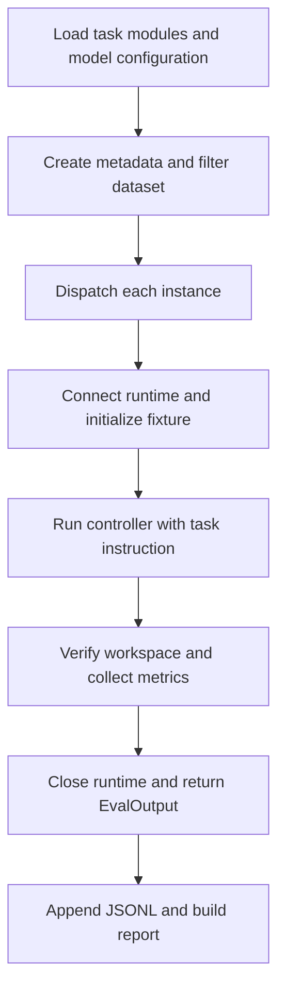

## Overview

OpenHands separates local unit and frontend checks from evaluations that run an agent against task instances. Local checks exercise implementation behavior; the integration evaluation runner creates a runtime, asks the agent to perform a task and verifies the resulting workspace. Begin with the development environment in [[Quickstart]], then choose the check that covers the change. Evaluation results include task outcomes and interaction data, so they answer a different question from a passing frontend or Python test suite.

Sources: [tests/unit/README.md:3-20](repo://tests/unit/README.md#L3-L20), [frontend/package.json:69-79](repo://frontend/package.json#L69-L79), [evaluation/integration_tests/run_infer.py:101-148](repo://evaluation/integration_tests/run_infer.py#L101-L148)

## Local checks

Run the Python unit suite from the repository root with the documented command below. The unit-test guide also supports selecting a file or an individual test and increasing verbosity. A concrete example of focused coverage is the configuration-precedence test: it supplies temporary configuration files and mocked arguments, invokes configuration setup, and asserts that the named CLI selection wins. This checks the behavior explained in [[Configuration]] without starting an agent task.

Sources: [tests/unit/README.md:5-26](repo://tests/unit/README.md#L5-L26), [tests/unit/core/config/test_config_precedence.py:20-67](repo://tests/unit/core/config/test_config_precedence.py#L20-L67), [tests/unit/core/config/test_config_precedence.py:70-95](repo://tests/unit/core/config/test_config_precedence.py#L70-L95)

```bash
poetry run pytest ./tests/unit
```

Sources: [tests/unit/README.md:5-9](repo://tests/unit/README.md#L5-L9)

| Check | Command and execution scope |
| --- | --- |
| Frontend tests | `make test-frontend` at the root, or `npm run test` in `frontend`; invokes Vitest |
| Default test target | `make test` invokes only `test-frontend`; it does not invoke the Python unit suite |
| Browser tests | `npm run test:e2e` in `frontend`; invokes Playwright |
| Frontend coverage | `npm run test:coverage` in `frontend`; generates translations before Vitest coverage |
| Frontend lint | `make lint-frontend`; the npm script runs type checking, ESLint and Prettier checks |
| Backend lint | `make lint-backend`; installs pre-commit hooks and runs the configured checks against all files |

Sources: [Makefile:185-197](repo://Makefile#L185-L197), [Makefile:237-242](repo://Makefile#L237-L242), [frontend/package.json:69-79](repo://frontend/package.json#L69-L79)

## Integration task lifecycle

The integration loader discovers Python files whose names start with `t` in its tests directory and builds a DataFrame containing file paths and instance IDs. Each module must expose a `Test` class inheriting `BaseIntegrationTest`. The contract contains an `INSTRUCTION`, an `initialize_runtime` method and a `verify_result` method returning `TestResult`, whose fields are a success boolean and optional reason. This keeps task preparation and scoring next to the task definition.

Sources: [evaluation/integration_tests/run_infer.py:88-101](repo://evaluation/integration_tests/run_infer.py#L88-L101), [evaluation/integration_tests/run_infer.py:152-165](repo://evaluation/integration_tests/run_infer.py#L152-L165), [evaluation/integration_tests/tests/base.py:9-32](repo://evaluation/integration_tests/tests/base.py#L9-L32)



Sources: [evaluation/integration_tests/run_infer.py:168-208](repo://evaluation/integration_tests/run_infer.py#L168-L208), [evaluation/integration_tests/run_infer.py:106-149](repo://evaluation/integration_tests/run_infer.py#L106-L149), [evaluation/utils/shared.py:292-305](repo://evaluation/utils/shared.py#L292-L305), [evaluation/integration_tests/run_infer.py:210-250](repo://evaluation/integration_tests/run_infer.py#L210-L250)

For example, the typo fixture copies a prepared `bad.txt` into `/workspace`. After the agent runs, verification reads that file through a runtime command, checks the command exit code and compares normalized contents with the expected correction. The runner requires a nonempty history, collects metrics and closes the connected runtime in a `finally` block around initialization, controller execution and verification. [[Sandbox Execution]] explains the command and file operations used by these fixtures.

Sources: [evaluation/integration_tests/tests/t01_fix_simple_typo.py:10-39](repo://evaluation/integration_tests/tests/t01_fix_simple_typo.py#L10-L39), [evaluation/integration_tests/run_infer.py:106-136](repo://evaluation/integration_tests/run_infer.py#L106-L136)

## Evaluation configuration

The integration shell runner accepts model configuration, commit hash, agent, instance limit, maximum iterations, worker count and instance IDs in that order. It defaults to one worker, `CodeActAgent` and ten maximum iterations. Its Python entry requires a resolvable LLM configuration, creates metadata, prepares the selected instances and calls the shared evaluator. Those defaults belong to this wrapper; the shared configuration helper independently defaults to fifty iterations when neither an override nor metadata supplies a value.

Sources: [evaluation/integration_tests/scripts/run_infer.sh:6-23](repo://evaluation/integration_tests/scripts/run_infer.sh#L6-L23), [evaluation/integration_tests/scripts/run_infer.sh:44-62](repo://evaluation/integration_tests/scripts/run_infer.sh#L44-L62), [evaluation/integration_tests/run_infer.py:168-208](repo://evaluation/integration_tests/run_infer.py#L168-L208), [evaluation/utils/shared.py:747-762](repo://evaluation/utils/shared.py#L747-L762)

`get_openhands_config_for_eval` creates an explicit evaluation configuration with a local file store under the absolute `.eval_sessions` path in the current working directory. Runtime selection comes from its argument, then `RUNTIME`, then `docker`. The default sandbox uses a 300-second timeout and disables keeping the runtime alive. The integration runner additionally sets the platform to `linux/amd64`, enables debugging and completion logging, and configures Jupyter and browsing tools with the LLM editor disabled. Inspect these runner overrides when comparing an evaluation with browser behavior.

Sources: [evaluation/utils/shared.py:692-705](repo://evaluation/utils/shared.py#L692-L705), [evaluation/utils/shared.py:743-781](repo://evaluation/utils/shared.py#L743-L781), [evaluation/integration_tests/run_infer.py:43-66](repo://evaluation/integration_tests/run_infer.py#L43-L66)

## Selection and resuming

`prepare_dataset` requires an `instance_id` column. It reads existing output JSON lines and treats every recorded ID as finished, regardless of its result. Explicit IDs take precedence over skip and limit selection. Otherwise, a positive limit samples without replacement using seed 42, optionally after skipping initial rows. Finished IDs are removed after selection, so a requested sample size can yield fewer remaining tasks on a resumed run. The helper also converts array and timestamp values into serializable forms.

Sources: [evaluation/utils/shared.py:219-289](repo://evaluation/utils/shared.py#L219-L289)

`make_metadata` organizes output by dataset, agent and model name, with maximum iterations and an optional evaluation note in the final directory name. It writes `metadata.json`, including the current Git commit, start time and supplied configuration. The integration runner places `output.jsonl` in that directory. Reusing the same output location therefore invokes ID-based resume behavior; a stored failure is not automatically retried simply because another run starts.

Sources: [evaluation/utils/shared.py:164-216](repo://evaluation/utils/shared.py#L164-L216), [evaluation/integration_tests/run_infer.py:179-200](repo://evaluation/integration_tests/run_infer.py#L179-L200), [evaluation/utils/shared.py:231-239](repo://evaluation/utils/shared.py#L231-L239), [evaluation/utils/shared.py:280-284](repo://evaluation/utils/shared.py#L280-L284)

## Workers and failures

More than one worker selects a multiprocessing pool with unordered result delivery; one worker processes rows sequentially. Each result is appended as a JSON line and flushed immediately. Output order consequently follows completion order in the pool. The wrapper defaults to five retries after the initial attempt, waits five seconds between exception retries, and passes a runtime-failure count only to processors declaring that parameter. A normal unsuccessful task result is returned directly; it does not trigger exception retries.

Sources: [evaluation/utils/shared.py:486-538](repo://evaluation/utils/shared.py#L486-L538), [evaluation/utils/shared.py:292-305](repo://evaluation/utils/shared.py#L292-L305), [evaluation/utils/shared.py:387-410](repo://evaluation/utils/shared.py#L387-L410), [evaluation/utils/shared.py:459-478](repo://evaluation/utils/shared.py#L459-L478)

Exhausted retries normally raise `RuntimeError`. With `EVAL_SKIP_MAXIMUM_RETRIES_EXCEEDED=true`, the wrapper instead logs the instance in `maximum_retries_exceeded.jsonl` and returns an output with an error and empty test result. Timeout handling similarly returns an error result without retrying. In this implementation, `run_evaluation` passes `timeout_seconds` through the multiprocessing path but omits it from the sequential wrapper call, so the shared timeout argument does not apply equally to both paths.

Sources: [evaluation/utils/shared.py:427-458](repo://evaluation/utils/shared.py#L427-L458), [evaluation/utils/shared.py:339-369](repo://evaluation/utils/shared.py#L339-L369), [evaluation/utils/shared.py:405-426](repo://evaluation/utils/shared.py#L405-L426), [evaluation/utils/shared.py:512-538](repo://evaluation/utils/shared.py#L512-L538)

## Results and reporting

`EvalOutput` requires an instance ID and test-result dictionary, with optional instruction, metadata, history, metrics, error and input instance. The integration runner fills these fields, reads the JSONL output back, computes success rate and recorded cost, and writes `report.md`. Its report directly indexes `success` and `reason` in each test result. Empty results produced by generic failure handling do not meet that report's assumptions, so successful result serialization alone does not guarantee that this report-generation step will succeed.

Sources: [evaluation/utils/shared.py:59-78](repo://evaluation/utils/shared.py#L59-L78), [evaluation/integration_tests/run_infer.py:138-148](repo://evaluation/integration_tests/run_infer.py#L138-L148), [evaluation/integration_tests/run_infer.py:210-250](repo://evaluation/integration_tests/run_infer.py#L210-L250), [evaluation/utils/shared.py:364-369](repo://evaluation/utils/shared.py#L364-L369)
