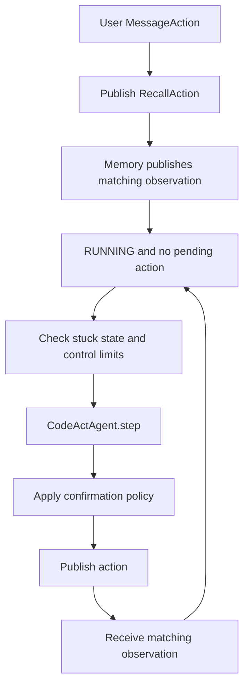

## Overview

`AgentController` decides when an agent may take a step, tracks its state, and publishes the resulting action. `CodeActAgent` decides what that action should be by converting conversation history into model messages. The controller does not execute shell commands itself: that responsibility belongs to [[Sandbox Runtimes]], while model connection and retries belong to [[Configuration and Language Models]].

Sources: [openhands/controller/agent_controller.py:821-887](repo://openhands/controller/agent_controller.py#L821-L887), [openhands/agenthub/codeact_agent/codeact_agent.py:182-224](repo://openhands/agenthub/codeact_agent/codeact_agent.py#L182-L224), [openhands/runtime/base.py:361-399](repo://openhands/runtime/base.py#L361-L399)

## From user message to eligible step

The controller skips hidden events, adds other events to its tracked history, handles their action or observation semantics, and asks `should_step` whether to continue. User messages normally qualify; state-change observations do not. A parent with an active delegate does not independently step. Its event callback forwards work to the delegate until the delegate has reached a finishing or error condition handled by that callback.

Sources: [openhands/controller/agent_controller.py:392-485](repo://openhands/controller/agent_controller.py#L392-L485)

A user message first triggers recall. For the first message, the controller requests `WORKSPACE_CONTEXT`; subsequent messages request `KNOWLEDGE`. It marks the recall action pending before publishing it and changes the agent state to `RUNNING` when necessary. Consequently, receiving a user message does not imply that the model is immediately called: [[Memory and Microagents]] must return the matching context observation to release this pending work.

Sources: [openhands/controller/agent_controller.py:549-588](repo://openhands/controller/agent_controller.py#L549-L588), [openhands/memory/memory.py:90-131](repo://openhands/memory/memory.py#L90-L131)

Sources: [openhands/controller/agent_controller.py:536-583](repo://openhands/controller/agent_controller.py#L536-L583), [openhands/controller/agent_controller.py:821-887](repo://openhands/controller/agent_controller.py#L821-L887), [openhands/controller/agent_controller.py:919-973](repo://openhands/controller/agent_controller.py#L919-L973), [openhands/memory/memory.py:90-131](repo://openhands/memory/memory.py#L90-L131)

## Scheduling guarantees

`_step` returns immediately unless the state is `RUNNING` and no action is pending. Before requesting a new action, it synchronizes spending with the budget flag, checks for a stuck agent, and runs control flags. A control-limit exception enters controller error handling. Replay can supply the next action instead of calling the agent, preserving the controller's surrounding action-handling path.

Sources: [openhands/controller/agent_controller.py:821-873](repo://openhands/controller/agent_controller.py#L821-L873)

An observation clears the pending action only when its `cause` matches that action's ID, and not while the controller is awaiting user confirmation. A confirmed action's result moves execution back to `RUNNING`; a rejected action's result moves it to `AWAITING_USER_INPUT`. Pending actions older than 60 seconds produce a diagnostic message but are not cleared by that timer. A long-running action therefore cannot be assumed abandoned solely because the log mentions a timeout.

Sources: [openhands/controller/agent_controller.py:536-547](repo://openhands/controller/agent_controller.py#L536-L547), [openhands/controller/agent_controller.py:979-1002](repo://openhands/controller/agent_controller.py#L979-L1002)

## CodeAct action selection

CodeAct starts with a queue of pending actions, a tool catalogue, conversation memory, and a condenser. Its sandbox plugins place agent skills before Jupyter because Jupyter needs the functions initialized by those skills. Tool configuration independently enables shell execution, thinking, finishing, condensation requests, browsing, Python, task tracking, and editing. The LLM-based editor takes precedence over the standard editor when both relevant switches are enabled; browsing is omitted on Windows.

Sources: [openhands/agenthub/codeact_agent/codeact_agent.py:70-96](repo://openhands/agenthub/codeact_agent/codeact_agent.py#L70-L96), [openhands/agenthub/codeact_agent/codeact_agent.py:108-152](repo://openhands/agenthub/codeact_agent/codeact_agent.py#L108-L152)

`step` drains queued actions before making another model request. If the queue is empty and the latest user message is `/exit`, it returns a finish action. Otherwise the condenser returns either a usable event view or a condensation action. A condensation action is returned immediately; a view is converted into messages, combined with checked tool schemas and metadata, and sent to `llm.completion`. Every returned action is queued, and the first is emitted for this step.

Sources: [openhands/agenthub/codeact_agent/codeact_agent.py:182-224](repo://openhands/agenthub/codeact_agent/codeact_agent.py#L182-L224)

Message construction delegates event formatting to `ConversationMemory`, passing the initial user message, character limit, and vision capability. Prompt caching is applied only when active for the configured model. [[Memory and Microagents]] owns the details of history selection and event-to-message conversion, so extensions should preserve that boundary instead of reimplementing prompt history inside the controller.

Sources: [openhands/agenthub/codeact_agent/codeact_agent.py:279-293](repo://openhands/agenthub/codeact_agent/codeact_agent.py#L279-L293)

## Tool responses and validation

`response_to_actions` accepts one model choice and translates each tool call into an OpenHands action. It parses arguments as JSON and raises `FunctionCallValidationError` for malformed JSON or required arguments that are absent. For example, the shell tool requires `command`, optionally sets a hard timeout, and translates its string `is_input` argument into a boolean. The Python tool requires `code`; the finish tool creates `AgentFinishAction` from the message argument.

Sources: [openhands/agenthub/codeact_agent/function_calling.py:73-150](repo://openhands/agenthub/codeact_agent/function_calling.py#L73-L150)

Malformed actions, missing actions, response errors, and tool-validation failures become `ErrorObservation` events, giving the conversation feedback instead of silently dropping the model output. Context-window errors have a separate recovery branch: when history truncation is enabled, the controller publishes `CondensationRequestAction`; otherwise it raises a context-window exception. Other provider failures propagate to the outer exception handler and runtime-status handling.

Sources: [openhands/controller/agent_controller.py:874-917](repo://openhands/controller/agent_controller.py#L874-L917), [openhands/controller/agent_controller.py:361-390](repo://openhands/controller/agent_controller.py#L361-L390)

## Confirmation and completion

Confirmation handling covers specific runnable action classes: shell, Python, interactive browsing, file edits, and file reads. The controller invokes security analysis, then considers the action's reported risk. CLI mode marks these actions for its own confirmation handling; outside CLI mode, high risk or unknown risk without an analyzer can require confirmation when confirmation mode is enabled. This is a class-specific branch, not a blanket promise that every possible runnable action receives the same policy.

Sources: [openhands/controller/agent_controller.py:919-959](repo://openhands/controller/agent_controller.py#L919-L959)

When the user confirms or rejects, the controller updates the pending action's confirmation state, clears its ID, and publishes it as a new event. State changes also emit `AgentStateChangedObservation` and save state. Finish and reject actions store outputs and set `FINISHED` or `REJECTED`; an agent message requesting a response sets `AWAITING_USER_INPUT`. [[Events and Persistence]] explains the saved state and event identities behind these transitions.

Sources: [openhands/controller/agent_controller.py:512-517](repo://openhands/controller/agent_controller.py#L512-L517), [openhands/controller/agent_controller.py:585-588](repo://openhands/controller/agent_controller.py#L585-L588), [openhands/controller/agent_controller.py:631-683](repo://openhands/controller/agent_controller.py#L631-L683)

## Extending an agent

An agent implements `step(State) -> Action`, can supply sandbox plugin requirements, and registers under a unique name through `Agent.register`. Duplicate registration raises an error. The base agent exposes a system-message action containing its prompt, tools, and class name. Reset clears completion status without resetting model metrics, and CodeAct additionally clears its pending-action queue. These interfaces allow a different action-selection strategy while preserving controller and runtime integration.

Sources: [openhands/controller/agent.py:34-51](repo://openhands/controller/agent.py#L34-L51), [openhands/controller/agent.py:59-93](repo://openhands/controller/agent.py#L59-L93), [openhands/controller/agent.py:104-133](repo://openhands/controller/agent.py#L104-L133), [openhands/agenthub/codeact_agent/codeact_agent.py:154-158](repo://openhands/agenthub/codeact_agent/codeact_agent.py#L154-L158)
