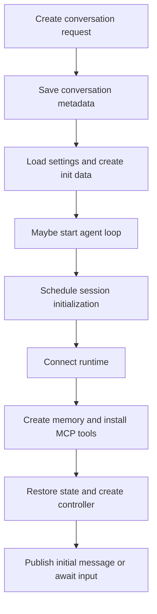

## Overview

The server turns conversation requests into managed agent sessions and connects clients to their event streams. FastAPI hosts HTTP routes, while the exported ASGI application wraps it with Socket.IO. `AgentSession` owns the runtime, memory, controller, and restoration attempt for one conversation. [[Web Interface]] follows the browser side; [[Agent Execution]] covers what happens after session initialization.

Sources: [openhands/server/app.py:58-86](repo://openhands/server/app.py#L58-L86), [openhands/server/listen.py:5-27](repo://openhands/server/listen.py#L5-L27), [openhands/server/session/agent_session.py:134-202](repo://openhands/server/session/agent_session.py#L134-L202)

## Application assembly

The FastAPI lifespan enters the conversation manager and combines it with the server's MCP application's lifespan. It includes public, file, security, feedback, conversation, settings, secrets, and trajectory routes; Git routes are included in OSS mode. The listener optionally mounts the frontend build when `SERVE_FRONTEND` is true, then installs localhost CORS, cache-control, and rate-limit middleware before wrapping the application with Socket.IO.

Sources: [openhands/server/app.py:37-86](repo://openhands/server/app.py#L37-L86), [openhands/server/listen.py:15-27](repo://openhands/server/listen.py#L15-L27)

## Creating a conversation

`POST /api/conversations` accepts task text, repository and branch selection, image URLs, replay data, suggested tasks, microagent-management inputs, conversation instructions, and MCP configuration. Suggested tasks can supply the initial prompt; microagent-management requests can fill repository and provider selection. Bearer-authenticated requests are classified as remote API requests and must include an initial user message or receive a 400 response.

Sources: [openhands/server/routes/manage_conversations.py:78-78](repo://openhands/server/routes/manage_conversations.py#L78-L78), [openhands/server/routes/manage_conversations.py:189-240](repo://openhands/server/routes/manage_conversations.py#L189-L240), [openhands/server/routes/manage_conversations.py:249-263](repo://openhands/server/routes/manage_conversations.py#L249-L263)

When a repository is supplied, the route asks the provider handler to verify it. It chooses the supplied conversation ID or generates one, then calls `create_new_conversation`. That service initializes conversation metadata before starting the conversation. The response includes `status`, `conversation_id`, and `conversation_status`; it is not the completed agent result.

Sources: [openhands/server/routes/manage_conversations.py:242-269](repo://openhands/server/routes/manage_conversations.py#L242-L269), [openhands/server/services/conversation_service.py:164-195](repo://openhands/server/services/conversation_service.py#L164-L195)

Startup loads saved user settings, checks credentials, adds repository and secret configuration, constructs `ConversationInitData`, applies the conversation experiment variant, and wraps task text and images in an initial `MessageAction`. Missing settings raise `MissingSettingsError`; non-Bedrock models without an acceptable API key raise `LLMAuthenticationError`. The create route maps these two failures to 400 responses with distinct message IDs. [[Configuration and Language Models]] explains the separate application-level loading path.

Sources: [openhands/server/services/conversation_service.py:98-161](repo://openhands/server/services/conversation_service.py#L98-L161), [openhands/server/routes/manage_conversations.py:270-288](repo://openhands/server/routes/manage_conversations.py#L270-L288)

## Session initialization

Sources: [openhands/server/services/conversation_service.py:98-195](repo://openhands/server/services/conversation_service.py#L98-L195), [openhands/server/conversation_manager/standalone_conversation_manager.py:340-367](repo://openhands/server/conversation_manager/standalone_conversation_manager.py#L340-L367), [openhands/server/session/agent_session.py:134-202](repo://openhands/server/session/agent_session.py#L134-L202), [openhands/server/session/agent_session.py:426-446](repo://openhands/server/session/agent_session.py#L426-L446)

The standalone manager reuses an existing agent loop for the conversation ID. Otherwise it can close older conversations when the configured concurrency limit is reached, creates registry and statistics objects, stores a new `Session`, and schedules `initialize_agent` as an asyncio task. The HTTP response can therefore arrive while the runtime is still starting; clients must use conversation and runtime status to distinguish accepted startup from readiness.

Sources: [openhands/server/conversation_manager/standalone_conversation_manager.py:280-367](repo://openhands/server/conversation_manager/standalone_conversation_manager.py#L280-L367)

`AgentSession.start` rejects a second start on an already populated session and returns if the session is closed. It creates the runtime, registers provider and custom secrets with the event stream, creates memory, installs MCP tools, and then creates or replays the controller. [[Sandbox Runtimes]], [[Memory and Microagents]], and [[MCP Tools]] own those component-specific operations. With an initial message it publishes that message and a running-state action; without one it publishes an awaiting-input state action.

Sources: [openhands/server/session/agent_session.py:117-202](repo://openhands/server/session/agent_session.py#L117-L202)

## HTTP operations

| Method and path | Behavior |
| --- | --- |
| `POST /api/conversations` | Creates metadata and starts or joins the agent loop |
| `POST /api/conversations/{conversation_id}/start` | Checks metadata and requests an existing or new loop |
| `POST /api/conversations/{conversation_id}/stop` | Closes a starting or running session |
| `GET /api/conversations/{conversation_id}/events` | Reads stored events with range, direction, filter, and limit |
| `POST /api/conversations/{conversation_id}/events` | Sends request JSON to the managed conversation |
| `GET /api/conversations/{conversation_id}/config` | Returns runtime and session identifiers |
| `GET /api/conversations/{conversation_id}/vscode-url` | Returns the runtime's editor URL |
| `GET /api/conversations/{conversation_id}/web-hosts` | Returns runtime preview hosts |

Sources: [openhands/server/routes/manage_conversations.py:78-78](repo://openhands/server/routes/manage_conversations.py#L78-L78), [openhands/server/routes/manage_conversations.py:189-269](repo://openhands/server/routes/manage_conversations.py#L189-L269), [openhands/server/routes/manage_conversations.py:473-574](repo://openhands/server/routes/manage_conversations.py#L473-L574), [openhands/server/routes/conversation.py:19-102](repo://openhands/server/routes/conversation.py#L19-L102), [openhands/server/routes/conversation.py:105-177](repo://openhands/server/routes/conversation.py#L105-L177)

Event search defaults to 20 results, asks storage for one extra result, and returns `events` plus `has_more`. The implementation rejects negative limits and limits above 100; zero is not rejected by that branch despite the docstring's stated minimum of one. Stored-event reads use `EventStore` directly, so reading history is separate from sending an action to a live session. [[Events and Persistence]] explains its inclusive range and cache behavior.

Sources: [openhands/server/routes/conversation.py:105-177](repo://openhands/server/routes/conversation.py#L105-L177)

## Socket connection and replay

A Socket.IO connection supplies `conversation_id` and optionally `latest_event_id` and provider selections. The server rejects a missing conversation ID, checks the configured session key, and invokes the conversation validator using cookies and authorization headers. It replays stored events starting after the client's latest ID, omits null and recall actions, and sends the last state-change observation after the other replayed events.

Sources: [openhands/server/listen_socket.py:35-114](repo://openhands/server/listen_socket.py#L35-L114)

After replay, the server loads initialization settings and joins the conversation. The standalone manager adds the connection to a conversation room, records its session mapping, and ensures the agent loop exists. Client `oh_user_action` events go through that mapping to session dispatch; `oh_action` remains as a compatibility alias. Disconnecting removes the connection mapping and is distinct from explicitly closing the session.

Sources: [openhands/server/listen_socket.py:120-158](repo://openhands/server/listen_socket.py#L120-L158), [openhands/server/conversation_manager/standalone_conversation_manager.py:151-165](repo://openhands/server/conversation_manager/standalone_conversation_manager.py#L151-L165), [openhands/server/conversation_manager/standalone_conversation_manager.py:369-408](repo://openhands/server/conversation_manager/standalone_conversation_manager.py#L369-L408)

## Restoration and shutdown

Controller creation requires a runtime and attempts to restore the saved state. Restoration errors are caught: they produce a warning when the event stream suggests prior activity, otherwise a debug message. A missing snapshot can therefore lead to controller creation without restored state rather than automatically aborting the conversation. Snapshot format and loading semantics are owned by [[Events and Persistence]].

Sources: [openhands/server/session/agent_session.py:409-446](repo://openhands/server/session/agent_session.py#L409-L446), [openhands/server/session/agent_session.py:492-510](repo://openhands/server/session/agent_session.py#L492-L510)

Stopping an already inactive conversation returns successfully with an explanatory message. Active shutdown disconnects associated sockets, removes the manager's session entry, and closes the session. `AgentSession.close` is guarded against repeated closure, closes the event stream, saves and closes the controller, and submits runtime cleanup to an executor. Runtime container retention still follows the settings documented in [[Sandbox Runtimes]].

Sources: [openhands/server/routes/manage_conversations.py:546-574](repo://openhands/server/routes/manage_conversations.py#L546-L574), [openhands/server/conversation_manager/standalone_conversation_manager.py:429-454](repo://openhands/server/conversation_manager/standalone_conversation_manager.py#L429-L454), [openhands/server/session/agent_session.py:224-245](repo://openhands/server/session/agent_session.py#L224-L245)
