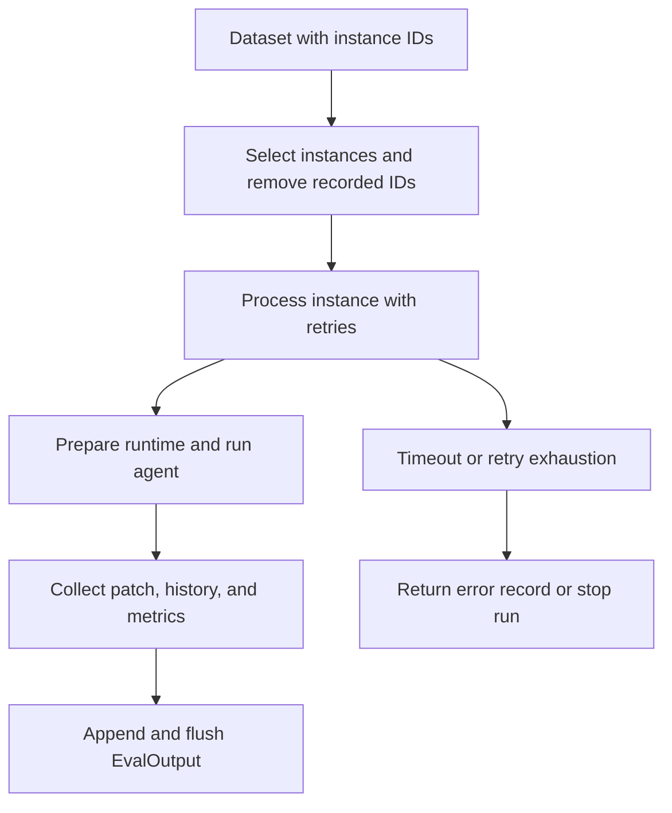

## Overview

OpenHands has ordinary code checks, runtime tests, agent integration tasks, and benchmark inference workflows. They answer different questions: unit tests validate implementation behavior, integration tasks let an agent operate a prepared runtime, and benchmark scripts collect outputs for scoring. Use [[Quickstart]] to prepare dependencies before these workflows. The execution shared by agent tasks is documented in [[Agent Execution]].

Sources: [.github/workflows/py-tests.yml:46-53](repo://.github/workflows/py-tests.yml#L46-L53), [evaluation/integration_tests/tests/base.py:9-32](repo://evaluation/integration_tests/tests/base.py#L9-L32), [evaluation/benchmarks/swe_bench/run_infer.py:637-709](repo://evaluation/benchmarks/swe_bench/run_infer.py#L637-L709)

## Local checks and CI coverage

The Linux Python workflow installs the development, test, and runtime dependency groups, builds the project, runs the unit-test directory with forked parallel pytest workers, and separately runs bash runtime tests against `CLIRuntime`. The Windows job runs a specific Windows bash unit test and the bash runtime tests with `LocalRuntime`. Enterprise unit tests run from their own package directory with their own dependency installation.

Sources: [.github/workflows/py-tests.yml:46-106](repo://.github/workflows/py-tests.yml#L46-L106)

The unit command used by Linux CI is:

Sources: [.github/workflows/py-tests.yml:50-51](repo://.github/workflows/py-tests.yml#L50-L51)

```bash
PYTHONPATH=".:$PYTHONPATH" poetry run pytest --forked -n auto -svv ./tests/unit
```

Sources: [.github/workflows/py-tests.yml:51-51](repo://.github/workflows/py-tests.yml#L51-L51)

`make test` invokes frontend tests only in this checkout; it is not an umbrella target for all Python checks. Frontend scripts use Vitest for unit tests, Playwright for end-to-end tests, and React Router type generation plus TypeScript for type checks. `make lint` runs frontend lint and backend pre-commit checks. The backend lint prerequisite installs hooks and dependencies, so that Make target has setup effects as well as validation effects.

Sources: [Makefile:185-201](repo://Makefile#L185-L201), [Makefile:237-242](repo://Makefile#L237-L242), [frontend/package.json:63-81](repo://frontend/package.json#L63-L81)

## Agent integration tests

An integration case exports a `Test` class derived from `BaseIntegrationTest`. It supplies an `INSTRUCTION`, initializes the runtime, and verifies the final runtime and event history with a `TestResult` containing success and an optional reason. The runner imports a case by its file path, checks for the `Test` class, and asserts the required inheritance. This gives each case explicit setup and outcome verification around an actual agent task.

Sources: [evaluation/integration_tests/tests/base.py:9-32](repo://evaluation/integration_tests/tests/base.py#L9-L32), [evaluation/integration_tests/run_infer.py:85-99](repo://evaluation/integration_tests/run_infer.py#L85-L99)

The shell runner's actual positional order is model configuration, commit, agent, evaluation limit, maximum iterations, worker count, and optional IDs. Its default is one worker and ten iterations. Follow the script's order: the integration README's abbreviated usage omits the maximum-iterations position. The script constructs a Python runner command and conditionally appends the requested limit and IDs.

Sources: [evaluation/integration_tests/scripts/run_infer.sh:6-62](repo://evaluation/integration_tests/scripts/run_infer.sh#L6-L62), [evaluation/integration_tests/README.md:47-64](repo://evaluation/integration_tests/README.md#L47-L64)

Version selection can change the checkout. If the supplied commit differs from HEAD, the shared helper requires a clean tracked working tree, checks out that commit, restores the current evaluation directory, and installs an exit trap to return to the original branch. This preserves the harness while testing a different OpenHands version; using the current HEAD takes the early return path.

Sources: [evaluation/utils/version_control.sh:1-40](repo://evaluation/utils/version_control.sh#L1-L40)

## Benchmark configuration and metadata

Evaluation constructs its own application and sandbox configuration. Shared sandbox defaults disable host networking, set a 300-second action timeout, disable keeping runtimes alive, and read remote-runtime settings from environment variables. The shared application helper selects the explicit runtime or `RUNTIME`, defaulting to Docker, and can derive agent and iteration settings from metadata. Do not assume every interactive configuration field automatically applies to a benchmark.

Sources: [evaluation/utils/shared.py:692-756](repo://evaluation/utils/shared.py#L692-L756)

SWE-Bench chooses an instance-specific image, enables automatic linting, fixes the platform to `linux/amd64`, and configures completion logging per instance. Its agent configuration disables Jupyter and MCP, makes browsing conditional, and installs the selected condenser. At startup it resolves the named model profile, enables completion logs, and disables LiteLLM parameter modification for reproducibility. [[Configuration and Language Models]] and [[Memory and Microagents]] explain those underlying settings.

Sources: [evaluation/benchmarks/swe_bench/run_infer.py:206-265](repo://evaluation/benchmarks/swe_bench/run_infer.py#L206-L265), [evaluation/benchmarks/swe_bench/run_infer.py:800-822](repo://evaluation/benchmarks/swe_bench/run_infer.py#L800-L822)

`make_metadata` creates the output directory and writes `metadata.json` with the agent, model configuration, iteration limit, timestamp, Git commit, dataset, split, details, and condenser configuration. The output path incorporates dataset, agent, model, iteration limit, and evaluation note. Recording the commit matters because agent prompts change between versions, as the version helper explicitly notes.

Sources: [evaluation/utils/shared.py:180-216](repo://evaluation/utils/shared.py#L180-L216), [evaluation/utils/version_control.sh:42-45](repo://evaluation/utils/version_control.sh#L42-L45)

## Dataset selection and resumption

`prepare_dataset` requires an `instance_id` column and reads existing JSONL results into a set of finished IDs. Explicit requested IDs take precedence over skipping or sampling. A positive evaluation limit samples without replacement with seed 42; it does not simply take the first rows. After selection, instances already present in output are removed, and array or timestamp values are converted for serialization.

Sources: [evaluation/utils/shared.py:219-289](repo://evaluation/utils/shared.py#L219-L289)

Completion is inferred from an output record, not its score or error status. A failed result already written to the JSONL is therefore excluded by this helper on a later run as well. Keep the output artifact and chosen instance set in mind when interpreting a resumed evaluation: an empty remaining dataset can mean everything has a record, rather than everything succeeded.

Sources: [evaluation/utils/shared.py:231-239](repo://evaluation/utils/shared.py#L231-L239), [evaluation/utils/shared.py:280-289](repo://evaluation/utils/shared.py#L280-L289)

## Worker execution and failures



Sources: [evaluation/utils/shared.py:219-305](repo://evaluation/utils/shared.py#L219-L305), [evaluation/utils/shared.py:387-458](repo://evaluation/utils/shared.py#L387-L458), [evaluation/benchmarks/swe_bench/run_infer.py:637-709](repo://evaluation/benchmarks/swe_bench/run_infer.py#L637-L709)

`run_evaluation` uses a multiprocessing pool when more than one worker is requested, consuming results in completion order with `imap_unordered`. Otherwise it calls the wrapper serially. Each result updates progress and is appended and flushed immediately. The multiprocessing path forwards `timeout_seconds`; the serial call currently omits that argument, so the wrapper's optional timeout is not applied through that branch.

Sources: [evaluation/utils/shared.py:292-305](repo://evaluation/utils/shared.py#L292-L305), [evaluation/utils/shared.py:486-549](repo://evaluation/utils/shared.py#L486-L549)

The wrapper permits an initial attempt plus `max_retries`, waits five seconds between failures, and tracks runtime failures for callbacks that accept that count. Timeouts return an error output. At exhausted retries, the default behavior raises and stops evaluation; `EVAL_SKIP_MAXIMUM_RETRIES_EXCEEDED=true` instead writes diagnostic information to `maximum_retries_exceeded.jsonl` and returns an error result. These retries are instance retries, distinct from provider-call retries.

Sources: [evaluation/utils/shared.py:330-369](repo://evaluation/utils/shared.py#L330-L369), [evaluation/utils/shared.py:387-478](repo://evaluation/utils/shared.py#L387-L478)

## Inference output versus scoring

SWE-Bench's instance callback prepares a runtime, obtains task instructions, invokes the controller, extracts the patch, and closes the runtime in a `finally` block. The resulting `EvalOutput` includes the original instance, instruction, metadata, agent history, metrics, error, and a `test_result` containing the patch. Agent history may include delegate events and is explicitly distinguished from the raw event stream.

Sources: [evaluation/benchmarks/swe_bench/run_infer.py:637-709](repo://evaluation/benchmarks/swe_bench/run_infer.py#L637-L709)

Actual SWE-Bench edit evaluation is deferred to `eval_infer.sh` because the agent may have changed the environment or tests. That script takes an output path, optional instance ID, dataset, split, and environment, and converts OpenHands output to SWE-Bench format when necessary. A completed inference file is therefore an artifact for scoring, not evidence that the patch passes the benchmark's tests.

Sources: [evaluation/benchmarks/swe_bench/run_infer.py:678-683](repo://evaluation/benchmarks/swe_bench/run_infer.py#L678-L683), [evaluation/benchmarks/swe_bench/scripts/eval_infer.sh:3-27](repo://evaluation/benchmarks/swe_bench/scripts/eval_infer.sh#L3-L27), [evaluation/benchmarks/swe_bench/scripts/eval_infer.sh:38-78](repo://evaluation/benchmarks/swe_bench/scripts/eval_infer.sh#L38-L78)
