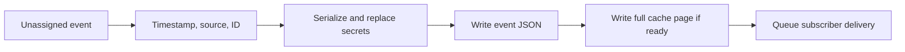

## Overview

An OpenHands conversation has a stored event sequence and a separate controller-state snapshot. `EventStream` extends `EventStore` with publication and subscriber delivery. State snapshots deliberately omit history because it is restored from the event stream. This division lets [[Agent Execution]] reason about conversation state while storage keeps the action/observation record independently.

Sources: [openhands/events/stream.py:43-69](repo://openhands/events/stream.py#L43-L69), [openhands/events/event_store.py:43-58](repo://openhands/events/event_store.py#L43-L58), [openhands/controller/state/state.py:191-209](repo://openhands/controller/state/state.py#L191-L209)

## Event identity and publication

`add_event` requires an event without an assigned ID. It stamps the time and source, then uses a lock to allocate the next ID and increment the counter. The counter is initially derived from stored filenames: an empty conversation begins at zero, and an existing conversation continues after its highest stored ID. Republishing an already-identified event raises an error, preventing the accidental handler loop described in the error message.

Sources: [openhands/events/stream.py:163-179](repo://openhands/events/stream.py#L163-L179), [openhands/events/event_store.py:53-83](repo://openhands/events/event_store.py#L53-L83)

Publication converts the event to a dictionary, replaces configured secrets, reconstructs the event, and adds its serialized representation to the write-page cache. It writes an individual JSON event before writing a completed cache page and before placing the event in the dispatch queue. Large JSON payloads trigger a size warning. The ID lock covers allocation and cache mutation; storage I/O happens after leaving that lock, so it should not be described as a transaction across all concurrent publishers.

Sources: [openhands/events/stream.py:170-203](repo://openhands/events/stream.py#L170-L203)

Sources: [openhands/events/stream.py:163-213](repo://openhands/events/stream.py#L163-L213)

## Secret replacement scope

`set_secrets` copies a supplied mapping and `update_secrets` extends it. Replacement traverses dictionary values recursively and substitutes configured secret strings with the literal marker `<secret_hidden>`. Top-level system fields such as ID, timestamp, source, cause, action, observation, and message are protected from replacement. Because the implementation branches on dictionaries and strings, it does not recursively traverse arbitrary list values. Its guarantee is this specific event transformation, not universal sanitization of every object or log sink.

Sources: [openhands/events/stream.py:215-244](repo://openhands/events/stream.py#L215-L244)

The transformed dictionary is used both for persistence and to reconstruct the dispatched event. Subscribers therefore receive the transformed event rather than the publisher's original object. Runtime result correlation still uses the protected cause and ID fields, which supports the pending-action checks described in [[Agent Execution]].

Sources: [openhands/events/stream.py:177-203](repo://openhands/events/stream.py#L177-L203), [openhands/events/stream.py:224-243](repo://openhands/events/stream.py#L224-L243), [openhands/controller/agent_controller.py:536-547](repo://openhands/controller/agent_controller.py#L536-L547)

## Subscriber ordering and shutdown

Each subscription is keyed by subscriber ID and callback ID. A duplicate callback ID within the same subscriber is rejected. Each callback gets its own single-worker thread pool, initialized with an asyncio event loop. The dispatch loop takes queued events, visits subscriber IDs in sorted order, and submits each callback to its pool. This serializes work within an individual callback's executor, but does not wait for all subscribers to finish one event before dispatching more work.

Sources: [openhands/events/stream.py:71-76](repo://openhands/events/stream.py#L71-L76), [openhands/events/stream.py:130-148](repo://openhands/events/stream.py#L130-L148), [openhands/events/stream.py:254-275](repo://openhands/events/stream.py#L254-L275)

Callback futures have error handlers that inspect the result, log exceptions with callback and subscriber identifiers, and re-raise them from the completion handler. There is no retry queue in this dispatch code. Closing the stream sets its stop flag, joins the queue thread, cleans up subscribers, and empties the remaining queue. Do not equate closing with a promise to process every event still waiting in that queue.

Sources: [openhands/events/stream.py:78-91](repo://openhands/events/stream.py#L78-L91), [openhands/events/stream.py:277-291](repo://openhands/events/stream.py#L277-L291)

## Reading history

`search_events` supports start and end IDs, reverse traversal, an event filter, and a result limit. Its explicit end ID is inclusive and converted internally to an exclusive bound. Reads first try a cache page and fall back to individual event files when no cache event exists. Missing individual event files are skipped during search; direct `get_event` reads and deserializes the requested file without that search-level fallback.

Sources: [openhands/events/event_store.py:85-142](repo://openhands/events/event_store.py#L85-L142)

Cache pages contain 25 events by default. The writer only persists a full page, and the reader tolerates a missing cache file. The comments explain the purpose: reading many individual events is slow. Cache presence is therefore an optimization, while individual event files remain sufficient for reading an incomplete tail of the conversation.

Sources: [openhands/events/event_store.py:43-50](repo://openhands/events/event_store.py#L43-L50), [openhands/events/event_store.py:118-142](repo://openhands/events/event_store.py#L118-L142), [openhands/events/event_store.py:158-175](repo://openhands/events/event_store.py#L158-L175), [openhands/events/stream.py:205-213](repo://openhands/events/stream.py#L205-L213)

## Storage backend selection

| Selection | Factory behavior |
| --- | --- |
| `local` | Creates `LocalFileStore`; requires a path |
| `s3` | Creates `S3FileStore` using the configured path |
| `google_cloud` | Creates `GoogleCloudFileStore` using the configured path |
| Any other value | Creates `InMemoryFileStore` |
| Webhook URL present | Wraps the selected store with a regular or batched webhook store |

Sources: [openhands/storage/__init__.py:14-57](repo://openhands/storage/__init__.py#L14-L57)

The local store expands a leading home-directory shorthand, creates its root, and writes text or bytes beneath that root. It creates parent directories for writes and distinguishes files from directories during deletion. Backend selection deserves particular attention: the factory's fallback for an unrecognized type is memory storage, not a validation error. A typo can therefore change whether records survive the process.

Sources: [openhands/storage/local.py:11-53](repo://openhands/storage/local.py#L11-L53), [openhands/storage/__init__.py:22-31](repo://openhands/storage/__init__.py#L22-L31)

## Saving and restoring controller state

`State.save_to_session` temporarily removes its conversation-statistics reference, pickles the state, base64-encodes it, and writes the conversation's state file. With a user ID, it also attempts to remove the old non-user-scoped state file. Write failures are logged and re-raised. The serialized state excludes history, cached views, and deprecated fields, so this file is a Python state snapshot rather than a JSON trajectory export.

Sources: [openhands/controller/state/state.py:122-147](repo://openhands/controller/state/state.py#L122-L147), [openhands/controller/state/state.py:191-209](repo://openhands/controller/state/state.py#L191-L209)

Restoration first reads the user-scoped location and can fall back to the old location when a user ID is supplied. It records a resumable previous state in `resume_state` and sets the immediate agent state to `LOADING`. Compatibility deserialization converts old iteration fields and supplies missing control flags. [[Conversations and Server API]] owns when this restoration is attempted and how the surrounding runtime and controller are recreated.

Sources: [openhands/controller/state/state.py:150-189](repo://openhands/controller/state/state.py#L150-L189), [openhands/controller/state/state.py:211-245](repo://openhands/controller/state/state.py#L211-L245)
