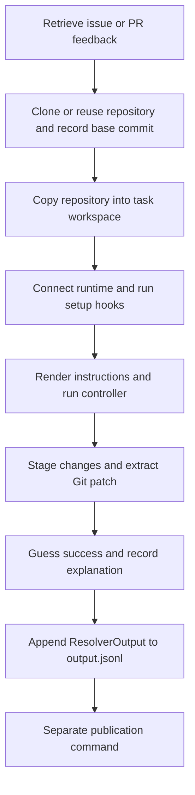

## Overview

The resolver turns a tracker issue or pull-request comment into a headless CodeAct task, captures the resulting Git patch, and writes a structured result. Publishing that result is a separate command that reconstructs a patched repository, commits changes, and pushes a branch or updates a pull request. [[Agent Execution]] owns the task loop, while [[Evaluation and Testing]] covers dataset-oriented experiments rather than tracker-driven automation.

Sources: [openhands/resolver/resolve_issue.py:128-135](repo://openhands/resolver/resolve_issue.py#L128-L135), [openhands/resolver/issue_resolver.py:397-477](repo://openhands/resolver/issue_resolver.py#L397-L477), [openhands/resolver/issue_resolver.py:654-665](repo://openhands/resolver/issue_resolver.py#L654-L665), [openhands/resolver/send_pull_request.py:522-584](repo://openhands/resolver/send_pull_request.py#L522-L584)

## Inputs and configuration

The resolve command requires `--selected-repo` in owner/repository form and an `--issue-number`. It accepts `--issue-type issue` or `pr`, an optional comment ID, output directory, runtime, image selection, prompt file, repository instructions, and base domain. Its default maximum iteration count is 50 and output directory is `output`. The parser constructs `IssueResolver` and runs its asynchronous `resolve_issue` method.

Sources: [openhands/resolver/resolve_issue.py:17-77](repo://openhands/resolver/resolve_issue.py#L17-L77), [openhands/resolver/resolve_issue.py:97-135](repo://openhands/resolver/resolve_issue.py#L97-L135)

The resolver takes a token from the argument or, in order, `GITHUB_TOKEN`, `GITLAB_TOKEN`, or `BITBUCKET_TOKEN`. Username comes from the argument or `GIT_USERNAME`; both token and username are required. It identifies the provider from the token and optional domain, then creates provider-specific issue or PR handlers. The factory supports GitHub, GitLab, and Bitbucket and raises for an unsupported provider or issue type.

Sources: [openhands/resolver/issue_resolver.py:74-97](repo://openhands/resolver/issue_resolver.py#L74-L97), [openhands/resolver/issue_resolver.py:165-175](repo://openhands/resolver/issue_resolver.py#L165-L175), [openhands/resolver/issue_handler_factory.py:36-110](repo://openhands/resolver/issue_handler_factory.py#L36-L110)

Application configuration starts with `load_openhands_config`, as described in [[Configuration and Language Models]], then resolver-specific changes select CodeAct, a runtime, the iteration limit, and a task budget of four. It creates an agent configuration disabling the `github` microagent. Supplying both a base image and a runtime image is rejected. These overrides mean a resolver run is not simply a browser session with the same settings file.

Sources: [openhands/resolver/issue_resolver.py:145-153](repo://openhands/resolver/issue_resolver.py#L145-L153), [openhands/resolver/issue_resolver.py:178-217](repo://openhands/resolver/issue_resolver.py#L178-L217)

## Retrieve the issue and prepare a reproducible base

`extract_issue` asks the handler for the selected issue and optional comment. No returned issue raises an error describing repository spelling, existence, and permissions as checks. When a comment ID was requested, `resolve_issue` also verifies that the converted issue contains matching thread or review content. This prevents an unmatched comment request from silently becoming a general issue-resolution task.

Sources: [openhands/resolver/issue_resolver.py:519-560](repo://openhands/resolver/issue_resolver.py#L519-L560)

The resolver creates its output and inference-log directories and clones the repository into `output_dir/repo` only if that directory is absent. It records the checkout's HEAD as the base commit. For PR work it fetches and checks out the PR's head branch, then records HEAD again. Existing `output.jsonl` entries are parsed before execution, and an entry with the same issue number causes the run to skip that issue, regardless of its previous success value.

Sources: [openhands/resolver/issue_resolver.py:562-615](repo://openhands/resolver/issue_resolver.py#L562-L615), [openhands/resolver/issue_resolver.py:623-652](repo://openhands/resolver/issue_resolver.py#L623-L652)

## Run the task in the workspace

Sources: [openhands/resolver/issue_resolver.py:267-307](repo://openhands/resolver/issue_resolver.py#L267-L307), [openhands/resolver/issue_resolver.py:350-386](repo://openhands/resolver/issue_resolver.py#L350-L386), [openhands/resolver/issue_resolver.py:397-477](repo://openhands/resolver/issue_resolver.py#L397-L477), [openhands/resolver/issue_resolver.py:571-590](repo://openhands/resolver/issue_resolver.py#L571-L590), [openhands/resolver/issue_resolver.py:654-664](repo://openhands/resolver/issue_resolver.py#L654-L664), [openhands/resolver/send_pull_request.py:522-584](repo://openhands/resolver/send_pull_request.py#L522-L584)

`process_issue` replaces the task workspace with a copy of the prepared repository, creates and connects a runtime, and subscribes an event logger. Initialization changes to `/workspace`, checks Git configuration commands, runs `.openhands/setup.sh` when available, and installs repository Git hooks. These hooks execute through the runtime mechanisms documented in [[Sandbox Runtimes]].

Sources: [openhands/resolver/issue_resolver.py:267-307](repo://openhands/resolver/issue_resolver.py#L267-L307), [openhands/resolver/issue_resolver.py:411-427](repo://openhands/resolver/issue_resolver.py#L411-L427)

The issue handler renders task instructions, conversation instructions, and image URLs. The resolver supplies these to `run_controller` with the existing runtime and its automated user-response callback. Default templates differ for new issues and follow-up PR work. A custom prompt file also requires the companion filename obtained by replacing `.jinja` with `-conversation-instructions.jinja`; the constructor opens both files.

Sources: [openhands/resolver/issue_resolver.py:99-123](repo://openhands/resolver/issue_resolver.py#L99-L123), [openhands/resolver/issue_resolver.py:429-446](repo://openhands/resolver/issue_resolver.py#L429-L446)

## Patch extraction and result meaning

Completion stages workspace changes with `git add -A` and requests `git diff --no-color --cached` against the recorded base commit. Diff extraction can retry up to five times, increasing its hard timeout on each attempt. The resulting patch is collected even after the caught agent-run failure path, so the presence of a patch is distinct from a successful task state.

Sources: [openhands/resolver/issue_resolver.py:350-386](repo://openhands/resolver/issue_resolver.py#L350-L386), [openhands/resolver/issue_resolver.py:440-469](repo://openhands/resolver/issue_resolver.py#L440-L469)

`ResolverOutput` contains the converted issue, issue type, instruction, base commit, Git patch, history, metrics, success flag, optional per-comment successes, explanation, and error. With a valid state, success comes from the handler's `guess_success` using issue context, history, and patch. It should be read as the resolver's assessment, not as a guaranteed independent test-suite result. Without state, history is empty, metrics are absent, and success is false.

Sources: [openhands/resolver/resolver_output.py:8-20](repo://openhands/resolver/resolver_output.py#L8-L20), [openhands/resolver/issue_resolver.py:462-476](repo://openhands/resolver/issue_resolver.py#L462-L476), [openhands/resolver/issue_resolver.py:504-517](repo://openhands/resolver/issue_resolver.py#L504-L517)

## Publish a recorded result

The publication command defaults to draft mode and accepts an issue number or `all_successful`. `process_single_issue` skips unsuccessful results unless `send_on_failure` is enabled. It creates a patch checkout beneath `output_dir/patches`, applies the stored patch, and makes a commit. Issue results go to the new-branch publication flow; PR results go to the existing-PR update flow.

Sources: [openhands/resolver/send_pull_request.py:124-159](repo://openhands/resolver/send_pull_request.py#L124-L159), [openhands/resolver/send_pull_request.py:522-584](repo://openhands/resolver/send_pull_request.py#L522-L584), [openhands/resolver/send_pull_request.py:609-637](repo://openhands/resolver/send_pull_request.py#L609-L637)

| Publication mode | Result |
| --- | --- |
| `branch` | Pushes a branch and returns a comparison URL without creating a PR |
| `draft` | Pushes changes and creates a draft PR |
| `ready` | Pushes changes and creates a regular PR |

Sources: [openhands/resolver/send_pull_request.py:329-379](repo://openhands/resolver/send_pull_request.py#L329-L379)

New-issue publication validates an explicit target branch or uses the default branch, chooses a unique issue-fix branch name, and pushes to the original owner or configured fork owner. A nonzero Git push result raises an error. PR metadata includes the generated or supplied title, issue reference, resolver explanation, and optional reviewer request. Even branch-only mode performs a remote push; it is not a local preview operation.

Sources: [openhands/resolver/send_pull_request.py:299-384](repo://openhands/resolver/send_pull_request.py#L299-L384)
