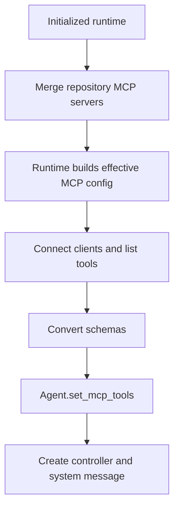

## Overview

The Model Context Protocol integration adds externally supplied tool schemas to the agent and executes selected tools through MCP clients. Startup discovers tools after the runtime is ready and before controller creation, allowing the initial system message to include them. The runtime boundary is described in [[Sandbox Runtimes]]; repository-supplied tool configuration comes from the always-active microagents in [[Memory and Microagents]].

Sources: [openhands/mcp/utils.py:267-317](repo://openhands/mcp/utils.py#L267-L317), [openhands/server/session/agent_session.py:156-189](repo://openhands/server/session/agent_session.py#L156-L189)

## Server configuration

| Transport | Configuration | Client behavior |
| --- | --- | --- |
| SSE | URL and optional API key | Creates an `SSETransport` |
| Streamable HTTP | URL and optional API key | Creates a `StreamableHttpTransport` |
| Stdio | Name, executable, argument list, environment mapping | Creates a `StdioTransport` |

Sources: [openhands/core/config/mcp_config.py:46-77](repo://openhands/core/config/mcp_config.py#L46-L77), [openhands/mcp/client.py:57-98](repo://openhands/mcp/client.py#L57-L98), [openhands/mcp/client.py:125-132](repo://openhands/mcp/client.py#L125-L132)

URL validation trims whitespace, requires a scheme and host, and accepts `http`, `https`, `ws`, or `wss`. That validator checks syntax; the selected transport still determines how connection occurs. Stdio names may contain letters, digits, underscores, and hyphens. Commands must be a single nonempty executable without spaces, with parameters placed in `args`. String arguments use shell-style splitting, including validation of unmatched quoting.

Sources: [openhands/core/config/mcp_config.py:25-43](repo://openhands/core/config/mcp_config.py#L25-L43), [openhands/core/config/mcp_config.py:79-140](repo://openhands/core/config/mcp_config.py#L79-L140)

HTTP clients attach a configured API key as a bearer authorization value and in the two runtime-related headers used by the implementation. A supplied conversation ID becomes `X-OpenHands-ServerConversation-ID`. Stdio transport receives the executable, argument list, and environment mapping directly. Each connection method defaults to a 30-second client timeout and records connection errors in the MCP error collector before re-raising them.

Sources: [openhands/mcp/client.py:57-145](repo://openhands/mcp/client.py#L57-L145)

## Discovery and partial availability

`create_mcp_clients` combines SSE, streamable-HTTP, and optional stdio configurations and connects them one at a time. Before connecting a stdio server it checks `shutil.which(command)`; a missing executable is logged and skipped. A server is added to the result only after successful connection. Failure to connect one server is logged without aborting all remaining servers, so discovery may produce a useful but incomplete tool collection.

Sources: [openhands/mcp/utils.py:78-148](repo://openhands/mcp/utils.py#L78-L148)

`MCPClient._initialize_and_list_tools` enters the client context, lists tools, and creates metadata wrappers with each tool's name, description, and input schema. `MCPClientTool.to_param` maps these to the function schema expected by the agent: `inputSchema` becomes `parameters`. Tool discovery is therefore a translation of advertised server schemas, rather than a handwritten catalogue of individual external functions.

Sources: [openhands/mcp/client.py:33-55](repo://openhands/mcp/client.py#L33-L55), [openhands/mcp/tool.py:14-23](repo://openhands/mcp/tool.py#L14-L23)

`fetch_mcp_tools_from_config` includes stdio servers only when `use_stdio` is true. It returns an empty list when no client connects, and its conversion and fetch failure paths record collector errors and return empty tool lists. A running conversation with no expected MCP tools can therefore reflect a discovery failure rather than an agent refusing to call a successfully installed tool.

Sources: [openhands/mcp/utils.py:28-60](repo://openhands/mcp/utils.py#L28-L60), [openhands/mcp/utils.py:151-203](repo://openhands/mcp/utils.py#L151-L203)

## Installing tools into the agent

Sources: [openhands/mcp/utils.py:279-317](repo://openhands/mcp/utils.py#L279-L317), [openhands/server/session/agent_session.py:165-189](repo://openhands/server/session/agent_session.py#L165-L189)

`add_mcp_tools_to_agent` asserts runtime initialization, gathers repository-microagent stdio configurations, deduplicates those extra configurations, and asks the runtime for its effective MCP configuration. It enables direct stdio discovery only for `CLIRuntime`. The action-execution client instead sends new stdio configurations to the runtime's `/update_mcp_server` endpoint and keeps a cache of previously installed server configurations.

Sources: [openhands/mcp/utils.py:279-309](repo://openhands/mcp/utils.py#L279-L309), [openhands/runtime/impl/action_execution/action_execution_client.py:372-429](repo://openhands/runtime/impl/action_execution/action_execution_client.py#L372-L429)

Agent installation indexes MCP tools by function name and appends new schemas to the agent's tool list. A name already present in its MCP mapping is logged and skipped. This gives tool names operational significance: the agent does not expose two different MCP entries under the same name through this method. [[Agent Execution]] then supplies the combined tool list to the model and translates selected external tool names into actions.

Sources: [openhands/controller/agent.py:163-183](repo://openhands/controller/agent.py#L163-L183), [openhands/agenthub/codeact_agent/codeact_agent.py:207-224](repo://openhands/agenthub/codeact_agent/codeact_agent.py#L207-L224), [openhands/agenthub/codeact_agent/codeact_agent.py:295-299](repo://openhands/agenthub/codeact_agent/codeact_agent.py#L295-L299)

## Calling a tool and returning results

`call_tool_mcp` searches clients in order and uses the first client advertising the action's tool name. No clients or no matching tool raises `ValueError`. The matched client's `call_tool` checks its tool map and client availability, enters the client context again, and invokes `call_tool_mcp` with the selected name and arguments. Discovery does not require keeping a continuously entered connection open between calls.

Sources: [openhands/mcp/utils.py:225-248](repo://openhands/mcp/utils.py#L225-L248), [openhands/mcp/client.py:147-156](repo://openhands/mcp/client.py#L147-L156)

A successful result becomes `MCPObservation` whose content is the JSON serialization of the returned MCP result, with the action name and arguments retained. `McpError` is caught and represented as an MCP observation containing `isError`, an error string, and an empty content list. Other exceptions are not handled by that narrow catch; the surrounding runtime handles them through its status/error path. The runtime also assigns the action cause and tool-call metadata before event publication.

Sources: [openhands/mcp/utils.py:246-264](repo://openhands/mcp/utils.py#L246-L264), [openhands/runtime/base.py:366-399](repo://openhands/runtime/base.py#L366-L399)

## Platform and troubleshooting boundaries

This checkout explicitly disables MCP on `win32` during client creation, tool fetching, and agent installation. Calling an MCP action on that platform returns an error observation. Elsewhere, trace an absent tool through configuration validation, executable availability, server connection, schema conversion, and name deduplication. These are separate stages with different errors; changing an LLM profile cannot repair a server executable that discovery could not find.

Sources: [openhands/mcp/utils.py:69-100](repo://openhands/mcp/utils.py#L69-L100), [openhands/mcp/utils.py:164-200](repo://openhands/mcp/utils.py#L164-L200), [openhands/mcp/utils.py:220-223](repo://openhands/mcp/utils.py#L220-L223), [openhands/mcp/utils.py:273-277](repo://openhands/mcp/utils.py#L273-L277), [openhands/controller/agent.py:172-180](repo://openhands/controller/agent.py#L172-L180)
