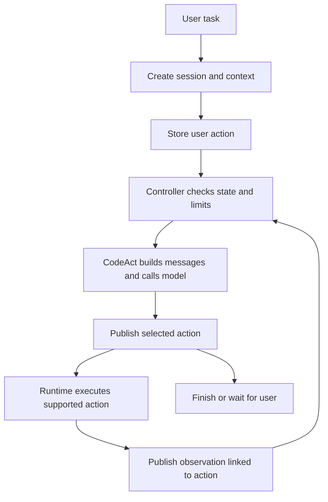

## Overview

OpenHands is a platform for AI software development agents. A task becomes a sequence of model-selected actions: the agent can communicate with a user, execute commands or Python, edit files, and interact with a browser. This checkout packages `openhands-ai` version 0.56.0. Its central abstraction is a conversation in which actions and observations accumulate while a controller advances the agent toward completion.

Sources: [README.md:35-38](repo://README.md#L35-L38), [pyproject.toml:7-28](repo://pyproject.toml#L7-L28), [openhands/agenthub/codeact_agent/codeact_agent.py:160-224](repo://openhands/agenthub/codeact_agent/codeact_agent.py#L160-L224)

There are two important startup paths. The headless `run_controller` builds an agent, runtime, memory, and controller around an initial action. The server's `AgentSession.start` builds the same operational pieces for a managed conversation, optionally restoring state and waiting for user input. They share execution concepts, but their startup and user-interaction responsibilities differ. [[Quickstart]] provides the local development entry point; [[Conversations and Server API]] explains managed sessions.

Sources: [openhands/core/main.py:97-167](repo://openhands/core/main.py#L97-L167), [openhands/server/session/agent_session.py:134-202](repo://openhands/server/session/agent_session.py#L134-L202)

## System map

| Area | What it does | Page |
| --- | --- | --- |
| Local setup | Builds dependencies and starts the backend and frontend | [[Quickstart]] |
| Configuration | Loads defaults, TOML, environment values, and model selections | [[Configuration and Language Models]] |
| Agent control | Selects the next action and enforces execution state | [[Agent Execution]] |
| Event transport | Assigns identity, stores events, and dispatches subscribers | [[Events and Persistence]] |
| Workspace execution | Routes actions to an execution backend and returns observations | [[Sandbox Runtimes]] |
| Context | Supplies workspace information and triggered knowledge | [[Memory and Microagents]] |
| External tools | Discovers MCP tool schemas and attaches them to the agent | [[MCP Tools]] |
| Server sessions | Initializes and manages conversations | [[Conversations and Server API]] |
| Browser client | Submits tasks and refreshes conversation queries | [[Web Interface]] |
| Issue automation | Runs an agent against a selected tracker issue | [[Issue Resolution]] |
| Validation | Records benchmark metadata, histories, metrics, and results | [[Evaluation and Testing]] |

Sources: [Makefile:244-279](repo://Makefile#L244-L279), [openhands/core/config/utils.py:819-836](repo://openhands/core/config/utils.py#L819-L836), [openhands/controller/agent_controller.py:821-887](repo://openhands/controller/agent_controller.py#L821-L887), [openhands/events/stream.py:163-203](repo://openhands/events/stream.py#L163-L203), [openhands/runtime/base.py:361-399](repo://openhands/runtime/base.py#L361-L399), [openhands/memory/memory.py:90-136](repo://openhands/memory/memory.py#L90-L136), [openhands/mcp/utils.py:267-317](repo://openhands/mcp/utils.py#L267-L317), [openhands/server/routes/manage_conversations.py:189-269](repo://openhands/server/routes/manage_conversations.py#L189-L269), [frontend/src/hooks/mutation/use-create-conversation.ts:20-55](repo://frontend/src/hooks/mutation/use-create-conversation.ts#L20-L55), [openhands/resolver/resolve_issue.py:17-77](repo://openhands/resolver/resolve_issue.py#L17-L77), [evaluation/utils/shared.py:44-78](repo://evaluation/utils/shared.py#L44-L78)

## A task through the system

Sources: [openhands/core/main.py:97-191](repo://openhands/core/main.py#L97-L191), [openhands/controller/agent_controller.py:821-887](repo://openhands/controller/agent_controller.py#L821-L887), [openhands/agenthub/codeact_agent/codeact_agent.py:182-224](repo://openhands/agenthub/codeact_agent/codeact_agent.py#L182-L224), [openhands/runtime/base.py:361-399](repo://openhands/runtime/base.py#L361-L399)

The session first prepares a runtime and workspace context, then installs external tools before constructing the controller. This startup ordering is explained in [[Conversations and Server API]] and [[MCP Tools]]: the code explicitly requires tool discovery before controller creation so the system message can include those tools. Repository context enters through the memory component described in [[Memory and Microagents]].

Sources: [openhands/server/session/agent_session.py:134-189](repo://openhands/server/session/agent_session.py#L134-L189)

The initial task is published as a user action. [[Events and Persistence]] describes how publication assigns an ID, serializes and redacts the event, writes it to storage, and queues delivery. The model never needs to operate the transport directly; its next step consumes the history supplied to CodeAct.

Sources: [openhands/core/main.py:177-191](repo://openhands/core/main.py#L177-L191), [openhands/events/stream.py:163-203](repo://openhands/events/stream.py#L163-L203), [openhands/agenthub/codeact_agent/codeact_agent.py:191-218](repo://openhands/agenthub/codeact_agent/codeact_agent.py#L191-L218)

The controller checks whether execution can proceed, then asks the agent for one action. CodeAct converts condensed history into model messages, invokes the configured LLM, and queues the returned actions. [[Agent Execution]] owns these scheduling rules; [[Configuration and Language Models]] owns how the model service is configured.

Sources: [openhands/controller/agent_controller.py:821-887](repo://openhands/controller/agent_controller.py#L821-L887), [openhands/agenthub/codeact_agent/codeact_agent.py:182-224](repo://openhands/agenthub/codeact_agent/codeact_agent.py#L182-L224), [openhands/core/config/utils.py:828-836](repo://openhands/core/config/utils.py#L828-L836)

The runtime executes an action and publishes its observation with the originating action's ID as its cause. [[Sandbox Runtimes]] follows that round trip into the workspace. A finished task, rejected task, error, pause, or stop ends the headless waiting loop; state and optional trajectories are then saved. [[Issue Resolution]] and [[Evaluation and Testing]] use task-oriented entry points to apply the same agent machinery to automated work.

Sources: [openhands/runtime/base.py:361-399](repo://openhands/runtime/base.py#L361-L399), [openhands/core/main.py:207-240](repo://openhands/core/main.py#L207-L240), [openhands/resolver/resolve_issue.py:17-77](repo://openhands/resolver/resolve_issue.py#L17-L77), [evaluation/utils/shared.py:44-78](repo://evaluation/utils/shared.py#L44-L78)

## Design decisions and boundaries

Action identity prevents accidental event loops. `EventStream.add_event` refuses an event that already has an ID, with an error specifically identifying re-publication from a handler as a likely cause. Runtime observations instead carry a cause reference. This makes the request/result relationship explicit without publishing the original action again.

Sources: [openhands/events/stream.py:163-179](repo://openhands/events/stream.py#L163-L179), [openhands/runtime/base.py:391-399](repo://openhands/runtime/base.py#L391-L399)

Execution backends share the `Runtime` contract. Selection recognizes built-in names, discovers optional third-party runtimes, and can resolve an implementation by name. Missing optional dependencies are tolerated during discovery; an invalid selected runtime raises an error. This lets the same action flow run against different workspace implementations while keeping backend availability explicit.

Sources: [openhands/runtime/__init__.py:14-103](repo://openhands/runtime/__init__.py#L14-L103)

The controller preserves a single outstanding runnable action: it refuses another step while an action is pending. Confirmation is also part of action state, and runtime dispatch declines actions awaiting confirmation. These are cooperating execution rules, rather than an implication that every tool is universally safe or that every runtime has the same isolation properties.

Sources: [openhands/controller/agent_controller.py:821-839](repo://openhands/controller/agent_controller.py#L821-L839), [openhands/controller/agent_controller.py:919-973](repo://openhands/controller/agent_controller.py#L919-L973), [openhands/runtime/base.py:950-971](repo://openhands/runtime/base.py#L950-L971)

The repository describes its local application as a single-user workstation deployment, and explicitly excludes shared multi-tenant deployment from that usage model. It also identifies the `enterprise/` directory as an exception to the main MIT license. Keep those boundaries in mind when moving from a local checkout to a hosted service.

Sources: [README.md:112-119](repo://README.md#L112-L119), [README.md:161-163](repo://README.md#L161-L163)
