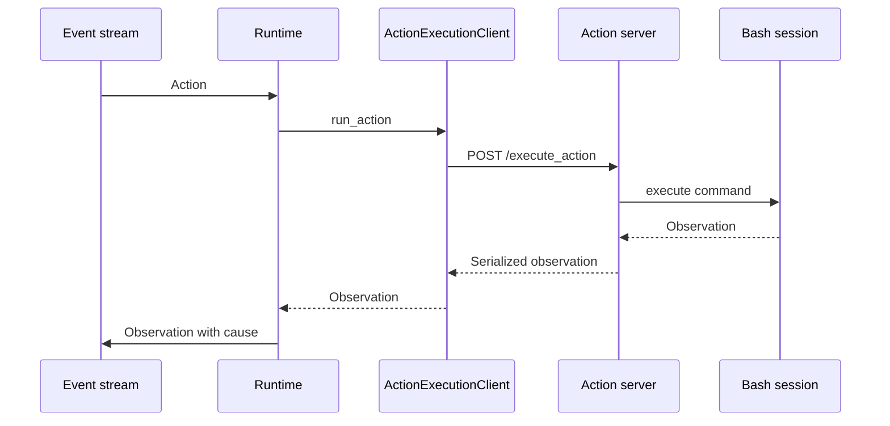

## Overview

A runtime connects the conversation's actions to an execution environment. It receives actions from the event stream, executes supported operations, and publishes observations correlated with their originating action. Docker uses an HTTP action-execution server, while other implementations provide the same runtime-facing contract through different environments. [[Agent Execution]] owns scheduling and confirmation decisions; [[Events and Persistence]] owns durable publication.

Sources: [openhands/runtime/base.py:320-399](repo://openhands/runtime/base.py#L320-L399), [openhands/runtime/impl/action_execution/action_execution_client.py:315-359](repo://openhands/runtime/impl/action_execution/action_execution_client.py#L315-L359), [openhands/runtime/__init__.py:14-21](repo://openhands/runtime/__init__.py#L14-L21)

## Backend choices

| Runtime name | Implementation and execution boundary |
| --- | --- |
| `docker`, `eventstream` | `DockerRuntime`, connecting to a runtime container |
| `local` | Runs the action-execution server directly on the local machine |
| `cli` | Runs local subprocesses and file operations; browser operations return errors |
| `remote` | Uses a configured remote runtime API; its URL is required |
| `kubernetes` | Creates and manages Kubernetes pods for agent execution |

Sources: [openhands/runtime/__init__.py:14-21](repo://openhands/runtime/__init__.py#L14-L21), [openhands/runtime/impl/docker/docker_runtime.py:170-214](repo://openhands/runtime/impl/docker/docker_runtime.py#L170-L214), [openhands/runtime/impl/local/local_runtime.py:1-1](repo://openhands/runtime/impl/local/local_runtime.py#L1-L1), [openhands/runtime/impl/cli/cli_runtime.py:90-105](repo://openhands/runtime/impl/cli/cli_runtime.py#L90-L105), [openhands/runtime/impl/cli/cli_runtime.py:588-598](repo://openhands/runtime/impl/cli/cli_runtime.py#L588-L598), [openhands/runtime/impl/remote/remote_runtime.py:92-104](repo://openhands/runtime/impl/remote/remote_runtime.py#L92-L104), [openhands/runtime/impl/kubernetes/kubernetes_runtime.py:61-76](repo://openhands/runtime/impl/kubernetes/kubernetes_runtime.py#L61-L76)

The selector also discovers third-party runtime packages and tolerates absent optional dependencies. If a name is not registered, it attempts to resolve a `Runtime` implementation by name; failure raises an error listing known keys. Choose a backend according to the execution boundary and operations it implements, rather than assuming that every runtime name implies a container or browser support.

Sources: [openhands/runtime/__init__.py:23-103](repo://openhands/runtime/__init__.py#L23-L103), [openhands/runtime/impl/cli/cli_runtime.py:588-598](repo://openhands/runtime/impl/cli/cli_runtime.py#L588-L598)

## Docker connection and readiness

`DockerRuntime.connect` first attempts to attach to its container. If Docker reports it missing and the session explicitly requested an existing runtime, connection fails with `AgentRuntimeDisconnectedError`. Otherwise the runtime obtains or builds an image and initializes a container. Image building requires either an existing runtime image or a base image; with neither configured, it raises `ValueError` before execution starts.

Sources: [openhands/runtime/impl/docker/docker_runtime.py:170-189](repo://openhands/runtime/impl/docker/docker_runtime.py#L170-L189), [openhands/runtime/impl/docker/docker_runtime.py:233-248](repo://openhands/runtime/impl/docker/docker_runtime.py#L233-L248)

After container attachment or creation, connection waits for the action server to become alive. A newly created session initializes environment variables and reports `READY`; attachment avoids that initial-environment setup. Only then does the runtime mark itself initialized. Additional configured Docker networks are connected afterward, with individual connection failures logged. Readiness and optional network attachment therefore have distinct failure reporting paths.

Sources: [openhands/runtime/impl/docker/docker_runtime.py:191-231](repo://openhands/runtime/impl/docker/docker_runtime.py#L191-L231)

## Workspace preparation

Volume interpretation begins in [[Configuration and Language Models]], which derives the workspace path from an explicit `/workspace` mount. Docker's mount processing builds host-to-container bindings, defaults unspecified modes to `rw`, and handles overlay entries separately. Legacy workspace mounting remains as a fallback when the newer volume configuration is absent.

Sources: [openhands/core/config/utils.py:377-424](repo://openhands/core/config/utils.py#L377-L424), [openhands/runtime/impl/docker/docker_runtime.py:261-322](repo://openhands/runtime/impl/docker/docker_runtime.py#L261-L322)

`clone_or_init_repo` can initialize Git in an empty workspace when configured. For a selected repository, it requests an authenticated Git URL, clones into the repository's final path component, and checks out either the selected branch or a generated `openhands-workspace-` branch. Missing credentials or an invalid repository URL causes an error before cloning. The optional `.openhands/setup.sh` hook is sourced as a hidden environment action with a 600-second hard timeout.

Sources: [openhands/runtime/base.py:401-488](repo://openhands/runtime/base.py#L401-L488)

## Action round trip

Sources: [openhands/runtime/base.py:361-399](repo://openhands/runtime/base.py#L361-L399), [openhands/runtime/impl/action_execution/action_execution_client.py:315-341](repo://openhands/runtime/impl/action_execution/action_execution_client.py#L315-L341), [openhands/runtime/action_execution_server.py:379-397](repo://openhands/runtime/action_execution_server.py#L379-L397), [openhands/runtime/action_execution_server.py:814-831](repo://openhands/runtime/action_execution_server.py#L814-L831)

The runtime applies a default nonblocking timeout when the action has none and refreshes referenced Git-provider tokens before dispatch. MCP actions take an asynchronous tool path covered by [[MCP Tools]]; other actions call `run_action`. A resulting observation inherits the action's cause ID and tool-call metadata. Null observations are suppressed by this wrapper, while ordinary results are published back to the event stream.

Sources: [openhands/runtime/base.py:324-399](repo://openhands/runtime/base.py#L324-L399)

The action client serializes supported runnable actions under an `action` key and sends them to `/execute_action`, allowing five seconds beyond the action timeout for the server response. It holds an action semaphore while dispatching. Actions awaiting confirmation produce a null observation, rejected actions produce a user-rejection observation, and unsupported operations produce an error observation. These checks complement the controller policy without replacing it.

Sources: [openhands/runtime/impl/action_execution/action_execution_client.py:280-338](repo://openhands/runtime/impl/action_execution/action_execution_client.py#L280-L338)

## Inside the execution server

The endpoint deserializes the request, checks that it represents an action, invokes the server client's `run_action`, and serializes the observation. Server execution holds an async lock and dispatches by action name. Shell actions use the persistent bash session unless `is_static` requests a separate session for the specified working directory. Shell execution exceptions become error observations; exceptions escaping the endpoint are logged and returned through its HTTP 500 path.

Sources: [openhands/runtime/action_execution_server.py:379-397](repo://openhands/runtime/action_execution_server.py#L379-L397), [openhands/runtime/action_execution_server.py:814-831](repo://openhands/runtime/action_execution_server.py#L814-L831)

Jupyter actions use the loaded Jupyter plugin and synchronize its working directory with the bash session before running code. HTTP middleware invokes session-key verification for requests other than `/alive` and `/server_info`. These execution-server routes belong to the runtime service, distinct from the user-facing conversation API described in [[Conversations and Server API]].

Sources: [openhands/runtime/action_execution_server.py:399-430](repo://openhands/runtime/action_execution_server.py#L399-L430), [openhands/runtime/action_execution_server.py:787-797](repo://openhands/runtime/action_execution_server.py#L787-L797)

## Failure and cleanup

At the runtime event boundary, permission errors become `ErrorObservation` so the agent can receive feedback. Network and disconnected-runtime errors instead report a disconnected runtime status and return without a normal observation. Other unexpected failures report the generic error status. The action client's HTTP timeout raises `AgentRuntimeTimeoutError`, which is different from a shell command successfully returning an observation describing its own failure.

Sources: [openhands/runtime/base.py:366-389](repo://openhands/runtime/base.py#L366-L389), [openhands/runtime/impl/action_execution/action_execution_client.py:332-338](repo://openhands/runtime/impl/action_execution/action_execution_client.py#L332-L338)

Docker cleanup closes shared resources and log streaming first. If `keep_runtime_alive` is enabled or the runtime attached to an existing container, it returns without stopping containers. Otherwise it selects either this container's name or the broader sandbox prefix according to `rm_all_containers`, stops matching containers, and releases port locks. Session shutdown therefore depends on both attachment mode and sandbox cleanup configuration.

Sources: [openhands/runtime/impl/docker/docker_runtime.py:593-612](repo://openhands/runtime/impl/docker/docker_runtime.py#L593-L612)
