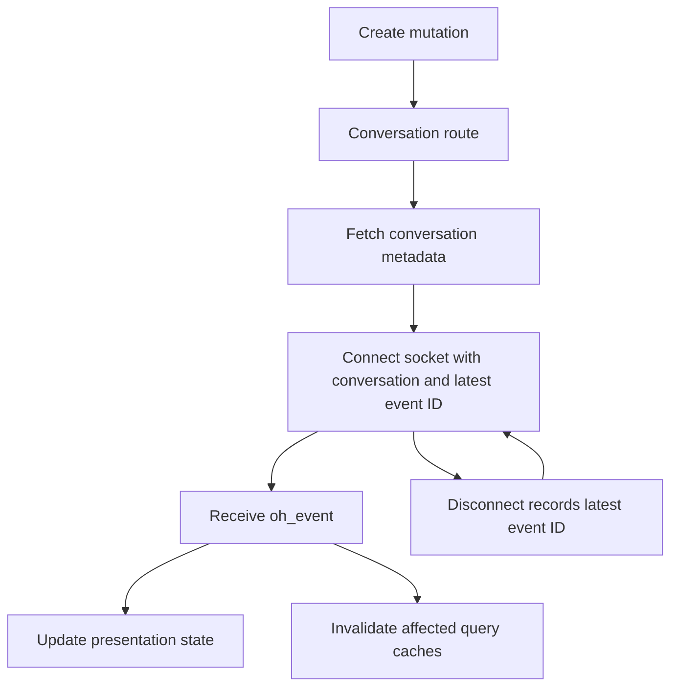

## Overview

The frontend is a React application with React Router routes, React Query mutations and caches, Redux presentation state, and a Socket.IO connection for conversation events. Its central flow creates a conversation through HTTP, navigates to that conversation, and renders live actions and observations beside workspace views. [[Quickstart]] covers running it; [[Conversations and Server API]] owns the backend request and session semantics.

Sources: [frontend/package.json:14-59](repo://frontend/package.json#L14-L59), [frontend/src/routes.ts:8-25](repo://frontend/src/routes.ts#L8-L25), [frontend/src/routes/conversation.tsx:32-95](repo://frontend/src/routes/conversation.tsx#L32-L95), [frontend/src/api/open-hands.ts:257-282](repo://frontend/src/api/open-hands.ts#L257-L282)

## Routes and task creation

The root layout contains the home page, settings routes, conversation route, and microagent-management page. Settings are split into model, MCP, user, integration, application, billing, secrets, and API-key routes. The conversation URL uses `conversations/:conversationId`, making the returned conversation identifier the key that connects navigation, metadata queries, and the socket session.

Sources: [frontend/src/routes.ts:8-25](repo://frontend/src/routes.ts#L8-L25), [frontend/src/routes/conversation.tsx:35-38](repo://frontend/src/routes/conversation.tsx#L35-L38), [frontend/src/context/ws-client-provider.tsx:312-318](repo://frontend/src/context/ws-client-provider.tsx#L312-L318)

`useCreateConversation` accepts a query, optional repository/provider/branch, suggested task, conversation instructions, and microagent-creation request. It delegates to `OpenHands.createConversation`, which translates those values into the server's request body and posts to `/api/conversations`. On success, the hook invalidates the user's conversation list and records task-submission analytics. Navigation is a caller responsibility rather than part of the API wrapper.

Sources: [frontend/src/hooks/mutation/use-create-conversation.ts:8-55](repo://frontend/src/hooks/mutation/use-create-conversation.ts#L8-L55), [frontend/src/api/open-hands.ts:257-282](repo://frontend/src/api/open-hands.ts#L257-L282)

The new-conversation button navigates to the returned conversation ID in its success callback. It stays disabled while a request is pending, after success while navigation is taking place, or while another creation is in progress. That success-state check is intentional: the comment explains that rendering the new screen can take time after the server creates the conversation.

Sources: [frontend/src/components/features/home/new-conversation/create-conversation-button.tsx:7-43](repo://frontend/src/components/features/home/new-conversation/create-conversation-button.tsx#L7-L43)

## Entering a conversation

The route loads active-conversation metadata and configuration, user authentication, provider selections, and feedback. If metadata has finished loading but the authenticated user has no accessible conversation, it shows an error toast and returns home. An initially stopped conversation is started through `OpenHands.startConversation`, followed by a metadata refetch. Changing conversation ID clears terminal, Jupyter, and conversation presentation state and marks the agent as loading.

Sources: [frontend/src/routes/conversation.tsx:32-74](repo://frontend/src/routes/conversation.tsx#L32-L74), [frontend/src/api/open-hands.ts:294-304](repo://frontend/src/api/open-hands.ts#L294-L304)

The rendered route nests `WsClientProvider`, `ConversationSubscriptionsProvider`, and `EventHandler` around the conversation name, tabs, and main area. `EventHandler` installs WebSocket-error handling and runtime-activity hooks. This is the point where HTTP-loaded metadata and event-driven presentation are assembled into one screen, while the backend continues to own agent progress.

Sources: [frontend/src/routes/conversation.tsx:76-95](repo://frontend/src/routes/conversation.tsx#L76-L95), [frontend/src/wrapper/event-handler.tsx:1-10](repo://frontend/src/wrapper/event-handler.tsx#L1-L10)

## Socket lifecycle

Sources: [frontend/src/hooks/mutation/use-create-conversation.ts:20-55](repo://frontend/src/hooks/mutation/use-create-conversation.ts#L20-L55), [frontend/src/components/features/home/new-conversation/create-conversation-button.tsx:23-29](repo://frontend/src/components/features/home/new-conversation/create-conversation-button.tsx#L23-L29), [frontend/src/context/ws-client-provider.tsx:164-265](repo://frontend/src/context/ws-client-provider.tsx#L164-L265), [frontend/src/context/ws-client-provider.tsx:295-355](repo://frontend/src/context/ws-client-provider.tsx#L295-L355)

The socket effect waits until conversation metadata indicates a running conversation or provides runtime status. It sends `latest_event_id`, `conversation_id`, providers, and the session API key as query values. An absolute conversation URL determines the host and any path prefix before `/api/conversations`; otherwise the connection uses the configured backend base URL or current browser host. The client explicitly selects WebSocket transport.

Sources: [frontend/src/context/ws-client-provider.tsx:295-339](repo://frontend/src/context/ws-client-provider.tsx#L295-L339)

Connect, event, error, and disconnect listeners update connection status and message handling. On disconnect, the provider writes the last recorded numeric event ID into the socket's next query. Connection errors also refetch conversation metadata. Conversation changes clear event arrays and the saved last-event reference; effect cleanup removes listeners, and component cleanup disconnects the socket. Server replay after the last ID is described in [[Conversations and Server API]].

Sources: [frontend/src/context/ws-client-provider.tsx:252-293](repo://frontend/src/context/ws-client-provider.tsx#L252-L293), [frontend/src/context/ws-client-provider.tsx:341-370](repo://frontend/src/context/ws-client-provider.tsx#L341-L370)

## Event rendering and cache updates

Every received message first passes through `handleAssistantMessage`, which routes actions, observations, and status updates to their presentation handlers. Action handling ignores hidden actions, updates cost and usage metrics when present, appends shell commands and Python code to their input displays, and records security-risk inputs. This turns the shared event format into component state without executing the represented command in the browser.

Sources: [frontend/src/context/ws-client-provider.tsx:164-165](repo://frontend/src/context/ws-client-provider.tsx#L164-L165), [frontend/src/services/actions.ts:17-43](repo://frontend/src/services/actions.ts#L17-L43), [frontend/src/services/actions.ts:69-77](repo://frontend/src/services/actions.ts#L69-L77)

The provider separately tracks parsed actions and observations, records error observations, and removes an optimistic user message when the server's user-message event arrives. File-edit, file-write, and command actions invalidate the conversation's file-changes cache. Edits and writes also invalidate a specific file-diff query after stripping the workspace and cloned-repository prefixes from its path. These invalidations connect agent activity to refreshed workspace displays.

Sources: [frontend/src/context/ws-client-provider.tsx:190-249](repo://frontend/src/context/ws-client-provider.tsx#L190-L249)

Status-update errors and agent error-state observations set the WebSocket error message and return early from the provider's general event accumulation path. Other server-error messages can produce toasts through `useHandleWSEvents`, including a session-expired toast for code 401. The hook also recognizes maximum-limit error text and sends a paused-state event. Actual state transitions and limit handling remain part of [[Agent Execution]].

Sources: [frontend/src/context/ws-client-provider.tsx:167-187](repo://frontend/src/context/ws-client-provider.tsx#L167-L187), [frontend/src/hooks/use-handle-ws-events.ts:15-45](repo://frontend/src/hooks/use-handle-ws-events.ts#L15-L45)

## Workspace panels

Conversation tabs expose changes, VS Code, terminal, Jupyter, application preview, and browser views. Selected tab and right-panel visibility persist in local storage and initialize Redux state on mount. Clicking the active visible tab requests panel closure; choosing another tab selects it and opens the panel when necessary. These preferences are browser presentation settings, separate from conversation snapshots in [[Events and Persistence]].

Sources: [frontend/src/components/features/conversation/conversation-tabs/conversation-tabs.tsx:24-88](repo://frontend/src/components/features/conversation/conversation-tabs/conversation-tabs.tsx#L24-L88), [frontend/src/components/features/conversation/conversation-tabs/conversation-tabs.tsx:90-133](repo://frontend/src/components/features/conversation/conversation-tabs/conversation-tabs.tsx#L90-L133)

At widths of 1024 pixels or less, chat and the optional workspace panel stack vertically. Wider layouts use resizable horizontal panels when the workspace is visible and center chat when it is hidden. Tab content shows the conversation-loading component while loading is requested; afterward the views remain mounted in containers whose visibility follows the selected tab. This preserves their mounted state across tab switches within that layout.

Sources: [frontend/src/components/features/conversation/conversation-main.tsx:13-85](repo://frontend/src/components/features/conversation/conversation-main.tsx#L13-L85), [frontend/src/components/features/conversation/conversation-tabs/conversation-tab-content.tsx:65-129](repo://frontend/src/components/features/conversation/conversation-tabs/conversation-tab-content.tsx#L65-L129)

## Frontend validation

The package exposes Vitest, Playwright, lint, and typecheck scripts. Type checking first generates React Router types; lint also checks ESLint and Prettier. Development and build scripts regenerate translations, and mock-development modes set distinct API and SaaS mock flags. [[Evaluation and Testing]] connects these frontend checks with backend and agent integration validation.

Sources: [frontend/package.json:63-81](repo://frontend/package.json#L63-L81)
