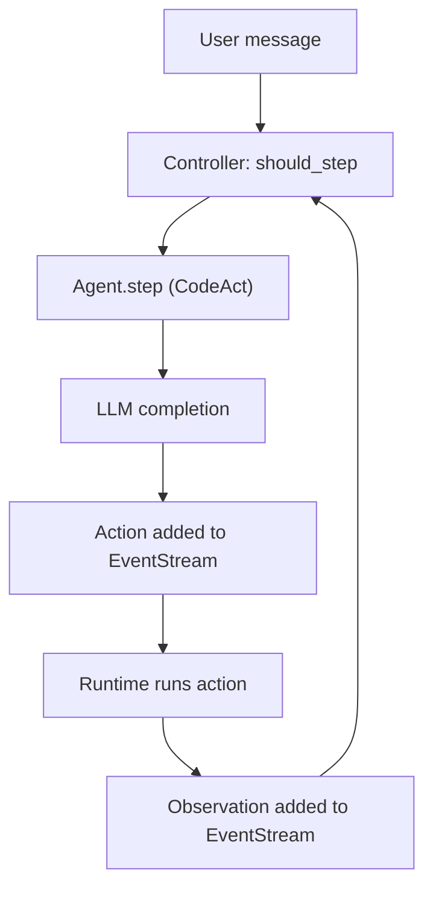

## Overview

OpenHands is a platform for software development agents. Its backend is the `openhands` Python package. It runs as a FastAPI application that serves REST routes and a Socket.IO endpoint, and it is also started from the `openhands` command. A conversation runs an agent loop: the agent chooses an action, a runtime executes it, and the result comes back to the agent as an observation.

Sources: [openhands/server/app.py:58-86](repo://openhands/server/app.py#L58-L86), [openhands/server/listen.py:1-12](repo://openhands/server/listen.py#L1-L12)

The server mounts one router per area of the API: conversations, files, settings, secrets, security, feedback, git and trajectories. The health endpoints are added last.

Sources: [openhands/server/app.py:75-86](repo://openhands/server/app.py#L75-L86)

## Parts

| Area | What it does | Page |
| --- | --- | --- |
| Conversation API | Creates, starts and stops conversations over HTTP | [[Conversation Lifecycle]] |
| Client sessions | Connects clients over Socket.IO and relays events | [[Client Sessions and Socket.IO]] |
| Agent controller | Runs the loop that steps the agent and reacts to events | [[Agent Controller]] |
| Agents | Choose the next action from the history | [[CodeAct Agent]], [[Agent Catalogue]] |
| LLM client | Calls the model and records cost and tokens | [[LLM Client]] |
| Memory | Adds workspace context and microagent knowledge | [[Memory and Microagent Recall]] |
| Condensers | Shorten the event history sent to the model | [[Condenser Catalogue]] |
| Event stream | Stores events and delivers them to subscribers | [[Events and the Event Stream]] |
| Runtime | Executes actions in a sandbox | [[Runtime Interface]], [[Runtime Implementations]] |
| Security | Rates each action's risk and holds risky ones for confirmation | [[Security and Confirmation]] |
| MCP and git | Connect external tool servers and git hosts | [[MCP Tools]], [[Git Providers]] |
| Entry points | The command line and the batch issue resolver | [[Command-Line Interface]], [[Issue Resolver]] |
| Configuration and storage | Build the config and persist files, settings and secrets | [[Configuration Loading]], [[Storage and Persistence]] |
| Web frontend | The React application that talks to the server | [[Web Frontend]] |

Sources: [openhands/server/app.py:58-86](repo://openhands/server/app.py#L58-L86), [openhands/controller/agent_controller.py:100-115](repo://openhands/controller/agent_controller.py#L100-L115), [openhands/runtime/base.py:90-128](repo://openhands/runtime/base.py#L90-L128), [openhands/events/stream.py:43-56](repo://openhands/events/stream.py#L43-L56), [openhands/llm/llm.py:54-61](repo://openhands/llm/llm.py#L54-L61)

## Main flow

A message from the user becomes an agent step, and the step's action goes to the runtime. The observation returns to the stream and triggers the next step.

Sources: [openhands/controller/agent_controller.py:467-492](repo://openhands/controller/agent_controller.py#L467-L492), [openhands/runtime/base.py:361-399](repo://openhands/runtime/base.py#L361-L399)

Sources: [openhands/controller/agent_controller.py:467-492](repo://openhands/controller/agent_controller.py#L467-L492), [openhands/runtime/base.py:361-399](repo://openhands/runtime/base.py#L361-L399), [openhands/events/stream.py:163-204](repo://openhands/events/stream.py#L163-L204)

1. The message enters through the server and the client session ([[Conversation Lifecycle]], [[Client Sessions and Socket.IO]]).
2. The controller decides whether the event should cause a step ([[Agent Controller]]).
3. The agent builds the prompt from the condensed history and calls the model ([[CodeAct Agent]], [[LLM Client]]).
4. The model response becomes an action, which is written to the event stream ([[Events and the Event Stream]]).
5. The runtime runs the action in the sandbox and returns an observation ([[Runtime Interface]]).
6. The observation is written to the stream, and the controller steps the agent again.

Sources: [openhands/controller/agent_controller.py:392-431](repo://openhands/controller/agent_controller.py#L392-L431), [openhands/agenthub/codeact_agent/codeact_agent.py:160-224](repo://openhands/agenthub/codeact_agent/codeact_agent.py#L160-L224), [openhands/runtime/impl/action_execution/action_execution_client.py:272-338](repo://openhands/runtime/impl/action_execution/action_execution_client.py#L272-L338)

## Design decisions

The parts do not call each other's internals. They share the event stream. `EventStream.add_event` gives each event an id and a timestamp, then writes it to the store and queues it for subscribers. It refuses an event that already has an id, because the error message says such an event was added back from inside a handler and would loop.

Sources: [openhands/events/stream.py:163-170](repo://openhands/events/stream.py#L163-L170)

The runtime client sends each action to an action execution server over HTTP, and the server returns the observation in the response. The runtime classes differ in where that server runs.

Sources: [openhands/runtime/impl/action_execution/action_execution_client.py:272-338](repo://openhands/runtime/impl/action_execution/action_execution_client.py#L272-L338), [openhands/runtime/action_execution_server.py:814-831](repo://openhands/runtime/action_execution_server.py#L814-L831)

A failure in the runtime does not stop the agent. A `PermissionError` becomes an error observation so the agent can read it and continue, as the comment says.

Sources: [openhands/runtime/base.py:370-376](repo://openhands/runtime/base.py#L370-L376)

When no security analyzer is configured, every action gets the `UNKNOWN` risk. The comment calls this a fail-safe that makes confirmation required, so the default is to ask before risky work.

Sources: [openhands/controller/agent_controller.py:235-242](repo://openhands/controller/agent_controller.py#L235-L242)

## Where to go next

Start with [[Quickstart]] to run the server. Then read [[Conversation Lifecycle]] to see how a conversation gets its runtime, memory and controller, and [[Agent Controller]] for the loop itself.

Sources: [openhands/server/session/agent_session.py:296-300](repo://openhands/server/session/agent_session.py#L296-L300), [openhands/server/session/agent_session.py:386-390](repo://openhands/server/session/agent_session.py#L386-L390), [openhands/server/session/agent_session.py:448-452](repo://openhands/server/session/agent_session.py#L448-L452)
