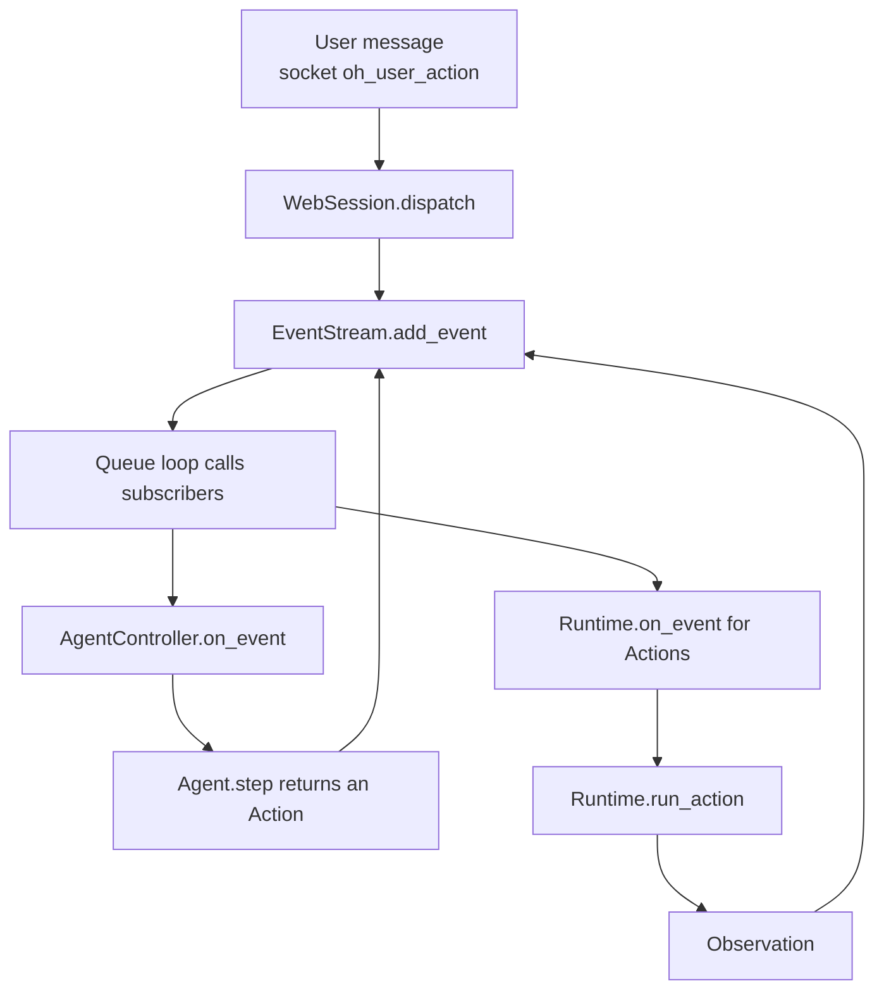

## Overview

OpenHands runs an AI agent that works on software tasks inside a sandbox: it reads the user's message, calls a language model to choose the next action, runs that action in a runtime such as a Docker container, and feeds the result back to the model. The code is one Python package (`openhands/`) with a FastAPI server, a React frontend, a CLI, an issue resolver and a benchmark harness around it.

Sources: [openhands/server/app.py:53-63](repo://openhands/server/app.py#L53-L63)

## The parts

| Area | What it does | Page |
| --- | --- | --- |
| Agent controller | Dispatches events, steps the agent, enforces limits and state | [[Agent Controller]] |
| Agents | Turn the history into the next action; `CodeActAgent` is the default | [[Agents and the Agent Registry]], [[CodeAct Agent]] |
| LLM client | Wraps LiteLLM with retries, metrics and routing | [[LLM Client]] |
| Memory | Adds microagent and workspace context and condenses long histories | [[Memory and Recall]], [[Condensers]], [[Microagents]] |
| Events | Actions and observations, serialised, ordered on one stream | [[Event Model]], [[Actions and Observations]], [[Event Stream]] |
| Storage | File stores for events, settings and secrets | [[File Stores and Settings]] |
| Runtime | Executes actions in a sandbox or locally | [[Runtime Core]], [[Runtime Implementations]], [[Action Execution Server]] |
| Server | HTTP routes, conversation lifecycle, socket.io sessions | [[Server Application]], [[Conversation Lifecycle]], [[Socket Sessions]] |
| Security and integrations | Action analysers, git providers, MCP servers | [[Security Analyzers]], [[Git Provider Integrations]], [[MCP Tools]] |
| Clients | Web app, command line, issue resolver, benchmarks | [[Web Frontend]], [[Command-Line Interface]], [[Issue Resolver]], [[Evaluation Harness]] |
| Extension | Swapping implementations by configuration | [[Extending OpenHands]] |

Sources: [openhands/core/main.py:51-70](repo://openhands/core/main.py#L51-L70), [openhands/server/session/agent_session.py:90-135](repo://openhands/server/session/agent_session.py#L90-L135)

## Main flow

A conversation is an `AgentSession` on the server (or one `run_controller` call from the command line). Starting it builds one `EventStream` and a `Runtime` attached to it, then an `AgentController` that subscribes to the same stream.

Sources: [openhands/server/session/agent_session.py:133-190](repo://openhands/server/session/agent_session.py#L133-L190)

Sources: [openhands/server/session/session.py:353-369](repo://openhands/server/session/session.py#L353-L369), [openhands/events/stream.py:254-276](repo://openhands/events/stream.py#L254-L276), [openhands/controller/agent_controller.py:433-465](repo://openhands/controller/agent_controller.py#L433-L465), [openhands/controller/agent_controller.py:870-873](repo://openhands/controller/agent_controller.py#L870-L873), [openhands/runtime/base.py:320-322](repo://openhands/runtime/base.py#L320-L322), [openhands/runtime/base.py:361-400](repo://openhands/runtime/base.py#L361-L400)

1. The socket handler parses the client's JSON into an event and adds it to the stream as a user event: [[Socket Sessions]].
2. The stream's queue thread calls each subscriber in turn: [[Event Stream]].
3. The controller decides whether to step the agent, and the agent's LLM call produces an action: [[Agent Controller]], [[CodeAct Agent]], [[LLM Client]].
4. The runtime executes each action in its sandbox and adds an observation: [[Runtime Core]], [[Runtime Implementations]].
5. The observation returns to the stream, so the controller can step again: [[Event Model]].

Sources: [openhands/events/stream.py:163-204](repo://openhands/events/stream.py#L163-L204), [openhands/controller/agent_controller.py:973-973](repo://openhands/controller/agent_controller.py#L973-L973), [openhands/runtime/base.py:400-400](repo://openhands/runtime/base.py#L400-L400)

The entry points differ in what they wire up. The server builds these objects per conversation in `AgentSession.start` (see [[Conversation Lifecycle]]). The command-line path builds them in `run_controller` and then waits in `run_agent_until_done` until the agent reaches a terminal state.

Sources: [openhands/core/main.py:112-120](repo://openhands/core/main.py#L112-L120), [openhands/core/main.py:165-168](repo://openhands/core/main.py#L165-L168), [openhands/core/main.py:216-216](repo://openhands/core/main.py#L216-L216), [openhands/core/loop.py:20-45](repo://openhands/core/loop.py#L20-L45)

## Design decisions

### One event stream connects every part

The controller, the runtime and the memory never call each other directly. Each one subscribes to a single `EventStream`, and each event carries its source and a cause link, so one part's output becomes another part's input. The stream assigns each event an ID under a lock and writes it to the file store before queuing it for subscribers.

Sources: [openhands/events/stream.py:163-204](repo://openhands/events/stream.py#L163-L204), [openhands/core/setup.py:35-89](repo://openhands/core/setup.py#L35-L89)

### Actions run in a runtime, not in the server

The server process never executes a command. `Runtime._handle_action` runs each `Action` through `run_action` and adds the returned observation to the stream, and `get_runtime_cls` picks the runtime class from the configured name. Changing `config.runtime` moves execution from a Docker container to a local process or a remote service without changing the controller.

Sources: [openhands/runtime/base.py:361-400](repo://openhands/runtime/base.py#L361-L400), [openhands/runtime/__init__.py:90-103](repo://openhands/runtime/__init__.py#L90-L103)

### Implementations are looked up by name

Agents, runtimes and conversation managers register under a name and are resolved from configuration, so a deployment can substitute its own class. The enterprise package relies on this to replace OSS classes. See [[Extending OpenHands]].

Sources: [openhands/utils/import_utils.py:1-40](repo://openhands/utils/import_utils.py#L1-L40), [openhands/controller/agent.py:121-151](repo://openhands/controller/agent.py#L121-L151)
