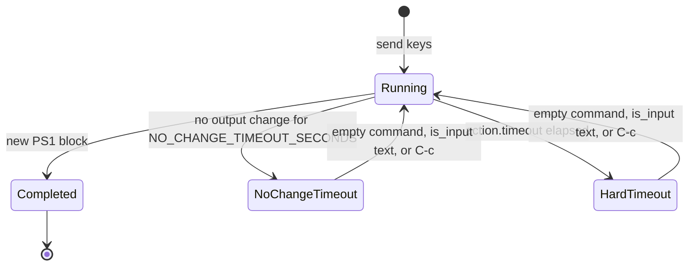

## Overview

`openhands/runtime/action_execution_server.py` is the program that runs inside the sandbox. It is a FastAPI app around one `ActionExecutor`, which owns a persistent shell session, a file editor, an optional browser and the sandbox plugins, and turns each action posted to `/execute_action` into an observation. The host side never runs commands itself: the [[Runtime Architecture]] client serializes the action, this server executes it, and the observation travels back as JSON.

Sources: [openhands/runtime/action_execution_server.py:166-223](repo://openhands/runtime/action_execution_server.py#L166-L223), [openhands/runtime/action_execution_server.py:814-831](repo://openhands/runtime/action_execution_server.py#L814-L831)

Each backend in [[Runtime Implementations]] starts this server in its own way (a Docker container, a Kubernetes pod, a local subprocess) with the same command-line arguments; the image that contains it is built as [[Runtime Images]] describes.

Sources: [openhands/runtime/action_execution_server.py:655-677](repo://openhands/runtime/action_execution_server.py#L655-L677)

## Startup

The server takes a port, `--working-dir`, `--plugins` (names from `ALL_PLUGINS`: `jupyter`, `agent_skills`, `vscode`), `--username` (default `openhands`), `--user-id` (default 1000), `--enable-browser`/`--no-enable-browser`, and `--browsergym-eval-env` for browser benchmarks. It starts a separate file viewer server on a free port above its own, then builds the app.

Sources: [openhands/runtime/action_execution_server.py:655-692](repo://openhands/runtime/action_execution_server.py#L655-L692), [openhands/runtime/plugins/__init__.py:21-25](repo://openhands/runtime/plugins/__init__.py#L21-L25)

In the app's lifespan it creates the `ActionExecutor` and awaits `ainit`, then, except on Windows, creates an `MCPProxyManager` (with authentication when `SESSION_API_KEY` is set) and mounts it on the app, which is how stdio MCP servers run in the sandbox as [[MCP Integration]] explains. On shutdown it releases the proxy and closes the executor.

Sources: [openhands/runtime/action_execution_server.py:697-757](repo://openhands/runtime/action_execution_server.py#L697-L757)

`ActionExecutor.__init__` prepares the sandbox user and working directory with `init_user_and_working_directory`, creates the `OHEditor` rooted at the working directory, and starts an optional memory monitor (`RUNTIME_MEMORY_MONITOR`); `RUNTIME_MAX_MEMORY_GB` sets a memory figure passed to the shell. Asking for a BrowserGym evaluation environment with the browser disabled is an error.

Sources: [openhands/runtime/action_execution_server.py:171-223](repo://openhands/runtime/action_execution_server.py#L171-L223)

`ainit` then:

Sources: [openhands/runtime/action_execution_server.py:291-294](repo://openhands/runtime/action_execution_server.py#L291-L294)

1. Creates the shell session (`BashSession`, or `WindowsPowershellSession` on Windows).
2. Starts browser initialization as a background task.
3. Initializes every requested plugin in parallel, within `INIT_PLUGIN_TIMEOUT` (default 120 seconds).
4. With both `agent_skills` and `jupyter`, runs `from openhands.runtime.plugins.agent_skills.agentskills import *` in the kernel so the skills are callable from Python cells.
5. Runs init commands: `alias git="git --no-pager"`, and `cd` to the working directory for non-root users.
6. Marks itself initialized, which flips `/alive` from `not initialized` to `ok`.

Sources: [openhands/runtime/action_execution_server.py:291-377](repo://openhands/runtime/action_execution_server.py#L291-L377), [openhands/runtime/action_execution_server.py:972-976](repo://openhands/runtime/action_execution_server.py#L972-L976)

## HTTP endpoints

| Endpoint | Purpose |
| --- | --- |
| `POST /execute_action` | Run one action and return the observation dict |
| `GET /alive` | Readiness: `ok` once `ainit` finished |
| `GET /server_info` | Uptime, idle time since the last action, system resource stats |
| `POST /list_files` | Sorted listing, directories first with a trailing `/` |
| `POST /upload_file` | Upload a file, or a zip unpacked at the destination |
| `GET /download_files` | Zip a path and stream it back |
| `GET /vscode/connection_token` | The VS Code server's connection token |
| `POST /update_mcp_server` | Replace the stdio MCP servers behind the proxy |

Sources: [openhands/runtime/action_execution_server.py:799-890](repo://openhands/runtime/action_execution_server.py#L799-L890), [openhands/runtime/action_execution_server.py:886-1000](repo://openhands/runtime/action_execution_server.py#L886-L1000), [openhands/runtime/action_execution_server.py:995-1074](repo://openhands/runtime/action_execution_server.py#L995-L1074)

`/execute_action` deserializes the action with `event_from_dict`, refuses anything that is not an `Action` with 400, records the time for idle tracking, and awaits `run_action`. Any exception becomes a 500 whose `detail` is the traceback, which the client's `RequestHTTPError` carries back to the host. A middleware checks `X-Session-API-Key` against `SESSION_API_KEY` on every path except `/alive` and `/server_info`.

Sources: [openhands/runtime/action_execution_server.py:814-831](repo://openhands/runtime/action_execution_server.py#L814-L831), [openhands/runtime/action_execution_server.py:786-797](repo://openhands/runtime/action_execution_server.py#L786-L797)

`run_action` holds an asyncio lock and calls the executor method named by `action.action`, so actions are executed one at a time even if several requests arrive.

Sources: [openhands/runtime/action_execution_server.py:379-383](repo://openhands/runtime/action_execution_server.py#L379-L383)

## Shell commands

`run` executes a `CmdRunAction` in the persistent session, or in a fresh session started in `action.cwd` when `is_static` is set. Exceptions come back as an `ErrorObservation`.

Sources: [openhands/runtime/action_execution_server.py:385-397](repo://openhands/runtime/action_execution_server.py#L385-L397)

`BashSession` runs bash inside tmux through `libtmux`. `initialize` starts a session sized 1000 by 1000 in the working directory, with a large history limit, in a new window running `su <user> -` for the `root` and `openhands` users and plain `/bin/bash` otherwise. It then sets `PROMPT_COMMAND` so every prompt prints the JSON metadata block from `CmdOutputMetadata.to_ps1_prompt` (exit code, pid, user, host, working directory, Python path), and clears `PS2`.

Sources: [openhands/runtime/utils/bash.py:175-252](repo://openhands/runtime/utils/bash.py#L175-L252), [openhands/events/observation/commands.py:38-57](repo://openhands/events/observation/commands.py#L38-L57)

The prompt is what makes the output parseable. `execute` counts the metadata blocks on screen, sends the keys, and polls the pane; a command is complete when a new block appears or the pane ends with one. The output is the text between the blocks, and the last block becomes the observation's metadata, which is where the exit code and current directory come from.

Sources: [openhands/runtime/utils/bash.py:523-633](repo://openhands/runtime/utils/bash.py#L523-L633), [openhands/runtime/utils/bash.py:316-372](repo://openhands/runtime/utils/bash.py#L316-L372)

Sources: [openhands/runtime/utils/bash.py:164-170](repo://openhands/runtime/utils/bash.py#L164-L170), [openhands/runtime/utils/bash.py:598-660](repo://openhands/runtime/utils/bash.py#L598-L660)

Two timeouts apply. If the output has not changed for `NO_CHANGE_TIMEOUT_SECONDS` (from the `NO_CHANGE_TIMEOUT_SECONDS` environment variable, 10 by default here) and the action is not blocking, the call returns early with exit code -1 and a suffix explaining the options: send an empty command to see more output, send input with `is_input`, send `C-c`, `C-z` or `C-d`, or use a longer `timeout`. If `action.timeout` passes, it returns the same way as a hard timeout. Either way the command keeps running in tmux, which is why the bash tool's description tells the model what exit code -1 means, as [[Agents and CodeAct]] shows.

Sources: [openhands/runtime/utils/bash.py:374-438](repo://openhands/runtime/utils/bash.py#L374-L438), [openhands/runtime/utils/bash_constants.py:1-7](repo://openhands/runtime/utils/bash_constants.py#L1-L7), [openhands/runtime/action_execution_server.py:269-289](repo://openhands/runtime/action_execution_server.py#L269-L289)

While a timed-out command is still running, a new non-input command is not executed; the observation shows the previous command's latest output with a note that the new command was not run. An empty command or input with no command running returns an error message. A string holding several top-level commands, as split by `split_bash_commands`, is refused with a request to run them separately or chain them with `&&` or `;`.

Sources: [openhands/runtime/utils/bash.py:483-578](repo://openhands/runtime/utils/bash.py#L483-L578), [openhands/runtime/utils/bash.py:24-80](repo://openhands/runtime/utils/bash.py#L24-L80)

## Python cells

`run_ipython` requires the Jupyter plugin. Before each cell it checks whether the shell's working directory has changed since the last cell and, if so, runs `os.chdir` in the kernel so shell and Python agree on the current directory. The output is stripped and, with `include_extra`, followed by the working directory and Python interpreter path.

Sources: [openhands/runtime/action_execution_server.py:399-434](repo://openhands/runtime/action_execution_server.py#L399-L434)

`JupyterPlugin.initialize` picks a free port between 40000 and 49999, starts `jupyter kernelgateway` there as the sandbox user with OpenHands' code on `PYTHONPATH`, waits for it to come up, and connects a `JupyterKernel` that executes cells and returns text and images.

Sources: [openhands/runtime/plugins/jupyter/__init__.py:18-110](repo://openhands/runtime/plugins/jupyter/__init__.py#L18-L110)

## Files

`read` refuses binary files. With `impl_source` `oh_aci` it delegates to the editor's `view` command, which returns numbered lines or a directory listing. Otherwise it resolves the path against the shell's current directory, returns images, PDFs and videos as base64 data URLs, and returns text files sliced by `start` and `end`, with clear errors for missing files, directories and non-UTF-8 content.

Sources: [openhands/runtime/action_execution_server.py:436-509](repo://openhands/runtime/action_execution_server.py#L436-L509)

`write` creates parent directories, writes the whole file or replaces a line range of an existing one, and then restores the original mode and owner, or gives a new file mode `0664` owned by the sandbox user.

Sources: [openhands/runtime/action_execution_server.py:511-563](repo://openhands/runtime/action_execution_server.py#L511-L563)

`edit` runs the requested `OHEditor` command (`create`, `str_replace`, `insert`, `undo_edit`) with linting off and returns a `FileEditObservation` carrying the editor's message and a diff of the old and new contents.

Sources: [openhands/runtime/action_execution_server.py:565-589](repo://openhands/runtime/action_execution_server.py#L565-L589), [openhands/runtime/action_execution_server.py:100-163](repo://openhands/runtime/action_execution_server.py#L100-L163)

## Browser

`BrowserEnv` runs BrowserGym in a separate process connected by a pipe: an open-ended headless Chromium environment normally, or a named WebArena, VisualWebArena or MiniWoB task in evaluation mode, where it can also answer requests for the task goal and rewards. `browse` turns a `BrowseURLAction` into `goto("<url>")` and passes `BrowseInteractiveAction` code through, returning a `BrowserOutputObservation` with the page text, screenshot, set-of-marks image and accessibility tree.

Sources: [openhands/runtime/browser/browser_env.py:23-100](repo://openhands/runtime/browser/browser_env.py#L23-L100), [openhands/runtime/browser/utils.py:100-120](repo://openhands/runtime/browser/utils.py#L100-L120)

Browser actions wait for the background initialization started in `ainit`, retrying it if it failed, and report an error when the browser is disabled or could not start. After a failed interactive action the server checks the downloads directory; a new file there is copied into `/workspace` with an extension guessed from its content, and a `FileDownloadObservation` tells the agent where it is.

Sources: [openhands/runtime/action_execution_server.py:229-267](repo://openhands/runtime/action_execution_server.py#L229-L267), [openhands/runtime/action_execution_server.py:591-643](repo://openhands/runtime/action_execution_server.py#L591-L643)

## Plugins

A `Plugin` has a `name`, an async `initialize(username)` and an async `run(action)`; a `PluginRequirement` is the lightweight marker an agent lists in `sandbox_plugins` and the runtime turns into `--plugins` names. Three ship with OpenHands:

Sources: [openhands/runtime/plugins/requirement.py:8-31](repo://openhands/runtime/plugins/requirement.py#L8-L31), [openhands/runtime/plugins/__init__.py:21-25](repo://openhands/runtime/plugins/__init__.py#L21-L25)

| Plugin | What it starts |
| --- | --- |
| `jupyter` | A Jupyter kernel gateway for IPython cells |
| `agent_skills` | Python helper functions (file viewing and editing helpers, document readers, repository search used by LocAgent) importable in the kernel |
| `vscode` | `openvscode-server` on `VSCODE_PORT` with a random connection token, only for the `root` and `openhands` users and not on Windows |

Sources: [openhands/runtime/plugins/agent_skills/README.md:1-20](repo://openhands/runtime/plugins/agent_skills/README.md#L1-L20), [openhands/runtime/plugins/vscode/__init__.py:20-90](repo://openhands/runtime/plugins/vscode/__init__.py#L20-L90), [openhands/agenthub/codeact_agent/codeact_agent.py:70-76](repo://openhands/agenthub/codeact_agent/codeact_agent.py#L70-L76)

The agent skills README sets the bar for adding a skill: only when the model cannot easily write the code itself, such as replacing specific lines in a file, or when it needs an external model, such as speech-to-text.

Sources: [openhands/runtime/plugins/agent_skills/README.md:12-20](repo://openhands/runtime/plugins/agent_skills/README.md#L12-L20)
