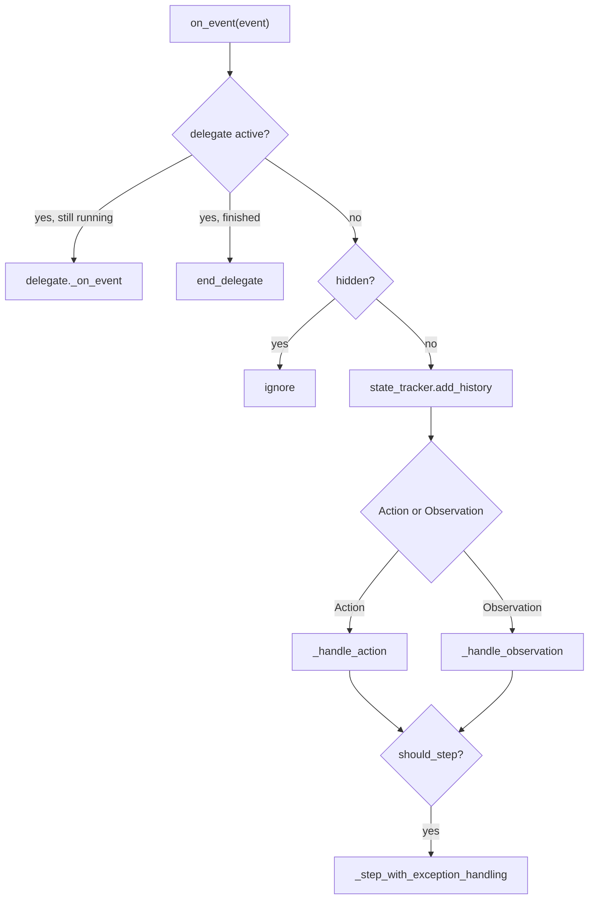

## Overview

`AgentController` runs one conversation's agent. It subscribes to the conversation's event stream, records each relevant event in the agent's `State`, decides whether the event should trigger a step, calls `agent.step(state)` to get the next action, and publishes that action back to the stream for the runtime to execute. It never calls the runtime directly: the observation comes back as another event, which triggers the next step.

Sources: [openhands/controller/agent_controller.py:154-202](repo://openhands/controller/agent_controller.py#L154-L202), [openhands/controller/agent_controller.py:467-492](repo://openhands/controller/agent_controller.py#L467-L492)

Around that loop the controller owns the agent's lifecycle state, the iteration and budget limits, loop detection, confirmation of risky actions, delegation to sub-agents, trajectory replay, and saving the state so a conversation can resume. The events it handles are catalogued in [[Actions and Observations]]; what the agent does inside `step` is in [[Agents and CodeAct]].

Sources: [openhands/controller/agent_controller.py:100-113](repo://openhands/controller/agent_controller.py#L100-L113)

## Construction

`create_controller` first tries `State.restore_from_session` for the stream's session id, then builds the controller with the config's `max_iterations`, `max_budget_per_task`, a per-agent LLM config map, confirmation mode and the runtime's security analyzer. In the web server `AgentSession` does the same, as [[Conversations and Sessions]] describes.

Sources: [openhands/core/setup.py:210-243](repo://openhands/core/setup.py#L210-L243)

The constructor subscribes `on_event` as `EventStreamSubscriber.AGENT_CONTROLLER` (delegates do not subscribe; their parent forwards events to them), hands the initial state to a `StateTracker`, creates a `StuckDetector` and a `ReplayManager`, and calls `_add_system_message`. That method scans the stream from `state.start_id` and adds the agent's `SystemMessageAction` only if neither a system message nor a user message is already there, so a restored conversation does not get a second system prompt.

Sources: [openhands/controller/agent_controller.py:166-202](repo://openhands/controller/agent_controller.py#L166-L202), [openhands/controller/agent_controller.py:244-268](repo://openhands/controller/agent_controller.py#L244-L268)

## Handling an event

Sources: [openhands/controller/agent_controller.py:433-492](repo://openhands/controller/agent_controller.py#L433-L492)

`_handle_action` reacts to control actions. `ChangeAgentStateAction` sets the state; `AgentFinishAction` and `AgentRejectAction` copy their outputs into `state.outputs` and move to `FINISHED` or `REJECTED`; `AgentDelegateAction` starts a delegate. A user `MessageAction` creates a `RecallAction` (workspace context for the first user message, knowledge for later ones), stores it as the pending action, publishes it, and sets the agent `RUNNING`. The memory component answers the recall, as [[Microagents]] explains. An agent message with `wait_for_response` moves to `AWAITING_USER_INPUT`.

Sources: [openhands/controller/agent_controller.py:494-588](repo://openhands/controller/agent_controller.py#L494-L588)

`_handle_observation` logs the observation (at info level when `LOG_ALL_EVENTS` is set) and clears the pending action when the observation's `cause` is that action's id. If the agent is still awaiting confirmation it leaves the pending action alone; after a confirmation it returns to `RUNNING`, after a rejection to `AWAITING_USER_INPUT`.

Sources: [openhands/controller/agent_controller.py:519-547](repo://openhands/controller/agent_controller.py#L519-L547)

`should_step` is the rule that keeps the loop moving. It returns false while a delegate is active. For actions it steps on any user message, on an agent message when not waiting for the user, and on delegate and condensation actions. For observations it steps on everything except `AgentStateChangedObservation` and `NullObservation`, with one exception: a `NullObservation` whose `cause` is above 0 is the answer to a recall, and does trigger a step.

Sources: [openhands/controller/agent_controller.py:392-431](repo://openhands/controller/agent_controller.py#L392-L431)

## One step

`_step` returns at once unless the agent is `RUNNING` and no action is pending, so a step can never overlap with an unanswered action. It then updates the budget flag from the accumulated LLM cost, checks for loops, runs the control flags, and only then asks for an action: from the replay log while one is loaded, otherwise from `agent.step(self.state)`.

Sources: [openhands/controller/agent_controller.py:821-873](repo://openhands/controller/agent_controller.py#L821-L873)

Errors from the agent's step are sorted by kind. A malformed or missing action, a bad response or an invalid function call becomes an `ErrorObservation` on the stream, so the agent sees the error and tries again on the next step. A context-window error becomes a `CondensationRequestAction` when `enable_history_truncation` is on, which makes the condenser shrink history before the retry; otherwise it is raised as `LLMContextWindowExceedError`.

Sources: [openhands/controller/agent_controller.py:874-917](repo://openhands/controller/agent_controller.py#L874-L917)

A runnable action becomes the pending action. In confirmation mode, commands, IPython cells, interactive browsing, file edits and file reads are first rated by the security analyzer; those rated `HIGH`, or any action when there is no analyzer, are marked `AWAITING_CONFIRMATION` and the agent moves to `AWAITING_USER_CONFIRMATION`. The controller attaches a trimmed metrics object (accumulated cost, token usage and the budget limit) to the action for the frontend and publishes it. [[Security Analyzers and Confirmation Mode]] covers the analyzers.

Sources: [openhands/controller/agent_controller.py:919-976](repo://openhands/controller/agent_controller.py#L919-L976), [openhands/controller/agent_controller.py:1079-1106](repo://openhands/controller/agent_controller.py#L1079-L1106)

The pending action is stored with the time it was set, and reading it logs a message when it has been pending for over a minute. This is only a diagnostic; nothing times out here.

Sources: [openhands/controller/agent_controller.py:978-1031](repo://openhands/controller/agent_controller.py#L978-L1031)

## Agent states

| State | Meaning |
| --- | --- |
| `LOADING` | Starting, or just restored |
| `RUNNING` | Stepping |
| `AWAITING_USER_INPUT` | Waiting for a user message |
| `AWAITING_USER_CONFIRMATION` | A risky action waits for approval |
| `USER_CONFIRMED`, `USER_REJECTED` | The user's answer to a confirmation |
| `PAUSED`, `STOPPED` | Halted by the user |
| `FINISHED`, `REJECTED` | The agent ended the task |
| `ERROR` | A step failed or a limit was hit |
| `RATE_LIMITED` | The LLM provider is throttling |

Sources: [openhands/core/schema/agent.py:4-51](repo://openhands/core/schema/agent.py#L4-L51)

`set_agent_state_to` is the only place the state changes. Entering `STOPPED` or `ERROR` calls `_reset`, which, if the pending action never got an observation, publishes an `ErrorObservation` tied to the action's tool call so the LLM history stays consistent, then resets the agent. Going from `ERROR` back to `RUNNING` raises the iteration and budget limits. A confirmation or rejection re-publishes the pending action with its new `confirmation_state`. Every change publishes an `AgentStateChangedObservation` (with `last_error` as the reason for `ERROR`) and saves the state.

Sources: [openhands/controller/agent_controller.py:590-683](repo://openhands/controller/agent_controller.py#L590-L683)

## Iteration and budget limits

`State` carries an `IterationControlFlag` and, when a budget is set, a `BudgetControlFlag`. Before each step `run_control_flags` calls `step()` on both: the iteration flag raises `RuntimeError('Agent reached maximum iteration...')` at its limit and otherwise counts one more step; the budget flag raises when the accumulated cost, synced from `ConversationStats` before every step, reaches the limit. The controller turns the error into the `ERROR` state.

Sources: [openhands/controller/state/control_flags.py:11-95](repo://openhands/controller/state/control_flags.py#L11-L95), [openhands/controller/state/state_tracker.py:254-268](repo://openhands/controller/state/state_tracker.py#L254-L268)

When the user resumes from `ERROR`, `maybe_increase_control_flags_limits` extends the limits. The iteration limit grows by its initial amount only in interactive mode, so a headless run stays capped; the budget limit becomes the current spend plus the initial budget.

Sources: [openhands/controller/state/control_flags.py:51-81](repo://openhands/controller/state/control_flags.py#L51-L81), [openhands/controller/state/state_tracker.py:231-236](repo://openhands/controller/state/state_tracker.py#L231-L236)

## Stuck detection

`StuckDetector.is_stuck` looks at the whole history in headless mode, and only at what follows the last user message in interactive mode, ignoring user messages and null events. With at least three events it checks, in order: four identical action and observation pairs; the same action failing three times in a row; the agent repeating the same message with no observation in between; an alternating pattern of two action and observation pairs over the last six steps; and repeated context-window condensation over the last ten. A positive check raises `AgentStuckInLoopError`, which puts the agent in `ERROR`.

Sources: [openhands/controller/stuck.py:28-110](repo://openhands/controller/stuck.py#L28-L110), [openhands/controller/agent_controller.py:849-853](repo://openhands/controller/agent_controller.py#L849-L853)

## Errors

`_step_with_exception_handling` catches anything the step raises. LiteLLM errors (timeouts, API, auth, rate limit, content policy, context window) are reported as-is; any other exception is replaced with a generic "unexpected error" message. `_react_to_exception` stores the text in `state.last_error`, maps the error to a `RuntimeStatus` such as `ERROR_LLM_AUTHENTICATION` or `ERROR_LLM_OUT_OF_CREDITS` for the status callback, and moves to `ERROR`. A rate-limit error moves to `RATE_LIMITED` instead, unless its retries are used up.

Sources: [openhands/controller/agent_controller.py:302-390](repo://openhands/controller/agent_controller.py#L302-L390)

## Delegation

An `AgentDelegateAction` names another registered agent and its inputs. `start_delegate` builds that agent with its own config, and a child `AgentController` with `is_delegate=True`, the id suffixed `-delegate`, and a new `State` that shares the parent's iteration and budget flags and metrics, starts at the next event id, and has `delegate_level` one higher. When the inputs hold a `task`, it is posted as a user message `TASK: ...` and the delegate is set `RUNNING`.

Sources: [openhands/controller/agent_controller.py:693-752](repo://openhands/controller/agent_controller.py#L693-L752), [openhands/controller/agent_controller.py:500-510](repo://openhands/controller/agent_controller.py#L500-L510)

While the delegate runs, the parent forwards every event to it. Once the delegate is `FINISHED`, `ERROR` or `REJECTED` (or hit a limit), `end_delegate` copies its iteration count back, closes it, and publishes an `AgentDelegateObservation` with its outputs, tied to the original delegate action's tool call, so the parent's next step sees the result as a tool response.

Sources: [openhands/controller/agent_controller.py:433-465](repo://openhands/controller/agent_controller.py#L433-L465), [openhands/controller/agent_controller.py:754-819](repo://openhands/controller/agent_controller.py#L754-L819)

## History and persistence

`StateTracker._init_history` loads the agent's history from the stream between `start_id` and `end_id`, excluding null events, state-change events and hidden events, and collapsing each delegate's events to its action and observation pair. `add_history` applies the same filter to each new event.

Sources: [openhands/controller/state/state_tracker.py:38-48](repo://openhands/controller/state/state_tracker.py#L38-L48), [openhands/controller/state/state_tracker.py:104-223](repo://openhands/controller/state/state_tracker.py#L104-L223)

`State.save_to_session` pickles the state, base64-encodes it, and writes it to the conversation's agent-state file in the file store; `__getstate__` drops the history and view caches, since they are rebuilt from the event stream. `restore_from_session` reads it back, records the saved agent state as `resume_state` when it was `RUNNING`, `PAUSED`, `AWAITING_USER_INPUT` or `FINISHED`, and sets the state to `LOADING`. File locations are listed in [[Storage]].

Sources: [openhands/controller/state/state.py:28-33](repo://openhands/controller/state/state.py#L28-L33), [openhands/controller/state/state.py:122-209](repo://openhands/controller/state/state.py#L122-L209)

## Replaying a trajectory

With `replay_trajectory_path` set, `load_replay_log` turns the saved trajectory into events and splits off the first user message as the task. `ReplayManager` drops environment events and null observations and turns off `wait_for_response` on every message but the last, so the replay does not stop for input. While `should_replay` is true, `_step` takes the next recorded action instead of calling the LLM; afterwards the agent continues normally. The class warns that results can differ when actions are non-deterministic or the starting state differs.

Sources: [openhands/controller/replay.py:11-98](repo://openhands/controller/replay.py#L11-L98), [openhands/core/main.py:263-283](repo://openhands/core/main.py#L263-L283)
