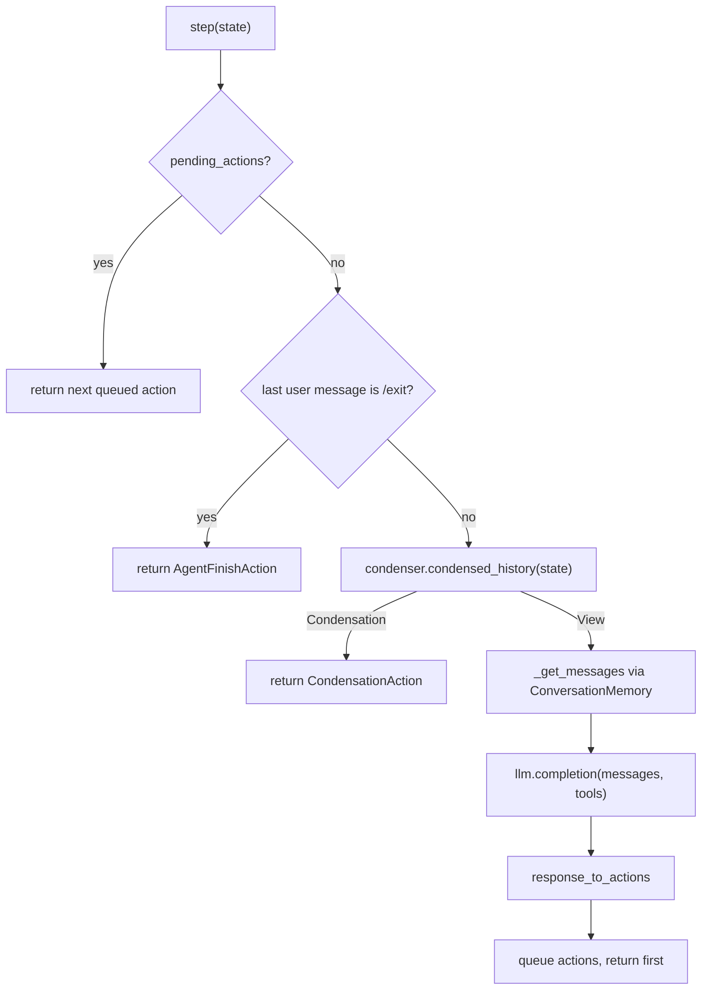

## Overview

An agent is the part of OpenHands that decides what to do next. The [[Agent Controller]] calls `agent.step(state)` and expects one `Action` back; everything else (running the action, recording history, enforcing limits) happens outside the agent. `CodeActAgent`, the default, answers each step by turning the conversation history into chat messages, calling the LLM with a set of tools, and converting the tool calls in the response into actions.

Sources: [openhands/controller/agent.py:25-51](repo://openhands/controller/agent.py#L25-L51), [openhands/controller/agent.py:104-109](repo://openhands/controller/agent.py#L104-L109), [openhands/core/config/config_utils.py:7-7](repo://openhands/core/config/config_utils.py#L7-L7)

CodeAct follows the CodeAct paper's idea of consolidating an agent's actions into one code action space: at each turn it either converses with the user in natural language or acts by running bash commands or Python in an interactive interpreter. The other agents shipped in `agenthub` are described in [[Agent Catalogue]].

Sources: [openhands/agenthub/codeact_agent/codeact_agent.py:49-68](repo://openhands/agenthub/codeact_agent/codeact_agent.py#L49-L68)

## The Agent base class

`Agent.__init__` takes an `AgentConfig` and the conversation's `LLMRegistry`, gets its LLM from the registry for the agent config, and starts with empty `tools` and `mcp_tools`. Subclasses implement `step` and may override `reset`, which by default only clears the completion flag.

Sources: [openhands/controller/agent.py:40-51](repo://openhands/controller/agent.py#L40-L51), [openhands/controller/agent.py:104-118](repo://openhands/controller/agent.py#L104-L118)

| Member | Purpose |
| --- | --- |
| `sandbox_plugins` | Plugins the runtime must start for this agent, read by `create_runtime` |
| `config_model` | The config class, `AgentConfig` unless a subclass needs more fields |
| `prompt_manager` | Renders prompt templates; raises if the subclass never set one |
| `get_system_message()` | Builds the `SystemMessageAction` with the system prompt and tools |
| `step(state)` | Returns the next action |
| `set_mcp_tools(tools)` | Adds MCP tool definitions, skipping duplicate names |
| `name` | The class name |

Sources: [openhands/controller/agent.py:34-118](repo://openhands/controller/agent.py#L34-L118), [openhands/controller/agent.py:163-183](repo://openhands/controller/agent.py#L163-L183), [openhands/core/setup.py:68-82](repo://openhands/core/setup.py#L68-L82)

The controller publishes the result of `get_system_message` as the first event of a conversation, so the system prompt and tool list are part of the stored history rather than something rebuilt on every call. MCP tools are added by `add_mcp_tools_to_agent` before the controller starts, as [[MCP Integration]] describes.

Sources: [openhands/controller/agent.py:59-93](repo://openhands/controller/agent.py#L59-L93), [openhands/controller/agent_controller.py:244-268](repo://openhands/controller/agent_controller.py#L244-L268), [openhands/core/main.py:145-155](repo://openhands/core/main.py#L145-L155)

## The agent registry

Agents are looked up by name in a class-level registry. Each agent package registers itself on import (CodeAct's `__init__.py` calls `Agent.register('CodeActAgent', CodeActAgent)`), and `openhands.agenthub` imports every package, so importing it is enough to make all built-in agents available. Registering a name twice raises `AgentAlreadyRegisteredError`; looking up an unknown name raises `AgentNotRegisteredError`.

Sources: [openhands/controller/agent.py:120-161](repo://openhands/controller/agent.py#L120-L161), [openhands/agenthub/codeact_agent/__init__.py:1-4](repo://openhands/agenthub/codeact_agent/__init__.py#L1-L4), [openhands/agenthub/__init__.py:1-24](repo://openhands/agenthub/__init__.py#L1-L24)

`create_agent` resolves `config.default_agent` through the registry and builds it with the matching agent config. A config group with a `classpath` registers an outside class under a new name, which [[Configuration]] covers.

Sources: [openhands/core/setup.py:202-208](repo://openhands/core/setup.py#L202-L208)

## Building CodeActAgent

The constructor builds the tool list, a `ConversationMemory` that turns events into messages, and a condenser from `config.condenser`, then replaces `self.llm` with `llm_registry.get_router(config)` so a configured model router can choose the model per call. The prompt manager loads templates from the agent's `prompts` directory, using `config.resolved_system_prompt_filename`: `system_prompt_long_horizon.j2` when plan mode is on and no custom file was set, otherwise `system_prompt.j2` or the configured file.

Sources: [openhands/agenthub/codeact_agent/codeact_agent.py:78-106](repo://openhands/agenthub/codeact_agent/codeact_agent.py#L78-L106), [openhands/core/config/agent_config.py:69-77](repo://openhands/core/config/agent_config.py#L69-L77)

`PromptManager` loads the system template plus `user_prompt.j2`, `additional_info.j2` (workspace context: repository, runtime and conversation instructions) and `microagent_info.j2` (triggered knowledge), and renders them with Jinja2.

Sources: [openhands/utils/prompt.py:43-134](repo://openhands/utils/prompt.py#L43-L134)

CodeAct needs two sandbox plugins: `AgentSkillsRequirement`, then `JupyterRequirement`. The order matters, the code notes, because the agent skills provide Python functions that must exist before Jupyter starts so the kernel can use them. The plugins themselves are described in [[Action Execution Server]].

Sources: [openhands/agenthub/codeact_agent/codeact_agent.py:70-76](repo://openhands/agenthub/codeact_agent/codeact_agent.py#L70-L76)

## Tools

`_get_tools` builds the tool list from the agent config's switches. Models whose name contains `gpt-4`, `o1`, `o3` or `o4` get short tool descriptions, a precaution kept from when OpenAI limited function descriptions to 1,024 characters.

Sources: [openhands/agenthub/codeact_agent/codeact_agent.py:108-152](repo://openhands/agenthub/codeact_agent/codeact_agent.py#L108-L152)

| Tool name | Enabled by | Becomes |
| --- | --- | --- |
| `execute_bash` | `enable_cmd` | `CmdRunAction` |
| `think` | `enable_think` | `AgentThinkAction` |
| `finish` | `enable_finish` | `AgentFinishAction` |
| `request_condensation` | `enable_condensation_request` | `CondensationRequestAction` |
| `browser` | `enable_browsing` (not on Windows) | `BrowseInteractiveAction` |
| `execute_ipython_cell` | `enable_jupyter` | `IPythonRunCellAction` |
| `task_tracker` | `enable_plan_mode` | `TaskTrackingAction` |
| `edit_file` | `enable_llm_editor` | `FileEditAction` (LLM-based) |
| `str_replace_editor` | `enable_editor`, when the LLM editor is off | `FileEditAction`, or `FileReadAction` for `view` |
| MCP tool names | `enable_mcp` | `MCPAction` |

Sources: [openhands/agenthub/codeact_agent/codeact_agent.py:125-152](repo://openhands/agenthub/codeact_agent/codeact_agent.py#L125-L152), [openhands/llm/tool_names.py:1-8](repo://openhands/llm/tool_names.py#L1-L8), [openhands/agenthub/codeact_agent/function_calling.py:101-229](repo://openhands/agenthub/codeact_agent/function_calling.py#L101-L229), [openhands/agenthub/codeact_agent/function_calling.py:230-309](repo://openhands/agenthub/codeact_agent/function_calling.py#L230-L309)

Each tool is a LiteLLM `ChatCompletionToolParam`. The bash tool's description tells the model that commands run in a persistent shell with a soft timeout, that exit code `-1` means the command is still running, and that it can then send `is_input: true` with an empty command, more input, or `C-c`. Its parameters are `command`, `is_input`, an optional hard `timeout`, and a required `security_risk` rating, which the security layer uses as described in [[Security Analyzers and Confirmation Mode]].

Sources: [openhands/agenthub/codeact_agent/tools/bash.py:10-82](repo://openhands/agenthub/codeact_agent/tools/bash.py#L10-L82)

The `str_replace_editor` tool exposes `view`, `create`, `str_replace`, `insert` and `undo_edit` on plain-text files, can view some binary formats as Markdown, and refuses `create` on an existing file.

Sources: [openhands/agenthub/codeact_agent/tools/str_replace_editor.py:9-30](repo://openhands/agenthub/codeact_agent/tools/str_replace_editor.py#L9-L30)

## One step

Sources: [openhands/agenthub/codeact_agent/codeact_agent.py:160-224](repo://openhands/agenthub/codeact_agent/codeact_agent.py#L160-L224)

A single LLM response can hold several tool calls. `step` queues every resulting action in `pending_actions` and returns the first; the following steps return the rest without calling the LLM again, one per step, so each action still gets its own observation before the next runs. `reset` clears the queue when the controller stops or errors.

Sources: [openhands/agenthub/codeact_agent/codeact_agent.py:154-158](repo://openhands/agenthub/codeact_agent/codeact_agent.py#L154-L158), [openhands/agenthub/codeact_agent/codeact_agent.py:182-224](repo://openhands/agenthub/codeact_agent/codeact_agent.py#L182-L224)

When the condenser decides history must shrink, it returns a `Condensation` instead of a `View`, and `step` returns that condensation action at once; the controller steps again and the agent sees the shorter view. Otherwise `_get_messages` finds the first user message and asks `ConversationMemory.process_events` to build the messages, then applies prompt caching when the LLM supports it. [[Conversation Memory and Condensers]] covers both.

Sources: [openhands/agenthub/codeact_agent/codeact_agent.py:191-208](repo://openhands/agenthub/codeact_agent/codeact_agent.py#L191-L208), [openhands/agenthub/codeact_agent/codeact_agent.py:246-293](repo://openhands/agenthub/codeact_agent/codeact_agent.py#L246-L293)

The call itself passes the messages, the tools after `check_tools` (which strips `default` fields and unsupported string formats for Gemini models), and `extra_body.metadata` from `state.to_llm_metadata`. How `llm.completion` handles retries, function-call emulation and cost tracking is in [[LLM Layer]].

Sources: [openhands/agenthub/codeact_agent/codeact_agent.py:209-218](repo://openhands/agenthub/codeact_agent/codeact_agent.py#L209-L218), [openhands/llm/llm_utils.py:11-41](repo://openhands/llm/llm_utils.py#L11-L41)

## From tool calls to actions

`response_to_actions` reads the single choice in the response. With no tool calls, the assistant's text becomes a `MessageAction` with `wait_for_response=True`, so a plain-text answer always hands the turn back to the user.

Sources: [openhands/agenthub/codeact_agent/function_calling.py:73-80](repo://openhands/agenthub/codeact_agent/function_calling.py#L73-L80), [openhands/agenthub/codeact_agent/function_calling.py:322-328](repo://openhands/agenthub/codeact_agent/function_calling.py#L322-L328)

With tool calls, any text content becomes the `thought` of the first action. Each call's JSON arguments are parsed and matched to a tool by name; missing required arguments, bad JSON, an invalid `timeout`, an unexpected editor argument or a malformed task list raise `FunctionCallValidationError`, and an unknown tool name raises `FunctionCallNotExistsError`. The controller turns both into an `ErrorObservation` the model sees on its next turn.

Sources: [openhands/agenthub/codeact_agent/function_calling.py:80-122](repo://openhands/agenthub/codeact_agent/function_calling.py#L80-L122), [openhands/agenthub/codeact_agent/function_calling.py:298-313](repo://openhands/agenthub/codeact_agent/function_calling.py#L298-L313), [openhands/controller/agent_controller.py:874-887](repo://openhands/controller/agent_controller.py#L874-L887)

A `delegate_to_browsing_agent` call becomes an `AgentDelegateAction` for `BrowsingAgent`. The `security_risk` argument, when it names a known level, is copied onto the action. Every action gets a `ToolCallMetadata` recording the call id, function name, the whole response and the number of calls in it, and every action from the response gets its `response_id`, so token usage can be matched back to the actions it produced.

Sources: [openhands/agenthub/codeact_agent/function_calling.py:59-70](repo://openhands/agenthub/codeact_agent/function_calling.py#L59-L70), [openhands/agenthub/codeact_agent/function_calling.py:135-142](repo://openhands/agenthub/codeact_agent/function_calling.py#L135-L142), [openhands/agenthub/codeact_agent/function_calling.py:311-338](repo://openhands/agenthub/codeact_agent/function_calling.py#L311-L338)
