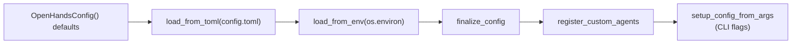

## Overview

Every entry point (the headless runner, the CLI and the web server) starts from one `OpenHandsConfig` object. `load_openhands_config` builds it in a fixed order: an instance with code defaults, then values from `config.toml`, then environment variables, then `finalize_config` to resolve derived fields, and finally `register_custom_agents` to load any agent classes the config names. The CLI and headless runner then apply command-line overrides on top with `setup_config_from_args`; the server loads it once into `openhands.server.shared.config`.

Sources: [openhands/core/config/utils.py:819-836](repo://openhands/core/config/utils.py#L819-L836), [openhands/server/shared.py:21-24](repo://openhands/server/shared.py#L21-L24)

The config is a Pydantic model with `extra='forbid'`, so a misspelled field set in code fails validation instead of being silently ignored. Unknown keys in the TOML `[core]` section and unknown section names are logged as warnings rather than rejected.

Sources: [openhands/core/config/openhands_config.py:127-129](repo://openhands/core/config/openhands_config.py#L127-L129), [openhands/core/config/utils.py:186-191](repo://openhands/core/config/utils.py#L186-L191), [openhands/core/config/utils.py:349-364](repo://openhands/core/config/utils.py#L349-L364)

## Precedence



Sources: [openhands/core/config/utils.py:819-904](repo://openhands/core/config/utils.py#L819-L904)

Because environment variables are read after the TOML file, `LLM_MODEL=...` beats `model = ...` under `[llm]`, and both beat the default. CLI flags win over both: `-l/--llm-config` replaces the default LLM config with a named section, `-c` sets `default_agent`, and `-i`, `-b` and `--selected-repo` set `max_iterations`, `max_budget_per_task` and `sandbox.selected_repo`. When the named LLM section is not in the loaded config, `setup_config_from_args` looks for it in the `--config-file` and then in `~/.openhands/config.toml`, and raises if neither has it.

Sources: [openhands/core/config/utils.py:839-904](repo://openhands/core/config/utils.py#L839-L904)

## The config.toml file

`load_from_toml` reads the file into a dict and routes each top-level section to its model. A missing file is not an error; a file that does not parse is logged and skipped as a whole.

Sources: [openhands/core/config/utils.py:138-158](repo://openhands/core/config/utils.py#L138-L158)

| Section | Loaded into | Notes |
| --- | --- | --- |
| `[core]` | fields of `OpenHandsConfig` | String values for `SecretStr` fields are wrapped |
| `[llm]`, `[llm.<name>]` | `config.llms` | Named groups inherit the base |
| `[agent]`, `[agent.<name>]` | `config.agents` | Named groups inherit the base |
| `[security]` | `config.security` | Invalid values raise `ValueError` |
| `[sandbox]` | `config.sandbox` | Invalid values raise `ValueError` |
| `[mcp]` | `config.mcp` | See [[MCP Integration]] |
| `[kubernetes]` | `config.kubernetes` | Used by the Kubernetes runtime |
| `[condenser]` | the default agent's `condenser` | See [[Conversation Memory and Condensers]] |
| `[model_routing]` | the default agent's `model_routing` | Collects LLMs marked `for_routing` |
| `[extended]` | `config.extended` | Free-form keys for extensions |

Sources: [openhands/core/config/utils.py:160-256](repo://openhands/core/config/utils.py#L160-L256), [openhands/core/config/utils.py:258-347](repo://openhands/core/config/utils.py#L258-L347)

When there is no `[condenser]` section and `enable_default_condenser` is true (the default), the default agent gets an `LLMSummarizingCondenserConfig` that uses the default LLM config, so long conversations are summarized unless you opt out.

Sources: [openhands/core/config/utils.py:320-338](repo://openhands/core/config/utils.py#L320-L338), [openhands/core/config/openhands_config.py:110-111](repo://openhands/core/config/openhands_config.py#L110-L111)

`config.template.toml` lists every option with its default, commented out. Its header says all settings have defaults, so you only uncomment what you change.

Sources: [config.template.toml:1-16](repo://config.template.toml#L1-L16)

## Named LLM and agent groups

`LLMConfig.from_toml_section` treats every non-table key under `[llm]` as the base config, stored under the key `llm`, and every sub-table such as `[llm.claude]` as a named config built by merging its keys over the base. A `num_retries` set in `[llm]` therefore applies to `[llm.claude]` too. A sub-table that fails validation is skipped with a warning; the others still load. `AgentConfig.from_toml_section` does the same for `[agent]` and `[agent.<AgentName>]`.

Sources: [openhands/core/config/llm_config.py:101-160](repo://openhands/core/config/llm_config.py#L101-L160), [openhands/core/config/agent_config.py:80-115](repo://openhands/core/config/agent_config.py#L80-L115)

```toml
[llm]
model = "gpt-4o"
num_retries = 5

[llm.claude]
model = "claude-3-5-sonnet"

[agent]
enable_prompt_extensions = false

[agent.BrowsingAgent]
enable_prompt_extensions = true
llm_config = "claude"
```

Sources: [openhands/core/config/llm_config.py:108-115](repo://openhands/core/config/llm_config.py#L108-L115), [openhands/core/config/agent_config.py:87-93](repo://openhands/core/config/agent_config.py#L87-L93)

Lookups fall back to the defaults. `get_llm_config(name)` returns the named group or, with a warning, the `llm` group, creating an empty one if needed; `get_agent_config(name)` does the same with `agent`. An agent's `llm_config` field names the LLM group it uses, which `get_llm_config_from_agent` resolves, and `get_agent_to_llm_config_map` gives the controller one LLM config per agent so delegates can run on a different model.

Sources: [openhands/core/config/openhands_config.py:131-172](repo://openhands/core/config/openhands_config.py#L131-L172), [openhands/core/setup.py:229-241](repo://openhands/core/setup.py#L229-L241)

## Environment variables

`load_from_env` walks the model's fields recursively and computes a variable name from the prefix and field name in upper case. Top-level fields have no prefix (`RUNTIME`, `MAX_ITERATIONS`); nested models use the field name as prefix (`SANDBOX_TIMEOUT`, `SECURITY_CONFIRMATION_MODE`). After the walk it applies `LLM_` variables to the default LLM config and `AGENT_` variables to the default agent config. Named groups cannot be set from the environment.

Sources: [openhands/core/config/utils.py:66-80](repo://openhands/core/config/utils.py#L66-L80), [openhands/core/config/utils.py:127-135](repo://openhands/core/config/utils.py#L127-L135)

Values are cast to the field's type: booleans are true for `true` or `1`, dicts and lists are parsed with `literal_eval` (and a list of Pydantic models is built item by item), and everything else is passed to the type's constructor. Empty values are skipped so the default stays, and a value that fails to cast is logged and ignored.

Sources: [openhands/core/config/utils.py:80-125](repo://openhands/core/config/utils.py#L80-L125)

```bash
export LLM_API_KEY='your_api_key_here'
export LLM_MODEL='gpt-4'
export SANDBOX_TIMEOUT='300'
export SANDBOX_RUNTIME_STARTUP_ENV_VARS="{'FOO': 'bar'}"
```

Sources: [openhands/core/config/README.md:29-36](repo://openhands/core/config/README.md#L29-L36), [openhands/core/config/utils.py:96-103](repo://openhands/core/config/utils.py#L96-L103)

## Derived values in finalize_config

`finalize_config` runs after the TOML file and environment are applied and turns the loaded values into what the runtime needs:

Sources: [openhands/core/config/utils.py:377-378](repo://openhands/core/config/utils.py#L377-L378), [openhands/core/config/utils.py:828-831](repo://openhands/core/config/utils.py#L828-L831)

- `sandbox.volumes` (`host:container[:mode]`, comma-separated) is the current way to mount the workspace. A mount whose container path is `/workspace` sets `workspace_mount_path`, `workspace_base` and `workspace_mount_path_in_sandbox`; with no such mount both workspace fields are cleared. A mount with fewer than two or more than three parts raises.
- The deprecated `workspace_base`, `workspace_mount_path` and `workspace_mount_rewrite` still work when `volumes` is unset, with a deprecation warning.
- Each LLM's `log_completions_folder` becomes absolute and `cache_dir` is created.
- With no `jwt_secret`, one is read from the file store or generated and saved there, so session ids stay stable across restarts.
- With `runtime = "cli"`, Jupyter and browsing are turned off for every agent, because the CLI runtime cannot run IPython.

Sources: [openhands/core/config/utils.py:367-470](repo://openhands/core/config/utils.py#L367-L470)

## Core fields

| Field | Default | Meaning |
| --- | --- | --- |
| `default_agent` | `CodeActAgent` | Agent class name to run |
| `runtime` | `docker` | Runtime backend name or class path |
| `file_store`, `file_store_path` | `local`, `~/.openhands` | Where events, state and settings persist |
| `max_iterations` | `500` | Step limit per task |
| `max_budget_per_task` | none | Dollar limit per task |
| `enable_browser` | `true` | Start the browser in the sandbox |
| `save_trajectory_path`, `replay_trajectory_path` | none | Write or replay a trajectory |
| `max_concurrent_conversations` | `3` | Agent loops allowed per user |
| `conversation_max_age_seconds` | `864000` | Ten days |
| `git_user_name`, `git_user_email` | `openhands`, `openhands@all-hands.dev` | Identity for the agent's commits |

Sources: [openhands/core/config/openhands_config.py:65-125](repo://openhands/core/config/openhands_config.py#L65-L125), [openhands/core/config/config_utils.py:7-9](repo://openhands/core/config/config_utils.py#L7-L9)

## Nested config groups

| Model | Selected fields | Used by |
| --- | --- | --- |
| `LLMConfig` | `model` (default `claude-sonnet-4-20250514`), `api_key`, `base_url`, `num_retries`, `temperature`, `native_tool_calling`, `caching_prompt`, `for_routing` | [[LLM Layer]] |
| `AgentConfig` | `llm_config`, `classpath`, `enable_cmd`, `enable_browsing`, `enable_jupyter`, `enable_editor`, `enable_mcp`, `condenser`, `model_routing` | [[Agents and CodeAct]] |
| `SandboxConfig` | `base_container_image`, `runtime_container_image`, `timeout` (120 s), `keep_runtime_alive`, `volumes`, `selected_repo`, `remote_runtime_api_url` | [[Runtime Implementations]] |
| `SecurityConfig` | `confirmation_mode`, `security_analyzer` | [[Security Analyzers and Confirmation Mode]] |
| `ModelRoutingConfig` | `router_name` (default `noop_router`), `llms_for_routing` | [[LLM Layer]] |
| `ExtendedConfig` | any keys, read by attribute or index | Extensions |

Sources: [openhands/core/config/llm_config.py:52-96](repo://openhands/core/config/llm_config.py#L52-L96), [openhands/core/config/agent_config.py:16-63](repo://openhands/core/config/agent_config.py#L16-L63), [openhands/core/config/sandbox_config.py:49-96](repo://openhands/core/config/sandbox_config.py#L49-L96), [openhands/core/config/security_config.py:12-13](repo://openhands/core/config/security_config.py#L12-L13), [openhands/core/config/model_routing_config.py:14-15](repo://openhands/core/config/model_routing_config.py#L14-L15), [openhands/core/config/extended_config.py:6-41](repo://openhands/core/config/extended_config.py#L6-L41)

## Custom agents

An `[agent.<name>]` group with a `classpath` registers a new agent: `register_custom_agents` imports the class with `get_impl(Agent, classpath)` and registers it under the group's name, so `-c <name>` or `default_agent = "<name>"` can select it. A class that fails to import is logged and skipped. The registry it adds to is described in [[Agents and CodeAct]].

Sources: [openhands/core/config/utils.py:796-816](repo://openhands/core/config/utils.py#L796-L816), [openhands/core/config/agent_config.py:18-20](repo://openhands/core/config/agent_config.py#L18-L20)
