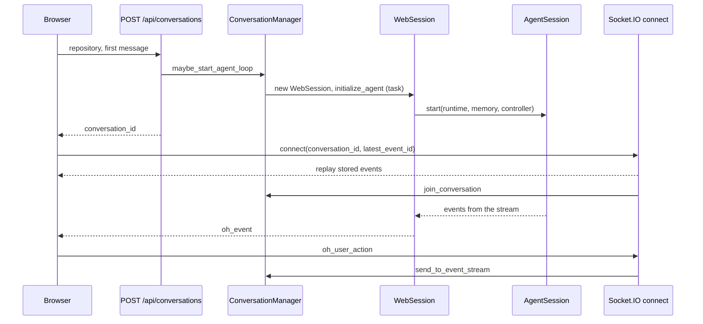

## Overview

In the web app each conversation gets its own agent loop: an event stream, a runtime, a memory component and an agent controller, the same parts the headless runner assembles in [[OpenHands Overview]]. The server's job is to create those per conversation, keep them alive while someone is using them, stream their events to the browser over Socket.IO, and feed the user's messages back in.

Sources: [openhands/README.md:22-24](repo://openhands/README.md#L22-L24), [openhands/server/session/agent_session.py:42-90](repo://openhands/server/session/agent_session.py#L42-L90)

Four layers share that work. The `ConversationManager` keeps the running conversations and routes requests and socket connections to them. A `WebSession` (still exported as `Session`) belongs to one conversation and talks to the browser. Its `AgentSession` owns the agent loop's parts. The REST routes that call into this layer are listed in [[Web Server and REST API]].

Sources: [openhands/server/conversation_manager/conversation_manager.py:20-44](repo://openhands/server/conversation_manager/conversation_manager.py#L20-L44), [openhands/server/session/session.py:40-66](repo://openhands/server/session/session.py#L40-L66)

Sources: [openhands/server/routes/manage_conversations.py:189-290](repo://openhands/server/routes/manage_conversations.py#L189-L290), [openhands/server/listen_socket.py:35-140](repo://openhands/server/listen_socket.py#L35-L140), [openhands/server/listen_socket.py:143-158](repo://openhands/server/listen_socket.py#L143-L158)

## Creating a conversation

`POST /api/conversations` calls `create_new_conversation`. `initialize_conversation` picks a new hex id (or reuses a given one), and for a new conversation saves `ConversationMetadata` with the trigger, a default title, the user, and the selected repository, branch and git provider.

Sources: [openhands/server/services/conversation_service.py:34-75](repo://openhands/server/services/conversation_service.py#L34-L75), [openhands/server/services/conversation_service.py:164-202](repo://openhands/server/services/conversation_service.py#L164-L202)

`start_conversation` loads the user's saved settings and refuses to start without them (`MissingSettingsError`) or without an LLM API key unless the model is a `bedrock/` model (`LLMAuthenticationError`). It builds a `ConversationInitData` from the settings plus the git provider tokens, custom secrets, repository, branch and conversation instructions, lets the experiment manager adjust it, wraps the first message and images in a `MessageAction`, and asks the conversation manager to start the agent loop.

Sources: [openhands/server/services/conversation_service.py:78-161](repo://openhands/server/services/conversation_service.py#L78-L161)

## The conversation manager

`ConversationManager` is an abstract class; `ServerConfig.conversation_manager_class` names the implementation and `shared.py` creates one per server. Its methods attach to and detach from conversations for REST calls, join a socket connection to a conversation, start agent loops, send data to a conversation's stream, list running loops and connections, and close sessions.

Sources: [openhands/server/conversation_manager/conversation_manager.py:20-60](repo://openhands/server/conversation_manager/conversation_manager.py#L20-L60), [openhands/server/conversation_manager/conversation_manager.py:60-148](repo://openhands/server/conversation_manager/conversation_manager.py#L60-L148), [openhands/server/shared.py:61-68](repo://openhands/server/shared.py#L61-L68)

| Implementation | Where agent loops run |
| --- | --- |
| `StandaloneConversationManager` (default) | In the server process, one `WebSession` per conversation |
| `DockerNestedConversationManager` | In a separate OpenHands server inside each conversation's runtime container |
| `ClusteredConversationManager` (enterprise) | Across several server processes, as [[Enterprise Server]] describes |

Sources: [openhands/server/conversation_manager/standalone_conversation_manager.py:53-76](repo://openhands/server/conversation_manager/standalone_conversation_manager.py#L53-L76), [openhands/server/conversation_manager/docker_nested_conversation_manager.py:50-51](repo://openhands/server/conversation_manager/docker_nested_conversation_manager.py#L50-L51)

## Standalone agent loops

`StandaloneConversationManager.maybe_start_agent_loop` returns the existing `WebSession` for a conversation or calls `_start_agent_loop`. That first enforces `max_concurrent_conversations` (default 3) per user: if the user is at the limit, the least recently updated conversations are closed, and their browsers get a `AGENT_ERROR$TOO_MANY_CONVERSATIONS` status saying so.

Sources: [openhands/server/conversation_manager/standalone_conversation_manager.py:280-339](repo://openhands/server/conversation_manager/standalone_conversation_manager.py#L280-L339), [openhands/core/config/openhands_config.py:112-114](repo://openhands/core/config/openhands_config.py#L112-L114)

It then builds the conversation's LLM registry and stats from the user's settings, creates a `WebSession`, starts `initialize_agent` as a background task, and subscribes a server callback to the stream. That callback keeps the stored metadata current on every event: it updates `last_updated_at` and the accumulated cost and tokens, and while the title is still the default, asks the LLM for a title and pushes it to the browser.

Sources: [openhands/server/conversation_manager/standalone_conversation_manager.py:340-367](repo://openhands/server/conversation_manager/standalone_conversation_manager.py#L340-L367), [openhands/server/conversation_manager/standalone_conversation_manager.py:473-561](repo://openhands/server/conversation_manager/standalone_conversation_manager.py#L473-L561)

REST routes that act on a running conversation call `attach_to_conversation`, which hands out a `ServerConversation` with a reference count; `detach_from_conversation` moves it to a detached list when the count reaches zero. A background task, `_cleanup_stale`, disconnects detached conversations and, when `sandbox.close_delay` is set, closes agent loops that have been inactive longer than that, are not `RUNNING`, and have no socket connected. On shutdown it closes every loop.

Sources: [openhands/server/conversation_manager/standalone_conversation_manager.py:78-149](repo://openhands/server/conversation_manager/standalone_conversation_manager.py#L78-L149), [openhands/server/conversation_manager/standalone_conversation_manager.py:167-228](repo://openhands/server/conversation_manager/standalone_conversation_manager.py#L167-L228)

## Connecting a browser

The browser opens a Socket.IO connection with `conversation_id`, `latest_event_id` and `providers_set` in the query string. `connect` refuses connections without a conversation id or with a wrong `session_api_key` when the server has one, and asks the conversation validator which user may access the conversation from the cookies and `Authorization` header.

Sources: [openhands/server/listen_socket.py:35-76](repo://openhands/server/listen_socket.py#L35-L76), [openhands/server/listen_socket.py:161-168](repo://openhands/server/listen_socket.py#L161-L168)

It then replays the stored history from `latest_event_id + 1`, read straight from an `EventStore` so it works even before the agent loop is up. Null events and recall actions are skipped, and agent state changes are held back so only the latest one is sent, last. This lets a reconnecting browser catch up from where it left off without duplicates.

Sources: [openhands/server/listen_socket.py:78-118](repo://openhands/server/listen_socket.py#L78-L118)

Finally `join_conversation` puts the connection in the conversation's Socket.IO room, records which conversation the connection belongs to, and starts the agent loop if it is not running, using the user's settings with the requested providers. If anything fails the connection is dropped.

Sources: [openhands/server/listen_socket.py:120-140](repo://openhands/server/listen_socket.py#L120-L140), [openhands/server/conversation_manager/standalone_conversation_manager.py:151-165](repo://openhands/server/conversation_manager/standalone_conversation_manager.py#L151-L165)

Messages from the browser arrive as `oh_user_action` (or the older `oh_action`) and go to `send_to_event_stream`, which finds the session by connection id and calls `dispatch`. `disconnect` removes the connection; the agent loop keeps running.

Sources: [openhands/server/listen_socket.py:143-158](repo://openhands/server/listen_socket.py#L143-L158), [openhands/server/conversation_manager/standalone_conversation_manager.py:369-408](repo://openhands/server/conversation_manager/standalone_conversation_manager.py#L369-L408)

## WebSession

`WebSession` creates the conversation's `AgentSession` with its own `queue_status_message` as the status callback, and subscribes to the event stream as the `server` subscriber. `_on_event` sends the browser every event from the agent or the user, plus command output, state changes and recall observations from the environment re-labelled as agent events, and error observations; null events are dropped.

Sources: [openhands/server/session/session.py:74-131](repo://openhands/server/session/session.py#L74-L131), [openhands/server/session/session.py:311-351](repo://openhands/server/session/session.py#L311-L351)

Outgoing data goes through a queue drained by one task, so messages reach the browser in order. Each one is emitted as `oh_event` to the conversation's room; the first send waits up to two seconds for a client to join the room, so early events are not lost. `last_active_ts` is updated on every send, which is what the stale cleanup reads.

Sources: [openhands/server/session/session.py:371-416](repo://openhands/server/session/session.py#L371-L416)

`dispatch` turns incoming data into an event and adds it to the stream with source `USER`. A message with images is refused with an error when the model does not support vision or images are disabled. Status updates from the runtime, controller or memory are sent as `status_update` messages with the `RuntimeStatus` id; an error status also sets the agent to `ERROR`.

Sources: [openhands/server/session/session.py:353-369](repo://openhands/server/session/session.py#L353-L369), [openhands/server/session/session.py:418-450](repo://openhands/server/session/session.py#L418-L450)

`initialize_agent` applies the user's settings over the server config: agent class, confirmation mode, security analyzer, iteration and budget limits, and MCP servers (merging the user's, plus OpenHands' own MCP server). With `enable_default_condenser` it installs a pipeline of three condensers, whose order the code explains: a conversation window condenser for explicit requests, a browser output masker keeping two observations, then an LLM summarizer (`keep_first=4`, `max_size` from settings or 120), so the summarizer only sees the latest browser output and costs less. It then starts the agent session, reporting microagent errors in full and other errors by class name only, which the code says avoids exposing sensitive information.

Sources: [openhands/server/session/session.py:132-248](repo://openhands/server/session/session.py#L132-L248), [openhands/server/session/session.py:250-304](repo://openhands/server/session/session.py#L250-L304)

## AgentSession

`AgentSession.start` brings up the agent loop in order:

Sources: [openhands/server/session/agent_session.py:90-130](repo://openhands/server/session/agent_session.py#L90-L130)

1. Creates and connects the runtime (not headless, so VS Code is available), then clones or initializes the repository and runs the setup script and git hooks.
2. Registers the git provider tokens and custom secrets as the stream's secrets, so they are masked in stored events.
3. Creates the memory component with the repository's microagents, as [[Microagents]] describes.
4. Adds MCP tools to the agent.
5. Loads a replay trajectory if one was given.
6. Creates the controller, restoring the saved `State` when there is one.
7. Posts the first message with `ChangeAgentStateAction(RUNNING)`, or with no message, `AWAITING_USER_INPUT`.

Sources: [openhands/server/session/agent_session.py:130-222](repo://openhands/server/session/agent_session.py#L130-L222), [openhands/server/session/agent_session.py:296-384](repo://openhands/server/session/agent_session.py#L296-L384)

A failed runtime connection stops the start without creating the controller. `_maybe_restore_state` only warns about a missing state when the stream already has events, since a new conversation has nothing to restore. `close` waits for a start in progress, then closes the event stream, the controller and, on a worker thread, the runtime.

Sources: [openhands/server/session/agent_session.py:224-245](repo://openhands/server/session/agent_session.py#L224-L245), [openhands/server/session/agent_session.py:362-384](repo://openhands/server/session/agent_session.py#L362-L384), [openhands/server/session/agent_session.py:492-510](repo://openhands/server/session/agent_session.py#L492-L510)

## Nested conversations in Docker

`DockerNestedConversationManager` keeps no agent loops in the main server. For each conversation it starts a `DockerRuntime` container whose main module is `openhands.server` rather than the action execution server, so the container runs a full OpenHands server with the `StandaloneConversationManager`, a `local` runtime, no frontend, and a per-conversation `SESSION_API_KEY` derived from the JWT secret and conversation id.

Sources: [openhands/server/conversation_manager/docker_nested_conversation_manager.py:148-188](repo://openhands/server/conversation_manager/docker_nested_conversation_manager.py#L148-L188), [openhands/server/conversation_manager/docker_nested_conversation_manager.py:480-488](repo://openhands/server/conversation_manager/docker_nested_conversation_manager.py#L480-L488), [openhands/server/conversation_manager/docker_nested_conversation_manager.py:534-620](repo://openhands/server/conversation_manager/docker_nested_conversation_manager.py#L534-L620)

Once the container is alive, the manager configures the nested server through its own REST API with that key: it posts the user's settings to `/api/settings`, the provider tokens to `/api/add-git-providers`, each custom secret to `/api/secrets`, and creates the conversation with `/api/conversations`. Socket connections and REST calls for that conversation go to the nested server's URL directly; `join_conversation` and `attach_to_conversation` are not supported in the outer server, and events are read through a `NestedEventStore`, as [[Event Stream]] notes.

Sources: [openhands/server/conversation_manager/docker_nested_conversation_manager.py:189-281](repo://openhands/server/conversation_manager/docker_nested_conversation_manager.py#L189-L281), [openhands/server/conversation_manager/docker_nested_conversation_manager.py:70-89](repo://openhands/server/conversation_manager/docker_nested_conversation_manager.py#L70-L89), [openhands/server/conversation_manager/docker_nested_conversation_manager.py:468-478](repo://openhands/server/conversation_manager/docker_nested_conversation_manager.py#L468-L478)
