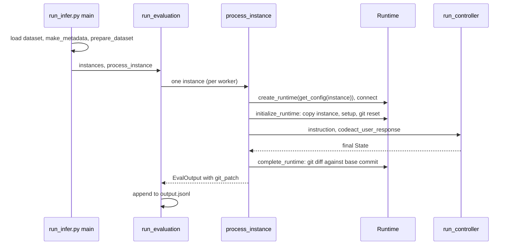

## Overview

The `evaluation/` folder runs OpenHands agents on benchmarks: software engineering sets such as SWE-bench, HumanEvalFix and Commit0, web browsing sets, and assistance and reasoning tasks, each in its own folder under `evaluation/benchmarks`. Every benchmark has a `run_infer.py` that runs the agent on each task and writes one JSON line of results per instance; scoring is a separate step, usually the benchmark's own harness.

Sources: [evaluation/README.md:1-18](repo://evaluation/README.md#L1-L18), [evaluation/README.md:95-110](repo://evaluation/README.md#L95-L110)

The harness uses the same headless entry points as [[Quickstart]]'s headless mode: `create_runtime` and `run_controller` from `openhands.core.main`. What it adds is shared machinery in `evaluation/utils/shared.py` for picking instances, running them in parallel with retries and timeouts, answering for the user, and recording results.

Sources: [evaluation/integration_tests/run_infer.py:1-40](repo://evaluation/integration_tests/run_infer.py#L1-L40), [evaluation/utils/shared.py:44-110](repo://evaluation/utils/shared.py#L44-L110)

## Configuring a run

The README notes that only the LLM sections of `config.toml` are used during evaluation; other settings are fixed by each benchmark's `get_config`. Named LLM groups let one file hold every model under test, selected with the benchmark's `--llm-config` argument (for example `llm.eval_gpt4_1106_preview_llm`), as [[Configuration]] explains for `[llm.<name>]` groups.

Sources: [evaluation/README.md:20-43](repo://evaluation/README.md#L20-L43), [evaluation/README.md:75-75](repo://evaluation/README.md#L75-L75)

Condensers are chosen the same way. Named `[condenser.<name>]` groups are selected with the `EVAL_CONDENSER` environment variable; without it, evaluation uses the `noop` condenser and keeps the full history, unlike the interactive default described in [[Conversation Memory and Condensers]].

Sources: [evaluation/README.md:45-73](repo://evaluation/README.md#L45-L73), [evaluation/benchmarks/swe_bench/run_infer.py:809-820](repo://evaluation/benchmarks/swe_bench/run_infer.py#L809-L820)

```toml
[condenser.summarizer_for_eval]
type = "llm"
llm_config = "haiku"
keep_first = 2
max_size = 100
```

Sources: [evaluation/README.md:49-56](repo://evaluation/README.md#L49-L56)

The common command-line arguments come from `get_evaluation_parser`: the headless arguments plus `--eval-output-dir`, `--eval-n-limit`, `--eval-num-workers` (default 4), `--eval-note` and `--eval-ids`.

Sources: [openhands/core/config/arg_utils.py:67-100](repo://openhands/core/config/arg_utils.py#L67-L100), [openhands/core/config/arg_utils.py:218-224](repo://openhands/core/config/arg_utils.py#L218-L224)

## Shared machinery

`make_metadata` records an `EvalMetadata` for the run: agent class, LLM config, agent config, iteration limit, output directory, start time, git commit, dataset and split, condenser config and free-form details. Results go to `<eval_output_dir>/<agent>/<model>_maxiter_<n>[_N_<note>]`, so runs with a different agent, model, limit or note get separate folders.

Sources: [evaluation/utils/shared.py:44-57](repo://evaluation/utils/shared.py#L44-L57), [evaluation/utils/shared.py:164-216](repo://evaluation/utils/shared.py#L164-L216)

`prepare_dataset` takes a DataFrame with an `instance_id` column and the output file. It reads the ids already in the output file and leaves them out, so an interrupted run resumes where it stopped. `--eval-ids` keeps only the listed instances, and `--eval-n-limit` samples that many with a fixed random seed of 42, so the same subset is chosen every time.

Sources: [evaluation/utils/shared.py:219-289](repo://evaluation/utils/shared.py#L219-L289)

`run_evaluation` runs a benchmark's `process_instance` on every remaining instance, in a `multiprocessing.Pool` of `num_workers` processes when there is more than one, and appends each `EvalOutput` to `output.jsonl` as it finishes, updating a progress bar.

Sources: [evaluation/utils/shared.py:486-540](repo://evaluation/utils/shared.py#L486-L540), [evaluation/utils/shared.py:292-306](repo://evaluation/utils/shared.py#L292-L306)

`_process_instance_wrapper` gives each instance up to `max_retries` attempts (default 5) and an optional timeout. An instance that times out is recorded with the error. An exception is logged and the instance retried after five seconds, with fatal runtime errors such as a disconnected runtime counted separately; after the last attempt the instance is recorded as skipped for exceeding the retry limit.

Sources: [evaluation/utils/shared.py:387-480](repo://evaluation/utils/shared.py#L387-L480), [evaluation/utils/shared.py:317-385](repo://evaluation/utils/shared.py#L317-L385), [evaluation/utils/shared.py:81-104](repo://evaluation/utils/shared.py#L81-L104)

`EvalOutput` is the line written per instance: the instance id, the instruction, the benchmark's `test_result` (for SWE-bench, the patch), the run's metadata, the agent's history as dicts, metrics, any error, and the instance itself.

Sources: [evaluation/utils/shared.py:59-79](repo://evaluation/utils/shared.py#L59-L79)

## Answering for the user

Benchmarks have no one to answer the agent's questions. `codeact_user_response`, passed to `run_controller` as `fake_user_response_fn`, replies whenever the agent waits for input: keep working with whatever approach seems suitable, send the answer as a message and finish when done, never ask for human help, and optionally wrap the final answer in `<solution>` tags for benchmarks that parse one.

Sources: [evaluation/utils/shared.py:106-154](repo://evaluation/utils/shared.py#L106-L154), [openhands/core/main.py:193-205](repo://openhands/core/main.py#L193-L205)

## SWE-bench as the worked example



Sources: [evaluation/benchmarks/swe_bench/run_infer.py:773-870](repo://evaluation/benchmarks/swe_bench/run_infer.py#L773-L870), [evaluation/benchmarks/swe_bench/run_infer.py:606-711](repo://evaluation/benchmarks/swe_bench/run_infer.py#L606-L711)

`get_config` gives each instance its own sandbox built on the SWE-bench image for that task (`sweb.eval.x86_64.<repo>_1776_<name>` from the official, SWE-rebench or other registries, depending on the dataset), with the browser only when `RUN_WITH_BROWSING` is set. [[Runtime Images]] builds the OpenHands runtime image on top of it.

Sources: [evaluation/benchmarks/swe_bench/run_infer.py:178-266](repo://evaluation/benchmarks/swe_bench/run_infer.py#L178-L266)

`initialize_runtime` copies the instance description into `/swe_util/eval_data/instances`, sources the setup script, changes into the repository and runs `git reset --hard`. The instruction is rendered from a Jinja template in the benchmark's `prompts` folder.

Sources: [evaluation/benchmarks/swe_bench/run_infer.py:268-320](repo://evaluation/benchmarks/swe_bench/run_infer.py#L268-L320), [evaluation/benchmarks/swe_bench/run_infer.py:340-392](repo://evaluation/benchmarks/swe_bench/run_infer.py#L340-L392), [evaluation/benchmarks/swe_bench/run_infer.py:109-176](repo://evaluation/benchmarks/swe_bench/run_infer.py#L109-L176)

After the agent stops, a fatal error in the state raises `EvalException` so the wrapper retries the instance. Otherwise `complete_runtime` stages all changes and takes `git diff --no-color --cached <base_commit>` as the patch, retrying the diff and removing binary diffs, and the runtime is closed. The patch is the instance's `test_result`; `eval_infer.py` later runs the official SWE-bench harness on the patches to score them.

Sources: [evaluation/benchmarks/swe_bench/run_infer.py:540-603](repo://evaluation/benchmarks/swe_bench/run_infer.py#L540-L603), [evaluation/benchmarks/swe_bench/run_infer.py:640-711](repo://evaluation/benchmarks/swe_bench/run_infer.py#L640-L711), [evaluation/benchmarks/swe_bench/eval_infer.py:370-400](repo://evaluation/benchmarks/swe_bench/eval_infer.py#L370-L400)

With `ITERATIVE_EVAL_MODE=true`, the run repeats up to `ITERATIVE_EVAL_MODE_MAX_ATTEMPTS` times (default 3). After each attempt an `AgentFinishedCritic` marks an instance as failed when its last action was not `AgentFinishAction` or its patch is empty, and only those instances are run again, each attempt in its own `critic_attempt_<n>` output file; a temperature of 0 is raised to 0.1 after the first attempt so retries can differ.

Sources: [evaluation/benchmarks/swe_bench/run_infer.py:851-960](repo://evaluation/benchmarks/swe_bench/run_infer.py#L851-L960), [openhands/critic/finish_critic.py:1-26](repo://openhands/critic/finish_critic.py#L1-L26)

## Integration tests

`evaluation/integration_tests` uses the same harness as an end-to-end check of the agent. Each test in `tests/` is a `BaseIntegrationTest` subclass with an `INSTRUCTION`, an `initialize_runtime` hook to prepare the sandbox and a `verify_result` that inspects the runtime and history and returns a `TestResult` with `success` and a `reason`. The tests cover a simple typo fix, a bash script, writing a file from Jupyter, git staging, browsing, browsing a GitHub PR and interactive commands.

Sources: [evaluation/integration_tests/tests/base.py:1-30](repo://evaluation/integration_tests/tests/base.py#L1-L30), [evaluation/integration_tests/run_infer.py:69-150](repo://evaluation/integration_tests/run_infer.py#L69-L150)

`run_infer.py` loads every test module as one instance, and for each one creates a runtime, runs `initialize_runtime`, runs the agent with the fake user response for CodeAct or the visual browsing agent, and stores the verification result.

Sources: [evaluation/integration_tests/run_infer.py:152-210](repo://evaluation/integration_tests/run_infer.py#L152-L210)
