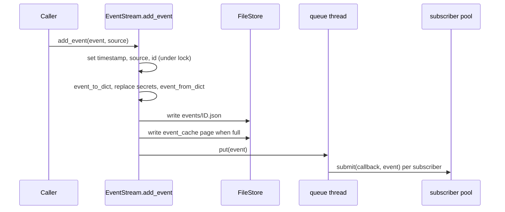

## Overview

`EventStream` is the ordered, persisted log of everything that happens in a conversation, and the bus that carries it. The agent controller, the runtime, the memory component, the server session and the headless runner each subscribe to it, and anything any of them publishes with `add_event` is numbered, masked for secrets, written to the file store, and then delivered to every subscriber. Because each event is on disk before it is delivered, the same log later serves history to a restored controller, a reconnecting browser, or a trajectory export.

Sources: [openhands/events/stream.py:23-69](repo://openhands/events/stream.py#L23-L69), [openhands/events/stream.py:163-203](repo://openhands/events/stream.py#L163-L203)

`EventStream` extends `EventStore`, the read side, which reads events back by id from the same files. One stream exists per conversation: `create_runtime` builds it from the session id and file store, and the runtime owns it from then on. The kinds of events that travel on it are catalogued in [[Actions and Observations]].

Sources: [openhands/events/event_store.py:43-63](repo://openhands/events/event_store.py#L43-L63), [openhands/core/setup.py:58-66](repo://openhands/core/setup.py#L58-L66)

## The Event base class

Every event is a dataclass extending `Event`. Its stream-assigned metadata lives in underscore attributes exposed as read-only properties: `id` (or `INVALID_ID`, -1, until it is added), `timestamp`, `source` and `cause` (the id of the event this one answers). Optional properties carry a hard `timeout`, the `llm_metrics` the controller attaches, the `tool_call_metadata` that links an event to the LLM tool call it came from, and the LLM `response_id`.

Sources: [openhands/events/event.py:35-131](repo://openhands/events/event.py#L35-L131)

`EventSource` says who produced an event: `agent`, `user` or `environment`. `RecallType` distinguishes the two kinds of recall the controller requests from memory: `workspace_context` (repository instructions and runtime details) and `knowledge` (keyword-triggered microagents).

Sources: [openhands/events/event.py:9-32](repo://openhands/events/event.py#L9-L32)

## Publishing an event

Sources: [openhands/events/stream.py:163-203](repo://openhands/events/stream.py#L163-L203), [openhands/events/stream.py:254-275](repo://openhands/events/stream.py#L254-L275)

`add_event` first refuses an event that already has an id, with the hint that it was probably re-added from inside a handler and would cause a loop. It stamps the timestamp and source, then under a lock assigns `cur_id` and increments it, so ids are dense and strictly increasing even when several threads publish at once. Still under the lock, it serializes the event, masks secrets in the dict, rebuilds the event from the masked dict, and appends the dict to the current write page.

Sources: [openhands/events/stream.py:163-184](repo://openhands/events/stream.py#L163-L184)

Outside the lock it writes the event as `events/<id>.json` under the conversation directory, logging a warning for events over about 1 MB, then writes the cache page if it is full, and finally puts the masked event on the delivery queue. Subscribers therefore see the masked copy, not the object the caller passed in.

Sources: [openhands/events/stream.py:186-213](repo://openhands/events/stream.py#L186-L213), [openhands/storage/locations.py:1-18](repo://openhands/storage/locations.py#L1-L18)

The first id of a stream is computed lazily: `_calculate_cur_id` lists the events directory and continues from the highest id found plus one, so a stream reopened on an existing conversation appends after its last event.

Sources: [openhands/events/event_store.py:53-83](repo://openhands/events/event_store.py#L53-L83)

## Secret masking

`set_secrets` replaces and `update_secrets` extends the stream's map of secret values. `_replace_secrets` walks the serialized event and replaces each secret value found in any string with `<secret_hidden>`, recursing into nested dicts. Top-level metadata fields (`timestamp`, `id`, `source`, `cause`, `action`, `observation`, `message`) are skipped. Because masking happens before the write, secrets never reach the file store or any subscriber.

Sources: [openhands/events/stream.py:215-244](repo://openhands/events/stream.py#L215-L244)

The secrets come from the git provider tokens exported into the runtime and from the user's custom secrets, which both call `set_secrets` with the values they expose as environment variables, as [[Git Provider Integrations]] and [[Storage]] describe.

Sources: [openhands/integrations/provider.py:338-354](repo://openhands/integrations/provider.py#L338-L354), [openhands/storage/data_models/user_secrets.py:142-148](repo://openhands/storage/data_models/user_secrets.py#L142-L148)

## Subscribers and delivery

| Subscriber id | Who listens |
| --- | --- |
| `agent_controller` | [[Agent Controller]] |
| `runtime` | [[Runtime Architecture]] |
| `memory` | the recall component in [[Microagents]] |
| `server` | the web session in [[Conversations and Sessions]] |
| `main` | the headless runner in `run_controller` |
| `openhands_resolver` | the [[Issue Resolver]] |
| `test` | tests |

Sources: [openhands/events/stream.py:23-30](repo://openhands/events/stream.py#L23-L30)

`subscribe(subscriber_id, callback, callback_id)` registers a callback and gives it its own single-worker `ThreadPoolExecutor`, whose thread creates a fresh asyncio loop at start. A subscriber id can hold several callbacks, keyed by `callback_id` (usually the session id); registering the same pair twice raises.

Sources: [openhands/events/stream.py:71-76](repo://openhands/events/stream.py#L71-L76), [openhands/events/stream.py:130-148](repo://openhands/events/stream.py#L130-L148)

Delivery runs on a daemon thread started in the constructor. `_process_queue` takes one event at a time and submits it to every callback, iterating subscriber ids in sorted order. Since each callback has a single worker, one callback sees events in id order and never runs two at once, but different callbacks run in parallel and a slow one does not hold up the others. An exception in a callback is logged with its subscriber and callback id.

Sources: [openhands/events/stream.py:246-291](repo://openhands/events/stream.py#L246-L291)

> [!NOTE]
> Callbacks are plain functions run on a worker thread. The controller, for example, runs its async handler with `run_until_complete` on that thread's own loop, which is why each worker gets a loop of its own.

Sources: [openhands/events/stream.py:71-76](repo://openhands/events/stream.py#L71-L76), [openhands/controller/agent_controller.py:433-465](repo://openhands/controller/agent_controller.py#L433-L465)

`unsubscribe` and `close` cancel the callback loop's pending tasks, stop and close the loop, and shut down the pool. `close` also stops the delivery thread and drains the queue.

Sources: [openhands/events/stream.py:78-128](repo://openhands/events/stream.py#L78-L128), [openhands/events/stream.py:150-161](repo://openhands/events/stream.py#L150-L161)

## Reading history

`search_events(start_id, end_id, reverse, filter, limit)` yields events in id order, or backwards with `reverse`. `end_id` is inclusive. Missing ids are skipped, the iteration stops early on server shutdown, and `limit` caps the number of matches. `get_event`, `get_latest_event` and `get_latest_event_id` read single events.

Sources: [openhands/events/event_store.py:85-148](repo://openhands/events/event_store.py#L85-L148)

Reading thousands of small files is slow, so the stream also writes cache pages of 25 events to `event_cache/<start>-<end>.json` once a page is full. `search_events` loads the page covering each index and falls back to the single-event file when there is no page. A cache page is written after its events, so a reader that finds no page simply reads the files.

Sources: [openhands/events/event_store.py:19-40](repo://openhands/events/event_store.py#L19-L40), [openhands/events/event_store.py:158-175](repo://openhands/events/event_store.py#L158-L175), [openhands/events/stream.py:201-213](repo://openhands/events/stream.py#L201-L213)

`EventFilter` selects events by `include_types` and `exclude_types`, `source`, a `start_date` and `end_date` range on the timestamp, `exclude_hidden`, and a case-insensitive `query` matched against the event's JSON. The controller's history uses one to drop null and state-change events.

Sources: [openhands/events/event_filter.py:8-98](repo://openhands/events/event_filter.py#L8-L98), [openhands/controller/state/state_tracker.py:38-48](repo://openhands/controller/state/state_tracker.py#L38-L48)

`AsyncEventStoreWrapper` lets async code iterate a store with `async for`, handing each event through the default executor.

Sources: [openhands/events/async_event_store_wrapper.py:8-23](repo://openhands/events/async_event_store_wrapper.py#L8-L23)

## Remote event stores

`NestedEventStore` implements the same read interface over HTTP: it pages through `GET {base_url}/events` with `start_id`, `reverse`, `end_id` and `limit` (at most 100 per request), sending `X-Session-API-Key` when it has one, and treats a 404 as an empty stream. The docker nested conversation manager uses it to read the events of a conversation running in another container, as [[Conversations and Sessions]] explains.

Sources: [openhands/events/nested_event_store.py:14-67](repo://openhands/events/nested_event_store.py#L14-L67), [openhands/server/conversation_manager/docker_nested_conversation_manager.py:130-140](repo://openhands/server/conversation_manager/docker_nested_conversation_manager.py#L130-L140)
