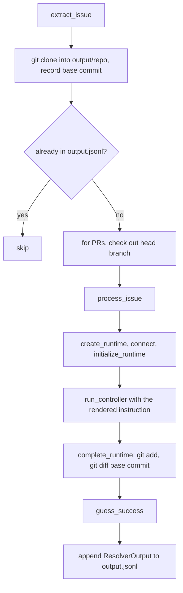

## Overview

The resolver, in `openhands/resolver`, lets OpenHands work through an issue or a pull request's review comments on GitHub, GitLab or Bitbucket without anyone at the keyboard. It runs in two steps. `resolve_issue` downloads the issue, runs the CodeAct agent on a fresh clone in a sandbox, records the resulting patch, and asks an LLM whether the issue looks fixed. `send_pull_request` then applies the patch, pushes a branch, and opens a pull request or comments on the existing one.

Sources: [openhands/resolver/README.md:1-9](repo://openhands/resolver/README.md#L1-L9), [openhands/resolver/README.md:139-196](repo://openhands/resolver/README.md#L139-L196)

The resolver reuses the headless agent loop, `run_controller` from [[OpenHands Overview]], rather than the web server, and talks to the git providers through its own issue handlers rather than the services in [[Git Provider Integrations]].

Sources: [openhands/resolver/issue_resolver.py:397-458](repo://openhands/resolver/issue_resolver.py#L397-L458), [openhands/resolver/issue_handler_factory.py:1-110](repo://openhands/resolver/issue_handler_factory.py#L1-L110)

## Running it

The README describes two ways to run it. The GitHub Actions workflow in `examples/openhands-resolver.yml` reacts to a `fix-me` label (the agent reads the whole issue thread) or to a comment mentioning `@openhands-agent` (the agent reads only that comment), then opens a draft PR if it succeeded or pushes a branch if not, comments with the result, and removes the label. It needs an `LLM_API_KEY` secret, and optionally a personal access token.

Sources: [openhands/resolver/README.md:11-65](repo://openhands/resolver/README.md#L11-L65), [openhands/resolver/examples/openhands-resolver.yml:1-34](repo://openhands/resolver/examples/openhands-resolver.yml#L1-L34)

Run by hand, the two steps are separate commands, with a token in `GITHUB_TOKEN`, `GITLAB_TOKEN` or `BITBUCKET_TOKEN` and the LLM settings in the environment:

Sources: [openhands/resolver/README.md:106-123](repo://openhands/resolver/README.md#L106-L123)

```bash
python -m openhands.resolver.resolve_issue --selected-repo [OWNER]/[REPO] --issue-number [NUMBER]
python -m openhands.resolver.send_pull_request --issue-number ISSUE_NUMBER --username YOUR_GIT_USERNAME --pr-type draft
```

Sources: [openhands/resolver/README.md:139-196](repo://openhands/resolver/README.md#L139-L196)

| `resolve_issue` option | Meaning |
| --- | --- |
| `--selected-repo` | `owner/repo` |
| `--issue-number`, `--issue-type` | The issue or PR, and whether it is an `issue` or a `pr` |
| `--comment-id` | Focus on one comment |
| `--token`, `--username`, `--base-domain` | Credentials and a self-hosted domain |
| `--llm-model`, `--llm-api-key`, `--llm-base-url` | The model |
| `--runtime`, `--base-container-image`, `--runtime-container-image` | The sandbox |
| `--max-iterations`, `--output-dir` | Limits and where results go |
| `--prompt-file`, `--repo-instruction-file` | Custom prompt and repository instructions |

Sources: [openhands/resolver/resolve_issue.py:16-131](repo://openhands/resolver/resolve_issue.py#L16-L131)

## Setting up a resolve

`IssueResolver` collects its inputs in the constructor. The token comes from `--token` or the provider's environment variable, and `identify_token` works out which provider it belongs to. The prompt template defaults to `basic-with-tests.jinja` for issues and `basic-followup.jinja` for PRs, each with a matching `-conversation-instructions` template. Repository instructions come from `--repo-instruction-file`, or later from a `.openhands_instructions` file in the cloned repository.

Sources: [openhands/resolver/issue_resolver.py:79-150](repo://openhands/resolver/issue_resolver.py#L79-L150), [openhands/resolver/issue_resolver.py:584-600](repo://openhands/resolver/issue_resolver.py#L584-L600)

`update_openhands_config` fixes the agent run: `CodeActAgent`, the chosen runtime (Docker by default), a budget of $4 per task, the iteration limit, the clone as the workspace, and the `github` microagent disabled. `update_sandbox_config` applies the container images and timeouts, with adjustments for running inside GitLab CI.

Sources: [openhands/resolver/issue_resolver.py:178-265](repo://openhands/resolver/issue_resolver.py#L178-L265)

## Issues and handlers

`IssueHandlerFactory` picks a handler for the platform and issue type and wraps it in a context: `ServiceContextIssue` with `GithubIssueHandler`, `GitlabIssueHandler` or `BitbucketIssueHandler` for issues, `ServiceContextPR` with the matching PR handler for pull requests. The handlers implement the same interface for downloading issues, building clone and API URLs, managing branches, creating pull requests, commenting and replying to review threads.

Sources: [openhands/resolver/issue_handler_factory.py:16-110](repo://openhands/resolver/issue_handler_factory.py#L16-L110), [openhands/resolver/interfaces/issue_definitions.py:19-44](repo://openhands/resolver/interfaces/issue_definitions.py#L19-L44), [openhands/resolver/interfaces/issue_definitions.py:270-330](repo://openhands/resolver/interfaces/issue_definitions.py#L270-L330)

Everything is normalized into an `Issue`: owner, repo, number, title, body, and for PRs the thread comments, the issues it closes, review comments, review threads with their files, thread ids and the head and base branches. `extract_issue` downloads exactly one issue (narrowed to `--comment-id` when given) and fails otherwise; an issue with no comments to act on is refused for comment-driven runs.

Sources: [openhands/resolver/interfaces/issue.py:7-25](repo://openhands/resolver/interfaces/issue.py#L7-L25), [openhands/resolver/issue_resolver.py:519-560](repo://openhands/resolver/issue_resolver.py#L519-L560)

## The agent run



Sources: [openhands/resolver/issue_resolver.py:570-665](repo://openhands/resolver/issue_resolver.py#L570-L665), [openhands/resolver/issue_resolver.py:397-500](repo://openhands/resolver/issue_resolver.py#L397-L500)

`resolve_issue` clones the repository with the handler's clone URL into `<output-dir>/repo` and records the base commit. Results go to `<output-dir>/output.jsonl`; an issue already recorded there is skipped, so a run can be repeated safely. For a PR, the clone checks out the PR's head branch before the agent starts.

Sources: [openhands/resolver/issue_resolver.py:570-640](repo://openhands/resolver/issue_resolver.py#L570-L640)

`process_issue` creates and connects a runtime with `create_runtime`, as [[Runtime Implementations]] describes, and `initialize_runtime` moves to `/workspace`, disables the git pager and sets up git hooks. The handler renders the instruction from the issue and the prompt templates, and `run_controller` runs the agent with `codeact_user_response` as the fake user: whenever the agent asks for input, it is told to keep going, to message its answer and finish when done, and never to ask for human help.

Sources: [openhands/resolver/issue_resolver.py:267-307](repo://openhands/resolver/issue_resolver.py#L267-L307), [openhands/resolver/issue_resolver.py:397-458](repo://openhands/resolver/issue_resolver.py#L397-L458), [openhands/resolver/utils.py:31-60](repo://openhands/resolver/utils.py#L31-L60)

`complete_runtime` stages everything with `git add -A` and takes `git diff --no-color --cached <base commit>` as the patch, retrying the diff if it fails.

Sources: [openhands/resolver/issue_resolver.py:309-387](repo://openhands/resolver/issue_resolver.py#L309-L387)

## Judging success

The resolver does not run tests to decide whether it succeeded; it asks an LLM. For an issue, `guess_success` renders `issue-success-check.jinja` with the issue body and thread comments, the agent's last message and the patch, and parses the reply for a `--- success` line of `true` or `false` and an explanation. For a PR, each review thread, thread comment set or review comment set is checked separately, and the result is a success only if every one was addressed, with one explanation per item.

Sources: [openhands/resolver/interfaces/issue_definitions.py:370-410](repo://openhands/resolver/interfaces/issue_definitions.py#L370-L410), [openhands/resolver/interfaces/issue_definitions.py:45-108](repo://openhands/resolver/interfaces/issue_definitions.py#L45-L108), [openhands/resolver/interfaces/issue_definitions.py:173-268](repo://openhands/resolver/interfaces/issue_definitions.py#L173-L268)

The `ResolverOutput` line records the issue, its type, the instruction, the base commit, the patch, the full event history, metrics, the success flags, the explanation and any error, so a run can be inspected afterwards with `visualize_resolver_output`.

Sources: [openhands/resolver/resolver_output.py:1-20](repo://openhands/resolver/resolver_output.py#L1-L20), [openhands/resolver/issue_resolver.py:460-517](repo://openhands/resolver/issue_resolver.py#L460-L517), [openhands/resolver/visualize_resolver_output.py:1-45](repo://openhands/resolver/visualize_resolver_output.py#L1-L45)

## Sending the result

`send_pull_request` reads the output line for the issue. `process_single_issue` skips unsuccessful results unless `--send-on-failure` is given, copies the clone to `<output-dir>/patches/<type>_<number>` at the base commit (or the PR's branch), applies the patch with the bundled `whatthepatch`-based patcher, and commits it as `Fix <type> #<number>: <title>`, configuring a git identity if none is set.

Sources: [openhands/resolver/send_pull_request.py:502-586](repo://openhands/resolver/send_pull_request.py#L502-L586), [openhands/resolver/send_pull_request.py:124-231](repo://openhands/resolver/send_pull_request.py#L124-L231), [openhands/resolver/patching/README.md:1-4](repo://openhands/resolver/patching/README.md#L1-L4)

For an issue it creates a branch named from `openhands-fix-issue-<number>` (made unique by the handler), pushes it to the repository or to `--fork-owner`'s fork, and with `--pr-type draft` or `ready` opens a pull request against `--target-branch` or the default branch, titled `Fix issue #<n>: <title>` unless `--pr-title` is given, with a body linking the issue and crediting OpenHands. `--pr-type branch` stops after the push and returns a compare URL; `--reviewer` requests a review.

Sources: [openhands/resolver/send_pull_request.py:299-391](repo://openhands/resolver/send_pull_request.py#L299-L391), [openhands/resolver/send_pull_request.py:615-621](repo://openhands/resolver/send_pull_request.py#L615-L621)

For a PR it pushes to the PR's own branch instead, posts a comment summarizing what was addressed (summarized by the LLM from the per-comment explanations), and replies to each unresolved review thread with its explanation.

Sources: [openhands/resolver/send_pull_request.py:393-499](repo://openhands/resolver/send_pull_request.py#L393-L499)
