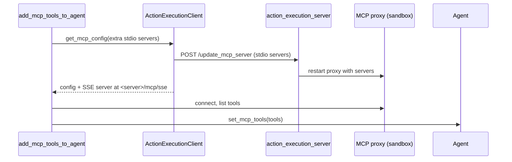

## Overview

The Model Context Protocol (MCP) lets OpenHands give its agent tools served by other programs. Each tool an MCP server offers becomes one more function in the agent's tool list; when the model calls it, CodeAct produces an `MCPAction`, the runtime forwards the call to the server that owns the tool, and the result comes back as an `MCPObservation`. The agent side of this is in [[Agents and CodeAct]]; this page follows configuration, discovery, calls, and OpenHands' own MCP server.

Sources: [openhands/agenthub/codeact_agent/function_calling.py:298-305](repo://openhands/agenthub/codeact_agent/function_calling.py#L298-L305), [openhands/runtime/base.py:368-369](repo://openhands/runtime/base.py#L368-L369), [openhands/mcp/utils.py:225-262](repo://openhands/mcp/utils.py#L225-L262)

MCP is skipped entirely on Windows, and only used when the agent config's `enable_mcp` is on (the default).

Sources: [openhands/mcp/utils.py:267-277](repo://openhands/mcp/utils.py#L267-L277), [openhands/core/main.py:145-155](repo://openhands/core/main.py#L145-L155), [openhands/core/config/agent_config.py:44-44](repo://openhands/core/config/agent_config.py#L44-L44)

## Server types and configuration

`MCPConfig` holds three lists of servers:

Sources: [openhands/core/config/mcp_config.py:202-213](repo://openhands/core/config/mcp_config.py#L202-L213)

| Kind | Model | Fields | Where it runs |
| --- | --- | --- | --- |
| SSE | `MCPSSEServerConfig` | `url`, `api_key` | Anywhere reachable over HTTP |
| Streamable HTTP | `MCPSHTTPServerConfig` | `url`, `api_key` | Anywhere reachable over HTTP |
| Stdio | `MCPStdioServerConfig` | `name`, `command`, `args`, `env` | A process started inside the sandbox (or on the host for the CLI runtime) |

Sources: [openhands/core/config/mcp_config.py:46-77](repo://openhands/core/config/mcp_config.py#L46-L77), [openhands/core/config/mcp_config.py:191-213](repo://openhands/core/config/mcp_config.py#L191-L213)

They come from the `[mcp]` section of `config.toml` (`sse_servers`, `shttp_servers`, `stdio_servers`; plain strings are accepted as URLs), from the user's saved settings in the web app, which are merged with the config file's, and from repository microagents that declare `mcp_tools`, which may only add stdio servers. Stdio server names and commands are validated, and `args` and `env` may be given as strings and are parsed.

Sources: [openhands/core/config/mcp_config.py:64-175](repo://openhands/core/config/mcp_config.py#L64-L175), [openhands/core/config/mcp_config.py:217-313](repo://openhands/core/config/mcp_config.py#L217-L313), [openhands/server/session/session.py:186-207](repo://openhands/server/session/session.py#L186-L207), [openhands/microagent/microagent.py:107-118](repo://openhands/microagent/microagent.py#L107-L118)

```toml
[mcp]
sse_servers = ["http://localhost:8080/sse"]
stdio_servers = [
  { name = "fetch", command = "uvx", args = ["mcp-server-fetch"] },
]
```

Sources: [openhands/core/config/mcp_config.py:202-238](repo://openhands/core/config/mcp_config.py#L202-L238), [openhands/core/config/mcp_config.py:257-305](repo://openhands/core/config/mcp_config.py#L257-L305)

## Default servers

`OpenHandsMCPConfig.create_default_mcp_server_config` adds two things to every conversation. It always adds OpenHands' own MCP server as a streamable HTTP server at `http://<mcp_host>/mcp/mcp`, where `mcp_host` defaults to `localhost` on the server port. And when `search_api_key` is a Tavily key (starting `tvly-`), it adds a `tavily` stdio server run with `npx -y tavily-mcp@0.2.1`. The class can be replaced with `OPENHANDS_MCP_CONFIG_CLS`.

Sources: [openhands/core/config/mcp_config.py:315-363](repo://openhands/core/config/mcp_config.py#L315-L363), [openhands/core/config/openhands_config.py:115-116](repo://openhands/core/config/openhands_config.py#L115-L116)

The headless runner adds the stdio servers from this call; the web session adds both, after merging the user's own servers into the config.

Sources: [openhands/core/main.py:145-155](repo://openhands/core/main.py#L145-L155), [openhands/server/session/session.py:186-210](repo://openhands/server/session/session.py#L186-L210)

## Discovering tools

`add_mcp_tools_to_agent` runs once the runtime is connected. It collects stdio servers declared by repository microagents (warning that SSE servers there are not supported), then asks the runtime for the final config with `runtime.get_mcp_config(extra_stdio_servers)`, connects to every server in it, lists their tools, and hands them to `agent.set_mcp_tools`.

Sources: [openhands/mcp/utils.py:267-317](repo://openhands/mcp/utils.py#L267-L317), [openhands/server/session/agent_session.py:156-168](repo://openhands/server/session/agent_session.py#L156-L168)



Sources: [openhands/runtime/impl/action_execution/action_execution_client.py:361-450](repo://openhands/runtime/impl/action_execution/action_execution_client.py#L361-L450), [openhands/runtime/action_execution_server.py:833-885](repo://openhands/runtime/action_execution_server.py#L833-L885)

Stdio servers are not run by the host. `ActionExecutionClient.get_mcp_config` sends any stdio servers it has not sent before to the sandbox's `POST /update_mcp_server`, where the action execution server's `MCPProxyManager` runs them behind a FastMCP proxy. Then, whenever the sandbox has stdio servers, the client adds the sandbox itself to the config as one SSE server at `<server url>/mcp/sse`, authenticated with the session API key. The agent's view is that all stdio tools come from that one server.

Sources: [openhands/runtime/impl/action_execution/action_execution_client.py:361-450](repo://openhands/runtime/impl/action_execution/action_execution_client.py#L361-L450), [openhands/runtime/mcp/proxy/manager.py:1-100](repo://openhands/runtime/mcp/proxy/manager.py#L1-L100), [openhands/runtime/action_execution_server.py:715-734](repo://openhands/runtime/action_execution_server.py#L715-L734)

With the CLI runtime there is no sandbox, so `fetch_mcp_tools_from_config` is told to start stdio servers directly on the host; for other runtimes it skips them, since they are reached through the sandbox's proxy.

Sources: [openhands/mcp/utils.py:151-203](repo://openhands/mcp/utils.py#L151-L203), [openhands/mcp/utils.py:303-311](repo://openhands/mcp/utils.py#L303-L311)

## Connecting to servers

`create_mcp_clients` makes one `MCPClient` per server. A stdio server whose command is not installed is skipped with a message to install it or remove it from the config. HTTP servers are connected with `connect_http`, which sends the server's API key as `Authorization: Bearer`, as `s` and as `X-Session-API-Key` (the code notes the last two are for the sandbox's MCP router and the remote runtime), and the conversation id as `X-OpenHands-ServerConversation-ID`. A server that fails to connect is logged and left out; the other servers are still used.

Sources: [openhands/mcp/utils.py:63-148](repo://openhands/mcp/utils.py#L63-L148), [openhands/mcp/client.py:57-135](repo://openhands/mcp/client.py#L57-L135)

Each client lists its server's tools on connect and wraps them as `MCPClientTool`s, which convert to the `ChatCompletionToolParam` format the LLM expects. `Agent.set_mcp_tools` appends them to the agent's tools, skipping names it already has.

Sources: [openhands/mcp/client.py:23-55](repo://openhands/mcp/client.py#L23-L55), [openhands/mcp/tool.py:1-20](repo://openhands/mcp/tool.py#L1-L20), [openhands/mcp/utils.py:28-60](repo://openhands/mcp/utils.py#L28-L60), [openhands/controller/agent.py:163-183](repo://openhands/controller/agent.py#L163-L183)

## Calling a tool

The runtime handles `MCPAction` outside `run_action`, in `call_tool_mcp`. `ActionExecutionClient.call_tool_mcp` recomputes the MCP config, creates fresh clients for the SSE and HTTP servers, and calls `openhands.mcp.utils.call_tool_mcp`, which finds the client whose tool list contains the action's name and calls it. The result is serialized to JSON in an `MCPObservation` with the tool name and arguments. An MCP protocol error comes back as an `MCPObservation` with `isError: true` instead of an exception, so the agent sees what went wrong.

Sources: [openhands/runtime/impl/action_execution/action_execution_client.py:452-481](repo://openhands/runtime/impl/action_execution/action_execution_client.py#L452-L481), [openhands/mcp/utils.py:205-264](repo://openhands/mcp/utils.py#L205-L264)

## OpenHands' own MCP server

The web server mounts a FastMCP server at `/mcp` (stateless HTTP, with the same session API key dependency as the REST API, and error details masked). Its tools open pull requests with the user's stored provider token: `create_pr` for GitHub, `create_mr` for GitLab and `create_bitbucket_pr` for Bitbucket.

Sources: [openhands/server/routes/mcp.py:26-31](repo://openhands/server/routes/mcp.py#L26-L31), [openhands/server/routes/mcp.py:83-152](repo://openhands/server/routes/mcp.py#L83-L152), [openhands/server/routes/mcp.py:152-232](repo://openhands/server/routes/mcp.py#L152-L232), [openhands/server/app.py:37-63](repo://openhands/server/app.py#L37-L63)

Each tool reads the conversation id from the `X-OpenHands-ServerConversation-ID` header and the user's provider token through the normal user-auth helpers, builds the provider service from [[Git Provider Integrations]], appends a link back to the OpenHands conversation to the description, creates the pull or merge request, and saves the new PR number in the conversation's metadata.

Sources: [openhands/server/routes/mcp.py:34-81](repo://openhands/server/routes/mcp.py#L34-L81), [openhands/server/routes/mcp.py:100-148](repo://openhands/server/routes/mcp.py#L100-L148)
