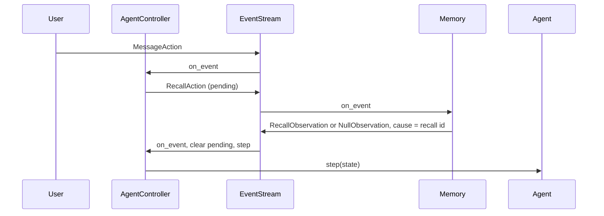

## Overview

Microagents are Markdown files of instructions that OpenHands adds to the agent's context: repository conventions that apply to every conversation in a repository, and expert knowledge that applies only when a keyword comes up. They are not separate agents; their content is added to the prompt. The README in the top-level `microagents/` folder describes them as specialized prompts that add domain-specific knowledge and task-specific workflows.

Sources: [microagents/README.md:1-3](repo://microagents/README.md#L1-L3)

Getting that content to the model is a three-part flow. The runtime and `Memory` load microagent files from several places when a conversation starts. The [[Agent Controller]] turns each user message into a `RecallAction`. `Memory`, subscribed to the [[Event Stream]], answers each recall with a `RecallObservation` holding the workspace context or the knowledge whose triggers matched, which [[Conversation Memory and Condensers]] then renders into the prompt.

Sources: [openhands/memory/memory.py:41-84](repo://openhands/memory/memory.py#L41-L84), [openhands/controller/agent_controller.py:549-583](repo://openhands/controller/agent_controller.py#L549-L583)

## Microagent files

A microagent is a Markdown file with optional YAML frontmatter. The frontmatter fields are `name`, `type`, `version`, `agent` (default `CodeActAgent`), `triggers`, `inputs` (each with `name` and `description`) and `mcp_tools`.

Sources: [openhands/microagent/types.py:11-37](repo://openhands/microagent/types.py#L11-L37)

```markdown
---
name: docker
type: knowledge
version: 1.0.0
agent: CodeActAgent
triggers:
- docker
- container
---

# Docker Usage Guide
```

Sources: [microagents/docker.md:1-11](repo://microagents/docker.md#L1-L11)

`BaseMicroagent.load` parses the file and infers the kind from its content, whatever `type` says: a file with `inputs` is a task microagent, a file with `triggers` is a knowledge microagent, and anything else is a repository microagent. An invalid `type` value or bad metadata raises `MicroagentValidationError`, naming the valid types.

Sources: [openhands/microagent/microagent.py:93-171](repo://openhands/microagent/microagent.py#L93-L171)

| Kind | Class | When it applies |
| --- | --- | --- |
| Repository (`repo`) | `RepoMicroagent` | Always, as part of the workspace context |
| Knowledge (`knowledge`) | `KnowledgeMicroagent` | When a trigger word appears in a message |
| Task (`task`) | `TaskMicroagent` | When the user types `/<name>`; asks for missing inputs |

Sources: [openhands/microagent/microagent.py:174-274](repo://openhands/microagent/microagent.py#L174-L274)

The name comes from the file's path relative to the microagents directory (without `.md`), falling back to the `name` field. Some files outside the frontmatter format are also read as repository microagents: the legacy `.openhands_instructions` file (named `repo_legacy`), `.cursorrules` (named `cursorrules`), and `AGENTS.md` or `agent.md` in any capitalization (named `agents`).

Sources: [openhands/microagent/microagent.py:17-91](repo://openhands/microagent/microagent.py#L17-L91)

`KnowledgeMicroagent.match_trigger` lower-cases the message and returns the first trigger that appears anywhere in it, so triggers are case-insensitive substrings rather than whole words.

Sources: [openhands/microagent/microagent.py:189-203](repo://openhands/microagent/microagent.py#L189-L203)

A task microagent always gets `/<name>` added to its triggers. When it declares inputs or its content uses `${variable}` placeholders, a sentence is appended telling the agent to ask the user for any variables they did not provide before proceeding.

Sources: [openhands/microagent/microagent.py:141-149](repo://openhands/microagent/microagent.py#L141-L149), [openhands/microagent/microagent.py:226-274](repo://openhands/microagent/microagent.py#L226-L274)

```markdown
---
name: fix_test
version: 1.0.0
author: openhands
agent: CodeActAgent
triggers:
- /fix_test
inputs:
  - name: BRANCH_NAME
    description: "Branch for the agent to work on"
  - name: TEST_COMMAND_TO_RUN
    description: "The test command you want the agent to work on. For example, `pytest tests/unit/test_bash_parsing.py`"
---
```

Sources: [microagents/fix_test.md:1-17](repo://microagents/fix_test.md#L1-L17)

A microagent can also declare MCP servers in `mcp_tools`. Only stdio servers are supported: SSE servers get a warning and a config with no stdio server is rejected. `Memory.get_microagent_mcp_tools` collects these from repository microagents, and [[MCP Integration]] adds them to the agent's tools.

Sources: [openhands/microagent/microagent.py:107-118](repo://openhands/microagent/microagent.py#L107-L118), [openhands/memory/memory.py:302-318](repo://openhands/memory/memory.py#L302-L318), [openhands/mcp/utils.py:280-290](repo://openhands/mcp/utils.py#L280-L290)

## Where microagents come from

`load_microagents_from_dir` loads every `.md` file under a directory except `README.md`, and also `.cursorrules` and the first `AGENTS.md`-style file found two levels up (the repository root when the directory is `.openhands/microagents`). It returns repository and knowledge microagents separately; task microagents go with the knowledge ones. Any file that fails to load fails the whole directory.

Sources: [openhands/microagent/microagent.py:277-341](repo://openhands/microagent/microagent.py#L277-L341)

Microagents are collected from four places, later ones replacing earlier ones with the same name:

Sources: [openhands/memory/memory.py:79-84](repo://openhands/memory/memory.py#L79-L84), [openhands/memory/memory.py:264-268](repo://openhands/memory/memory.py#L264-L268)

1. Global: the `microagents/` folder shipped with OpenHands, loaded when `Memory` is created.
2. User: `~/.openhands/microagents/`, created if missing; a failure here is only a warning.
3. Organization or user: for a selected repository `owner/repo`, the runtime shallow-clones `owner/.openhands` (on GitLab, `owner/openhands-config`) into the workspace, loads its `microagents/` folder, and deletes the clone. A missing repository is logged, not an error.
4. Repository: `.openhands/microagents/` in the cloned repository (or the workspace when none is selected), plus a legacy `.openhands_instructions` file in the workspace or repository root.

Sources: [openhands/memory/memory.py:33-38](repo://openhands/memory/memory.py#L33-L38), [openhands/memory/memory.py:270-300](repo://openhands/memory/memory.py#L270-L300), [openhands/runtime/base.py:666-760](repo://openhands/runtime/base.py#L666-L760), [openhands/runtime/base.py:764-821](repo://openhands/runtime/base.py#L764-L821), [openhands/runtime/base.py:823-888](repo://openhands/runtime/base.py#L823-L888)

The last two run inside the sandbox, since that is where the repository is. `_load_microagents_from_directory` lists the directory through the runtime, copies it out with `copy_from` as a zip, and loads the extracted files on the host. `create_memory` passes the result to `Memory.load_user_workspace_microagents`, and records the repository name and directory and the runtime's hosts and working directory for the workspace context.

Sources: [openhands/runtime/base.py:586-640](repo://openhands/runtime/base.py#L586-L640), [openhands/core/setup.py:157-199](repo://openhands/core/setup.py#L157-L199), [openhands/memory/memory.py:254-268](repo://openhands/memory/memory.py#L254-L268)

## Answering recalls



Sources: [openhands/controller/agent_controller.py:549-583](repo://openhands/controller/agent_controller.py#L549-L583), [openhands/memory/memory.py:86-137](repo://openhands/memory/memory.py#L86-L137), [openhands/controller/agent_controller.py:392-431](repo://openhands/controller/agent_controller.py#L392-L431)

For the first user message the controller asks for `workspace_context`. `Memory` concatenates the content of every repository microagent as the repository instructions, finds knowledge microagents triggered by the message, and returns a `RecallObservation` with those plus the repository name, directory and branch, runtime hosts, extra runtime instructions, today's date, custom secret descriptions, conversation instructions and working directory. For later messages, from the user or the agent, it asks for `knowledge` and returns only the triggered microagents.

Sources: [openhands/memory/memory.py:139-252](repo://openhands/memory/memory.py#L139-L252), [openhands/memory/memory.py:320-365](repo://openhands/memory/memory.py#L320-L365)

When there is nothing to add, `Memory` publishes a `NullObservation` instead. Either way the reply's `cause` is set to the recall's id. The code calls this important: the controller set the recall as its pending action and will not step until an observation with that cause arrives, and `should_step` treats a `NullObservation` with a cause as a reason to step. An exception while answering sets the runtime status `ERROR_MEMORY` through the status callback.

Sources: [openhands/memory/memory.py:97-137](repo://openhands/memory/memory.py#L97-L137), [openhands/memory/memory.py:367-387](repo://openhands/memory/memory.py#L367-L387), [openhands/controller/agent_controller.py:418-425](repo://openhands/controller/agent_controller.py#L418-L425)

Recalled knowledge is rendered into the prompt only when `enable_prompt_extensions` is on, and microagents listed in the agent config's `disabled_microagents` or already shown earlier in the conversation are skipped, as [[Conversation Memory and Condensers]] describes.

Sources: [openhands/memory/conversation_memory.py:527-530](repo://openhands/memory/conversation_memory.py#L527-L530), [openhands/memory/conversation_memory.py:626-662](repo://openhands/memory/conversation_memory.py#L626-L662)
