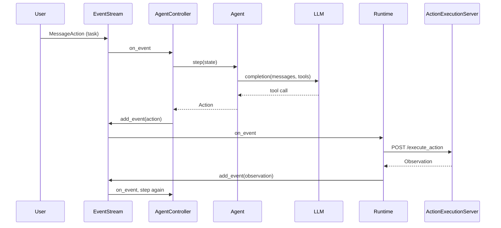

## Overview

OpenHands (formerly OpenDevin) is a platform for software development agents powered by AI. Its agents modify code, run commands, browse the web and call APIs, and the project can run as a local CLI, as a web GUI served from your machine, as a headless script, or as the hosted OpenHands Cloud.

Sources: [README.md:37-46](repo://README.md#L37-L46)

The Python package `openhands` holds the core. An `Agent` looks at the current `State` and produces an `Action`; the `AgentController` drives the agent step by step; the `Runtime` performs actions and sends back `Observation`s; and the `EventStream` is the hub every component publishes to and listens on. A server brokers these sessions over HTTP for the frontend.

Sources: [openhands/README.md:8-24](repo://openhands/README.md#L8-L24)

## Parts of the project

| Area | What it does | Page |
| --- | --- | --- |
| Configuration | Builds `OpenHandsConfig` from defaults, `config.toml`, environment and CLI flags | [[Configuration]] |
| Controller | Runs the step loop, agent states, limits, stuck detection and delegation | [[Agent Controller]] |
| Events | Orders, stores and fans out every action and observation | [[Event Stream]] |
| Event types | The catalogue of actions, observations and their serialization | [[Actions and Observations]] |
| Agents | The `Agent` base class, its registry and the default CodeAct agent | [[Agents and CodeAct]] |
| Other agents | Browsing, read-only, localization and test agents | [[Agent Catalogue]] |
| LLM | LiteLLM wrapper, retries, function-call emulation, metrics, routing | [[LLM Layer]] |
| Memory | Turns history into LLM messages and condenses long histories | [[Conversation Memory and Condensers]] |
| Microagents | Repository instructions and keyword-triggered knowledge | [[Microagents]] |
| Runtime | Executes actions in a sandbox through an HTTP client | [[Runtime Architecture]] |
| Sandbox server | The server inside the sandbox: shell, files, Jupyter, browser | [[Action Execution Server]] |
| Runtime backends | Docker, remote, local, Kubernetes and CLI runtimes | [[Runtime Implementations]] |
| Sandbox images | Builds and tags the runtime image | [[Runtime Images]] |
| Server | FastAPI app, REST routes and authentication | [[Web Server and REST API]] |
| Sessions | Creates, runs and streams web conversations | [[Conversations and Sessions]] |
| Storage | File stores and the conversation, settings and secrets stores | [[Storage]] |
| Git providers | GitHub, GitLab and Bitbucket clients | [[Git Provider Integrations]] |
| MCP | Model Context Protocol tools for agents | [[MCP Integration]] |
| Security | Confirmation mode and risk analyzers | [[Security Analyzers and Confirmation Mode]] |
| Resolver | Fixes an issue and opens a pull request | [[Issue Resolver]] |
| CLI | The `openhands` terminal app | [[Command-Line Interface]] |
| Frontend | The React web app | [[Frontend Web App]] |
| Evaluation | Benchmarks that run agents at scale | [[Evaluation Harness]] |
| Enterprise | The SaaS server built on the open-source server | [[Enterprise Server]] |

Sources: [openhands/README.md:8-24](repo://openhands/README.md#L8-L24), [pyproject.toml:170-171](repo://pyproject.toml#L170-L171)

## Main flow

The headless entry point `run_controller` shows the whole loop with no server in the way. It builds the LLM registry and the agent, creates and connects a runtime (cloning the selected repository if one is set), creates the memory that loads microagents, adds MCP tools, creates the controller, then posts the user's task to the event stream and waits until the agent reaches an end state.

Sources: [openhands/core/main.py:97-216](repo://openhands/core/main.py#L97-L216)

Sources: [openhands/README.md:39-51](repo://openhands/README.md#L39-L51), [openhands/core/main.py:177-216](repo://openhands/core/main.py#L177-L216)

1. The user's task enters as a `MessageAction` with source `USER`; [[Event Stream]] gives it an id and hands it to every subscriber.
2. The controller decides the event should trigger a step and calls the agent, as [[Agent Controller]] traces.
3. The agent builds messages from history and calls the model ([[Agents and CodeAct]], [[Conversation Memory and Condensers]], [[LLM Layer]]).
4. The model's tool call becomes an action from the catalogue in [[Actions and Observations]].
5. The runtime picks the action off the stream and sends it to the sandbox ([[Runtime Architecture]]).
6. The server inside the sandbox runs it and answers an observation ([[Action Execution Server]]).
7. The observation goes back onto the stream and the controller steps again, until the agent finishes, errors, or waits for the user.

Sources: [openhands/core/main.py:177-216](repo://openhands/core/main.py#L177-L216), [openhands/runtime/README.md:61-80](repo://openhands/runtime/README.md#L61-L80)

In the web app the same pieces are assembled per conversation by an `AgentSession`, as [[Conversations and Sessions]] describes, and the terminal app does the same in [[Command-Line Interface]].

Sources: [openhands/core/setup.py:157-243](repo://openhands/core/setup.py#L157-L243)

## Design decisions

### Every interaction is an event

Components never call each other to report progress: the controller, the runtime, memory and the frontend all publish to and subscribe to one `EventStream`. The architecture notes say most of the loop is "achieved through message passing, via the EventStream", which "serves as the backbone for all communication". Because the stream is written to a file store, the same events let a session be restored, replayed or sent to a reconnecting browser.

Sources: [openhands/README.md:26-51](repo://openhands/README.md#L26-L51), [openhands/core/main.py:193-205](repo://openhands/core/main.py#L193-L205)

### Execution happens in a sandbox behind HTTP

The `Runtime` class is the only interface the agent has to the outside environment. `ActionExecutionClient` implements it by posting actions over HTTP to an `action_execution_server` that runs inside the sandbox, and each backend (Docker, remote, Kubernetes and others) only manages the lifecycle of the environment running that server. This keeps the agent's commands out of the host process and lets the same client work against a local container or a remote machine.

Sources: [openhands/runtime/README.md:10-47](repo://openhands/runtime/README.md#L10-L47)

### Pluggable parts chosen by name

Agents register themselves by name when `openhands.agenthub` is imported, and `create_agent` looks the class up from `config.default_agent`. Runtimes are looked up from `config.runtime` among the built-in names, discovered third-party runtimes, or any fully qualified class name; storage backends are picked by `file_store`. On the server, the conversation manager, settings, secrets and conversation stores are classes named in `ServerConfig` and loaded with `get_impl`, which the code describes as the extensibility mechanism that "allows runtime substitution of implementations". The [[Enterprise Server]] uses this to swap in its own classes without forking the core.

Sources: [openhands/agenthub/__init__.py:1-24](repo://openhands/agenthub/__init__.py#L1-L24), [openhands/core/setup.py:202-208](repo://openhands/core/setup.py#L202-L208), [openhands/runtime/__init__.py:14-103](repo://openhands/runtime/__init__.py#L14-L103), [openhands/storage/__init__.py:14-57](repo://openhands/storage/__init__.py#L14-L57), [openhands/server/shared.py:54-77](repo://openhands/server/shared.py#L54-L77), [openhands/utils/import_utils.py:42-73](repo://openhands/utils/import_utils.py#L42-L73)

### Short, deterministic session ids

`generate_sid` hashes the session name with the JWT secret and caps the id at 32 characters, so Kubernetes resource names stay under the 63-character limit after the `openhands-runtime-` prefix and suffixes like `-svc` are added. A named session therefore maps back to the same id, which is how a resumed run finds its saved state.

Sources: [openhands/core/setup.py:210-270](repo://openhands/core/setup.py#L210-L270)
