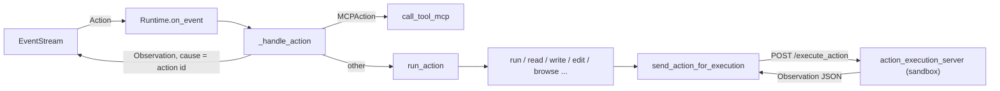

## Overview

The runtime is the agent's only way to touch the outside world: a shell, files, a Python kernel, a browser and MCP tools, all inside a sandbox. `Runtime` in `openhands/runtime/base.py` is the abstract interface. It subscribes to the conversation's [[Event Stream]], executes each action it sees, and publishes the resulting observation back. Its docstring calls it an extension point: an application can subclass it and select the class by name in the config.

Sources: [openhands/runtime/base.py:90-117](repo://openhands/runtime/base.py#L90-L117), [openhands/runtime/base.py:146-151](repo://openhands/runtime/base.py#L146-L151)

Most runtimes split the work in two. `ActionExecutionClient`, an abstract `Runtime` subclass, runs on the host next to the agent and sends each action over HTTP to an `action_execution_server` running in the sandbox, which executes it and returns the observation. The concrete backends (Docker, remote, Kubernetes, local) only start the sandbox and tell the client its URL; they are covered in [[Runtime Implementations]], and the server side in [[Action Execution Server]].

Sources: [openhands/runtime/README.md:26-54](repo://openhands/runtime/README.md#L26-L54), [openhands/runtime/impl/action_execution/action_execution_client.py:32-66](repo://openhands/runtime/impl/action_execution/action_execution_client.py#L32-L66)

Sources: [openhands/runtime/base.py:320-399](repo://openhands/runtime/base.py#L320-L399), [openhands/runtime/base.py:890-972](repo://openhands/runtime/base.py#L890-L972), [openhands/runtime/impl/action_execution/action_execution_client.py:272-359](repo://openhands/runtime/impl/action_execution/action_execution_client.py#L272-L359)

## Creating a runtime

`create_runtime` builds the event stream for the session, resolves the runtime class from `config.runtime`, and constructs it with the config, the stream, the session id, the agent class's `sandbox_plugins`, the headless flag, the LLM registry and any git provider tokens. The runtime is returned unconnected; the caller awaits `runtime.connect()`, which each backend implements to start or attach to its sandbox.

Sources: [openhands/core/setup.py:35-94](repo://openhands/core/setup.py#L35-L94), [openhands/runtime/base.py:984-986](repo://openhands/runtime/base.py#L984-L986)

`get_runtime_cls` knows the built-in names `docker` (and the legacy alias `eventstream`), `remote`, `local`, `kubernetes` and `cli`. It also discovers packages under `third_party/runtime/impl/<name>/` and loads a class named `<NAME>Runtime` or `<Name>Runtime` from `<name>_runtime.py`, skipping any whose optional dependencies are not installed. Any other value is treated as a class path and loaded with `get_impl(Runtime, name)`.

Sources: [openhands/runtime/__init__.py:14-103](repo://openhands/runtime/__init__.py#L14-L103)

The constructor deep-copies the config and plugin list, adds `VSCodeRequirement` unless running headless, and collects the initial environment: every host variable named `SANDBOX_ENV_<KEY>` becomes `<KEY>` in the sandbox, `ENABLE_AUTO_LINT` is set when auto-lint is on, and git provider tokens are added as their environment variables (such as `GITHUB_TOKEN`). It also creates the security analyzer named in `security.security_analyzer`, which the controller later uses, as [[Security Analyzers and Confirmation Mode]] describes.

Sources: [openhands/runtime/base.py:79-87](repo://openhands/runtime/base.py#L79-L87), [openhands/runtime/base.py:128-204](repo://openhands/runtime/base.py#L128-L204)

## Initial environment

Once connected, `setup_initial_env` exports the initial variables and `sandbox.runtime_startup_env_vars`, then sets the git identity from `git_user_name` and `git_user_email` (skipped for the CLI runtime, which uses the user's own git config). Nothing is set up when attaching to an existing sandbox.

Sources: [openhands/runtime/base.py:210-219](repo://openhands/runtime/base.py#L210-L219), [openhands/runtime/base.py:988-1022](repo://openhands/runtime/base.py#L988-L1022)

`add_env_vars` upper-cases the names and applies them everywhere a later command might run: in the Jupyter kernel through `os.environ` when that plugin is present, in the current shell with `export`, and in `~/.bashrc` so new shells see them too. On Windows it sets `$env:` variables in PowerShell instead. A failing export raises `RuntimeError`. Values are never logged, only names.

Sources: [openhands/runtime/base.py:245-318](repo://openhands/runtime/base.py#L245-L318)

## Handling an action

`on_event` ignores observations and runs `_handle_action` for every action. An action without a timeout gets `sandbox.timeout` (120 seconds by default) as a non-blocking hard timeout. If the action refers to a provider token, `_export_latest_git_provider_tokens` fetches fresh tokens, adds them to the stream's masked secrets, and re-exports them before the action runs. MCP actions go to `call_tool_mcp`, everything else to `run_action` on a worker thread.

Sources: [openhands/runtime/base.py:320-371](repo://openhands/runtime/base.py#L320-L371), [openhands/core/config/sandbox_config.py:61-61](repo://openhands/core/config/sandbox_config.py#L61-L61)

The observation gets the action's id as its `cause` and the action's `tool_call_metadata`, and is published with the action's source. A `NullObservation` is not published. Failures are reported differently by kind: a `PermissionError` becomes an `ErrorObservation` the agent sees; a network error or `AgentRuntimeDisconnectedError` sets the status `ERROR_RUNTIME_DISCONNECTED`, and any other exception sets `ERROR`, both through the status callback and without publishing an observation.

Sources: [openhands/runtime/base.py:372-399](repo://openhands/runtime/base.py#L372-L399)

## run_action dispatch

`run_action` decides what to do with an action before any sandbox call:

Sources: [openhands/runtime/base.py:890-894](repo://openhands/runtime/base.py#L890-L894)

| Action | Result |
| --- | --- |
| `AgentThinkAction` | `AgentThinkObservation('Your thought has been logged.')` |
| `TaskTrackingAction` with `plan` | Writes `TASKS.md` in the conversation directory of the file store |
| `TaskTrackingAction` with `view` | Reads `TASKS.md` back, or says none exists |
| Other non-runnable actions | `NullObservation` |
| Awaiting confirmation | `NullObservation`: nothing runs yet |
| Rejected by the user | `UserRejectObservation` |
| Unknown type | `ErrorObservation` |
| Runnable | Calls the method named by `action.action`: `run`, `run_ipython`, `read`, `write`, `edit`, `browse`, `browse_interactive` |

Sources: [openhands/runtime/base.py:890-972](repo://openhands/runtime/base.py#L890-L972)

Because a confirmation-pending action returns a null observation that is not published, the controller keeps it pending until the user answers; the controller then re-publishes it with its new `confirmation_state`, and this time it runs or is rejected, as [[Agent Controller]] describes.

Sources: [openhands/runtime/base.py:951-970](repo://openhands/runtime/base.py#L951-L970), [openhands/controller/agent_controller.py:658-669](repo://openhands/controller/agent_controller.py#L658-L669)

## The HTTP client

`ActionExecutionClient` implements each action method with `send_action_for_execution`. LLM-based file edits are handled on the host by `FileEditRuntimeMixin`, which uses an LLM to merge the edit and then reads and writes the file through the runtime. Every other action is serialized with `event_to_dict` and posted to `{action_execution_server_url}/execute_action` with an HTTP timeout five seconds longer than the action's own, and the JSON reply is turned back into an observation. A blocking command without a timeout is refused.

Sources: [openhands/runtime/impl/action_execution/action_execution_client.py:272-359](repo://openhands/runtime/impl/action_execution/action_execution_client.py#L272-L359), [openhands/runtime/base.py:185-189](repo://openhands/runtime/base.py#L185-L189)

A semaphore of one makes the client send one action at a time. An HTTP timeout becomes `AgentRuntimeTimeoutError`. Requests go through `send_request`, which retries a 429 up to three times and raises `RequestHTTPError` with the server's `detail` message for other HTTP errors; the client additionally retries dropped connections (`RemoteProtocolError`) up to five times with exponential backoff.

Sources: [openhands/runtime/impl/action_execution/action_execution_client.py:26-29](repo://openhands/runtime/impl/action_execution/action_execution_client.py#L26-L29), [openhands/runtime/impl/action_execution/action_execution_client.py:82-129](repo://openhands/runtime/impl/action_execution/action_execution_client.py#L82-L129), [openhands/runtime/utils/request.py:11-60](repo://openhands/runtime/utils/request.py#L11-L60)

The client also wraps the server's other endpoints:

Sources: [openhands/runtime/impl/action_execution/action_execution_client.py:101-103](repo://openhands/runtime/impl/action_execution/action_execution_client.py#L101-L103)

| Method | Endpoint | Purpose |
| --- | --- | --- |
| `check_if_alive` | `GET /alive` | Readiness probe while starting |
| `list_files(path)` | `POST /list_files` | Directory listing |
| `copy_to(src, dest, recursive)` | `POST /upload_file` | Upload a file or a zipped directory |
| `copy_from(path)` | `GET /download_files` | Download a path as a zip |
| `get_vscode_token` | `GET /vscode/connection_token` | Token for the in-sandbox VS Code |
| `get_mcp_config` | `POST /update_mcp_server` | Register new stdio MCP servers in the sandbox |

Sources: [openhands/runtime/impl/action_execution/action_execution_client.py:131-180](repo://openhands/runtime/impl/action_execution/action_execution_client.py#L131-L180), [openhands/runtime/impl/action_execution/action_execution_client.py:182-270](repo://openhands/runtime/impl/action_execution/action_execution_client.py#L182-L270), [openhands/runtime/impl/action_execution/action_execution_client.py:361-450](repo://openhands/runtime/impl/action_execution/action_execution_client.py#L361-L450)

Backends that protect their server with a session API key set it as the `X-Session-API-Key` header on the client's HTTP session, which the server checks on every request except `/alive` and `/server_info` when it was started with `SESSION_API_KEY`.

Sources: [openhands/runtime/impl/remote/remote_runtime.py:360-368](repo://openhands/runtime/impl/remote/remote_runtime.py#L360-L368), [openhands/runtime/action_execution_server.py:88-97](repo://openhands/runtime/action_execution_server.py#L88-L97), [openhands/runtime/action_execution_server.py:787-795](repo://openhands/runtime/action_execution_server.py#L787-L795)

## Workspace setup

`initialize_repository_for_runtime` runs three runtime steps after connecting. `clone_or_init_repo` clones the selected repository with an authenticated URL from the provider handler and checks out the requested branch, or otherwise creates a new branch `openhands-workspace-<random>`. With no repository it runs `git init` only when `init_git_in_empty_workspace` is set.

Sources: [openhands/core/setup.py:124-155](repo://openhands/core/setup.py#L124-L155), [openhands/runtime/base.py:401-461](repo://openhands/runtime/base.py#L401-L461)

`maybe_run_setup_script` sources `.openhands/setup.sh` when it exists, as a hidden blocking command with a ten-minute timeout, so its environment changes persist in the agent's shell. `maybe_setup_git_hooks` installs `.openhands/pre-commit.sh` as the repository's pre-commit hook, moving an existing hook not installed by OpenHands to `pre-commit.local`.

Sources: [openhands/runtime/base.py:463-488](repo://openhands/runtime/base.py#L463-L488), [openhands/runtime/base.py:495-565](repo://openhands/runtime/base.py#L495-L565)

The runtime also loads the repository's and organization's microagents through the sandbox, as [[Microagents]] describes, and provides `get_git_changes`, `get_git_diff` and `get_workspace_branch` through a `GitHandler` that runs git commands in the sandbox for the server's git routes.

Sources: [openhands/runtime/base.py:823-888](repo://openhands/runtime/base.py#L823-L888), [openhands/runtime/base.py:1142-1170](repo://openhands/runtime/base.py#L1142-L1170)

## Status reporting

Runtimes report progress and failures through `status_callback(level, RuntimeStatus, message)`, which the headless runner and the web session install. The statuses cover the lifecycle (`BUILDING_RUNTIME`, `STARTING_RUNTIME`, `RUNTIME_STARTED`, `SETTING_UP_WORKSPACE`, `SETTING_UP_GIT_HOOKS`, `READY`, `STOPPED`) and the error states shared with the controller and memory, such as `ERROR_RUNTIME_DISCONNECTED`, the LLM errors, `LLM_RETRY` and `ERROR_MEMORY`.

Sources: [openhands/runtime/runtime_status.py:4-24](repo://openhands/runtime/runtime_status.py#L4-L24), [openhands/runtime/base.py:235-241](repo://openhands/runtime/base.py#L235-L241), [openhands/core/loop.py:15-39](repo://openhands/core/loop.py#L15-L39)
